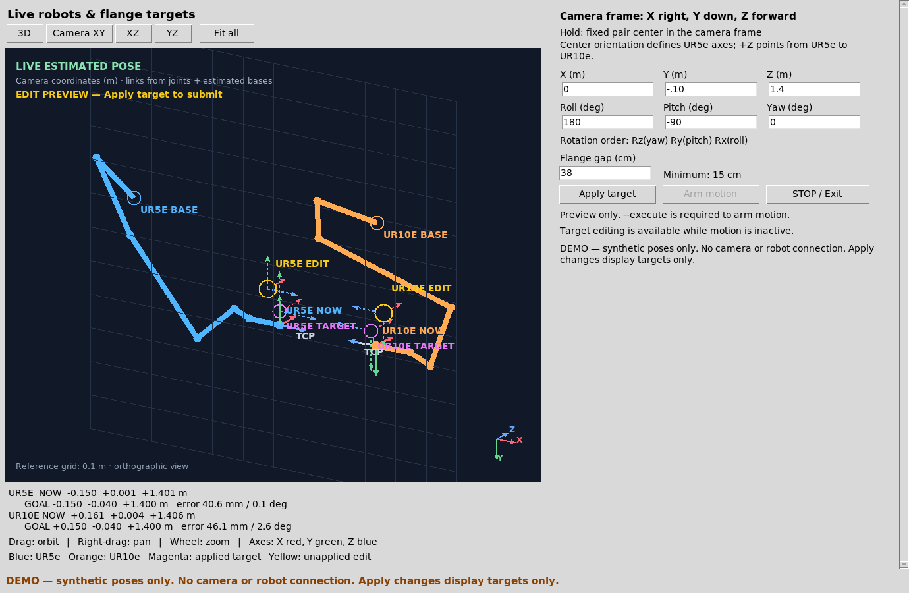

# UR5e / UR10e 실시간 캘리브레이션과 양팔 상대 제어

현재 기능·제어 흐름·실행 방법·설정을 한 문서로 보려면 [현재 구현 문서](docs/CURRENT_IMPLEMENTATION.md)를 참고하세요.

RealSense D435 RGB 영상과 UR RTDE 관절값을 이용해 카메라 기준 로봇 베이스
포즈를 매 프레임 추정하고, 이를 이용해 플랜지 자세를 유지하거나 상대 경로를
추종하는 실행 묶음입니다. 모델별 가중치와 실행 스크립트가 포함되어 있으며,
기본 추론은 중복 연산을 줄인 최적화 버전입니다.
최적화 전 Python 코드 6개는 `reference/`에 보관했습니다.

처리 흐름은 RGB → 신경망/투표 기반 2D 키포인트 검출 → 관절값으로 3D
키포인트 계산 → EMPnP 포즈 추정입니다. 카메라 내부 파라미터와 왜곡 계수는
RealSense에서 읽습니다. 기본 입력 크기는 640×480, 카메라 설정은 30 FPS입니다.
실제 추론 처리 FPS는 하드웨어에 따라 달라집니다.

| 하고 싶은 작업 | 실행 | 움직이는 팔 |
| --- | --- | --- |
| UR5e 또는 UR10e의 카메라 기준 포즈 확인 | `run_ur5e.sh` / `run_ur10e.sh` | 없음 |
| 같은 영상에서 왼쪽 UR5e·오른쪽 UR10e 포즈 확인 | `run_dual.sh` | 없음 |
| 카메라 기준 한 위치에서 두 플랜지를 마주보게 유지 | `run_dual_control.sh --mode hold` | 양팔 |
| 리더에 대한 상대 자세 유지·직선·원 경로 추종 | `run_cooperative.sh` 또는 `run_dual_control.sh --mode follow` | 팔로워만 |
| 현재 관절값·TCP·캘리브레이션을 가져와 GUI에서 가상 제어 | `run_simulation.sh --mode hold` / `--mode follow` | 가상 로봇만 |
| 장비 없이 세 제어 방식 비교 | `python3 -m urcal.tools.simulate` | 없음 |

제어 프로그램도 기본값은 미리보기입니다. 실제 구동에는 `--execute`, 실제 TCP offset,
GUI/영상 창에서의 명시적인 Arm이 모두 필요합니다. 기본 역할은 **UR10e 리더 / UR5e 팔로워**,
플랜지 원점 간 초기 간격은 **30 cm**입니다.

## 포함 파일

```text
ur_live_calibration/
├── README.md
├── requirements.txt
├── run_ur5e.sh
├── run_ur10e.sh
├── run_dual.sh                   # 같은 프레임에서 두 로봇 추론
├── run_dual_control.sh           # 고정 자세 / 리더–팔로워 제어
├── run_cooperative.sh            # 이동 정반 협업 제어 실행
├── run_simulation.sh             # 현재 상태 취득 후 가상 관절 제어 / 저장 상태 재실행
├── urcal/                        # 실행 코드 패키지
│   ├── paths.py                  # 작업 디렉터리와 무관한 묶음 루트 BUNDLE
│   ├── inference/                # 기존 포즈 센서
│   │   ├── infer_live.py          # UR5e, 카메라·RTDE 공통 유틸리티
│   │   ├── infer_live_ur10e.py    # UR10e, 선택적 ROS 2 출력
│   │   ├── infer_live_dual.py     # 같은 영상의 좌우 분할 추론
│   │   ├── infer_live_10.py       # UR10e 진입점 별칭
│   │   ├── display.py            # OpenCV Qt의 누락된 폰트 경로 보정
│   │   ├── network3.py           # ResNet·Transformer 키포인트 신경망
│   │   ├── vote2.py              # 2D 키포인트와 공분산 투표
│   │   └── my_pnp.py             # EMPnP
│   ├── control/                  # 공통 제어 기반과 카메라 고정 hold
│   │   ├── runtime.py            # 상태 수신, RTDE 세션, 실행 옵션
│   │   ├── startup.py            # 실제 초기 정렬의 수용 조건·제어기 경로 사전 검사
│   │   ├── approximation.py      # 플랜지 허용 범위 안의 초기 정렬 후보 탐색
│   │   ├── handoff.py            # 정렬 완료 후 새 캘리브레이션 수집·추종 전환
│   │   ├── acquisition.py        # 정지 단계의 최근 프레임 합의·평균 초기값
│   │   ├── alignment.py          # 측정 관절 피드백·속도 제한·정지 확인
│   │   ├── geometry.py           # 좌표변환·플랜지·TCP·마주보기 목표
│   │   ├── policy.py             # 측정 유효성·안정화·hold 속도 제한
│   │   ├── vision.py             # 별도 프로세스의 영상/관절 샘플링
│   │   ├── diagnostics.py        # 원검출점 재투영 오차 표시·진단 저장
│   │   ├── scene.py              # 카메라 좌표의 양팔·목표 기하와 3D 투영
│   │   ├── scene_view.py         # 마우스로 회전·확대하는 실시간 3D 화면
│   │   └── gui.py                # 3D 보기·목표 편집·Arm·Pause·Stop GUI
│   ├── cooperative/              # 이동 정반 상대 작업 제어
│   │   ├── runtime.py            # 제어 루프·명령 성공 후 진행률 확정
│   │   ├── controller.py         # 상태·목표·보상·피드백·검사 통합
│   │   ├── diagnostics.py        # WAIT 원인·실제 오차·로봇 상태 기록
│   │   ├── state.py              # 시간 정합·SE(3) 필터·단기 예측
│   │   ├── task.py               # 상대 경로와 작업 속도 비율 선택
│   │   ├── kinematics.py         # nominal FK·Jacobian·IK·캡슐 검사
│   │   └── logging.py            # 비동기 JSONL 기록
│   ├── simulation/               # 실제 초기 상태에서 시작하는 가상 제어
│   │   ├── snapshot.py           # 수신 전용 초기 취득·JSON 저장·불러오기
│   │   ├── plant.py              # 초기 TCP에 맞춘 FK/Jacobian·관절속도 적분
│   │   ├── approach.py           # 큰 초기 자세 차이를 정렬하는 가상 관절 경로
│   │   └── runtime.py            # hold/follow 연결·가상 시계·GUI·기록
│   └── tools/
│       ├── analyze_log.py         # 추정/독립 기준 오차·완료시간 분석
│       ├── simulate.py            # 같은 합성 조건으로 세 방식 비교
│       └── preview_gui.py         # 로봇 연결 없는 합성 상태 GUI 데모
├── docs/Research_Implementation_Plan.txt # 연구 진행 계획 원문
├── configs/workspace.example.json # 작업공간·캡슐 설정 예시
├── reference/                     # 최적화 전 코드 6개
├── tests/                         # 수학·상태·모의 장비·원본 동등성 검사
├── trained_models/
│   ├── v3m2a3/best.pt              # UR5e
│   └── ur10e_2/best.pt             # UR10e
├── torch_cache/hub/checkpoints/
│   └── resnet18-f37072fd.pth       # 모델 초기화용 ResNet 가중치
├── runs/                         # 실행 시 생성되는 실험 로그, Git 제외
├── MANIFEST.json                  # 파일 출처, 가중치 메타데이터
└── SHA256SUMS                     # 파일 무결성 확인
```

루트에는 실행 스크립트와 안내·의존성·무결성 파일을 두고, Python 구현은 `urcal/`로
모았습니다. 기존 `run_*.sh` 명령은 그대로 사용합니다. Python 파일을 직접 실행하던 경우에는
저장소 루트에서 `python3 -m urcal.inference.infer_live_dual`처럼 모듈 경로로 실행하세요.
가중치와 캐시는 이동하지 않았고, `reference/`는 원본 비교용으로 분리해 유지합니다.

## 모듈을 따라 이해하는 처리 흐름

1. [추론 진입점](urcal/inference/infer_live_dual.py)이 영상과 관절값을 받습니다.
   [network3.py](urcal/inference/network3.py)의 ResNet·Transformer가 7개 키포인트별
   segmentation과 2D 방향 벡터장을 출력합니다.
   [vote2.py](urcal/inference/vote2.py)는 픽셀들의 방향으로 키포인트 위치·공분산·유효 여부를 계산합니다.
2. 모델별 FK가 관절값으로 로봇의 3D 키포인트를 계산하고,
   [my_pnp.py](urcal/inference/my_pnp.py)가 2D–3D 대응과 내부 파라미터로
   카메라–학습 모델 베이스 변환을 추정합니다. 단일 UR5e와 UR10e 실행은 각각
   [infer_live.py](urcal/inference/infer_live.py), [infer_live_ur10e.py](urcal/inference/infer_live_ur10e.py)이며,
   [infer_live_10.py](urcal/inference/infer_live_10.py)는 UR10e 별칭입니다.
3. 제어 실행에서는 [vision.py](urcal/control/vision.py)가 이 포즈 센서를 별도 프로세스에서 실행합니다.
   촬영 시각과 관절 샘플 시각을 보존하고, 원래 검출점의 재투영 오차를 다시 계산해 양팔 측정을 함께 전달합니다.
   [policy.py](urcal/control/policy.py)는 누락·시간 역전·노후화·과도한 점프·낮은 품질을 거부합니다.
4. 카메라 고정 모드는 [control/runtime.py](urcal/control/runtime.py)의 고정 목표 제어를 사용합니다.
   상대 작업은 [state.py](urcal/cooperative/state.py)에서 상태를 시간 정합하고,
   [controller.py](urcal/cooperative/controller.py)와 [task.py](urcal/cooperative/task.py)에서
   경로·보상·오차 피드백·허용 작업 속도를 계산합니다.
5. [kinematics.py](urcal/cooperative/kinematics.py)가 상대 작업의 관절·도달성·공간 조건을 검사합니다.
   공통 RTDE 세션은 제어기 상태와 목표를 확인한 뒤 `speedL`로 TCP 속도를 보냅니다.
   연구용 상대 작업에서는 현재 목표와 선택한 다음 목표를 모두 확인합니다.
   [cooperative/runtime.py](urcal/cooperative/runtime.py)는 전송 성공 후에만 경로 진행률과 명령 이력을 확정합니다.
6. [gui.py](urcal/control/gui.py)는 별도 프로세스에서 목표와 시작·정지 입력을 다룹니다.
   [logging.py](urcal/cooperative/logging.py)가 실험을 기록하고,
   [analyze_log.py](urcal/tools/analyze_log.py)가 결과를 분석합니다.
   [simulate.py](urcal/tools/simulate.py)는 같은 상위 제어기를 합성 상태와 연결해 장비 없이 검사합니다.

좌표 계산은 [geometry.py](urcal/control/geometry.py), 데이터 위치는
[paths.py](urcal/paths.py)가 공통으로 관리합니다. 따라서 영상, GUI, 제어 프로세스가
같은 가중치·좌표 정의·실행 루트를 사용합니다.

## 포함 가중치

| 로봇 | 원본 가중치 | 학습 epoch | 확인한 키포인트 |
| --- | --- | --- | --- |
| UR5e | `trained_models/v3m2a3/best.pt` | 85 | `ur5e_link0` ~ `ur5e_link6` |
| UR10e | `trained_models/ur10e_2/best.pt` | 73 | `ur10e_link0` ~ `ur10e_link6` |

두 체크포인트 모두 640×480 입력과 ImageNet 정규화로 학습되었습니다.
기본 옵션을 사용하고 `--no_normalize`는 지정하지 마세요.
UR5e는 저장소의 여러 가중치 중 로봇 종류를 메타데이터로 확인한 `v3m2a3`를
선택했습니다. 다른 UR5e 가중치를 쓰려면 실행 시 `--checkpoint`로 바꿀 수 있습니다.
기구학이 모델별로 다르므로 실행 코드와 가중치는 같은 로봇용으로 사용하세요.

## 환경 준비

GitHub에서 내려받는 경우 가중치 파일을 받기 위해 Git LFS가 필요합니다.
Ubuntu에서는 `sudo apt install git-lfs`로 설치할 수 있습니다.

```bash
git lfs install
git clone https://github.com/Stick-0/ur_live_calibration.git
cd ur_live_calibration
git lfs pull
sha256sum -c SHA256SUMS
```

저장소는 비공개이므로 접근 권한이 있는 GitHub 계정 인증이 필요합니다.
`.pt`와 `.pth` 파일은 Git LFS로 관리합니다. 일반 ZIP 다운로드 대신 위의
clone/pull 절차를 사용하면 실제 가중치까지 받을 수 있습니다.

이미 의존성이 설치된 Python 3.10 환경이 있으면 해당 환경을 활성화해 사용하세요.
새 환경에서는 이 폴더 전체를 복사하고 의존성을 설치합니다.
Python 환경 자체는 이 묶음에 포함하지 않았습니다.

```bash
cd /복사한/경로/ur_live_calibration
python3.10 -m venv .venv
source .venv/bin/activate
python -m pip install -r requirements.txt
```

GPU를 사용하려면 해당 PC의 드라이버에 맞는 PyTorch/CUDA 환경이 필요합니다.
코드는 CUDA가 사용 가능하면 GPU, 그렇지 않으면 CPU를 선택합니다.
OpenCV 화면을 띄울 수 있는 데스크톱 세션, D435 USB 연결 및 카메라 접근 권한,
UR 컨트롤러와 RTDE 통신이 가능한 네트워크가 필요합니다.

## 실행

아래 IP는 현재 배치의 예시이며 실제 로봇 컨트롤러 IP에 맞추세요. 사용하는 로봇에 맞춰
아래 두 명령 중 하나를 실행합니다.

```bash
# UR5e
./run_ur5e.sh --robot_ip 169.254.186.10 --show_seg

# UR10e
./run_ur10e.sh --robot_ip 169.254.186.6 --show_seg
```

실행 스크립트는 자체 위치를 기준으로 코드, 체크포인트 및 ResNet 캐시를 찾으므로
다른 작업 디렉터리에서도 실행할 수 있습니다. 다른 Python 실행 파일을 지정하려면
`ROBOTPOSE_PYTHON=/경로/python ./run_ur5e.sh ...` 형식을 사용하세요.
인자 없이 실행하거나 `--help`를 주면 장비 연결 없이 도움말을 표시합니다.

segmentation 디버그 창이 필요 없으면 `--show_seg`를 생략하세요. 최적화 버전은
이 창이 꺼져 있을 때 전체 segmentation 확률 맵의 CPU 복사를 생략합니다.
실행 중 `s`로 다시 켤 수 있습니다.

화면에는 키포인트, 추정 좌표축, `EMPnP OK/FAIL`, 처리 FPS가 표시됩니다.
`s`는 segmentation 창 전환, `q` 또는 `Esc`는 종료입니다.
`EMPnP OK`는 계산 성공 표시이며 실제 캘리브레이션 정확도를 보증하지 않습니다.

로봇 연결 없이 정지한 로봇의 관절값을 직접 줄 수도 있습니다. D435는 필요합니다.
아래 숫자는 예시이므로 영상에 보이는 로봇의 실제 관절값(라디안)으로 바꾸세요.

```bash
./run_ur5e.sh --joints 0 -1.57 1.57 -1.57 -1.57 0 --show_seg
```

순서는 shoulder_pan, shoulder_lift, elbow, wrist_1, wrist_2, wrist_3입니다.
UR10e도 같은 `--joints` 옵션을 지원합니다.

## 같은 카메라에서 UR5e와 UR10e 함께 추론

`run_dual.sh`는 D435에서 프레임을 한 번 읽고, 왼쪽 영역에 UR5e 모델,
오른쪽 영역에 UR10e 모델을 순서대로 실행합니다. 두 로봇은 화면의 각 영역 안에
들어오도록 배치하세요. 로봇 종류를 자동으로 판별하거나 경계 너머로 추적하지 않습니다.

```bash
# IP는 각 로봇 컨트롤러 주소로 변경
./run_dual.sh --ur5e_ip 169.254.186.10 --ur10e_ip 169.254.186.6 --show_seg

# 추론 영역의 경계를 왼쪽에서 영상 너비의 45% 위치로 변경 (기본값 0.5)
./run_dual.sh --ur5e_ip 169.254.186.10 --ur10e_ip 169.254.186.6 --split_ratio 0.45

# 정지한 로봇은 실제 관절값 6개를 라디안으로 직접 지정 가능
./run_dual.sh \
  --ur5e_joints 0 -1.57 1.57 -1.57 -1.57 0 \
  --ur10e_joints 0 -1.57 1.57 -1.57 -1.57 0
```

각 로봇에 IP 또는 관절값이 필요하며, 한쪽만 RTDE로 연결하는 방식도 가능합니다.
두 관절값은 카메라 프레임을 받은 직후, 신경망 실행 전에 읽습니다. 카메라 노출과
RTDE 사이의 하드웨어 시간 동기화는 수행하지 않습니다.

영역별 영상은 종횡비를 유지하면서 여백을 추가해 640×480으로 입력합니다.
투표에서는 여백을 제외하고, 특징점과 공분산을 원본 영상 좌표로 복원합니다.
두 EMPnP 계산에 원본 카메라 내부 파라미터와 왜곡 계수를 공통으로 사용하므로
각 결과는 같은 카메라 좌표계에서 표현한 로봇별 학습 모델 베이스 포즈 `T_C_M`입니다.
제어에 쓸 때는 아래의 모델–제어기 베이스 변환을 추가합니다.
각 로봇의 FK와 이전 포즈는 별도로 관리하며, 투표 실패 특징점은 PnP에서 제외합니다.
유효 특징점이 4개 미만인 쪽은 `FAIL`로 표시하고 다른 쪽은 계속 처리합니다.
UR10e의 기존 학습 좌표 정의와 5 mm Z 오프셋도 유지합니다.

화면에 두 로봇의 특징점·좌표축·상태와 전체 처리 FPS를 표시합니다.
영상과 분할 표시 창에 좌우 영역의 경계를 흰 구분선으로 표시합니다. `--split_ratio`를 바꾸면 구분선도 이동합니다.
`k`로 두 로봇의 키포인트 점과 이름 표시를
켜고 끌 수 있으며, `--hide_keypoints`를 추가하면 숨긴 상태로 시작합니다.
`s`로 두 영역의 segmentation 창을 전환하고 `q`/`Esc`로 종료합니다.
이 실행 파일은 화면 표시용이며 ROS 발행이나 포즈 파일 저장은 하지 않습니다.
두 모델을 메모리에 함께 올리고 프레임마다 순차 실행하므로, 단일 모델 실행보다
메모리와 처리 시간이 더 필요합니다. `--device cpu` 또는 `--device cuda`로
실행 장치를 선택할 수 있으며 기본값은 자동 선택입니다.

가중치를 바꾸려면 `--ur5e_checkpoint`, `--ur10e_checkpoint`를 사용하세요.
Git LFS 포인터만 있는 경우에는 장비 연결 전에 `git lfs pull` 안내와 함께 종료합니다.
분할 입력과 실제 두 로봇 영상에 대한 정확도·속도는 실장비에서 확인해야 합니다.
장비/가중치 없이 좌표 복원, 투표, 독립 포즈 처리 등을 검사할 수 있습니다.

```bash
python -B -m unittest discover -s tests -p test_dual_inference.py -v
```

## 실시간 캘리브레이션을 반영한 양팔 플랜지 제어

`run_dual_control.sh`는 위의 왼쪽 UR5e / 오른쪽 UR10e 추론을 내부에서 실행합니다.
기존 `run_dual.sh`는 종료한 뒤 사용하세요. 두 프로그램이 카메라를 동시에 열면 안 됩니다.
이동 중에도 각 팔이 지정된 좌우 영역에 보여야 합니다. 고정 모드는 추정 실패 시 멈추고,
연구용 추종 모드는 아래에 설명한 짧은 측정 공백만 보완한 뒤 계속 유효하지 않으면 멈춥니다.
기본 실행은 **수신·목표 미리보기만** 수행하며 로봇 제어 스크립트를 업로드하지 않습니다.
`--mode follow`는 아래 연구 계획 기반 협업 모듈을 사용합니다. `--mode hold`는 기존 카메라 고정 목표 모드를 유지합니다.

```bash
# 고정 모드: 카메라 좌표계의 고정된 위치·방향으로 두 플랜지를 유지
./run_dual_control.sh --mode hold \
  --ur5e_ip 169.254.186.10 --ur10e_ip 169.254.186.6 --show_seg

# 추종 모드: UR10e 리더 / UR5e 팔로워 (기본값)
./run_dual_control.sh --mode follow \
  --ur5e_ip 169.254.186.10 --ur10e_ip 169.254.186.6 --show_seg
```

제어 버전의 EMPnP 이전 자세 보정은 기본 OFF입니다. 약하게 사용하려면 위 명령이나 아래 실제 구동 명령에
다음 옵션을 추가하세요. `run_cooperative.sh`와 hold 모드도 같은 옵션을 사용합니다.

```bash
--empnp_use_prev --ur5e_empnp_lambda 0.005 --ur10e_empnp_lambda 0.005
```

`lambda`가 작을수록 이전 자세의 영향이 약해집니다. `0.001`은 최신 관측에 더 민감하고,
`0.01`은 이전 자세의 영향이 더 강합니다. 보정은 최대 50번 반복되므로 한 프레임의 단순 혼합 비율은 아닙니다.
`lambda`만 지정하면 이전 자세 보정은 켜지지 않으며, `--empnp_use_prev`를 함께 지정해야 합니다.
완전히 끄려면 `--no_empnp_use_prev`를 사용하고 두 켜기/끄기 옵션을 동시에 넣지 마세요.
각 로봇의 `lambda`를 생략하면 기존 UR5e `0.5`, UR10e `0.2`를 사용합니다.
시작 로그의 `[vision] ur5e EMPnP previous pose: ON; lambda=0.005; max_iter=50` 등으로 적용값을 확인할 수 있습니다.
추종 실행의 JSONL 설정에도 이 옵션들이 저장됩니다.

PnP 이후 제어용 자세 필터는 별도 `--filter_alpha`로 조절합니다. 기본 `0.2`에서 `1.0`으로 올리면
수용된 최신 자세의 보정량을 그대로 반영합니다. 이는 제어 버전 옵션이며 `run_dual.sh`에는 없습니다.
캘리브레이션 수용 검사와 초기 정렬의 Arm 좌표 고정 동작은 이 설정으로 바뀌지 않습니다.

두 모드의 기본 마주보기는 플랜지의 **+Z 축이 상대 플랜지 원점을 향하고 +X 축을 공유**하도록
목표를 만듭니다. 팔로워 모드의 초기 목표는 리더 플랜지의 +Z 방향으로 `gap`만큼 떨어진
위치에 팔로워를 배치하고, 자세는 리더 기준 X축으로 180도 회전시킵니다.
`--leader ur5e`로 역할을 바꿀 수 있습니다. 리더에는 제어 인터페이스를 만들지
않으므로 기존 프로그램 또는 작업자가 별도로 움직입니다. 자동 freedrive 전환은 없습니다.

기본 플랜지 원점 간격은 **30 cm**입니다. `--gap 0.30` 또는 GUI에서 바꿀 수 있습니다.
고정 모드의 목표는 별도 GUI에서 입력합니다.

1. 최초 유효 상태의 두 플랜지 중점·UR5e→UR10e 방향이 입력칸에 초기값으로 표시됩니다.
2. `X / Y / Z`는 **카메라 좌표계, m** 단위입니다. 카메라 X는 오른쪽, Y는 아래, Z는 앞쪽입니다.
3. `Roll / Pitch / Yaw`는 **도(deg)** 단위이며 `Rz(yaw) Ry(pitch) Rx(roll)` 순서의 방향입니다.
   이 방향의 +Z를 따라 UR5e는 중점에서 −간격/2, UR10e는 +간격/2에 놓입니다.
4. 입력 중에는 3D 화면의 노란색 `EDIT`로 적용 전 목표를 미리 확인합니다.
   `Apply target`을 누르면 제어기에 목표를 보내며, 반영된 목표는 자홍색 `TARGET`으로 표시됩니다.
   고정 모드는 Apply 전에는 시작할 수 없습니다. 미적용 편집이 있으면 GUI의 Arm 버튼도 잠깁니다.
5. 구동 중에는 입력칸을 잠급니다. 목표를 바꾸려면 정지·종료 후 다시 미리보기로 실행하세요.

팔로워 모드의 GUI에서는 간격과 상대 경로를 설정합니다. 기준 위치·방향은 실시간 UR10e 플랜지에서 정합니다.
고정 모드는 적용한 목표를 카메라 좌표에 고정하고, 캘리브레이션 갱신에 따라 각 로봇 base의 명령을 다시 계산합니다.
CLI의 `--center_pose X Y Z RX RY RZ`로 고정 목표를 미리 지정할 수도 있습니다.
이 CLI 옵션은 XYZ가 m, RX/RY/RZ가 라디안 **회전 벡터**입니다. GUI의 Euler 각과 구분하세요.
카메라를 고정해 사용해야 이 모드가 물리 공간의 한 자세를 유지합니다.
GUI에는 Tkinter가 필요합니다. Ubuntu에서 없다면 `sudo apt install python3-tk`로 설치하세요.

### 현재 로봇 자세와 목표를 함께 보는 3D GUI

왼쪽 3D 화면에서 **양팔의 현재 링크 자세, 현재 플랜지, 목표 플랜지**를 같은 카메라 좌표계로 확인합니다.
오른쪽은 기존 목표 설정과 제어 버튼입니다. 창 크기와 좌우 패널 폭을 조절할 수 있고,
입력 패널이 화면보다 길면 오른쪽 스크롤바를 사용합니다.

| 표시 | 의미 |
| --- | --- |
| 파란색 / 주황색 링크와 `NOW` | UR5e / UR10e의 관절 상태와 추정 베이스로 만든 현재 자세 |
| 빨강·초록·파랑 화살표 | 플랜지 X·Y·Z 방향 |
| 자홍색 `TARGET`와 점선 축 | 현재 제어 목표, 현재 위치와 목표 사이 오차선 |
| 노란색 `EDIT`와 경로 | 아직 적용하지 않은 입력값의 미리보기; 상대 경로는 끝 자세도 표시 |
| 하단 수치 | 카메라 기준 현재/목표 XYZ(m), 위치 오차(mm), 회전 오차(deg) |
| 회색 자세와 `STALE / UNAVAILABLE` | 상태 갱신이 끊겼거나 캘리브레이션이 유효하지 않아 남겨둔 마지막 그림 |

왼쪽 버튼을 누른 채 드래그하면 회전, 오른쪽 드래그는 화면 이동, 휠은 확대·축소입니다.
`3D`, `Camera XY`, `XZ`, `YZ`로 시점을 바꾸고 `Fit all`로 두 팔과 목표·경로를 화면에 맞춥니다.
배경 격자는 카메라 XY 방향의 시각적 기준이며 실제 정반이나 장애물 모델이 아닙니다.

링크 형상은 nominal FK의 선분 모델이고, 플랜지/TCP 마커는 수신한 제어기 TCP와 설정 오프셋으로 계산합니다.
로봇 베이스 위치는 영상 추정값을 사용합니다. 이 그림은 CAD 형상이나 독립적인 실측 정확도를 뜻하지 않습니다.
IK·이동 범위 검사에서 `WAIT`가 나와도 유효한 현재 상태와 의도한 목표를 볼 수 있으며,
그림이 보이는 것과 실제 구동 허용은 별개입니다. 화면 조작과 편집 미리보기는 로봇 명령을 보내지 않습니다.

장비 없이 화면부터 확인하려면 아래 데모를 사용하세요. 데모는 합성 자세임을 표시하며
RTDE·카메라에 연결하지 않고, Arm은 항상 비활성입니다.

```bash
python3 -m urcal.tools.preview_gui --mode follow
python3 -m urcal.tools.preview_gui --mode hold
```

아래는 실제 GUI를 **합성 로봇 상태**로 실행한 화면입니다. 현재 자세(`NOW`), 적용된 목표(`TARGET`),
편집 중인 목표(`EDIT`)가 함께 표시됩니다.



영상 창에는 `TARGET` 좌표축과 `WAIT`/`READY`/`ACTIVE` 상태를 표시합니다.
`k`는 키포인트, `s`는 segmentation 표시 전환입니다. **스페이스 또는 q/Esc는
정지 후 종료**, GUI의 `Stop` 또는 창 닫기, 터미널의 Ctrl+C도 정지 후 종료합니다.
종료나 오류 후 자동 재시작하지 않습니다.

캘리브레이션에서 `WAIT`가 계속되면 영상 하단의 `RAW` 수치를 확인하세요.
**평균·최대 재투영 오차 상한에 의한 거절은 기본 OFF입니다. 미리보기와 `--execute` 구동에 모두 적용됩니다.**
영상에는 `RAW limits OFF`와 실제 평균·최대 오차를 표시하고, GUI와 시작 로그에도 OFF를 표시합니다.
오차 수치는 **원본 영상 픽셀** 단위입니다. 이 두 수치가 크다는 이유만으로 측정을 거절하지 않습니다.
유효 키포인트는 각 로봇 최소 5개이며, PnP 성공·유한한 포즈·시간·안정화·포즈 급변 등 나머지 조건은 계속 확인합니다.

재투영 오차 상한 검사를 다시 켜려면 기존 실행 명령에 아래 옵션을 추가합니다.

```text
--check_reprojection --max_reproj_px 5 --max_point_reproj_px 8
```

ON일 때 `mean=측정값/제한값`, `max=측정값/제한값`으로 표시하며 각 로봇의 유효 키포인트에 따로 적용합니다.
`--max_reproj_px`나 `--max_point_reproj_px`만 지정하는 것으로는 검사가 켜지지 않습니다.
기존 평균 3 px·최대 8 px는 연구계획이나 실측으로 도출한 값이 아닌 초기 구현의 임시 기본값이었습니다.
이후 평균 설정값을 5 px로 바꾸고, 사용자 요청으로 평균·최대 상한 검사를 기본 비활성화했습니다.
ON으로 사용할 때의 5 px·8 px도 실험 데이터로 조정할 설정값이며,
실제 3D 위치·방향 정확도를 보장하는 기준은 아닙니다. EMPnP 내부 초기화 기준과는 별개입니다.
`worst=link...`는 원검출점과의 오차가 가장 큰 키포인트입니다.
마젠타 `+`는 추정 자세를 영상에 재투영한 위치이고 연결선은 검출점과의 차이입니다.
`k`로 검출점·재투영 표시를 함께 끌 수 있습니다. 하단 수치가 양호해도 시간·안정화 등 다른 조건으로 `WAIT`일 수 있습니다.

`EMPnP OK`는 원검출점 오차 검사를 통과했다는 뜻이 아닙니다. 상한 검사를 켠 경우에는 EMPnP 내부 보정 후의 오차와
별도로 원검출점 기준을 검사하므로, 점들이 눈으로 대체로 맞아 보여도 거절될 수 있습니다.
거절된 추정을 카메라 기준의 확정된 3D 배치로 사용하지 않으며,
처음 한 쌍도 수용되지 않았다면 3D 화면은 기다리는 상태를 유지합니다.
터미널과 GUI는 다음 프레임이 올 때까지 마지막 거절 사유와 수치를 보존합니다.

**`--execute` 없는 미리보기에서 영상 창에 포커스를 두고 `d`를 누르면**
`runs/calibration-debug/`에 원본 PNG, 표시 PNG, JSON을 저장하고 경로를 출력합니다.
JSON에는 카메라 내부 파라미터, 양팔 관절값, 키포인트, 추정 포즈와 원검출점 재투영 오차가 포함됩니다.
누락된 값은 `null`이며 파일은 덮어쓰지 않습니다. 자동 저장하지 않고, 실행 모드에서는 저장하지 않습니다.
현재 추정 실패 원인을 확인하기 위한 자료이며 독립 실측 정확도 자료는 아닙니다.

`QFontDatabase: Cannot find font directory .../cv2/qt/fonts` 경고는 OpenCV wheel의 폰트 경로 문제입니다.
패키지 진입점은 해당 폴더가 없을 때 설치된 시스템 폰트 폴더를 사용하며,
유효한 사용자 `QT_QPA_FONTDIR` 설정은 보존합니다. 이 경고와 캘리브레이션 수용 실패는 별개입니다.

실제 제어는 `--execute`와 **양쪽 로봇에 설정된 실제 TCP offset**을 명시한 뒤,
목표를 확인하고 GUI의 `Arm` 또는 영상 창의 `a`로 시작합니다. `--execute` 없이 `a`를 누르면
미리보기 상태를 유지합니다. 아래 예시는 양쪽 활성 TCP offset이 모두 0인 경우에만 맞습니다.
공구를 사용한다면 로봇 Installation의 값을 **m / 회전 벡터 rad**로 바꾸세요.

```bash
./run_dual_control.sh --mode follow \
  --ur5e_ip 169.254.186.10 --ur10e_ip 169.254.186.6 \
  --ur5e_tcp_offset 0 0 0 0 0 0 \
  --ur10e_tcp_offset 0 0 0 0 0 0 \
  --leader ur10e --gap 0.30 --show_seg --initial_align --execute
# READY에서 목표를 검토한 뒤 Arm 또는 영상 창에서 a.
# 고정 모드는 --mode hold로 바꾸고 GUI에서 Apply target 후 시작합니다.
```

`--initial_align`을 붙이면 **Arm에서 캘리브레이션·목표 확정 → 고정된 좌표로 제어기 IK·관절 경로 검사 →
초기 정렬 → 정지 확인 → 새 캘리브레이션 안정화 → 실시간 hold/follow** 순서로 시작합니다.
follow에서는 UR10e는 수신만 하고 UR5e만
정렬합니다. hold에서는 GUI에서 적용한 고정 목표까지 두 팔을 정렬합니다.
기본값은 OFF이므로 이 옵션을 생략하면 기존의 정렬된 자세에서 시작하는 방식입니다.

캘리브레이션이 근사값임을 전제로, **기준 목표 주위 위치 5 cm / 방향 10°**를 기본 작업 허용 범위로
사용합니다. 이는 측정된 캘리브레이션 정확도나 실제 로봇의 절대 정확도 보장이 아닙니다.
30 cm 마주보기와 상대 작업 경로는 기준 목표로 보존합니다. 정확한 목표의 제어기 IK가 거절되거나
반환된 관절 해가 추종용 특이점 조건을 만족하지 못하면
허용 범위 안에서 특이점·작업공간·간격 조건을 만족하는 별도 명령 목표를 찾습니다.
후보는 다시 제어기의 정밀 IK/FK와 전체 관절 경로 검사를 통과해야 하며, 후보 탐색만으로 동작하지 않습니다.
캘리브레이션 자체를 해가 나오는 값으로 바꾸지는 않습니다.

후보를 만든 기구학 모델과 로봇의 기구학 보정이 다르므로, 후보 관절값의 조건이 좋아도 로봇이
반환한 관절값의 조건은 나쁠 수 있습니다. 작은 차이로도 이런 현상이 생기며, 반드시 다른 IK 분기로
바뀌었다는 뜻은 아닙니다. 이제 로봇이 반환한 해를 **81개 경로 검사 전에** 정렬 모델과 실시간 추종 모델로
확인합니다. 불합격이면 특이점에서 더 여유 있는 목표를 최대 3개까지 시도합니다.
검색 선호값만 기존 최솟값의 2·4·6배로 바꾸며, 실제 통과 기준 `--min_singular_value`와
5 cm / 10° 목표 조정 범위는 유지합니다. 모든 후보가 실패하면 동작 없이 `ARM BLOCKED` 미리보기로
돌아가고 새 Arm을 기다립니다. 정지 요청·관절 이동·native FK 불일치·경로 및 안전 한계 오류는 재시도로 넘기지 않습니다.
JSONL의 `alignment_candidate`에는 후보 관절값과 로봇이 반환한 관절값, 두 모델의 특이값,
후보별 수용·거절 이유가 기록됩니다. 콘솔의 `returned IK conditioning`도 실제 검사값과 기준을 표시합니다.

```bash
# 기존 실행 명령에 붙일 수 있으며, 생략해도 아래 값이 기본 적용됩니다.
--target_tolerance_m 0.05 --target_tolerance_deg 10
# 이전의 정확한 목표 방식을 사용하려면 두 값을 모두 0으로 지정합니다.
--target_tolerance_m 0 --target_tolerance_deg 0
```

위치 한도는 축별 5 cm가 아닌 **플랜지 원점의 3차원 거리**, 방향 한도는 SO(3) 회전각입니다.
follow에서는 리더에 대한 팔로워의 상대 플랜지 자세에 적용하고, hold에서는 각 팔의 플랜지 목표에
각각 적용합니다. 따라서 hold에서 두 팔의 간격 오차는 두 목표 조정의 영향을 함께 받습니다.
실시간 피드백은 허용 범위 안에서 0이며, 밖에서는 초과한 부분만 연속적으로 보정합니다.
기본 `separated` 모드는 이와 별도로 리더·베이스 운동을 보상하므로 허용 범위 안에서도 리더를 따라갑니다.
보상 항이 없는 `direct`/`predict` 비교 모드는 허용 범위 안의 작은 움직임이나 경로에 반응하지 않을 수 있습니다.
기준 목표를 만족하는 최종 IK 대신 실제 다음 명령의 관절·작업공간·간격·추종 오차를 검사하며,
관절·속도·가속도·최소 간격·이동 범위와 통신 검사는 유지합니다.
GUI의 자홍색 `TARGET`는 기준 목표, 청록색 `COMMAND`는 정렬 목표 또는 다음 짧은 명령의 예상 위치입니다.
실제 오차는 기준 목표에 대해 표시하고 기록합니다.

초기 정렬 속도는 `--align_speed_scale`로 조절합니다. **1**은 이전의 절반 속도이고,
기본값 **2**는 전체 속도 제한의 **90%**까지 명령합니다. 허용 범위는 `0 < 값 <= 2`이며,
명령 상한은 `min(배율 / 2, 0.9)`입니다. 기본 정렬 명령 상한은 TCP **18 mm/s**,
회전 **0.09 rad/s (약 5.16°/s)**, 관절 **0.18 rad/s**입니다.
실제 요청은 명령 상한의 98%를 목표로 하며 경로와 가속도 조건에 따라 줄어듭니다.
측정 속도의 정지 기준은 기존 **20 mm/s / 0.1 rad/s / 0.2 rad/s** 그대로입니다.
명령과 측정 사이에 여유를 둔 이유는 기존 98% 명령에서 회전 속도가 0.100375 rad/s로
측정되어 0.1 rad/s 기준을 넘었던 사례 때문입니다. 10%는 서보 응답·측정 변동을 위한
설계 여유이며 실제 로봇의 오버슈트 한계를 보장하는 수치는 아닙니다.
이 옵션은 실제 초기 정렬에만 적용되며, 정렬 이후 hold/follow와 시뮬레이터의 속도 설정은 그대로입니다.
가속도·이동 범위 및 정지 확인 조건도 유지합니다.
티치펜던트 속도 슬라이더도 실제 속도에 영향을 줍니다. 예를 들어 60%이면 명령과 측정 속도의 차이가
가속도 검사에 걸려, 명령 상한을 높여도 기대한 만큼 빨라지지 않을 수 있습니다.
실제 속도 슬라이더를 100%로 사용해도 코드의 전체 속도·가속도 상한은 유지되며,
실제 완료 시간과 로봇 응답은 장비에서 확인해야 합니다.
정렬 시간은 정확히 절반이 되지 않으며, Arm 사전 검사에서 적용 배율과 명령 상한을 표시합니다.

기존 실행 명령을 그대로 사용하면 새 기본값이 적용됩니다. 이전 속도가 필요하면
기존 명령에 `--align_speed_scale 1`을 추가하세요.

`--initial_align`에서 Arm은 최근 1초 영상 중 서로 일치하는 프레임을 최소 5개 확보한 뒤 가능합니다.
기본 `--calibration_acquisition consensus`는 전체 후보의 60% 이상이 일치해야 하며,
그 안의 모든 프레임 쌍에서 양쪽 베이스와 상대 베이스의 변화가 5 cm / 5도 이내여야 합니다.
단발성 PnP 실패·이상치는 제외하고 정상 후보를 유지합니다. 최종 좌표는 일치한 후보의 평균이며,
시간 기준은 가장 최근 **정상 후보의 실제 촬영 시각**입니다. 거절된 영상으로 0.5초 신선도 기한을 늘리지 않습니다.
이 방식은 베이스가 정지해 있어야 하는 Arm 전·정렬 후 확보 단계에만 적용합니다.
`--calibration_acquisition consecutive`는 이전의 연속 프레임 방식을 사용합니다.
Arm 시 베이스 좌표와 목표를 복사하고, 연결·IK·관절 경로 검사 및 정렬이 끝날 때까지 유지합니다.
이 단계의 새 영상은 정렬 좌표를 갱신하거나 정렬을 허가하는 조건으로 사용하지 않습니다.
따라서 연결이 오래 걸리거나 정렬 중 PnP 결과가 튀어도 카메라의 나이·급변만으로 정렬을 중단하지 않습니다.
관절·TCP는 계속 RTDE에서 읽으며, 리더 이동·상태 지연·Stop·경로·속도 검사는 유지합니다.

정렬 목표에 도착해 정지를 확인하면 `ALIGNED`로 표시하고, **완료 시각 이후 촬영된** 새 프레임을
같은 합의 방식으로 기본 5개 모읍니다. 정렬 전에 촬영되어 늦게 도착한 추론이나 중복 프레임은 세지 않습니다.
정지 상태에서 확보한 평균 좌표로 상태 추정기를 시작하고 초기 베이스 속도는 0으로 둡니다.
연구 비교용 `--method direct`는 합의를 통한 승인 후 가장 최근 정상 원시 좌표를 사용합니다.
수집 중 PnP 흔들림을 순간 속도로 미분해 첫 추종 명령에 넣지 않습니다.
매 제어 주기에 검증한 영속도 `speedJ`를 보내 정지 상태와 watchdog을 유지합니다.
기본 `--handoff_wait hold`는 15초(`--handoff_timeout`)가 지나도 정렬 완료 상태를 유지하고 새 캘리브레이션을 기다립니다.
대기 중에는 추종하지 않으며, fresh 프레임과 목표·첫 명령 검증이 모두 통과해야 추종에 진입합니다.
`--handoff_wait stop`을 지정하면 기한 초과 시 이전처럼 정지·미리보기 복구 및 새 Arm 절차로 전환합니다.
정렬 중 확인된 로봇의 이탈·과속이나 RTDE 지연은 정지·종료 처리하며 자동으로 재개하지 않습니다.
새 좌표 때문에 각 팔의 기준 플랜지 목표가 바뀌는 양이 전환 허용 범위(기본 15 cm / 15°) 이내인지,
원래 목표가 기존 추종·이동 범위 조건을 만족하는지도 확인합니다.
`--handoff_max_shift_m 0 --handoff_max_shift_deg 0`이면 이전의 베이스 10 mm / 1도 비교를 사용합니다.
전환 허용 범위는 `--handoff_max_shift_m`, `--handoff_max_shift_deg`로 조절하며, 목표의 작업 허용 오차
`--target_tolerance_m 0.05 --target_tolerance_deg 10`과 독립적입니다. 전환 시 목표 변화·추종 오차·보상
가속도 등 일시적인 계획 검증 실패는 정렬을 다시 시작하지 않고 정지 상태에서 다음 정상 프레임을 기다립니다.
새 영상의 수집 결과가 있어야 재검증합니다. 실제 과속·로봇 이동·통신 오류는 이 재시도에 포함하지 않습니다.
기존 명령을 다시 실행하면 완화된 기본값을 사용하며 시작 로그의 `Calibration limits`에서 확인할 수 있습니다.
실시간 추종으로 전환한 뒤에는 기존 추정 베이스 속도 검사(기본 0.15 m/s, 0.5 rad/s)를 적용합니다.
이동 범위·충돌·실제 속도 검사는 유지합니다.
follow의 상태 추정기는 새 프레임만으로 구성하므로 정렬 전후 좌표 차이가 가짜 베이스 속도로 들어가지 않습니다.
검증 후 `LIVE CALIBRATION READY`를 표시하고 다음 새 제어 주기부터 실시간 추종을 시작합니다.
GUI에서는 정렬·전환 대기 중 `CAPTURED CALIBRATION + LIVE JOINTS`로 고정 좌표와 실시간 관절을 구분합니다.

follow의 리더 정지 판정은 TCP **10 mm/s**, 회전 **0.05 rad/s**, 각 관절 **0.025 rad/s** 이하를
허용합니다. Arm 사전 검사·초기 정렬·정렬 후 캘리브레이션 대기에 같은 기준을 적용합니다.
`--align_leader_max_speed`, `--align_leader_max_angular_speed`, `--align_leader_max_joint_speed`로
조절할 수 있으며, 공통 정렬 실측 속도 상한도 적용됩니다. Arm 당시 리더 자세에서 TCP 3 mm,
회전 0.5도, 관절 0.01 rad를 넘는 이탈 검사는 유지합니다. 팔로워와 hold의 두 팔은 기존 정지 기준
(TCP 2 mm/s, 회전 0.01 rad/s, 관절 0.005 rad/s)으로 확인합니다. 이 설정은 정렬 단계의 정지 판정이며,
`ACTIVE` 이후의 추종 속도 설정과는 별개입니다. 시작 로그의 `Alignment leader rest limits`에서 적용값을 확인합니다.

`controller reports no IK solution for alignment target`는 제어기가 요청한 **위치와 방향을 동시에
만족하는 관절 해를 찾지 못했다**는 뜻입니다. 속도 설정을 적용하기 전 검사이므로 정렬 속도를
낮추거나 높여도 해결되지 않습니다. 베이스·테이블 배치를 바꾸면 같은 30 cm 마주보기 조건도
팔로워 베이스 기준 목표가 달라집니다. 현재 TCP와 목표가 가깝거나 이동 거리 제한 안에 있어도
그 방향까지 만족하는 자세에 도달할 수 있다는 뜻은 아닙니다.
오류에는 XYZ와 회전벡터를 함께 표시합니다. 이 거절은 위치만 고정한 IK의 결과가 아니며,
캘리브레이션으로 계산한 목표가 실제 의도한 목표와 일치한다는 검증도 아닙니다.
재투영 오차가 비슷한 여러 캘리브레이션에서 목표의 도달 가능성 판정이 달라질 수 있습니다.
기본 설정에서는 이 거절 뒤 허용 범위 안의 명령 목표를 탐색하고 그 변경량을 표시합니다.
범위 안의 후보를 찾지 못하거나 제한된 후보들의 native IK·추종 조건이 모두 거절되면,
구동 전 제어 연결을 정리하고 `ARM BLOCKED` 상태로 미리보기를 유지합니다.
미리보기에서 리더 자세·베이스 배치 또는 목표 간격을 조정하고 캘리브레이션이 안정되면
**Arm을 다시 눌러** 새 목표를 검사하세요. 30 cm 조건을 유지하려면 리더 자세나 배치를 조정하세요.
기준 목표와 native IK/FK의 수치 검증 정밀도는 유지합니다. 목표 조정은 사용자가 지정한 작업 허용 범위
안에서만 수행하며, 이미 동작 중에 발생한 오류는 계속 정지 처리합니다.

`controller IK and joint path checks`에서 오래 멈춘 뒤 `getForwardKinematics() function did not succeed!`로
종료된다면 zero TCP에 대한 SDK 패킷 오류가 원인일 수 있습니다. 설치된 `ur_rtde 1.6.3`의
[공식 소스 배포본](https://pypi.org/project/ur-rtde/1.6.3/#files)에서
`getForwardKinematics(q, [0, 0, 0, 0, 0, 0])`가 6개 double을 선언한 recipe에 12개 값을
전송하는 분기를 확인했습니다. 응답을 받지 못하면 SDK 내부 대기가 약 300초까지 이어집니다.
현재 코드는 zero TCP인 경우 **FK 계산 요청에만** Z=1 mm의 가상 TCP를 사용하고,
반환 변환에서 이를 제거해 원래 TCP 좌표를 복원합니다. 실제 `setTcp`나 목표 변경은 하지 않으므로
실제 TCP가 0이라면 CLI의 `--*_tcp_offset 0 0 0 0 0 0`을 그대로 사용하세요.
IK 잔차와 경로 검사는 복원된 실제 TCP를 기준으로 수행합니다. TCP 인자를 생략하면 이전 입력
레지스터 값이 남을 수 있어 생략하지 않습니다. 다른 통신 장애의 SDK 내부 timeout까지 변경한 것은 아닙니다.
사전 검사 중에는 `solving native IK`, `verifying native FK at IK solution`,
`joint path 0/81 checked`부터 `joint path 81/81 checked`까지 단계와 진행 상황을 표시합니다.

초기 정렬과 새 캘리브레이션 대기 중에는 **카메라·두 베이스·리더를 고정**해 두세요.
고정 좌표를 사용하는 동안에는 영상으로 실제 베이스·카메라 이동을 감시하지 않습니다.
`ALIGNED`만으로는 아직 추종이 시작되지 않았습니다. `LIVE CALIBRATION READY` 이후
`ACTIVE` 추종 상태를 확인한 뒤 리더를 움직이세요. GUI와 터미널에 단계·진행률이 표시됩니다.
`STOP / Exit`, 영상 창의 Space/q/ESC는 정렬도 중단합니다. `Pause task`는 이후의 상대 경로 진행만 제어합니다.

정렬은 제어기의 보정된 IK/FK와 안전 한계 검사로 목표와 관절 경로를 확인한 뒤 `speedJ`로
측정 관절값을 목표에 접근시킵니다. 조인트·TCP 명령 속도는
`min(align_speed_scale / 2, 0.9)`에 해당하는 설정 상한 이내로 제한하고(기본 90%, 이전 속도는 50%),
선택된 명령 목표에 대한 TCP 오차 2 mm / 1도 이내 및 정지를 연속 확인하고 새 캘리브레이션을 검증한 뒤
기존 `speedL` 제어로 전환합니다. 이는 기준 목표나 실제 카메라 좌표에 대한 2 mm / 1도 정확도를 뜻하지 않습니다.
`speedJ`의 가속도 인자는 측정 관절속도와 요청 속도의 차이·제어 주기로 계산하며,
관절 및 Jacobian으로 계산한 TCP 가속도 상한을 적용합니다. `speedJ`의 `t`는 반환 시간이라
설정 가속도를 제어 주기에 걸쳐 분산하는 기능이 아닙니다.
([UR speedj 정의](https://www.universal-robots.com/manuals/EN/HTML/SW10_10/Content/prod-scriptmanual/all_scripts/speedj_qdat.htm))
이 명령·측정 검사가 실제 로봇의 연속 시간 가속도나 정지 지연을 검증한 것은 아닙니다.
명령 선택 시 다음 관절 자세에서도 같은 명령 속도 여유와 기존 가속도 조건을 검사하며, 경계값을 넘으면 한계
안에서 더 낮은 명령을 다시 찾습니다. 로봇이 이전 명령보다 느리게 반응하는 경우에는 실측
관절속도를 기준으로 한 후보도 검사하여 감속할 수 있도록 합니다. 두 방식 모두 이전 명령과
실측값에 대한 속도·가속도 조건을 유지하며, 조건을 만족하는 후보가 없으면 정지합니다.
측정 속도 초과 메시지와 로그에는 관절/병진/회전 항목·측정값·제한값·단위를 표시합니다.
예측 속도·가속도와 명령 전환 오류에는 제어 주기도 표시합니다.
관절 경로는 직선 보간한 경로이며 장애물을 돌아가는 경로를 자동으로 찾지는 않습니다.
실제 링크 형상 대신 캡슐 근사를 사용하므로 사전 검사만으로 충돌 없는 동작을 보장할 수 없습니다.
이동 범위·경로 간섭과 RTDE로 확인된 리더 이동이면 중단합니다.
구동 전의 명시적인 native IK 거절은 위에서 설명한 미리보기 복귀를 적용합니다.

**실시간 hold/follow 중 한 프레임의 캘리브레이션이 튀면 그 측정만 버리고 다음 프레임을 확인합니다.**
hold는 마지막 정상 베이스 좌표로, follow는 기존의 제한된 상태 예측으로 제어를 이어갑니다.
`CALIBRATION HOLD`는 측정을 보류했다는 뜻이며
로봇 동작을 일시 정지했다는 뜻은 아닙니다. 거절 시작 후 기본 **0.3초**(`--max_invalid_duration`) 안에
새 정상 프레임 하나가 수용되면 `CALIBRATION RECOVERED`를 표시하고 실시간 갱신을 이어갑니다.
실시간 제어 중 복구에는 5프레임을 다시 요구하지 않지만, 최초/새 Arm과 정렬 완료 후 전환에는 5프레임을 요구합니다.
연속 거절이 0.3초를 넘거나 마지막 정상 촬영값이 **0.5초**(`--max_calibration_age`)보다 오래되면 정지합니다.
거절·중복 프레임은 정상 촬영 시각이나 유예 시간을 갱신하지 않습니다. 정렬 후 follow의 기존 예측 시간 제한도 유지합니다.
실제 정지 후에는 정상 프레임이 들어와도 자동 재개하지 않습니다.
로봇 상태·통신·경로·명령 검사는 이 유예와 무관하게 계속 적용합니다.
재투영 오차 상한 검사는 기본 OFF이며, 캘리브레이션 급변 판정 기본값은 50 mm / 5도입니다.

실제 hold/follow의 기본 `--fault_response preview`는 **운동 중단과 프로그램 종료를 구분**합니다.
캘리브레이션 만료·연속 거절, 정렬 후 새 캘리브레이션 대기 시간초과, 허용된 목표·경로를 현재
계산할 수 없는 경우에는 로봇에 감속 정지를 요청하고 제어 스크립트를 종료하지만 영상·GUI는 유지합니다.
콘솔의 `MOTION STOPPED` 또는 `RECOVERY STOP` 뒤에 `RECOVERY WAIT`가 표시됩니다.

| 상황 | 기본 처리 |
| --- | --- |
| 짧은 영상 이상치 | 기존 시간 범위 안에서 다음 정상 프레임을 기다리며 제한된 보상 유지 |
| 리더 시작·정지 시 큰 속도 변화 요구 | bounded 추종이 실행 가능한 가속·감속 명령 선택 |
| 캘리브레이션 수명 초과·복구 가능한 계획 실패 | 운동 정지 → 정지 확인 → 새 측정 수집 → 미리보기에서 새 Arm 대기 |
| 실제 측정 과속, 상태/통신 오류, 제어 주기 초과, 정지 명령 실패, 잘못된 RTDE 상태 | 정지 후 종료 |
| 사용자 Stop/창 닫기/q/Esc/Ctrl+C | 정지 후 종료 |

미리보기 복귀는 정지 API 호출만으로 완료되지 않습니다. 새 RTDE 타임스탬프와 관절·TCP 위치 변화 및
속도를 확인해 명령한 팔이 0.2초 연속 정지한 것을 확인합니다. 최초 정지 확인이 5초 안에 되지 않으면
종료합니다. 그 뒤에 촬영한 새 안정 캘리브레이션을 기본 5프레임 모으고 목표 조건을 다시 검사합니다.
준비가 끝난 화면을 확인한 후 **Arm을 새로 눌러야** 제어 연결과 검사를 다시 시작합니다.
정지 전·복구 대기 중·첫 READY 시점까지 눌린 Arm은 늦게 도착해도 무효입니다.
복구 대기 중 팔을 다시 움직이면 정지 확인과 새 프레임 수집부터 반복합니다.

복구 정지 확인에서 TCP 병진 위치는 기본 0.2초 구간의 변화로 검사합니다. 기존의
40 ms 간격 위치 차분은 수십 μm의 정지 자세 변동도 1 mm/s를 넘는 이동으로 해석해,
`RECOVERY READY`와 `WAIT`를 왕복하면서 캘리브레이션 5프레임 수집을 반복 초기화할 수 있었습니다.
이제 구간 안의 위치 변화와 누적 드리프트를 함께 검사합니다. 짧은 간격 비교에는
`1 mm/s × 0.2 s = 0.2 mm` 기준을 적용하고, 더 오래 떨어진 샘플은 실제 시간 간격을 사용합니다.
보고된 TCP·관절속도와 관절·방향 변화 검사는 매번 적용하며, 실제 재이동 시에는 정지 확인과
새 캘리브레이션 수집을 다시 진행합니다. READY를 한 번 얻었다고 영구 고정하는 방식은 아닙니다.

기존 목표, 상대 경로 진행률, 최초 TCP 이동 범위는 유지하고 속도·피드백·캘리브레이션 이력은 재설정합니다.
`--initial_align`을 사용했다면 새 Arm에서 현재 자세부터 유지된 경로 진행 지점의 목표까지 다시 검사·정렬합니다.
이 과정은 새 추정값이 실제 위치와 정확히 일치한다는 보장이 아니므로 GUI에서 현재·목표 자세를 확인해야 합니다.
이전처럼 복구 가능한 오류도 프로그램을 종료하려면 `--fault_response exit`를 추가하세요.
속도·가속도, 이동 범위·간격, 영상 유효기간 수치는 이 설정으로 늘어나지 않습니다.

`WAIT: relative target exceeds allowed tracking error`에는 이제 TCP 위치·각도 오차와 한계가
표시되고 JSONL에는 해당 시점의 관절·TCP·목표가 함께 남습니다. `calibration is stale`은
마지막으로 **수용된** 측정이 오래됐다는 뜻이며, 새 추론이 계속돼도 급변 검사를 연속 거절하면
발생합니다. 이 경우 마지막 거절 이유도 함께 표시합니다.

`EMPnP failed`는 사용할 자세 계산 결과가 없다는 뜻입니다. 영상에서 로봇이 잘 보이거나
검출점이 `7/7`이어도, 점의 정확도와 배치에 따라 PnP 초기화가 실패할 수 있습니다.
기존 PnP 내부의 RANSAC 초기화 기준은 3 px이며, 제어 단계의 평균·최대 재투영 오차 상한
OFF와는 별개입니다. 이전 포즈를 사용하는 EM 보정도 RANSAC 초기화가 성공해야 실행됩니다.
`follow`의 `runs/*.jsonl`에는 컨트롤러가 받은 정상·실패 추론 프레임의 `pose_diagnostics`를
자동 기록합니다. 검출점, 원본 유효 마스크, 촬영 시 관절값, FK 3D점, K/dist, 좌우 영역과
PnP 입력 점 번호가 포함되므로 `d`를 누르지 않아도 초기화 입력을 확인할 수 있습니다.
최신 결과만 전달하는 큐를 사용하므로 모든 카메라 프레임이 기록되지는 않습니다.
원영상·RANSAC 난수 상태·전체 EM 입력은 포함하지 않으며, 영상 저장은 기존 미리보기 `d` 기능을 사용합니다.

`initial alignment target outside start-position envelope`는 현재 기준 위치에서 목표까지의
이동 거리가 `--max_travel`(기본 150 mm)을 넘었다는 뜻입니다. 예를 들어
`distance=281.5mm, limit=150.0mm`처럼 실제 거리와 한계를 표시합니다. 캘리브레이션을 통과해도
이 조건을 넘으면 Arm은 비활성 상태이며, 현재 자세와 목표 위치를 GUI에서 확인해야 합니다.
이 거리와 목표·기준 좌표는 WAIT 로그에, 정렬 시작 상태·각 제어 주기·예측 관절값은 정렬 로그에 기록합니다.
오류 로그의 `control_at`/`control_dt`는 실패한 제어 주기를 나타내며, 정리 작업 이후의 기록 시각과 구분됩니다.

**Arm 전 `stale`이 계속 늘어나고 `calibration jump`가 반복될 때**는 처음 수용한 기준과
이후 추정값이 달라서 새 프레임을 계속 거절하는 경우가 있습니다. 제어 연결이 없는 미리보기에서는
기존 정상 측정이 유효기간을 넘으면 새 후보를 따로 수집합니다. `PREVIEW REACQUIRING (n/5 frames)`가
표시되며, 기본 5개의 새 후보가 품질·시간 조건을 통과하고 직전 후보 및 첫 후보와의 변화가
설정된 급변 한계(기본 50 mm / 5도) 이내이면 새 기준으로 교체합니다. 두 베이스와 상대 변환을 모두 검사하며,
중복 프레임은 세지 않고, 다른 후보군이나 품질 실패가 나오면 다시 수집합니다.
follow의 속도 추정기는 새 후보 이력으로만 다시 구성하므로 이전 기준과의 차이가 가짜 속도로
들어가지 않습니다. 후보 내부의 베이스 속도 제한은 계속 검사합니다.
`PREVIEW: calibration reacquired ...` 이후 현재 자세·목표와 READY 상태를 확인하고 Arm을 누르세요.
기준 교체와 같은 주기에 들어온 Arm 요청은 취소하며, 자동 구동하지 않습니다.
Arm 후 사전 검사와 실제 구동에는 이 기준 교체를 적용하지 않습니다. 기존 목표·추종 경로도 유지합니다.
연속성은 추정값끼리 일치한다는 뜻이며, 실제 3D 정확도를 입증하지는 않습니다.

구동할 팔은 UR의 Remote Control 및 모션이 가능한 상태여야 합니다. `a`를 누르면
해당 팔에 ur_rtde 제어 스크립트가 올라가므로 그 팔의 다른 모션 프로그램과 함께
실행하지 마세요. 제어하는 팔의 TCP offset은 실제 설정과 매 주기 비교합니다.
리더의 offset은 수신 API에서 조회할 수 없어 명시한 값을 사용하고, 두 팔 모두
관절 기반 nominal FK와 실제 TCP에서 복원한 플랜지를 비교해 큰 불일치를 거부합니다.

`Arm motion` 직후 `ur_rtde: Please enable remote control on the robot!`가 나오면
제어할 팔의 티치펜던트에서 **☰ → Settings → System → Remote Control → Enable**을
선택한 다음, 상단 프로필도 **Local Control → Remote Control**로 전환하세요.
Enable만 누르면 아직 Local 모드입니다.
[UR 공식 Remote Control 안내](https://www.universal-robots.com/manuals/EN/HTML/SW5_25/Content/prod-usr-man/software/PolyScope/content/hamburger_menu_g5/System_remote_en.htm)
기본 follow에서는 **UR5e만** Remote가 필요하고 UR10e 리더는 상태만 읽습니다.
hold에서는 양쪽 팔을 Remote로 전환합니다.

이 오류가 제어 인터페이스 생성 단계에서 발생하면 GUI·영상 미리보기를 유지하고
`ARM BLOCKED`에 로봇 이름·IP·조치 방법을 표시합니다. 모드를 바꾼 뒤 **Arm motion을 다시 눌러야**
하며 자동 재연결·자동 구동하지 않습니다. 부분적으로 생성된 연결도 이 단계에서는
스크립트를 올리거나 정지 명령을 보내지 않고 연결만 해제합니다.
이 처리는 인터페이스 생성 시 확인된 Remote 모드 거절만 대상으로 합니다.
구동 세션이 생성된 뒤의 캘리브레이션·계획 실패에는 위의 정지 후 미리보기 복구를 적용하고,
하드웨어·통신·잘못된 상태 등의 오류는 정지·종료 처리를 유지합니다.

추론과 GUI는 각각 별도 프로세스, 제어는 기본 25 Hz 루프에서 동작합니다.
GUI의 정지 입력은 추론 완료를 기다리지 않고 공유 이벤트로 전달됩니다. 캡처 스레드는
추론 중에도 최신 프레임을 받아 두 팔의 관절값을 함께 기록합니다. 수신 시각과
카메라 타임스탬프로 노후화·관절 샘플 시차를 검사하지만, 하드웨어 동기화는
아니며 디바이스 시계의 노출 시각은 호스트 시계로 근사 변환합니다.

### 좌표계와 플랜지·TCP 관계

`T_A_B`는 B 좌표의 점을 A 좌표로 옮기는 4×4 강체변환입니다.
`C`는 카메라, `M`은 학습 모델 베이스, `B`는 UR 제어기 베이스,
`F`는 제어기의 TCP offset이 0일 때의 말단 좌표계, `TCP`는 실제 활성 공구 좌표계입니다.
여기서 플랜지 `F`는 UR `tool0` 관례를 따르며 ROS의 이름이 `flange`인 부착 프레임과
축 정의가 같다고 가정하면 안 됩니다. 내부 이동 단위는 m, 회전 벡터는 rad입니다.

```text
T_C_B = T_C_M · T_M_B
T_B_F = T_B_TCP · inverse(T_F_TCP)

카메라 고정 목표: T_B_TCP* = inverse(T_C_B) · T_C_F* · T_F_TCP
상대 추종 목표:   T_Bf_TCP* = inverse(T_C_Bf) · T_C_Bl · T_Bl_Fl · D(u) · T_Ff_TCP
```

상대식의 `l`은 리더, `f`는 팔로워, `D(u)`는 리더 플랜지 기준의 목표 팔로워 플랜지입니다.
초기 마주보기 목표는 `D(0) = TransZ(gap) · RotX(π)`이며, 측정된 현재 상대 자세로
매번 다시 설정하지 않습니다. 30 cm는 **플랜지 원점 사이** 거리이고 TCP나 공구 끝의 여유 거리가 아닙니다.
직선·원 경로에서는 `D(u)`가 변하므로 최초 마주보기의 정확한 위치 관계도 경로에 따라 변합니다.

UR5e의 `T_M_B`는 항등변환이고, UR10e는 +5 mm Z 이동과 Z축 π 회전입니다.
이 연결은 이 저장소의 학습/FK 정의에 맞춘 값입니다. 두 팔의 실제 활성 TCP offset을 적용하므로
공구를 장착한 상태에서도 플랜지 목표와 명령 TCP를 구분합니다.

기존 `reproj_mean` 대신 **EM 보정 전 원래 검출점**에 대한 재투영 오차를 다시 계산합니다.
고정 모드의 필터는 위치 선형 보간과 SO(3) 회전 보간을 사용합니다.
연구용 팔로워 모드의 시간 정합·필터·예측은 아래 설명을 따릅니다.

기본 구동 제한은 다음과 같습니다. 이 값들은 충돌 없는 경로를 보장하지 않습니다.

| 항목 | 기본값 |
| --- | --- |
| 초기 정렬 Arm 전 양쪽 캘리브레이션 | 최근 1초 중 5개 이상·60% 이상 일치 (`--calibration_acquisition consensus`) |
| 캘리브레이션 최대 나이 | Arm 및 실시간 제어에서 0.5초; 초기 정렬은 Arm 좌표 고정 |
| 정렬 완료 후 실시간 캘리브레이션 전환 | 완료 후 새 프레임 합의; 기본 자세 유지 대기, `--handoff_wait stop`이면 15초 후 정지 |
| 정렬 전후 기준 플랜지 목표 변화 | 0.15 m / 15도 이하 (`--handoff_max_shift_m`, `--handoff_max_shift_deg`) |
| 실시간 제어 중 일시적인 캘리브레이션 거절 유예 | 0.3초; 새 정상 프레임 1개로 복구 |
| 복구 가능한 오류의 처리 | 운동 정지 후 미리보기 유지; 새 정지 확인·5프레임·새 Arm 필요 |
| RTDE 수신 최대 정체 시간 | 0.15초 |
| 정렬·전환 대기 중 리더 정지 판정 속도 | TCP 10 mm/s, 회전 0.05 rad/s, 관절 0.025 rad/s; 위치 이탈 3 mm 검사는 유지 |
| 유효 특징점 | 각 5개 이상 |
| 원래 검출점 재투영 오차 | 상한 검사 기본 OFF; `--check_reprojection`으로 ON일 때 평균 5 px·최대 8 px |
| 마지막 승인값 대비 캘리브레이션 변화 | 50 mm / 5도 이하, 상대 베이스도 검사 (`--max_calibration_jump_m`, `--max_calibration_jump_deg`) |
| 팔로워 추종 TCP 선속도 상한 | 1.0 m/s (1,000 mm/s), `--follow_max_speed` |
| hold·초기 정렬 TCP 선속도 상한 | 0.02 m/s, `--max_speed`; 정렬 명령은 최대 90% 사용 |
| TCP 각속도 / 관절속도 상한 | 0.1 rad/s / 0.2 rad/s |
| 명령 가속도 / 각가속도 상한 | 0.1 m/s² / 0.5 rad/s² |
| 현재 자세와 기준 목표 차이 | 0.20 m / 25도 이하 (`--max_target_m`, `--max_target_deg`); 허용 범위 모드는 플랜지, 정확 목표 모드는 TCP 기준 |
| 근사 캘리브레이션 작업 허용 범위 | 플랜지 기준 0.05 m / 10도; 기준 목표·실제 오차 별도 보존 |
| 시작 TCP 위치로부터 이동 영역 | 반경 0.15 m |
| 최소 플랜지 원점 간 거리 | 0.15 m |

`--initial_align`이 없으면 처음부터 대략 마주보는 배치가 필요하며, 현재 목표와 차이가
추종 오차 한계를 넘으면 `WAIT`로 거부합니다. 초기 정렬을 켜도 15 cm 이동 범위와
경로 검사는 적용하고, 정렬 후에는 같은 추종 오차 한계를 다시 적용합니다. 실시간 제어 중 캘리브레이션
거절이 위 유예/유효기간을 넘거나 도달 가능한 명령이 없으면 제어하는 팔 모두에 정지를 요청하고
기본적으로 미리보기 복구로 전환합니다. 상태 갱신 정지, 제어기 안전 상태 변화, 명령 전송 오류는
정지·종료 처리합니다. 연구용 follow는 아래의 제한된 측정 공백 보완도 적용합니다.
통신 watchdog도 설정합니다.

기존 follow 실행 명령을 그대로 재실행하면 추종 선속도 상한 **1,000 mm/s**가 적용됩니다.
공식 [UR5e 사양서](https://www.universal-robots.com/media/1802778/ur5e-32528_ur_technical_details_.pdf)의
TCP 속도 약 1 m/s를 기준으로 설정한 값이며, 모든 자세에서 보장되는 절대 최고 속도는 아닙니다.
직접 지정하려면 `--follow_max_speed 1.0`, 500 mm/s로 제한하려면 `--follow_max_speed 0.5`를
추가합니다. 단위는 m/s이며, 항상 그 속도로 움직이라는
명령이 아닙니다. 리더의 움직임에 따라 속도를 계산하고 가속도·관절속도·각속도 제한과
티치펜던트 속도 배율을 함께 적용하므로 실제 속도는 낮을 수 있습니다.
추종 오차 보정 성분의 상한은 기존 `--feedback_speed 0.01` (10 mm/s)입니다.
초기 정렬과 hold의 선속도·가속도는 이 설정으로 바뀌지 않습니다.
이전 20 mm/s 추종 상한으로 되돌리려면 `--follow_max_speed 0.02`를 사용하세요.
기존 사용자 지정값을 유지하기 위해, `--max_speed`만 명시한 명령에서는 그 값이 추종에도 적용됩니다.
두 옵션을 모두 지정하면 추종에는 `--follow_max_speed`, hold·초기 정렬에는 `--max_speed`를 사용합니다.
이 구분은 캡처 상태 기반 시뮬레이션에도 동일하게 적용되며, 실행 시작 메시지와 JSONL 설정·제어 기록에
적용된 추종 상한을 남깁니다.

제어 스크립트는 Arm 시 한 번만 올리고, RTDE 재연결 시 자동 업로드를 끕니다.
따라서 watchdog으로 멈춘 스크립트를 재연결이 다시 시작하지 않습니다.
SDK 내부의 짧은 재시도와 OS 스케줄링 지연은 남으므로, 호스트의 시간 제한이 엄밀한
실시간 정지 시간을 보장하지는 않습니다. watchdog 설정은 기본 5 Hz입니다.

`C207A0 (Fieldbus input disconnected)` 팝업과 함께 `control program stopped`가 나오면
로봇의 통신 입력 감시로 프로그램이 정지한 상황입니다. 이 오류는 RTDE watchdog 외에도
설치에서 사용하는 Fieldbus/URCap 입력과 관련될 수 있습니다.
[UR C207 오류 설명](https://www.universal-robots.com/manuals/EN/HTML/SW10_7/Content/prod-err-codes/topics/CODE_207.html).
이 코드의 5 Hz watchdog은 감시 입력이 약 0.2초 동안 갱신되지 않으면 프로그램을 정지합니다.
`speedL`/`speedJ`와 제어기 질의 패킷이 해당 입력을 갱신하며, 별도 스레드에서 무조건 watchdog을
갱신하거나 정지된 프로그램을 자동 재실행하지 않습니다.

연구 로그는 정렬·추종 명령의 `prepared_at`, `transport`에 전송 단계와 소요 시간,
마지막 성공한 속도 명령의 시각을 남깁니다. 속도 전송·실행 루프 오류의 `details.detected_at`,
`details.transport`, `details.receive_status`는 정지·연결 해제 **전에** 수집합니다.
오류 레코드의 `at`는 정리 뒤 기록 시각이므로 둘의 차이를 명령 공백으로 해석하면 안 됩니다.
PC의 SDK 전송 성공은 로봇의 패킷 수신 시각을 증명하지 않으며,
control/receive 상태도 별도 수신 캐시라 전환 순간 서로 다를 수 있습니다.
이 진단은 임계값이나 정지·재시작 정책을 바꾸지 않습니다.

초기 정렬과 연구용 follow는 nominal 링크/공구 캡슐과 설정한 장애물 여유를 검사합니다.
정렬 후 기존 hold 제어에는 연속 링크 충돌 검사가 없습니다.
이 근사 검사는 실제 형상 기반의 충돌 없는 경로를 보장하지 않습니다.
15 cm는 플랜지 원점 기준이며 장착 공구의 여유 거리를 뜻하지 않습니다.
nominal FK 검사는 공장 기구학 보정이나 캘리브레이션의 실측 정확도 검증을 대신하지 않습니다.

기하학·필터·속도 제한 및 모의 RTDE/영상 테스트는 장비 없이 실행할 수 있습니다.
실제 양팔 이동, 제어 주기, 추종 오차와 정지 동작은 이 코드 작성 과정에서 시험하지 않았습니다.

```bash
python3 -B -m unittest discover -s tests -p 'test_dual_control_*.py' -v
```

API/좌표 정의 근거: [ur_rtde API](https://sdurobotics.gitlab.io/ur_rtde/pages/reference/api.html),
[UR robot frames](https://docs.universal-robots.com/Universal_Robots_ROS_Documentation/rolling/doc/ur_description/doc/robot_frames.html),
[RTDE 재연결·스크립트 업로드 구현](https://gitlab.com/sdurobotics/ur_rtde/-/raw/master/src/rtde_control_interface.cpp).

## 현재 로봇 상태로 시작하는 제어 시뮬레이션

현재 양팔의 **관절각·TCP 자세·베이스 캘리브레이션**을 한 번 취득한 뒤,
카메라와 RTDE 수신 연결을 종료하고 이후 제어를 가상 관절 모델에서 실행합니다.
실제 로봇으로 `speedL`·`speedJ`·정지 명령을 보내거나 제어 스크립트를 올리지 않습니다.
`--execute`와 시뮬레이션은 함께 사용할 수 없습니다.

처음 실행하여 현재 상태를 가져옵니다.

```bash
./run_simulation.sh --mode hold \
  --ur5e_ip 169.254.186.10 \
  --ur10e_ip 169.254.186.6 \
  --gap 0.30 --show_seg
```

수신에는 기존 영상 추론·안정화 조건을 사용하며, 최초 취득 제한시간은 60초입니다.
모델 로딩이 오래 걸리면 `--sim_initial_timeout 120`으로 늘릴 수 있습니다.
취득 시 양팔 관절값과 영상은 하드웨어 동기화된 측정이 아니므로, 초기 상태를 가져올 때는
로봇을 정지시켜 두는 것이 좋습니다. 재투영 오차 상한은 기존 설정대로 기본 OFF이며
`--check_reprojection`으로 다시 켤 수 있습니다.

툴이 장착되어 있으면 실제 설치값인 `--ur5e_tcp_offset x y z rx ry rz`와
`--ur10e_tcp_offset x y z rx ry rz`도 지정하세요. 현재 수신 API에서는 TCP offset을 읽지
못하므로, 생략하면 **0으로 가정**하고 해당 사실을 화면 로그와 저장 파일에 기록합니다.
위의 여섯 숫자는 m와 회전벡터 rad입니다. 저장 상태를 다시 불러올 때는 저장된 offset을 사용합니다.

취득이 끝나면 터미널에 다음 두 파일의 실제 경로가 나옵니다.

```text
runs/simulation/<시각-실행ID>/initial_state.json
runs/simulation/<시각-실행ID>/simulation.jsonl
```

첫 번째 파일로 **장비를 연결하지 않고 반복 실행**할 수 있습니다. 아래 경로를 출력된 경로로 바꾸세요.

```bash
# 동일한 초기 상태에서 고정 목표 제어
./run_simulation.sh --mode hold \
  --initial_state "runs/simulation/실행ID/initial_state.json"

# UR10e 가상 리더가 움직이고 UR5e가 플랜지를 마주보며 추종
./run_simulation.sh --mode follow \
  --initial_state "runs/simulation/실행ID/initial_state.json" \
  --leader ur10e --gap 0.30 --sim_motion leader
```

저장 파일 모드는 IP·D435·RTDE·신경망 가중치가 필요 없고, NumPy·SciPy·Tkinter로 실행됩니다.
기존 `run_dual_control.sh` 또는 `run_cooperative.sh`에도 `--simulate`를 붙여 같은 모드를 실행할 수 있습니다.

GUI에서 현재 링크·플랜지·TCP와 목표를 확인하고, 목표 수정 후 **Apply target → Start simulation**을 누릅니다.
초기 자세와 목표의 차이가 추종 오차 범위(기본 10 cm / 25°)를 넘으면 먼저 **Initial alignment**로
최종 목표에 접근하고, 정렬 후 기존 hold/follow 제어를 시작합니다. 이때도 설정된 관절·TCP
속도/가속도, 시작 위치 이동 범위와 간섭 검사를 사용합니다. 정렬 중 리더·베이스 외부 움직임과
상대 경로 진행은 대기하며, 정렬을 마친 시점부터 외부 움직임을 시작합니다.
시뮬레이션도 기본 플랜지 허용 범위 5 cm / 10°를 사용합니다. 정확한 초기 목표의 IK만 실패하면
이 범위 안에서 별도 명령 목표를 선택하고 가상 모델의 IK·전체 경로를 다시 검사합니다.
경로 간섭이나 현재 상태 오류는 목표 조정으로 우회하지 않습니다. 원래 목표는 그대로 표시하고,
선택된 정렬 목표와 이후 명령은 청록색으로 구분합니다. hold/follow 피드백도 같은 허용 범위를
사용하므로 실제 명목 목표 오차가 0이 아니어도 그 범위 안에서 정지할 수 있습니다.
`--target_tolerance_m 0 --target_tolerance_deg 0`은 기존 정확한 목표 방식으로 실행합니다.
예를 들어 방향 차이가 139°라면 기본 각속도 0.1 rad/s에서 정렬에 수십 초가 걸릴 수 있습니다.
**Pause simulation**은 가상 시간과 양팔을 함께 멈추며, Resume으로 이어집니다.
**Reset simulation**은 관절·베이스를 취득한 초기 상태로 돌리고 목표 편집을 다시 활성화합니다.
적용했던 목표는 유지됩니다. follow의 기존 **Pause task**는 상대 경로 진행만 멈추므로,
리더/베이스 움직임과 그 보상도 멈추려면 Pause simulation을 사용하세요.
STOP / Exit 또는 Esc는 시뮬레이션을 종료합니다.

| `--sim_motion` | 가상 외부 움직임 |
| --- | --- |
| `none` (기본) | 베이스와 리더가 정지한 상태에서 제어 |
| `leader` | follow에서 리더 관절 2·4가 완만하게 왕복 |
| `bases` | 두 베이스가 카메라 Y 방향으로 각각 최대 ±1 cm 왕복 |
| `both` | follow에서 리더와 베이스가 함께 움직임 |

왕복 주기는 가상 시간 20초입니다. hold는 양팔을 제어하므로 `none`과 `bases`를 지원합니다.
follow의 `--path hold/line/circle`, `--method direct/predict/separated`와 GUI 경로 설정도 사용할 수 있습니다.
시간은 성공한 제어 스텝마다 `1/control_hz`씩 증가하며, 컴퓨터가 느리면 재생이 느려집니다.
중간 누락 시간을 한꺼번에 적분하지 않습니다.

취득한 관절값에서 속도를 적분해 움직입니다. IK는 짧은 반복 계산이 실패하면 관절 범위를 제한한
최소제곱법으로 재시도합니다. 초기 정렬은 최종 IK 해까지의 부드러운 관절 경로를 검사하고 실행하며,
일반적인 장애물 우회 경로 탐색기는 아닙니다. 목표를 풀지 못하거나 이동 범위·경로 간섭 조건에 걸리면
`WAIT` 이유를 표시합니다. 실행 중 실패하면 그 상태에서 멈추고 Reset이 필요합니다.
이 시뮬레이션용 경로 실행과 IK 재시도는 가상 관절 모델 전용입니다. 실제 제어는 별도의
`--initial_align` 경로에서 제어기의 IK/FK와 측정 관절 피드백을 사용하며 추종 오차 제한은 유지합니다.

이 모델은 **관절속도를 적분하는 기구학 시뮬레이션**입니다. 관절각과 TCP를 모두 보존하기 위해
nominal FK에 초기 자세에서 계산한 고정 플랜지 보정을 적용합니다. 다른 자세에서 실제 공장
캘리브레이션·동역학·접촉·서보 지연까지 재현하지는 않습니다. 초기 속도는 0으로 시작하며,
취득한 속도는 JSON에만 보존합니다. 최초 캘리브레이션 이후의 베이스 측정은 가상 위치를 사용하는
이상적인 센서이고, 실제 영상 잡음이나 추론 지연을 재생하지 않습니다.
`simulation.jsonl`에는 가상 시간·관절·베이스·제어 계산과 시작/정지/초기화 이벤트를 기록하며,
모든 기록에 `simulation=true`, `hardware_commands=false`를 붙입니다.
Reset마다 `episode` 번호를 올려, 가상 시간이 0으로 돌아간 구간을 구분합니다.

## 연구 계획 기반: 이동 정반 보상과 상대 작업 진행

[연구 구현 계획](docs/Research_Implementation_Plan.txt)의 상태처리·목표 생성 모듈을 추가했습니다.
원문과 기존 네트워크/voting/PnP는 수정하지 않았습니다. 두 팔은 같은 이미지에서 추론하며,
UR10e 리더 / UR5e 팔로워와 30 cm 마주보기 목표를 기본으로 사용합니다.
RTDE 제어 스크립트와 `speedL` 전송 방식도 기존 것을 공유합니다.

```text
기존 포즈 센서 → 촬영 시각·수신 시각 분리 → 상대 상태/단기 예측
             → 고정 상대 목표 또는 상대 작업 경로
             → 보상 + 오차 피드백 + 작업 속도 비율(ρ) × 작업 운동
             → 관절·공간·도달성·충돌 여유 검사 → 기존 RTDE 제어
```

| 계획 단계 | 구현 |
| --- | --- |
| 1. 상대 자세 유지 | `--path hold`: 설정한 상대변환을 유지하며 현재 측정값으로 다시 설정하지 않음 |
| 2. 정반 이동 보상 | 양쪽 베이스 이동과 리더 팔 운동을 반영해 팔로워 base의 목표를 갱신 |
| 3. 시간 정합·필터·예측 | 촬영 시각 기반 SE(3) 필터, 위치·회전 속도와 제한된 단기 예측 |
| 4. 상대 경로·진행률 | `line`/`circle`, 별도 진행률, 작업 일시정지 중에도 보상 유지 |
| 5. 운동 여유 관리 | 리더 추종의 속도 변화를 제한하고 작업 진행률을 선택; 필수 베이스 보상 자체가 불가능하면 중단 |

이 표는 소프트웨어 구현 범위입니다. 정반을 실제로 움직이며 각 단계를 검증한 실험 결과를 뜻하지 않습니다.
두 팔이 보상을 나누어 수행하는 기능, 힘 제어·접촉·물체 인계 제어는 포함하지 않습니다.

같은 `hold`라는 이름의 두 기능은 기준 좌표와 구동 대상이 다릅니다.

| 옵션 | 고정하는 것 | 베이스/리더가 움직이면 |
| --- | --- | --- |
| `--mode hold` | 카메라 좌표계의 두 플랜지 목표 | 양팔이 각각 그 카메라 목표를 유지하도록 움직임 |
| `--mode follow --path hold` | 리더 플랜지 기준의 상대 목표 `D` | 팔로워가 리더를 따라 움직이며 같은 상대 관계를 유지 |

카메라 고정 모드가 물리 공간의 고정 자세를 뜻하려면 카메라도 고정되어 있어야 합니다.
상대 경로의 `hold`와 `Pause task`는 팔을 정지시키는 명령이 아닙니다.

미리보기 실행 예시는 다음과 같습니다. 기존 카메라 프로그램은 종료한 뒤 실행하세요.

```bash
# 정반이 움직여도 30 cm 상대 자세 유지
./run_cooperative.sh --method separated --path hold \
  --ur5e_ip 169.254.186.10 --ur10e_ip 169.254.186.6

# 리더 플랜지 기준 Z 방향으로 5 cm 접근하는 상대 경로
./run_cooperative.sh --method separated --path line \
  --path_delta 0 0 -0.05 0 0 0 --path_duration 10 \
  --ur5e_ip 169.254.186.10 --ur10e_ip 169.254.186.6

# 반지름 2 cm, 리더 플랜지 XY 평면의 한 바퀴 경로
./run_cooperative.sh --method separated --path circle --path_radius 0.02 \
  --ur5e_ip 169.254.186.10 --ur10e_ip 169.254.186.6
```

`run_dual_control.sh --mode follow`도 같은 모듈을 실행합니다. GUI에서 간격·경로·이동량·반지름·시간을
바꾸고 `Apply target`으로 적용할 수 있습니다. 경로 이동량은 **리더 플랜지 좌표계**입니다.
GUI의 이동량은 cm, 회전 증분은 **회전벡터 성분의 도(deg)**입니다. CLI는 m/rad입니다.
기존 카메라 고정 hold GUI의 Roll/Pitch/Yaw Euler 입력과 구분하세요.
원 경로는 설정한 시작 목표에 `[r(cosθ−1), r sinθ, 0]`을 더해 한 바퀴 돌며 시작점으로 돌아옵니다.
원 경로의 상대 방향은 고정이고, 직선 경로의 회전 증분은 리더 플랜지 축에서 시작 방향에 적용됩니다.
선·원 경로 모두 `s(u)=10u³−15u⁴+6u⁵`를 사용해 경로 성분의 명목 속도·가속도가 시작과 끝에서 0이 됩니다.
베이스/리더가 움직이는 동안에는 경로 끝에서도 보상 운동이 남을 수 있습니다.

실제 구동은 위 명령에 `--execute`, `--ur5e_tcp_offset X Y Z RX RY RZ`,
`--ur10e_tcp_offset X Y Z RX RY RZ`를 실제 설치값으로 추가한 다음 `Arm motion`으로 시작합니다.
미리보기는 진행률을 증가시키지 않습니다. 구동 중에도 전송이 성공한 명령만 진행률에 반영합니다.
`Pause task`는 가속도 한계 안에서 작업 속도를 줄여 진행률을 멈춥니다. 이 과정에서 잠깐 경로가 더 진행할 수 있으며,
진행률이 멈춘 뒤에도 베이스/리더 운동 보상은 계속합니다. `STOP / Exit`는 로봇 제어 자체를 종료합니다.

### 세 가지 비교 방식

| `--method` | 상태 처리 | 명령 생성 |
| --- | --- | --- |
| `direct` | 원본 포즈를 공통 촬영 시각에 정합; 현재 시각 외삽 없음 | 목표 오차의 P 피드백; 기본 명목 속도로 경로 진행 |
| `predict` | SE(3) 필터와 현재 시각 단기 예측 | direct와 동일한 P 피드백·기본 경로 진행 |
| `separated` (기본) | predict와 동일 | 베이스/리더 보상 + P 피드백 + 작업 feedforward; 오차와 운동 여유에 따라 경로 감속 |

세 방식은 포즈 센서, 피드백 이득, 저수준 RTDE 제어와 물리 한계 검사를 공유합니다.
비교 방식 간 차이는 후속 상태 처리와 상위 목표/속도 생성입니다. `direct`/`predict`는 보상 feedforward와
오차 기반 자동 작업 감속을 사용하지 않습니다. 두 방법도 목표를 실시간으로 다시 계산하므로 움직이는 리더를
오차 피드백으로 추종합니다. 사용자 일시정지, 측정 공백 처리, 한계·기하 검사와 실행 불가 시 중단은 공통입니다.
방식은 실행 시 `--method`로 선택하며 구동 중 GUI에서 전환하지 않습니다.

같은 영상의 두 추정값은 완료 시각과 무관하게 같은 촬영 시각을 사용합니다. 별도 비동기 입력 API도 제공하며,
direct는 공통 과거 시각으로 보간하고 보간 구간이 없으면 거부합니다. predict는 두 상태를 현재 시각으로
예측합니다. 출력은 상대변환, 회전하는 리더 좌표계의 영향을 포함한 상대 속도, 마지막 측정 이후 경과시간입니다.
필터는 공간 twist 기반 SE(3) 보정이며, 공통 강체 운동에서 일정한 상대변환이 유지되도록 구성했습니다.
상대 베이스는 `inverse(T_C_Bl) · T_C_Bf`로 계산하고, 실제 상대 플랜지는 각 베이스에 관절/제어기 FK를
연결해 계산합니다. 베이스 속도는 카메라 좌표의 베이스 원점 선속도와 각속도이며, 상대 속도 계산에는
회전하는 리더 좌표계의 영향도 포함합니다. 품질 검사와 상태 갱신은 양팔 쌍으로 적용하므로
한쪽 측정만 반영된 상태로 다음 주기를 진행하지 않습니다.

기본 예측 한계는 촬영 이후 0.5초입니다. 구동 중 잠깐의 잘못된 측정은 마지막 유효 상태로 보완하면서 작업 진행을
감속·정지시키지만, 무효 측정이 0.3초 지속되거나 측정/예측 수명이 끝나면 보상도 중단합니다.
예측으로 갑작스러운 정반 이동을 정확히 알아내거나 실제 이동과 추정 오류를 항상 구분하지는 못합니다.
`--velocity_alpha`, `--prediction_horizon`, `--max_invalid_duration` 등은 실험 설정과 함께 로그에 남습니다.

### 실행 가능성 검사

기본 `--leader_response bounded`는 `separated`와 작업 허용 범위가 설정된 경우에 적용됩니다.
리더가 움직이기 시작하거나 멈추고 방향을 바꿀 때, 팔로워 명령을 측정 속도와 직전 전송 명령에서
허용 속도·가속도 안의 값으로 연결합니다. 리더의 요구를 그 한 주기에 전부 따라잡지 못해도,
실행 가능한 명령과 추종 오차 범위가 있으면 계속 따라갑니다. 이 전이 계산이 실행 중 속도·가속도 설정값을
자동으로 올리지는 않습니다.
상한을 넘는 리더 운동이 계속되거나 안전한 다음 명령이 없으면 계속 구동할 수 있는 것은 아닙니다.

추종 기준은 초기 정렬 후 첫 구동 명령이 성공할 때 한 번 고정합니다. 당시 상대 자세의 기준 목표 대비
오프셋을 위치 5 cm / 방향 10도 등 설정한 허용 범위 안으로 제한해 보존합니다.
이후에는 이 오프셋을 리더와 실시간 베이스 캘리브레이션에 적용하고, 기본 1 mm / 0.3도 deadband로
지연을 보정합니다. 따라서 작은 리더 이동이 5 cm 허용 범위 안에 있다는 이유로 영구히 무시되지 않습니다.
미리보기·실패한 전송에서는 기준을 저장하지 않으며, Apply target은 기준을 초기화합니다.
기준 목표와 실제 추정 오차는 계속 별도로 표시합니다. 이 동작이 캘리브레이션의 실제 정확도를 보장하지는 않습니다.

기존 연구 비교 동작은 `--leader_response strict`로 선택합니다. 이 경우 베이스와 리더 보상을 모두
즉시 수행할 수 있어야 하며, 보상 자체가 가속도 제한을 넘으면 중단합니다.
`direct`/`predict`, 허용 범위가 모두 0인 정확 목표 모드, 해당 옵션이 없는 과거 설정은 기존 동작을 유지합니다.

`separated`의 속도 명령은 다음 성분으로 구성됩니다. 모든 성분은 **팔로워 base에서 표현한 TCP의
선속도·각속도**이며, TCP offset이 있을 때 회전에 따른 공구 끝의 선속도도 포함합니다.

```text
strict:  V_command = V_base + V_leader + β V_feedback + ρ V_task
bounded: V_command = V_base + V_tracking_applied + ρ V_task
         V_tracking_requested = V_leader + β V_feedback
u_next = min(1, u + ρ · dt / path_duration)
```

`V_base`는 두 베이스의 상대 운동 보상, `V_leader`는 리더 관절 운동에 따른 목표 이동,
`V_feedback`은 플랜지 오차를 TCP 속도로 변환한 보정(bounded는 고정한 추종 기준, strict는 작업 허용 범위 기준),
`V_task`는 상대 경로의 명목 시간 미분입니다. 작업 허용 범위가 모두 0이면 기존 TCP 오차 피드백을 사용합니다.
`ρ`는 작업 속도 비율, `u`는 별도로 저장하는 경로 진행률입니다. `hold` 경로는 `u`를 증가시키지 않습니다.
`direct`/`predict`는 앞의 보상 두 항과 작업 feedforward를 명령에 더하지 않습니다.

전체 명령을 만든 뒤 단순히 잘라 보내지 않습니다. `V_base`는 축소하지 않고 독립적으로 검사합니다.
bounded는 이전 비베이스 명령에서 요청 추종 명령으로 연결되는 실행 가능한 구간을 계산한 뒤
남은 여유에서 작업 속도 비율을 선택합니다. strict는 리더 성분도 전량 유지합니다.
피드백에는 별도의 deadband·크기·변화율 제한이 있으며, 실행 가능한 조합을 찾기 위해
피드백 비율 `β`를 1, 0.75, 0.5, 0.25, 0 순서로 시도합니다.
각 피드백 후보에서 Cartesian 속도/가속도와 Jacobian으로 계산한 관절 속도/가속도의 가능한 `ρ` 구간을
먼저 계산합니다. 총 명령은 측정된 현재 속도와 직전 전송 명령 양쪽에 대해 가속도 제한을 확인하고,
필수 보상 자체는 이전 보상 이력에 대해 따로 검사합니다.
bounded의 후보는 다음 자세에서의 Jacobian으로 TCP 속도·가속도를 검사하고,
같은 TCP 명령에 필요한 미래 관절속도를 다시 풀어 관절 속도·가속도도 검사합니다.
추종 전이 중 이전 작업 속도의 일부가 남을 수 있으므로 명목 경로·현재와 다음 추종 오차도 계속 검사합니다.

bounded에서는 `speedL`에 넘기는 가속도도 매 주기 계산합니다. 측정 속도에서 요청 속도로 바뀌는 동안
병진·회전이 각각 또는 함께 가속하는 경우를 현재 Jacobian으로 계산해 관절 가속도 상한을 적용합니다.
이는 국소 기구학 모델의 검사이며 실제 서보 응답·변하는 Jacobian의 연속 시간 가속도를 보증하지 않습니다.

그 구간 안에서 최대 9개 작업 비율 후보를 평가해 다음 명령의 관절 위치, 작업공간,
팔 사이·장애물 여유를 확인합니다. 각 명령의 반 주기와 한 주기 뒤 자세도 샘플링합니다.
허용 범위가 있는 경우 측정 TCP에 맞춘 근접 미래 FK와 기준 목표 대비 추종 오차를 검사하며,
도달 불가능한 정확한 기준 목표의 IK를 매 주기 요구하지 않습니다. 허용 범위가 모두 0이면 기존 국소 IK 검사도 수행합니다.
`finished`는 설정한 작업 허용 범위와 완료 오차 중 큰 한계 내에서 대기 시간을 충족한 상태입니다.
JSONL의 `within_nominal_finish_tolerance`와 실제 `relative_error_m/rad`를 이용하면 기존 정밀 완료 기준 충족 여부도
별도로 확인할 수 있습니다.
속도·가속도 구간은 수학적으로 계산하지만 기하 검사는 유한 후보 검색이므로,
모든 가능한 경로를 찾거나 연속 시간의 충돌 없음을 증명하지는 않습니다.
일시정지/감속 시 즉시 `ρ=0`으로 바꾸면 가속도 한계를 넘는 경우에는 잠깐 더 진행하며 감속합니다.
필수 보상(bounded는 베이스, strict는 베이스+리더) 자체가 속도·가속도·기하학 한계를 넘으면
`compensation_infeasible`로 중단합니다.
측정 만료, 추종 오차, 특이점, 도달 불가, 충돌 여유 부족은 별도 원인으로 기록합니다.
상대 자세 유지인 `--path hold`에서는 콘솔에 작업 진행률 0% 대신 추종 상태와 추정 위치·방향 오차를 표시합니다.

| 연구용 추가 설정 | 기본값 |
| --- | --- |
| 관절 명령 속도 / 가속도 | 각 0.2 rad/s / 0.5 rad/s² |
| Jacobian 최소 특이값 | 0.01 (m/rad를 포함한 nominal Jacobian 기준) |
| 위치 / 회전 피드백 deadband | 1 mm / 0.3도 |
| 작업 감속 시작 오차 | 1 cm / 5도 |
| 목표 도달 판정 | 경로 진행률 1 + 추정 오차 5 mm / 2도 이내 0.5초 유지 |
| 링크 캡슐 반지름 | UR5e 6 cm / UR10e 8 cm |
| 공구 캡슐 반지름 / 추가 여유 | 4 cm / 2 cm |

위 반지름은 **실험용 근사 모델 설정**이며 실제 로봇/공구 형상을 검증한 값이 아닙니다.
`--workspace_config configs/workspace.example.json`으로 관절 위치 제한, base 기준 TCP 박스, 링크/공구 반지름,
카메라 기준 구형 장애물을 지정할 수 있습니다. 예시에는 실제 작업장 장애물이 들어 있지 않습니다.
[설정 예시](configs/workspace.example.json)를 실제 배치에 맞춰 별도 파일로 작성해 사용하세요.
팔 사이 캡슐과 설정한 장애물은 검사하지만, CAD mesh와 자기 충돌의 완전한 모델은 없습니다.
nominal IK/Jacobian 검사는 공장 보정을 대신하지 않으며, 전송 직전 로봇 제어기로 현재·다음 목표를 추가 검사합니다.
실험 시작 전에 정반을 멈추고 두 플랜지를 목표 근처에 배치해야 합니다.

정반은 외부에서 움직이는 비구동 장치이므로 **로봇 Stop과 별도로 정반 이동도 중지**해야 합니다.
팔로워 모드의 Stop은 제어 중인 팔로워에 적용되며, 외부에서 실행 중인 리더 프로그램을 제어하지 않습니다.
실험에서는 외부 이동을 멈출 담당자/장치를 정하고, 중단 로그를 확인한 뒤 재배치·미리보기부터 다시 시작하세요.

### 기록과 검증

기본 로그는 `runs/<UTC시각>-<방식>-<고유값>.jsonl`입니다. `--log 경로`로 지정할 수 있으며 기존 파일은 덮어쓰지 않습니다.
촬영/수신/제어 시각, 원본 포즈와 품질, 상대 상태와 속도, 관절 위치·속도, TCP, 생성 목표,
보상/피드백/작업 성분, 추정 상대 오차, 명령 전·후 진행률, 전송 여부, 완료와 중단 원인을 기록합니다.
bounded의 `tracking_requested`/`tracking_applied`는 리더+피드백의 요구/적용 성분이며,
`tracking_scale`은 이전 상태에서 새 요구로 이동한 비율입니다(리더 속도의 단순 배율이 아닙니다).
`tracking_speed_scale`과 `tracking_endpoint`는 속도 상한에 맞춘 추종 전이의 도착값을 나타냅니다.
`applied_compensation`은 필수 베이스 성분, `requested_compensation`은 원래 베이스+리더 요구입니다.
`feedback_is_requested=true`이면 `feedback`은 추종 전이 전 요청값입니다.
`tracking_offset`, `tracking_relative_target`, `tracking_limited`, `speedl_acceleration`도 기록합니다.
정지 후 미리보기 복구는 `motion_stopped`, 실제 정지 확인은 `recovery_stationary`로 기록합니다.
분석기의 `recoverable_motion_stop_count`/`recoverable_motion_stops`는 이 횟수·이유를 최종 종료 오류와
구분합니다. 복구 대기는 실제 제어 시간·오차·감속 비율의 적분 구간에서 제외하며,
첫 구동부터 완료까지의 경과 시간(`completion_time_s`)에는 대기 시간이 포함됩니다.
follow 초기 정렬은 제어기 연결 전에 `alignment_request`로 Arm 당시 목표 TCP·베이스·관절·TCP 상태를
기록하므로 사전 검사에서 거절되어도 요청을 확인할 수 있습니다. native IK 거절은 `wait` 이벤트의
`category=arm_ik`와 함께 제어기에 전달한 베이스 기준 목표 pose, 관절 seed, TCP offset, 허용 오차를 보존합니다.
디스크 쓰기는 별도 스레드에서 처리하며 큐 초과나 쓰기 실패 시 실험을 중단합니다.

```bash
python3 -m urcal.tools.analyze_log runs/실험.jsonl
python3 -m urcal.tools.analyze_log runs/실험.jsonl \
  --reference independent_reference.jsonl --output report.json

# 장비 없는 합성 비교: 세 방식에 동일한 베이스 운동·지연·노이즈 조건 적용
python3 -m urcal.tools.simulate --output_dir runs/synthetic-comparison \
  --scenario bases --duration 20 --seed 7
```

독립 기준 파일은 각 줄에 `{"at": 제어와_같은_단조시계_초, "relative_pose": 4x4행렬_또는_pose6}`를 넣습니다.
상대변환은 리더 플랜지 좌표로 표현한 팔로워 플랜지 포즈 `T_Fl_Ff`이며,
팔로워 좌표를 리더 좌표로 옮깁니다. pose6 단위는 m/회전벡터 rad입니다.
모션캡처 등 외부 장치의 시계는 먼저 정합해야 하며, 기본 ±0.03초 안의 기준만 사용합니다.
제어에 사용한 추정 오차와 독립 기준 오차를 별도 출력하며, 기준 파일이 없으면 실제 오차를 만들어 내지 않습니다.

경로 진행률 완료와 추정 목표 도달·유지 완료는 구분합니다. `path_finished`는 기준 경로의 진행률이 1인 상태이고,
`finished`는 그 이후 추정 상대 오차가 위치·회전 허용값 안에 유지된 시간이 `finish_dwell`을 충족한 상태입니다.
미리보기나 전송 실패 주기는 이 유지 시간에 포함하지 않습니다. 완료 후에도 종료하지 않고 마지막 상대 목표를 유지합니다.
따라서 `finished`도 독립 실측에 의한 정확도 판정은 아닙니다. 감속 비율은 미완료 작업 구간에서만 집계하고,
완료 이후 상대 자세 유지 시간은 별도입니다. 세 방법의 오차뿐 아니라 완료시간·진행률도 함께 비교해야 합니다.
시뮬레이터는 Cartesian 6자유도 속도 적분 모델입니다. 독립 합성 기준은 제공하지만 실제 UR 동역학,
정반·공구 충돌, 영상 정확도 또는 실험실의 실제 오차를 검증하는 도구는 아닙니다.

실제 카메라와 양팔을 구동한 검증은 수행하지 않았습니다. 측정된 제어 주기·정지 지연·독립 기준 오차는
실험 장비에서 단계별로 확인해야 합니다. 단위·회귀 테스트는 `python3 -B -m unittest discover -s tests -v`로 실행합니다.
추종 선속도 설정 변경 후 전체 832개 중 829개가 통과했고 CUDA 전용 3개는 건너뛰었습니다.
0.5/1.0 m/s 상한 검사 사례를 보강한 속도 테스트 12개도 별도 통과했습니다. 초기 정렬 속도 보존,
20 mm/s 초과 추종, 기존 가속도·관절속도·각속도 제한, 실제 과속과 미래 Jacobian 검사를 포함합니다.
시간 정합, 회전 예측,
보상/작업 분리, 실행 가능성, 전송 실패 시 진행률 보존, 로그 분석과 모의 장비 정지,
화면 좌표 변환·현재/목표 오차·미적용 목표 미리보기·상태 만료 표시,
거절 사유 보존·원검출점 오차·진단 이미지/JSON 저장·폰트 경로 보정을 포함합니다.
실제 초기 정렬은 모의 제어기로 native IK/FK·watchdog·가속도 인자·전송/정지/추종 전환 순서를 검사했고,
저장된 로봇 초기값으로 hold/follow 정렬 후 기존 제어 각각 100스텝을 장비 없이 실행했습니다.
구동 전 IK 거절 시 hold/follow 미리보기 유지, 명시적인 Arm 재시도, 실패 세션 정리,
목표·seed·TCP offset 기록 보존과 동작 중 오류의 기존 정지 처리도 검사했습니다.
실패 전 누른 Arm은 IPC로 늦게 도착해도 무효화하며, 새 Arm과 대기 중인 목표 변경·Stop은
보존하는지 검사했습니다. 명령 처리 중 예외가 나도 뒤의 명령이 사라지지 않도록 확인했습니다.
Arm 좌표가 사전 검사·정렬 중 급변이나 영상 지연으로 바뀌지 않는지, 정렬 완료 후 새 5프레임만으로
추종을 준비하는지 검사했습니다. 전환 대기의 영속도 전송, 오래된 추론·중복 프레임 제외, 새 후보군
속도 검사, 5초 시간초과, 베이스 좌표 불일치와 목표 검증 실패 시 정지, 다음 주기 `speedL` 전환을 확인했습니다.
GUI 고정 좌표 표시가 캘리브레이션 나이를 숨기지 않으면서 관절 상태 만료는 계속 표시하는지도 검사했습니다.
11.9 cm 급변 측정 폐기, 다음 정상 프레임 하나로 복구, 연속 거절·정상 측정 노후화 시 정지,
명령 전송 직전 유예 만료 차단과 최초 Arm 안정화 조건도 모의 장비로 확인했습니다.
미리보기에서 오래된 기준을 새 안정 후보 5개로 교체하는 처리, 후보 내부 속도 검사,
같은 주기의 Arm 취소도 검사했습니다. 실제 대기 로그 두 개를 오프라인 재생해 캘리브레이션 준비 상태가 복구되는 것을 확인했습니다.
초기 정렬 중 예측 각가속도 경계 초과와 측정 속도 지연으로 중단된 두 상태도 재생해,
기존 관절·TCP 속도/가속도 제한을 모두 유지하면서 유효한 명령을 선택하는지 검사했습니다.
이 재생은 로그에 남은 값으로 일부 초기 상태와 제어 주기를 재구성한 것으로, 실제 구동 전체를 재현한 것은 아닙니다.
PnP 입력 진단은 실패 결과 보존, 실제 초기화 입력의 점 선택, 배열 복사와 JSON 저장,
기존 수용·거절 판단 및 촬영 시각 유지를 검사했습니다. 이 기록 추가가 추론 실패 자체를 해결한 것은 아닙니다.
초기 정렬 배율 1/2의 가상 관절 수렴, 두 팔 hold, 모든 기존 가속도·전체 속도 상한,
기존 로그 설정 호환과 잘못된 배율 거절도 검사했습니다. 저장된 Arm 초기값의 이상 응답,
지연 응답과 고정 60% 응답 모델에서 모두 목표·정지 조건을 만족했습니다.
추가로 2026-10-19의 속도 초과 로그에서 Arm 자세·native IK 목표를 추출해,
한 주기 명령 지연·4% 속도 이득 오차·측정 잡음·주기 변동을 넣은 가상 모델로 정렬을 끝까지 검사했습니다.
같은 모델에서 기존 100% 명령 예산은 측정 상한을 넘고, 90% 명령 예산은 목표 도달·정지까지 통과합니다.
원본 로그의 실제 초과 값과 세 종류의 측정 속도 초과는 여전히 명령 없이 거절하는지도 검사했습니다.
이 검증에서 제어기 IK와 모터 응답은 가상 모델로 대체했으며 실제 로봇 구동 결과가 아닙니다.
리더 추종 시작 시 중단된 `20261019T070406Z-separated-554fdeab` 기록도 재생했습니다.
당시 팔로워 요구 TCP 속도는 약 2.44 mm/s로 낮았지만, 즉시 보상에 필요한 관절 가속도가
약 0.92 rad/s²로 0.5 rad/s² 상한을 넘었습니다. bounded에서는 첫 명령을 약 1.15 mm/s로
연결해 기존 가속도 상한을 지키며 진행합니다. 실제 UR 기구학·고정 베이스와 60% 응답·한 주기 지연을
사용한 14초 모의 시험에서 리더 시작·정지·역전 후 추종 오차가 줄어드는지 확인했습니다.
별도로 작은 리더 이동 보정, 허용 오프셋 고정, 미래 Jacobian 검사와 실제 전송 인자 전달을 검사했습니다.
이 시험은 새 명령에 대한 가상 응답이며 제조사 서보 동역학이나 실제 구동 성공을 뜻하지 않습니다.
정지 후 미리보기 복구는 hold/follow 모의 실행에서 정지 명령 성공·실패, 새 RTDE 상태로 정지 확인,
정지 후 촬영한 5프레임, 새 Arm 입력, 목표·경로 진행률·최초 이동 범위 보존을 검사했습니다.
저장된 4연속 캘리브레이션 거절도 재생해 기존 만료 조건에서 운동을 중단하고 미리보기로 복구하는지 확인했습니다.
오래된 Arm의 늦은 도착, 복구 대기 중 로봇 재이동, 통신·실제 과속·잘못된 상태 등의 종료 경로도 검사했습니다.
복구 정지 판정 보완 후 관련 테스트 52개가 통과했습니다. 실제 WAIT 로그의 속도 0인 자세 58개를
40 ms 주기로 반복한 잡음 검사와 모의 follow 실행에서 준비 상태·수집한 캘리브레이션이 유지됩니다.
로그는 대기 샘플만 저장했으므로 이 검사는 원래 구동의 전체 주기 재현이 아닙니다. 위치 급변,
지속적인 드리프트와 실제 속도 보고에 대한 준비 취소도 확인했습니다.
상한 OFF에서는 큰 재투영 오차를 수용해 모의 구동 명령까지 도달하며, ON 복원과 비유한 통계·다른 유효성 조건의 거절도 확인했습니다.
합성 상태와 독립된 Xvfb 화면으로 실제 Tk GUI의 고정/팔로워 모드를 실행해 입력·Apply·마우스 조작·Stop을 확인했고,
1000×650 및 1380×900 창에서 입력칸과 제어 버튼이 보이는지 확인했습니다. 실제 장비 연결 검증은 아닙니다.
독립 Xvfb에서 합성 OpenCV 창도 열어 Qt 폰트 경고 없이 정상 종료하는 것을 확인했습니다.
추가로 저장소 밖 작업 디렉터리에서 6개 실행 스크립트와 두 원본 추론 도움말 실행을 확인했고,
이동한 모듈로 두 실제 체크포인트의 CPU `strict=True` 로드가 성공했습니다.
패키지 정리 과정에서 핵심 네트워크·투표·PnP 코드, 원본 비교 파일과 가중치의 내용을 보존했습니다.
실제 nominal FK와 캡슐 검사를 사용한 정지 자세에서 `prepare()` 계산은 방식별 중앙값 10.90~14.68 ms였습니다
(3회 준비 후 각 10회, 최대 14.75 ms). 영상 추론·RTDE 통신을 포함한 전체 주기나 최악 실행 시간은 아닙니다.

## UR10e ROS 2 포즈 출력

UR10e 코드는 선택적으로 `geometry_msgs/PoseStamped`와 재투영 오차를 발행합니다.
설치된 ROS 2 배포판의 환경을 source하고, `rclpy`, `geometry_msgs`, `std_msgs`가
import 가능한 Python 환경에서 실행하세요. 일반 venv에 pip 패키지만 설치하는
것으로는 ROS 2 Python 환경이 구성되지 않습니다.

```bash
./run_ur10e.sh --robot_ip 169.254.186.6 --show_seg \
  --ros_pose_topic /robotpose/ur10e/pnp_pose \
  --ros_frame_id camera_color_optical_frame \
  --ros_reproj_topic /robotpose/ur10e/reproj_error

# ROS 2 환경을 준비한 다른 터미널
ros2 topic echo /robotpose/ur10e/pnp_pose
```

포즈는 코드의 FK/학습 데이터 베이스 좌표를 카메라 좌표로 변환하는 `T_C_B`입니다.
이동 단위는 m, 자세는 quaternion입니다. 원본 UR10e 코드는 학습 데이터와 맞추기
위해 베이스에 0.005 m의 Z 오프셋을 적용합니다. UR 제어기 좌표와 연결할 때는
원본 코드의 베이스 좌표 정의까지 확인해야 합니다.
UR5e 원본 코드에는 ROS 발행 옵션이 없습니다. 두 코드 모두 기본 실행에서는
화면을 표시하며 포즈를 파일에 자동 저장하지 않습니다.

## 복사본 확인

폴더를 옮긴 뒤 다음 명령으로 파일 무결성을 확인할 수 있습니다.

```bash
sha256sum -c SHA256SUMS
```

실행 스크립트가 동봉한 `torch_cache`를 사용하므로 ResNet 초기화 파일을
추가로 다운로드할 필요가 없습니다. URDF, CAD mesh, 학습 데이터는 이 추론 경로에서
읽지 않습니다. 파일 출처와 원본 대비 조정 사항은 `MANIFEST.json`에 기록합니다.

## 확인한 범위

- 두 로봇 체크포인트, ResNet 파일 및 `reference/` 코드의 원본 일치 여부를 확인했습니다.
- 두 실행 스크립트의 문법 및 `/tmp`에서 기본/원본 버전 도움말 실행을 확인했습니다.
- 기존 Python 3.10 환경에서 필수 패키지 import와 동봉한 캐시만 사용하는 모델
  초기화를 확인했습니다. 두 체크포인트 모두 신경망에 `strict=True`로 로드됩니다.
- 초기 추론 최적화 회귀 테스트 19개 중 CPU 검사 16개가 통과했습니다. CUDA 접근이 불가능하여
  GPU 검사 3개는 건너뛰었습니다. 원본 대비 비교 허용 오차는 0입니다.
- EMPnP는 두 로봇의 FK에서 생성한 144개 사례에서 성공 결과 140개와 초기화 실패
  4개가 원본과 동일했습니다. 4~7개 키포인트, 왜곡, 잡음, 이상치를 포함합니다.
- 실제 저장 RGB 프레임 한 장을 두 체크포인트에 입력한 CPU FP32 검사에서 전체
  segmentation/vector 출력이 원본과 완전히 일치했습니다. 이는 구현 동등성 검사이며
  UR10e 실영상 정확도 평가를 의미하지 않습니다.
- 검증 환경의 패키지 버전은 `MANIFEST.json`에 기록했습니다. 실제 카메라/로봇 연결,
  GPU 추론 속도·동등성, 실환경 정확도 및 ROS 2 발행은 이번 작업에서 시험하지 않았습니다.

## 적용한 최적화

| 위치 | 변경 |
| --- | --- |
| [inference/vote2.py](urcal/inference/vote2.py) | 각도 구간별 픽셀 선택을 GPU reduction으로 처리. 구간 순서와 동점 시 첫 픽셀 선택을 유지 |
| [inference/vote2.py](urcal/inference/vote2.py) | 채널별 sigmoid·mask·픽셀 수 재사용, 이웃 선택용 픽셀 수를 한 번에 CPU로 전달 |
| [inference/](urcal/inference/)의 `infer_live*.py` | segmentation 창이 꺼져 있으면 디버그 확률 맵 생성·CPU 복사 생략 |
| [inference/network3.py](urcal/inference/network3.py) | eval 모드에서 같은 입력의 LayerNorm 결과 재사용. attention 연산 경로와 덧셈 순서 유지 |
| [inference/my_pnp.py](urcal/inference/my_pnp.py) | 고정 가중치 및 prior 곱 재사용, 동일 파라미터에 대한 연속 residual 요청 캐싱 |

입력 해상도, 가중치, FP16 설정, 투표 가설 수, 임계값, 난수 사용 순서,
EMPnP 반복 횟수·수렴 기준·RANSAC 초기화는 유지했습니다. 새로운 attention 커널,
해석적 Jacobian, 포즈 warm-start, 해상도 축소는 적용하지 않았습니다.

참고 CPU 측정에서 합성 입력(7개 키포인트, 120×160, 1 thread)의 **투표 단계만**
중앙값 35.182 → 5.822 ms였습니다. 합성 144개 사례의 **EMPnP 합계**는
414.475 → 386.586 ms였습니다. 전체 라이브 FPS나 GPU 개선율로 해석하면 안 됩니다.

## 회귀 검사 및 원본 비교

카메라/로봇 연결 없이 검사할 수 있습니다. CUDA가 사용 가능한 환경에서는
회귀 검사의 GPU 항목도 자동 실행됩니다.

```bash
python -B -m unittest discover -s tests -v

# 저장한 RGB 이미지로 두 실제 체크포인트의 전체 신경망 출력 비교
python -B tests/verify_checkpoints.py --image /경로/frame.png --device cpu

# GPU에서는 라이브와 같은 FP16/channels_last 설정으로 비교
python -B tests/verify_checkpoints.py --image /경로/frame.png --device cuda
```

최적화 전 버전으로 실행하려면 같은 명령 앞에 `ROBOTPOSE_REFERENCE=1`을 붙이세요.
가중치는 공통으로 사용하며 Python 코드만 `reference/`에서 불러옵니다.

```bash
ROBOTPOSE_REFERENCE=1 ./run_ur5e.sh --robot_ip 169.254.186.10
ROBOTPOSE_REFERENCE=1 ./run_ur10e.sh --robot_ip 169.254.186.6
```
