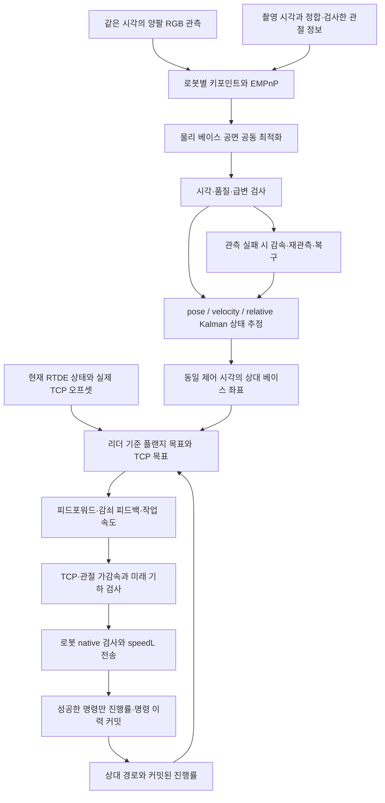

# UR5e–UR10e 협업제어의 전체 원리와 구현

기준일: 2026-11-25 · 기준 구현: `8921476` · 대상: 이 저장소의 실제 `follow` 제어 경로

이 문서는 영상에서 얻은 베이스 자세가 어떤 좌표변환과 상태 추정을 거쳐 팔로워의 속도 명령이 되는지, 그리고 그 명령을 언제 허용·감속·보류·정지하는지를 하나의 흐름으로 설명한다. 기본 모드뿐 아니라 코드에 남아 있는 비교용 제어 방식과 시뮬레이션도 다룬다. 카메라 선택, 창 배치, 버튼 외형 같은 부수적인 구현은 제외하고, 사용자 조작이 제어 상태나 목표를 바꾸는 경우에만 설명한다.

기본값은 클래스 생성자의 독립 실행용 기본값이 아니라 **`urcal.control.runtime.parse_args()`를 통해 실제 프로그램을 실행할 때의 값**이다. 저장된 과거 설정에는 호환성용 다른 기본값이 적용될 수 있다. 아래 설명은 새로운 실행과 과거 설정 재생을 구분한다.

**목차**

1. [협업제어가 풀고 있는 문제](#sec-01)
2. [전체 데이터 흐름과 제어 주기](#sec-02)
3. [좌표계·시간·속도 표기](#sec-03)
4. [영상 관측과 물리 베이스의 공면 추정](#sec-04)
5. [촬영 시각 정합과 관측 수락](#sec-05)
6. [베이스 상태 추정 모드와 SE(3) 시간 처리](#sec-06)
7. [상대 좌표 안정화와 공면 보존](#sec-07)
8. [평면 상대 Kalman 필터](#sec-08)
9. [목표 운동을 베이스·리더·작업 속도로 분해하는 원리](#sec-09)
10. [상대 작업 경로와 작업 시간](#sec-10)
11. [목표 허용오차와 추종 기준을 분리하는 이유](#sec-11)
12. [추종 제어법과 속도 피드백](#sec-12)
13. [제한 안에서 실행 가능한 속도를 선택하는 원리](#sec-13)
14. [현재 상태와 짧은 미래 상태의 제약 검사](#sec-14)
15. [최종 speedL 가속도와 명령 확정](#sec-15)
16. [실행 단계와 명령 소유권](#sec-16)
17. [초기 정렬: 측정한 상태에서 native IK 목표까지 이동](#sec-17)
18. [정렬 완료 후 새 캘리브레이션으로 넘기는 절차](#sec-18)
19. [ACTIVE 중 영상 이상: 유예, 감속 관측, 좌표 보간](#sec-19)
20. [15 cm 접근: 추종을 유지하면서 상대 참조만 바꾸기](#sec-20)
21. [실제 정지와 복구 후 재Arm](#sec-21)
22. [속도 명령 전송과 watchdog의 실제 의미](#sec-22)
23. [검증용 시뮬레이션의 두 종류와 해석 범위](#sec-23)
24. [오차와 로그: 무엇을 실제 성능으로 해석할 수 있는가](#sec-24)
25. [설정값을 해석할 때 구분해야 하는 물리량](#sec-25)
26. [구현 범위와 검증 결과를 해석하는 기준](#sec-26)

<a id="sec-01"></a>

## 1. 협업제어가 풀고 있는 문제

UR5e와 UR10e가 서로 다른 베이스에 설치되어 있고, 카메라가 그 베이스들의 위치·방향을 관측한다고 하자. 리더 팔의 관절이 움직이거나 베이스가 놓인 정반의 상대 위치가 바뀌면, 리더에 대해 같은 상대 자세를 유지하기 위한 팔로워 목표도 달라진다. 목표를 처음 한 번 계산해서 고정하면 이 변화를 따라갈 수 없다.

따라서 제어기는 다음 정보를 조합한다.

| 필요한 정보 | 관측·계산 경로 | 제어에서 맡는 역할 |
| --- | --- | --- |
| 카메라에서 본 양팔 베이스 자세 | 같은 RGB 프레임의 키포인트와 관절 기반 FK를 사용한 포즈 추정 | 서로 다른 로봇 베이스 사이의 좌표 관계 |
| 현재 로봇 관절각·관절속도 | 각 로봇 RTDE 수신 | 링크 자세, Jacobian, 리더 운동과 실제 관절 운동 검사 |
| 현재 활성 TCP 자세·속도 | RTDE 수신 | 실제 제어 기준점, 오차와 감쇠 피드백, 실제 속도 검사 |
| 플랜지에서 TCP까지의 설치 변환 | 실행 시 명시한 TCP 오프셋 | 플랜지 작업 목표를 TCP 명령으로 변환 |
| 리더 기준 상대 작업 경로 | 마주보기 목표, hold·line·circle·간격 접근 | 유지하거나 진행할 상대 작업의 정의 |
| 과거 명령·측정의 시간과 이력 | 제어기 내부 상태와 프레임 메타데이터 | 가속도 제한, 예측, 관측 만료, 복구 및 작업 진행률 |

현재의 협업은 **외부에서 움직이는 리더를 관측하고 팔로워 한 대를 구동하는 리더–팔로워 방식**이다. 기본 리더는 UR10e, 팔로워는 UR5e이며 역할은 바꿀 수 있다. 프로그램은 리더나 정반에 운동 명령을 보내지 않는다. 두 로봇이 힘을 나누어 물체를 잡는 물체 중심 동역학 제어나 힘·토크 제어는 구현되어 있지 않다.

베이스의 위치를 아는 것과 로봇 관절로부터 플랜지 위치를 아는 것은 서로 다른 문제다. 전자는 카메라가 담당하고, 후자는 로봇 상태와 기구학이 담당한다. 이를 결합하므로 카메라 영상만 사용하는 2D 이미지 오차 제어도 아니고, 고정 외부 보정값만 사용하는 로봇 제어도 아니다.

근거: [협업제어기](../urcal/cooperative/controller.py), [실행 루프](../urcal/cooperative/runtime.py), [공통 CLI와 RTDE 전송](../urcal/control/runtime.py).

<a id="sec-02"></a>

## 2. 전체 데이터 흐름과 제어 주기



영상 작업자, 제어 루프, GUI는 별도 프로세스다. 영상의 기본 입력은 640×480, 30 FPS이지만 이는 카메라 설정이다. 두 로봇 신경망은 한 프레임에서 순서대로 추론하며, 실제 측정 갱신 주파수는 추론 시간에 의해 정해진다. 제어 루프의 기본 주기는 25 Hz, 즉 약 40 ms이다. GUI나 화면 표시 주파수로 제어 주기를 정의하지 않는다.

프로세스 사이에서는 오래된 표시·측정 작업을 끝없이 쌓는 대신 최신 항목을 취한다. 따라서 같은 영상 측정으로 여러 제어 주기를 수행할 수 있다. 이때 최신 RTDE 상태는 계속 바뀔 수 있으나, 이전 영상의 `captured_at`은 바뀌지 않는다. 관측이 새로 들어온 것처럼 시각을 갱신하면 실제보다 신선한 보정값으로 오인하므로 금지한다.

초기 정렬은 별도의 관절 공간 제어기에서 `speedJ`를 사용하고, ACTIVE 추종은 TCP 공간의 `speedL`을 사용한다. 두 단계는 같은 목표·좌표계 규약을 공유하지만 명령의 상태와 유효성을 확인하는 절차가 다르다. 이후 절에서 정렬 후 영속도 유지, 새 측정 확보, 첫 추종 명령 검증을 포함한 전환을 설명한다.

제어 계산은 현재 입력으로 실행 가능한 명령을 **제안**하고, 전송 직전에 다시 유효성을 확인한 뒤, 전송에 성공했을 때만 그 제안을 내부 상태로 **확정**하는 구조다. 미리보기, 계획 실패, 통신 실패가 작업 경로를 앞서 진행시키지 않는 것이 핵심 불변조건이다.

근거: [영상 작업자](../urcal/control/vision.py), [최신 항목 큐·MotionSession](../urcal/control/runtime.py), [협업 실행 루프](../urcal/cooperative/runtime.py).

<a id="sec-03"></a>

## 3. 좌표계·시간·속도 표기

### 3.1 변환의 방향과 단위

이 문서에서 $^{A}T_B$는 **B로 표현한 점을 A로 바꾸는 변환**이다.

$$
{}^{A}T_B=\begin{bmatrix}{}^{A}R_B&{}^{A}p_B\\0&1\end{bmatrix},
\qquad {}^{A}\bar p={}^AT_B\,{}^{B}\bar p.
$$

변환의 곱은 오른쪽부터 작용한다. 거리·위치는 m, 시간은 s, 코드의 관절각·회전벡터는 rad이다. `*_deg`라는 CLI 값만 입력 단계에서 degree를 쓰고 내부에서 rad로 변환한다. `rx, ry, rz`는 Euler 각 세 개가 아니라 회전벡터 성분이다.

| 기호 | 의미 |
| --- | --- |
| $C$ | 카메라 좌표계: X 오른쪽, Y 아래, Z 전방 |
| $M_i$ | 학습 키포인트 FK의 로봇 모델 베이스 |
| $B_i$ | 제어 출력 베이스; 기본 설정에서는 물리 제어기 베이스 $B_i^p$와 일치 |
| $F_i$ | TCP 오프셋이 0일 때의 UR 플랜지 기준 |
| $TCP_i$ | 현재 활성 TCP |
| $l$, $f$ | 리더와 팔로워 역할 |
| $A={}^CT_{B_l}$, $B={}^CT_{B_f}$ | 제어 시각에 채택한 두 베이스 변환 |
| $G=B^{-1}A={} ^{B_f}T_{B_l}$ | 리더 베이스를 팔로워 베이스로 옮기는 변환 |
| $H=G^{-1}=A^{-1}B$ | 반대 방향의 상대 베이스 변환 |
| $L={} ^{B_l}T_{F_l}$ | 리더 베이스에서 본 현재 리더 플랜지 |
| $O_i={} ^{F_i}T_{TCP_i}$ | 설치한 플랜지–TCP 오프셋 |
| $D(u)={} ^{F_l}T_{F_f}^{\star}$ | 진행률 $u$에서의 명목 상대 플랜지 목표 |
| $\widetilde D$ | 허용 오프셋까지 반영해 실제 추종에 채택한 상대 목표 |
| $t_c,t_r,t$ | 촬영 시각, 결과 수신 시각, 현재 제어 시각 |
| $u,\rho$ | 커밋된 작업 진행률, 해당 주기의 작업 진행 배율 |

특히 코드의 `RelativeSnapshot.relative_pose`는 $H$ 방향이고, 상대 Kalman의 상태와 `G_control`은 $G$ 방향이다. 변수 이름에 `relative`가 붙었다는 이유만으로 두 행렬을 같은 방향으로 해석하면 목표가 반대로 변환된다. 각 식의 역행렬과 출발·도착 좌표계를 확인해야 한다.

### 3.2 모델 베이스·물리 베이스·제어 출력 베이스

$^{A}T_B$는 $B$ 좌표의 점을 $A$ 좌표로 옮긴다. 동차변환은 $T=[R,p;0,1]$이고 길이는 m, 회전벡터는 rad, 각속도는 rad/s를 사용한다. $C$는 카메라, $M_i$는 학습/FK 모델 베이스, $B_i^p$는 물리 컨트롤러 베이스, $B_i$는 선택된 제어 출력 베이스이다. 기본 설정에서는 $B_i=B_i^p$이지만 UR10e 출력 보정을 끄면 이 해석이 달라진다.

PnP가 반환하는 값과 고정 모델 변환을 다음과 같이 둔다.

$$
P_i={}^{C}T_{M_i},\qquad N_i={}^{M_i}T_{B_i^p},\qquad U_i={}^{M_i}T_{B_i}.
$$

실제 코드의 고정 모델 변환은 다음과 같다.

$$
N_5=I,\qquad N_{10}=\begin{bmatrix}R_z(\pi)&[0,0,0.005]^T\\0&1\end{bmatrix}.
$$

기본 출력 보정 ON이면 $U_i=N_i$이다. OFF이면 두 로봇 모두 $U_i=I$이며, UR5e는 원래 $N_5=I$이므로 결과가 변하지 않는다. 제어에 전달하는 포즈는 $T_i=P_iU_i$이다. **오른쪽 곱**이므로 UR10e의 5 mm 이동은 모델의 로컬 Z 방향이다.

출력 보정은 데이터셋 FK, 컨트롤러 기준 nominal FK 또는 Jacobian을 바꾸지 않는다. 보정을 끈 값은 원래 PnP 좌표계를 제어 베이스처럼 해석하는 것이며, 물리 기준이 자동으로 동등해지는 변경이 아니다. 물리 제약을 적용할 때는 다음 상수 변환으로 되돌아간다.

$$
W_i=U_i^{-1}N_i={}^{B_i}T_{B_i^p},\qquad T_i^p=T_iW_i=P_iN_i.
$$

리더를 $l$, 팔로워를 $f$라 하면 제어 목표를 옮기는 상대변환은

$$
G={}^{B_f}T_{B_l}=T_f^{-1}T_l.
$$

기존 `RelativeSnapshot.relative_pose` 필드는 반대 방향인 $H=T_l^{-1}T_f=G^{-1}$를 저장한다. 평면 칼만 필터의 `relative_filter['G_control']`는 위의 $G$를 저장한다. 문서의 수식을 코드에 대입할 때 이 역변환을 구분해야 한다.

구현 근거: [geometry.py](../urcal/control/geometry.py)의 `model_from_controller_base`, `calibration_output_mapping`, [base_plane.py](../urcal/cooperative/base_plane.py)의 `_physical_offsets`, [state.py](../urcal/cooperative/state.py)의 `RelativeSnapshot`.

### 3.3 플랜지 목표와 TCP 명령의 연결

로봇이 보고하는 값이 활성 TCP 자세라면 플랜지는 다음과 같이 복원한다.

$$
{}^{B_i}T_{F_i}={} ^{B_i}T_{TCP_i}O_i^{-1}.
$$

마주보기 기본 상대 목표는 다음과 같다.

$$
D_0=\begin{bmatrix}\operatorname{diag}(1,-1,-1)&[0,0,g]^T\\0&1\end{bmatrix}.
$$

즉 리더의 +Z 방향으로 간격 $g$만큼 떨어지고, 두 플랜지는 +X를 공유하며 +Y와 +Z가 반대가 된다. 단순히 위치만 가까워지는 목표가 아니다. 기본 $g$는 0.20 m이며, 실행 예시에 자주 나오는 0.30 m는 명시적으로 지정한 값이다.

팔로워 베이스에서 본 TCP 목표는 다음 하나의 변환 연결로 정해진다.

$$
{}^{B_f}T_{TCP_f}^{\star}=B^{-1}AL\widetilde D O_f
=GL\widetilde D O_f.
$$

현재 실제 상대 플랜지 자세는 다음과 같다.

$$
D_{\rm actual}=(AL)^{-1}B\,{}^{B_f}T_{F_f}.
$$

두 식에 같은 시각의 동일한 $A,B$를 사용해야 한다. 목표는 새 필터 좌표, 현재 자세는 예전 좌표로 계산하면 로봇이 움직이지 않아도 가짜 오차가 생긴다. 특히 상대 Kalman 모드는 하나의 $G_{\rm control}$에서 일관된 베이스 쌍을 재구성한다.

TCP에 공구 오프셋이 있으면 플랜지 원점이 고정된 순수 회전도 TCP의 병진 운동을 만든다. 그래서 상대 플랜지 간격, TCP 추종 오차, TCP 속도 제한은 서로 바꿔 사용할 수 없다. 0 TCP 오프셋은 실제 활성 TCP가 플랜지와 일치할 때에만 맞는 입력이다.

### 3.4 기하 속도와 SE(3) 공간 twist

명령 벡터의 순서는 $\xi=[v^T,\omega^T]^T$이다. 대부분의 제어식에서 $v$는 **지정한 기준점 원점의 실제 선속도**이고 $\omega$는 같은 표현 좌표계의 각속도다. 기준점을 P에서 Q로 옮기면 다음 관계를 적용한다.

$$
v_Q=v_P+\omega\times(p_Q-p_P).
$$

반면 $\dot TT^{-1}$에서 얻은 SE(3) 공간 twist의 선형 성분은 그 움직이는 원점의 속도와 같지 않다. 공간 성분을 $v_s$라 하면 원점 위치 $p$의 속도는 $\dot p=v_s+\omega\times p$이다. `RelativeStateEstimator`의 로그·지수 미분을 명령의 TCP 원점 속도로 옮길 때 이 구분이 필요하다. 이후 모든 속도 합성식에는 표현 좌표계와 작용 원점을 함께 명시한다.

근거: [상대 상태 추정의 SE(3) 연산](../urcal/cooperative/state.py), [목표 속도 성분](../urcal/cooperative/task.py).

<a id="sec-04"></a>

## 4. 영상 관측과 물리 베이스의 공면 추정

이 절은 영상이 생성한 한 쌍의 포즈를 제어가 사용할 좌표로 바꾸는 과정을 설명한다. 순서는 **현재 영상의 기하 추정 → 측정 수락 검사 → 정지 초기화 또는 시간 상태 추정 → 제어 좌표의 점진 적용**이다. 이 단계들은 서로 다른 문제를 푼다. 한 단계의 성공이 다른 단계의 조건을 대신하지 않는다.

영상 추정기는 로봇 관절각을 추정하는 센서가 아니다. 카메라 영상의 키포인트와 RTDE가 제공하는 실제 관절각을 조합하여 **카메라 기준 로봇 베이스**를 구한다. 제어 시점의 관절 운동은 별도의 최신 엔코더·RTDE 값으로 계산한다.

### 4.1 같은 프레임에서 얻는 포즈 측정

양팔 추론은 **동일한 한 장의 RGB 영상**을 로봇별 영역으로 나누고 모델 두 개를 순차 실행한다. 왼쪽 UR5e·오른쪽 UR10e라는 배치를 가정하며 로봇 종류를 자동 분류하지 않는다. 순차 추론 완료 시각이 달라도 두 결과의 촬영 시각은 같다.

각 로봇에 대해 관절각 $q_i$로 모델 키포인트 $X_{ij}(q_i)$를 만들고, 투표로 얻은 영상 점 $u_{ij}$ 및 공분산 $\Sigma_{ij}$와 결합한다. 영역의 letterbox 여백은 투표에서 제거한다. 좌표 복원은 OpenCV 픽셀 중심 규약에 맞춰 $u_{\rm full}=(u_{\rm crop}+0.5)\odot s-0.5+o$이며, 공분산은 $S\Sigma S^T$로 복원한다. 이 변환을 생략하면 크롭 좌표에 전체 영상의 카메라 행렬을 적용하는 오차가 생긴다.

투표가 유효하다고 표시한 점 중 좌표·공분산이 유한하고 공분산 대각이 음수가 아니며 담당 영상 영역 안에 있는 점만 사용한다. 공분산에는 $10^{-6}I_2$를 더한다. 제어 추론의 투표 설정은 segmentation 임계값 0.5, 방향 일치 기준 0.99, 최대 4,000픽셀, 기본 최소 유효 픽셀 50, 3° 방향 bin이며 후보 수는 `PVNetVoteConfig(num_hypotheses=8)`로 설정한다.

EMPnP 입력 신뢰도는 공분산 크기로 정한다.

$$
a_j=\frac{1}{\operatorname{tr}(\Sigma_j)/2},\qquad
s_j=0.05+0.90\frac{a_j-\min a}{\max a-\min a}.
$$

모든 $a_j$가 사실상 같으면 $s_j=0.9$이다. 초기 inlier prior는 $\operatorname{clip}(s_j\,\texttt{empnp_prior}/0.9,10^{-6},1-10^{-6})$이다. 제어 경로의 `empnp_prior`는 0.9이고, 투영 잡음 $\sigma$는 3 px이다.

EMPnP는 3 px RANSAC 초기화 후 가중 재투영 최적화를 반복한다. 중요한 점은 E-step이 관측점 자체를 보정한다는 사실이다. 현재 투영 $\hat u_j$와 이전 기준점 $u_j^{pre}$에 대해

$$
c_j=e^{-\|u_j^{pre}-\hat u_j\|^2/(2\sigma^2)},\qquad
u_j^{new}=u_j+c_j[\lambda_e(u_j^{pre}-u_j)+(1-\lambda_e)(\hat u_j-u_j)].
$$

여기서 $u_j^{new}$는 보정 후 영상점이며 구현에서는 이를 다시 `u`에 저장한다. inlier Gaussian likelihood와 영상 면적의 역수인 outlier likelihood로 posterior를 만들고, prior와 posterior를 0.5씩 혼합한 뒤 점들 사이에서 min–max 정규화한 가중치 $w_j$로 $\sum_jw_j\|u_j-\pi(PX_j)\|^2$를 최소화한다. 제어에서는 최대 50회, 파라미터 변화량 $10^{-6}$ 이하를 종료 기준으로 사용한다.

제어 기본값은 이전 포즈 prior 사용 OFF이고 $\lambda_e$는 UR5e 0.5, UR10e 0.2이다. 이전 포즈 prior가 OFF여도 현재 점과 투영을 조합하는 EMPnP 내부 반복은 남는다. 따라서 solver가 보고한 최종 오차는 원래 신경망 검출점에 대한 오차와 다를 수 있다. 아래 수락 단계에서 **원본 검출점**으로 오차를 다시 계산하는 이유이다.

구현 근거: [infer_live_dual.py](../urcal/inference/infer_live_dual.py)의 `infer_region`, `RobotEstimator.infer`, `process_frame`; [infer_live.py](../urcal/inference/infer_live.py)의 `score_from_covariance`, `solve_pose_empnp`; [my_pnp.py](../urcal/inference/my_pnp.py)의 `EMPnP.e_step`, `m_step`; [vision.py](../urcal/control/vision.py)의 `make_pose_args`.

### 4.2 물리적으로 공면인 두 베이스의 영상 최적화

기본 공면 가정은 **두 물리 베이스의 +Z 법선이 같고 두 원점이 그 법선에 대해 같은 높이**라는 것이다. 카메라 수평면과 일치한다는 가정도, 두 베이스의 yaw 또는 간격을 안다는 가정도 아니다. 카메라가 기울어져 있어도 같은 물리 평면을 추정한다.

먼저 $T_i^p=P_iN_i=[R_i,p_i]$로 바꾼다. 공통 법선과 평면 중점은

$$
n=\frac{R_5e_z+R_{10}e_z}{\|R_5e_z+R_{10}e_z\|},\qquad m=\frac{p_5+p_{10}}2.
$$

각 회전에는 기존 +Z를 $n$으로 보내는 최단 회전을 왼쪽에 곱하고, 원점은

$$
p_i' = p_i-nn^T(p_i-m)
$$

으로 옮긴다. 두 높이를 대칭적으로 맞추므로 한 로봇만 강제로 기준으로 삼지 않는다. 법선 합의 크기가 $10^{-6}$ 미만인 반대 방향 법선은 명확한 공통 평면을 만들 수 없어 거절한다.

이 기하 투영을 초기값으로 하여 9개 파라미터를 영상에서 함께 최적화한다.

$$
\theta=[p_5^T,\phi_5^T,x_{10/5},y_{10/5},\psi_{10/5}]^T,\quad
T_{10}^p=T_5^p\begin{bmatrix}R_z(\psi_{10/5})&[x_{10/5},y_{10/5},0]^T\\0&1\end{bmatrix}.
$$

따라서 모든 반복점이 공면 제약을 만족한다. 영상 residual은 모델 프레임으로 되돌린 포즈 $T_i^pN_i^{-1}$와 **이번 영상의 원본 2D 점**으로 정의한다.

$$
r_{ij}(\theta)=\pi(K,d,T_i^p(\theta)N_i^{-1}X_{ij})-u_{ij},\qquad
J(\theta)=\sum_{a}9\left(\sqrt{1+(r_a/3)^2}-1\right).
$$

$a$는 모든 점의 X/Y 잔차 성분이다. `least_squares`의 `soft_l1`, `f_scale=3`, `x_scale='jac'`, 최대 함수평가 40회를 사용한다. 이 비용에는 이전 시각 포즈, 베이스 간 거리, yaw 또는 카메라 수평면을 선호하는 항이 없다.

입력과 투영 초기값은 모든 유효 키포인트 깊이가 $10^{-6}$ m보다 커야 한다. 최적화가 평가 제한에 도달해 `success=False`여도 유한하고 양의 깊이를 유지하며 투영 초기값보다 비용이 크지 않으면 결과를 채택할 수 있다. 사용할 수 없는 결과는 유효한 **공면 초기값**으로 돌아간다. 공면을 깨는 원래 두 포즈로 되돌리지 않는다. 초기값부터 유효하지 않으면 측정쌍을 거절한다.

한 팔의 포즈가 실패하면 다른 팔의 과거 포즈로 메우지 않는다. 두 팔이 모두 있어야 공동 최적화를 수행한다. 입력이나 공면 초기값이 유효하지 않아 `constraint_error`가 발생하면 EMPnP의 이전 포즈 이력을 해당 프레임 처리 전 상태로 복원한다. 반면 수치 최적화가 수렴하지 않아도 유효 공면 초기값 fallback을 채택한 경우에는 그 채택 포즈로 이력을 갱신할 수 있다. 이 단계는 같은 시각의 기하 제약이며 시간 필터와 목적이 다르다.

구현 근거: [coplanar.py](../urcal/inference/coplanar.py)의 `project_coplanar_bases`, `refine_coplanar_pair`; [infer_live_dual.py](../urcal/inference/infer_live_dual.py)의 `constrain_base_plane`, `process_frame`.

<a id="sec-05"></a>

## 5. 촬영 시각 정합과 관측 수락

### 5.1 촬영·수신·제어 시각과 관절 보간

세 시각을 구분한다. $t_c$는 영상 촬영시각, $t_r$은 호스트가 결과를 받은 시각, $t$는 제어 계산시각이다. 물리 상태 차분과 칼만 예측 간격은 촬영시각 차이로 계산한다. 신선도는 $t-t_c$로 검사하며, 처리 완료나 중복 수신으로 $t_c$를 갱신하지 않는다.

캡처 스레드는 추론 중에도 카메라를 계속 읽고 가장 최근의 한 프레임을 보관한다. 초기 9개 프레임은 버리고 10번째부터 게시한다. 프레임 번호 또는 센서 timestamp가 이전보다 증가하지 않으면 오류로 처리한다. 이렇게 해야 버퍼에 남은 오래된 이미지가 새 측정처럼 소비되지 않는다.

카메라 timestamp가 system/global time이면 호스트 wall-clock과의 차이 $a$로 age를 구하고 monotonic 시간으로 옮긴다. 센서 시간이 호스트보다 50 ms 넘게 앞서면 거절한다. device clock이면 관찰한 $t_{receive}-t_{sensor}$의 최소값을 offset으로 유지한다. 이 값에는 알려지지 않은 일정한 전송 지연이 남을 수 있다.

기존 `pose`·`velocity` 경로는 보수적인 노출 여유를 둔다. system/global clock에서는 영상 age를 `max(wall_age, frame_period)`로 잡아 최소 한 카메라 주기를 확보한다. device clock에서는 위 offset으로 계산한 촬영시각에서 한 주기를 추가로 뺀다. 수신 때 읽은 관절값과의 경과시간을 skew로 평가한다. `relative_kalman` 경로는 촬영시각 보간이 필요하므로 이 한 주기 여유를 timestamp에 적용하지 않고 **별도의 노출 불확실성**으로 기록한다.

`relative_kalman`에서는 별도 `JointSampler`가 각 RTDE 수신기를 100 Hz 목표 주기로 읽는다. 한 샘플은 `timestamp → q → timestamp` 순서로 읽고 두 timestamp가 같을 때만 채택한다. 패킷 경계를 가로지르면 다시 읽되 최초 읽기를 포함해 최대 3회 시도한다. 중복 RTDE timestamp는 관절값과 최초 수신 구간을 그대로 보존하며 신선도를 갱신하지 않는다.

로봇 시각 $\tau_j$를 호스트로 옮기는 offset은 읽기 전후 시각 $b_j,a_j$를 사용한다.

$$
o_q=\min_j\left(\frac{b_j+a_j}{2}-\tau_j\right),\qquad \tau_c=t_c-o_q.
$$

$t_c$를 끼우는 두 고유 샘플 $\tau_0\le\tau_c\le\tau_1$에 대해

$$
\eta=\frac{\tau_c-\tau_0}{\tau_1-\tau_0},\qquad
q(t_c)=q_0+\eta\operatorname{atan2}(\sin(q_1-q_0),\cos(q_1-q_0)).
$$

`atan2`는 관절별로 적용하여 $+\pi/-\pi$ 경계를 짧은 방향으로 보간한다. timestamp가 정확히 일치하면 그 샘플을 그대로 사용한다. 과거·미래 extrapolation은 하지 않으며, 보간 불가 시 임의의 최신 `q`로 대체하지 않는다.

기본 보간 bracket 간격은 최대 50 ms, 뒤쪽 샘플을 기다리는 시간은 최대 30 ms이다. 버퍼는 로봇별 512개이며, 실제 live 전달값에서 RTDE age 한계는 0.5 s이다. 최신 고유 샘플이나 bracket이 오래되면 해당 관측을 거절한다.

보간 경로의 유효 skew 예산은

$$
\epsilon_q=T_{camera}+\max_i\left(\max_{j\in\{0,1\}}|t_c-(\tau_{ij}+o_{q_i})|+\frac{\max_j(a_{ij}-b_{ij})}{2}\right)
$$

이다. 기본 수락 상한은 0.08 s이다. 이 예산은 지원 샘플 간격·노출 여유를 나타내며 추론 대기시간을 모두 합친 값이 아니다. 카메라와 RTDE의 서로 다른 알려지지 않은 일정 지연까지 보정한 하드웨어 동기화도 아니다. 누락 bracket은 거절 패킷으로 게시되며 그 이미지의 모델 추론을 진행하지 않는다.

구현 근거: [vision.py](../urcal/control/vision.py)의 `LatestCapture`, `vision_worker`; [joint_history.py](../urcal/control/joint_history.py)의 `JointHistory.append`, `interpolate`, `JointSampler._sample_once`.

### 5.2 어떤 관측쌍을 받아들이는가

`calibration_frame`은 EMPnP/공면 처리 결과를 원본 관측점으로 다시 평가한다. 한 팔의 실패, 유효점 부족, 비유한 값, 키포인트가 카메라 뒤에 있는 경우 또는 과도한 관절 skew를 거절 사유로 기록한다. 2D 점들을 평균 중심으로 이동한 행렬의 두 번째 특잇값을 $s_2$라 할 때 $s_2/\sqrt{n}<5$ px이면 지나치게 작거나 공선적인 검출 배치로 거절한다.

재투영 통계는 원본 점에 대한 $e_j=\|\pi(P_iX_{ij})-u_{ij}\|$의 평균과 최대이다. 공면 보정 ON이면 보정 후 모델 포즈 $P_i$로 계산한다. EMPnP가 내부에서 보정한 점이나 solver가 보고한 작은 오차를 그대로 수락 지표로 사용하지 않는다.

`CalibrationTracker.update`는 완전한 두 로봇 쌍만 받는다. sequence가 증가해야 하고 새로운 촬영시각도 증가해야 한다. 똑같은 sequence는 신선한 마지막 수락값을 확인한 뒤 `False`를 반환하며 안정 프레임 수를 늘리지 않는다. 새로운 sequence라도 오래되거나 미래의 영상은 거절한다.

현재 live 협업 실행값과 클래스 자체 기본값은 다르다. 실제 제어의 의미는 아래 live 값을 기준으로 읽어야 한다.

| 검사·처리 | live 협업 실행 기본값 | 의미 |
| --- | --- | --- |
| 최대 영상 age | 0.5 s | 마지막 수락 영상의 원래 촬영시각 기준 |
| 준비에 필요한 고유 수락 프레임 | 3 | 클래스 독립 기본값 5와 구분 |
| 최소 유효 키포인트 | 각 로봇 5개, 최대 7개 | PnP 자체의 최소 4개보다 엄격 |
| 원본 평균/최대 오차 한계 | 5 px / 8 px | `check_reprojection` ON일 때 수치 거절 |
| 재투영 수치 거절 | 기본 OFF | 통계의 유한성 및 $0\le\bar e\le e_{max}$ 검사는 항상 적용 |
| 연속 원본 위치/회전 변화 한계 | 0.05 m / 5° | 클래스 독립 기본값 0.015 m / 2°와 구분 |
| 협업 gate의 필터 계수 | 1 | gate와 상태 추정기의 이중 시간 필터링을 피함 |

변화량 검사는 마지막 **수락 원본**과 새 원본 사이의 병진 노름 및 $\|\log(R_{old}^TR_{new})\|$로 한다. 보통 각 베이스와 원본 모델 상대변환 $P_5^{-1}P_{10}$을 모두 검사한다. 이 relative gate는 리더 선택과 무관하게 $^{M_5}T_{M_{10}}$을 사용한다. 즉 UR10e 모델 좌표의 점을 UR5e 모델 좌표로 옮기는 변환이며, 아직 $U_i$ 출력 변환을 적용하기 전이다. 여기서 원본 포즈는 시간 필터 전의 측정을 뜻하며, 공면 보정이 켜져 있으면 그 결과는 이미 반영되어 있다.

`relative_kalman`에서는 같은 카메라의 공통 운동을 개별 베이스의 급변으로 거절하지 않도록 **개별 베이스 jump 검사만 해제**한다. 상대변환 jump, age, 기하·키포인트·통계 검사 및 이후 KF innovation 검사는 남는다. 상대 gate는 위의 5 cm/5°가 기본이므로 KF 자체의 15 cm/15° step 한계보다 먼저 거절할 수 있다.

일반 `CalibrationTracker`의 평활화는 $p^+=(1-\alpha)p+\alpha p_{meas}$, $R^+=R\exp[\alpha\log(R^TR_{meas})]$이다. 그러나 협업 `CooperativeController`는 gate에 $\alpha=1$을 주고, 수락된 **이번 packet**을 독립 상태 추정기에 넘긴다. `filter_alpha=0.2`는 아래 상태 추정 경로에 적용된다.

거절은 준비 카운터를 초기화하지만 마지막 수락 포즈와 촬영시각을 남긴다. 이는 짧은 관측 이상 동안 사용할 수 있는 과거 상태의 나이를 계속 검사하기 위해서다. gate 통과와 상태 추정기 갱신은 controller에서 복사본을 이용해 연결하며 한 팔만 새 좌표로 바뀌는 부분 수락을 피한다. ACTIVE의 일시 거절 유예·재관측 전환은 별도 상태 기계가 결정한다.

구현 근거: [vision.py](../urcal/control/vision.py)의 `calibration_frame`; [policy.py](../urcal/control/policy.py)의 `CalibrationTracker`; [controller.py](../urcal/cooperative/controller.py)의 `__init__`, `ingest`; 실제 기본값은 [runtime.py](../urcal/control/runtime.py)의 `parse_args`.

### 5.3 정지 상태 초기화: 연속 성공과 최근 합의

초기 정렬 전후에는 베이스·카메라·관절이 정지해 있다고 가정할 수 있다. 이때 단일 PnP 분기 전환이나 고립된 outlier 때문에 매번 수집을 처음부터 시작하지 않도록 최근 합의를 사용한다. 이 수집기는 움직이는 베이스를 계속 따라가는 필터로 쓰지 않는다.

`StationaryCalibrationAcquisition`은 최근 1 s 안에 들어온 관측을 보관한다. 각 새 관측을 독립적인 gate로 검증하고, 실패도 분모에 넣는다. 복제 sequence는 증거를 추가하지 않는다. 메모리는 $\max(32,2N_s)$개의 항목으로 제한한다.

두 관측 $a,b$의 정규화 거리는 두 원본 베이스 및 그 상대변환 세 가지 모두에 대해 계산한 최댓값이다.

$$
d(a,b)=\max_{T\in\{P_5,P_{10},P_5^{-1}P_{10}\}}
\left\{\frac{\|p_T^a-p_T^b\|}{d_{max}},\frac{\|\log[(R_T^a)^TR_T^b]\|}{\theta_{max}}\right\}.
$$

각 유효 관측을 seed로 하여 거리순으로 후보를 붙이되 **기존 모든 멤버와 $d\le1$인 경우에만** 추가한다. 이는 A≈B, B≈C이지만 A와 C는 먼 연쇄 drift를 하나의 합의로 묶지 않기 위한 조건이다. 전역 최대 clique를 푸는 알고리즘은 아니며 seed별 제한된 탐욕 군집 중 멤버 수가 가장 많은 것을 고른다. 크기가 같으면 가장 최신 관측을 가진 군집을 선택한다.

군집 크기 $n$은 $n\ge N_s$ 및 $n\ge0.6N_{recent}$를 모두 만족해야 한다. live $N_s=3$이므로 3개 이상이면서 최근 관측의 60% 이상이 필요하다. 유효하지만 다른 분기에 속한 점과 실패 프레임 모두 합의를 어렵게 만든다. 후보 중 최신 inlier 촬영시각은 현재 age 한계도 만족해야 한다.

최종 병진은 군집 평균, 회전은 동일 가중치의 `Rotation.mean()`으로 구한다. 평균 포즈에 새 촬영시각을 발급하지 않고 **가장 최신 실제 inlier의 촬영시각**을 유지한다. 첫 live 변화량을 비교할 raw history에는 평균이 아니라 최신 실제 원본 포즈를 남긴다.

`stationary_estimator`는 위의 원본·평균을 따로 받아 속도 0으로 초기화한다. 그래야 평균과 다음 영상 사이의 작은 차이가 실제 베이스 속도로 오해되지 않는다. `direct` 방식은 계속 raw 관측을 사용하고, `pose`·`predict` 및 평면 KF는 정지 합의값을 초기 필터 상태로 사용할 수 있다.

preview에서 오래되거나 달라진 분기를 교체하는 `PreviewCalibrationRecovery`와 ACTIVE 중 재관측 후보는 별도 수명·조건을 가진다. 정지 합의를 한 번 얻었다고 이후의 모든 관측을 정지 상태로 해석하지 않으며, 제어가 시작되면 이 정지 초기화 경로를 떠난다.

구현 근거: [acquisition.py](../urcal/control/acquisition.py)의 `StationaryCalibrationAcquisition`, `stationary_estimator`; [controller.py](../urcal/cooperative/controller.py)의 `ingest`; 초기 정렬 이후의 적용 위치는 [handoff.py](../urcal/control/handoff.py).

<a id="sec-06"></a>

## 6. 베이스 상태 추정 모드와 SE(3) 시간 처리

### 6.1 베이스 운동 모드와 제어 방법의 조합

`base_motion_mode`는 **영상으로 어떤 상태를 추정할지**, `method`는 **그 상태로 만든 목표와 운동 성분을 어떻게 사용할지**를 정한다. 이름이 비슷해도 같은 선택지가 아니다.

| base_motion_mode | method | 상태 추정 | 제어에서의 핵심 차이 |
| --- | --- | --- | --- |
| `pose` | `direct` | SE(3) 좌표 갱신, 계수 1, 영상 속도 0 | 작업·리더 feedforward 분리합성 없음 |
| `pose` | `predict` | SE(3) 좌표 갱신, `filter_alpha`, extrapolation 없음 | 이름과 달리 pose 모드에서는 영상 속도 예측 안 함 |
| `pose` | `separated` | 위와 동일, ACTIVE 상대 포즈 smoother 적용 가능 | 엔코더 리더 추종·작업·오차 보정을 분리 가능; 기본 조합 |
| `velocity` | `direct` | 원본 이력의 공통 과거시각 보간, 원본 차분 속도 | extrapolation 없음; 분리 feedforward 합성 없음 |
| `velocity` | `predict` | 개별 베이스 SE(3) 예측·보정·속도 필터 | 현재시각으로 예측한 목표에 피드백 |
| `velocity` | `separated` | 같은 예측 상태 추정기 | 베이스/리더/작업 속도를 별도 성분으로 합성 |
| `relative_kalman` | `separated`만 | 동일 프레임의 평면 상대변환 KF | 신뢰도 가중 정반 보상; feedforward+bounded+공면 필수 |

`base_motion_mode=pose`이면 `method`가 direct·predict·separated 중 어느 것이든 ACTIVE에서 상대 smoother가 적용될 수 있다. 따라서 `method=direct`의 계수 1은 개별 SE(3) 갱신을 뜻하며, 상대 smoother까지 해제하려면 `base_pose_window=0`이 필요하다.

`follow_law=pose`는 추가로 `method=separated`, `base_motion_mode=pose`, `leader_response=bounded`를 요구한다. 이 조합에서는 매 주기 좌표 목표를 재계산하되 속도 명령은 포즈 오차와 측정 운동 감쇠로 만든다. 표의 분리 가능 성분을 실제로 더하는 것은 `follow_law=feedforward`일 때이다.

기본 `pose`에서 영상 속도 0은 “실제 베이스가 정지했다고 측정했다”는 뜻이 아니다. 영상 추정의 프레임간 변화로 물리적 속도를 만들어 제어에 주입하지 않는다는 설계 선택이다. 실제 베이스 이동은 갱신된 좌표의 목표 오차로 반영된다. 반대로 `velocity`는 영상 차분을 물리 운동 추정으로 사용하므로 잡음과 급격한 분기 변경의 영향이 크다.

구현 근거: [controller.py](../urcal/cooperative/controller.py)의 `_new_estimator`, `state`, `prepare`; [runtime.py](../urcal/control/runtime.py)의 조합 검증.

### 6.2 개별 베이스 SE(3) 상태 추정기

`RelativeStateEstimator`는 로봇별 최대 256개 관측 이력을 가진다. 같은 프레임의 두 입력을 원자적으로 갱신하며, 순서 역전·미래 촬영·수신 시각 역전·지나치게 늦게 도착한 측정을 거절한다. 같은 sequence가 다른 포즈 또는 촬영시각으로 재등장하면 오류이고, 동일한 중복은 아무 상태도 갱신하지 않는다.

내부 Lie algebra 벡터는 $\xi=[v_s;\omega]$이다. 여기서 $v_s$는 베이스 원점 속도가 아니다. $T=[R,p]$에 대해

$$
\dot p=v_s+\omega\times p,\qquad v_{origin}=v_s+\omega\times p.
$$

외부 `base_twists`는 카메라 축으로 표현한 **해당 베이스 원점의** $[v_{origin};\omega]$를 반환한다. 원점이 다른 twist를 그대로 더하면 안 된다. $\exp(\xi)$의 병진은 $J(\omega)v_s$이고 $J$는 SO(3) left Jacobian이다.

$$
J(\phi)=I+\frac{1-\cos\theta}{\theta^2}[\phi]_\times+\frac{\theta-\sin\theta}{\theta^3}[\phi]_\times^2,\qquad\theta=\|\phi\|.
$$

구현은 $\theta<10^{-5}$에서 계수의 Taylor 전개를 사용한다. SE(3) 로그의 병진 성분은 $J(\phi)^{-1}p$로 구하므로, 평행이동 벡터 자체를 각속도와 단순 결합한 보간과 다르다.

`pose` 모드에서는 $\Delta=\log(T_{meas}T_{prev}^{-1})$로 두고

$$
T^+=\exp(\alpha\Delta)T_{prev},\qquad \xi_{raw}=\xi_{filtered}=0.
$$

수락된 측정의 좌표를 SE(3)에서 갱신할 뿐, 프레임간 차분 속도 검사나 촬영 이후 extrapolation을 하지 않는다. `estimate(t)`가 최신 filtered pose를 유지해도 age는 원래 촬영시각을 기준으로 증가한다.

`velocity` 모드의 원본 속도는 촬영 간격 $\Delta t$로 계산한다.

$$
\xi_{raw,k}=\frac{\log(T_{raw,k}T_{raw,k-1}^{-1})}{\Delta t}.
$$

이 값의 각속도와 이전·현재 원점에서 환산한 선속도를 검사한다. live 한계는 0.25 m/s와 0.15 rad/s이다. 넘는 측정을 clip하여 유효 관측으로 바꾸지 않고 거절한다. 클래스 독립 기본값 0.15 m/s, 0.5 rad/s와 live 전달값을 혼동하지 않아야 한다.

`direct`는 raw pose와 raw velocity를 사용한다. 두 입력이 비동기라면 가장 최근 촬영시각 중 작은 시각 $t_* = \min_i t_{c,i}$를 선택하고 더 최신인 쪽의 raw 이력을 SE(3) 보간한다. 그 시각을 끼우는 이력이 없으면 거절한다. 실제 동일 프레임 입력에서는 촬영시각이 같아 이 보간이 필요 없다.

`predict` 추정기의 갱신은 다음과 같다.

$$
T_k^- =\exp(\xi_{k-1}\Delta t)T_{k-1}^+,\quad
T_k^+=\exp\{\alpha\log[T_{raw,k}(T_k^-)^{-1}]\}T_k^-,
$$
$$
\xi_k=(1-\beta)\xi_{k-1}+\beta\xi_{raw,k}.
$$

기본 $\alpha=0.2$, $\beta=0.3$이다. 관측 간격이 예측 한계보다 길면 새 raw pose와 속도 0으로 시작하지만, 그 전에 원본 변화의 속도 검사는 수행한다. 제어시각 예측은 $T_i(t)=\exp[\xi_i(t-t_{c,i})]T_i^+$이며 기본 horizon은 0.5 s이다. 최신 영상 age나 예측 horizon을 초과하면 사용할 수 없다.

리더 프레임에서 팔로워 베이스 원점의 상대 속도도 운반항을 포함한다. 카메라 기준 $T_l=[R_l,p_l],T_f=[R_f,p_f]$에 대해

$$
\dot p_H=R_l^T[v_f-v_l-\omega_l\times(p_f-p_l)],\qquad
\omega_H=R_l^T(\omega_f-\omega_l).
$$

따라서 같은 강체 카메라 운동을 두 포즈에 가했을 때 상대변환과 상대 속도는 일관되게 유지된다. 이 식은 `relative_pose=H`의 원점 미분이다. $G$ 원점의 미분과 방향을 바꾸려면 역변환의 미분까지 적용해야 한다.

구현 근거: [state.py](../urcal/cooperative/state.py)의 `_exp`, `_log`, `_origin_twist`, `RelativeStateEstimator._candidate`, `_historical`, `estimate`.

<a id="sec-07"></a>

## 7. 상대 좌표 안정화와 공면 보존

### 7.1 기본 pose 모드의 상대 좌표 smoother

개별 베이스를 시간 필터링한 뒤에도 작은 PnP 깊이 변화가 상대 좌표를 흔들 수 있다. `RelativePoseSmoother`는 ACTIVE에서 $H=T_l^{-1}T_f$를 먼저 만들고 상대 좌표 자체를 처리한다. 이 때문에 동일한 카메라 강체 이동은 필터 입력에서 상쇄된다. 현재 리더의 카메라 포즈는 유지하고 팔로워 포즈만 $T_f=T_l\widetilde H$로 재구성한다.

기본 최근 창은 5개의 고유 촬영쌍이며 3개부터 대표값을 계산한다. 1 s보다 오래된 증거는 제거한다. 제어 루프가 같은 프레임을 여러 번 호출해도 표본 수가 증가하지 않는다. 대표값은 행렬 원소별 median이나 가상 평균이 아니라 실제 관측 중 거리합이 최소인 **medoid**이다.

$$
d_{ij}=\frac{\|p_i-p_j\|}{\max(d_b,0.005)}+
\frac{\|\log(R_iR_j^T)\|}{\max(\theta_b,0.5^\circ)},\qquad
H_{target}=H_{\arg\min_i\sum_jd_{ij}}.
$$

거리합 동률은 가장 오래된 표본이 이긴다. 새 표본 하나가 대표값을 쉽게 바꾸지 않도록 한 선택이다. 이전 창이 모두 만료되면 새 창이 쌓일 때까지 target을 현재 적용 좌표로 고정하여 오래된 medoid 쪽으로 계속 끌리지 않게 한다.

각 제어 주기의 유효 시간과 지수 계수는 $\delta t=\min(t-t_{prev},0.08)$, $w=1-e^{-\delta t/0.35}$이다. 병진 오차 $e_p=p_{target}-p$, 회전 오차 $e_R=\log(R_{target}R^T)$ 각각에 대해

$$
\mathcal I(e;d,w,b)=
\begin{cases}0,&\|e\|\le d,\\
\dfrac e{\|e\|}\min\{(\|e\|-d)w,b\},&\text{그 외}
\end{cases}
$$

를 사용하고 $p^+=p+\mathcal I(e_p;d_b,w,v_b\delta t)$, $R^+=\exp[\mathcal I(e_R;\theta_b,w,\omega_b\delta t)]R$로 바꾼다. 기본 deadband는 5 mm와 0.5°, 좌표 적용 속도 상한은 0.02 m/s와 0.05 rad/s이다. deadband는 축별 사각형이 아닌 벡터 노름 기준이다.

이 속도 상한은 **로봇 TCP 속도 상한이 아니라 좌표 갱신 속도**이다. 리더 엔코더 feedforward를 늦추는 필터도 아니다. 순간 좌표 변경을 줄이는 대신 실제 베이스가 빠르게 이동할 때 목표 좌표 반영에 지연이 생긴다. 첫 관측은 즉시 seed하며 긴 정지·RPC 지연을 큰 한 번의 좌표 이동으로 소비하지 않는다.

smoother는 base twist와 상대 twist를 0으로 유지하고 촬영·수신·age 메타데이터를 그대로 보존한다. 같은 ACTIVE session의 live 추정기 교체 중에도 smoother를 유지하여 새 분기가 점진 적용을 우회하지 못하게 한다. 새 정지/target session에서는 초기화한다.

구현 근거: [pose_smoothing.py](../urcal/cooperative/pose_smoothing.py)의 `_center`, `_increment`, `apply`; [controller.py](../urcal/cooperative/controller.py)의 `state`.

### 7.2 시간 처리 뒤에도 물리 공면을 보존하는 이유

각 영상에서 공면을 만족하더라도 두 포즈를 독립적으로 시간 보간하면 정확한 공면 조건에서 벗어날 수 있다. 회복 중 포즈를 혼합하는 경우도 같다. 따라서 제어 snapshot은 필요 시 물리 베이스로 변환하고 기하 투영한 뒤 출력 좌표로 복원한다.

`pose`에서는 입력 영상 twist가 0이므로 그대로 0이다. `velocity` 연구 모드에서는 원점과 제약 접공간까지 맞춘다. 출력 원점에서 물리 원점, 다시 투영된 원점으로 옮길 때마다

$$
v_{new}=v_{old}+\omega\times(p_{new}-p_{old})
$$

를 적용한다. 공통 법선 $n$에 수직인 각속도 성분은 두 팔 평균인 공통 tilt 속도 $\omega_t$로 맞추고, 법선 방향 yaw 속도는 각자 남긴다. $\dot n=\omega_t\times n$, $d=p_{10}-p_5$라 하면 공면 높이 제약의 미분 오차는

$$
\dot h=n^T(v_{10}-v_5)+\dot n^Td.
$$

$v_5\leftarrow v_5+\tfrac12\dot h n$, $v_{10}\leftarrow v_{10}-\tfrac12\dot h n$으로 대칭 보정한다. 이는 공면과 양립하지 않는 영상 베이스 속도 성분을 제거하는 것이며 실제 엔코더 속도를 수정하는 것이 아니다. 복원한 출력 원점에서 상대 twist를 다시 계산한다.

일반 snapshot에는 추정 후 투영을 적용하고, ACTIVE smoother·recovery blend 뒤에도 한 번 더 투영한다. 평면 KF는 내부에서 상대 평면 상태를 구성하므로 평상시 중복 투영을 하지 않으며, recovery blending 중에는 공면 복원을 수행한다.

구현 근거: [base_plane.py](../urcal/cooperative/base_plane.py)의 `project_output_bases`, `constrain_base_snapshot`; [controller.py](../urcal/cooperative/controller.py)의 `state`.

<a id="sec-08"></a>

## 8. 평면 상대 Kalman 필터

### 8.1 동일 영상 상대변환을 직접 추정하는 평면 칼만 필터

`PlanarRelativeStateEstimator`는 두 카메라 기준 베이스를 따로 차분하지 않는다. 수락한 동일 촬영쌍을 물리 공면으로 복원한 뒤

$$
G_p=(T_fW_f)^{-1}(T_lW_l),\qquad z=[(G_p)_{x},(G_p)_{y},\operatorname{atan2}((G_p)_{21},(G_p)_{11})]^T
$$

를 측정한다. 공통 카메라 강체변환 $Q$는 $(QT_f^p)^{-1}(QT_l^p)=G_p$에서 소거된다. 추정 상태는 팔로워 **물리 베이스 좌표**의 $x=[x,y,\psi,v_x,v_y,\dot\psi]^T$이고, 각 성분의 단위는 m·rad·m/s·rad/s이다.

상수 속도 전이와 측정 행렬은

$$
F(\Delta t)=\begin{bmatrix}I_3&\Delta tI_3\\0&I_3\end{bmatrix},\qquad H_k=[I_3\;0].
$$

$A=\operatorname{diag}(\sigma_a^2,\sigma_a^2,\sigma_{a\psi}^2)$일 때 구현의 이산 가속도 잡음은

$$
Q(\Delta t)=\begin{bmatrix}\frac{\Delta t^4}{4}A&\frac{\Delta t^3}{2}A\\\frac{\Delta t^3}{2}A&\Delta t^2 A\end{bmatrix},\qquad
R=\operatorname{diag}(\sigma_m^2,\sigma_m^2,\sigma_\psi^2).
$$

이는 $\Delta t^3/3$ 항을 사용하는 연속 백색가속도 모델과 다른 구체적인 잡음 정의이다. 코드의 $\sigma_a$를 다른 모델의 spectral density로 읽으면 안 된다.

예측·갱신은 $x^-=Fx$, $P^-=FPF^T+Q$, $r=z-H_kx^-$, $S=H_kP^-H_k^T+R$, $K=P^-H_k^TS^{-1}$, $x^+=x^-+Kr$이다. yaw 잔차와 갱신된 yaw는 `atan2(sin,cos)`로 감싸 $-\pi$와 $+\pi$ 경계를 짧은 방향으로 처리한다. 공분산은 Joseph 형태

$$
P^+=(I-KH_k)P^-(I-KH_k)^T+KRK^T
$$

로 갱신한 뒤 대칭화하고 음의 고윳값을 0으로 잘라 수치적 PSD를 유지한다. 초기 속도는 0이고 $P_0=\operatorname{diag}(\sigma_m^2,\sigma_m^2,\sigma_\psi^2,\sigma_{v0}^2,\sigma_{v0}^2,\sigma_{\dot\psi0}^2)$이다.

| KF 파라미터 | 현재 기본값 및 provisional JSON 값 |
| --- | --- |
| 측정 표준편차 $\sigma_m$, $\sigma_\psi$ | 0.007 m, 0.3° |
| 가속도 표준편차 $\sigma_a$, $\sigma_{a\psi}$ | 0.10 m/s², 0.15 rad/s² |
| 초기 속도 표준편차 $\sigma_{v0}$, $\sigma_{\dot\psi0}$ | 0.05 m/s, 0.15 rad/s |
| prediction horizon / gap reset | 각각 0.35 s |
| 최소 속도 지지 표본 수 | 4 |
| Mahalanobis 제곱거리 gate | 16.27 |
| 자체 원본 관측 step 한계 | 0.15 m / 15° |
| 추정 속도 상한 | 0.15 m/s / 0.5 rad/s |
| 정지 관측 창 / 잡음 배수 | 0.25 s / 0.75 |
| 방향 반전 잡음 배수 | 3 |
| 속도 SNR 진입 / 완전 적용 | 1.5 / 3.0 |

초기 이후에는 새 측정과 마지막 raw 측정의 병진·wrapped yaw step을 먼저 검사하고, innovation 제곱거리 $r^TS^{-1}r>16.27$이면 거절한다. 이전 거절 또는 0.35 s보다 긴 관측 간격이 있으면 **이 검사를 통과한 후** 새 측정·속도 0으로 reset한다. reset이 큰 잘못된 관측을 자동 수락하는 우회로는 아니다.

실패 시 마지막 수락 $x,P,t_c,t_r$와 raw pose는 유지하고 rejected 표시와 support=0만 설정한다. 다음 `estimate`는 이 정보를 보고 속도 예측을 억제한다. `estimate` 자체는 후방 공분산이나 촬영시각을 갱신하지 않는 읽기 전용 계산이다.

반전은 직전 추정 속도와 raw 이동 step의 내적으로 판정한다. 병진은 $v_{old}^T\Delta p<-3\sqrt2\sigma_m\|v_{old}\|$, yaw는 $\dot\psi_{old}\Delta\psi<-3\sqrt2\sigma_\psi|\dot\psi_{old}|$일 때이다. 어느 쪽이든 만족하면 모든 속도를 0으로 만들고 위치–속도 교차 공분산을 0으로 하며 속도 공분산을 초기값으로 돌리고 support를 1부터 다시 모은다.

최근 최소 4개 표본이 0.25 s 이상을 덮고, 모든 최근 위치가 마지막 위치에서 $0.75\sigma_m$ 이내이며 wrapped yaw 범위가 $0.75\sigma_\psi$ 이내이면 “측정 잡음 범위 내 정지”로 판단해 속도를 0으로 만든다. 이는 외부 센서로 확인한 정지가 아니라 설정한 관측 잡음 모델에 따른 억제이다. 갱신 후 속도는 위의 0.15 m/s·0.5 rad/s 한계로 제한한다. 이것은 다른 `velocity` 모드의 원본 속도 초과 **거절**과 다르다.

구현 근거: [relative_kalman.py](../urcal/cooperative/relative_kalman.py)의 `PlanarKalmanConfig`, `_noise`, `_measurement`, `update_pair`; 설정값은 [relative_kalman.provisional.json](../configs/relative_kalman.provisional.json).

### 8.2 KF 예측의 신뢰도, 감속과 출력 원점

관측과 제어 사이의 age를 $a=t-t_c$라 한다. 먼저 **수락 posterior** 속도의 SNR로 병진과 yaw를 따로 평가한다. $\hat d=v/\|v\|$에 대해 $s_{xy}=\|v\|/\sqrt{\hat d^TP_{vv}\hat d}$, $s_\psi=|\dot\psi|/\sqrt{P_{\dot\psi\dot\psi}}$이다. 제곱근 안의 분산에는 $10^{-18}$ 하한을 적용하므로 분모 하한은 $10^{-9}$이며 속도가 0이면 병진 방향벡터를 0으로 둔다.

$$
g_{xy}=\operatorname{clip}\frac{s_{xy}-1.5}{3-1.5},\quad
g_\psi=\operatorname{clip}\frac{s_\psi-1.5}{3-1.5},\quad
g_n=\operatorname{clip}\frac{n-4+1}{4},\quad g=g_n[g_{xy},g_{xy},g_\psi]^T.
$$

모든 `clip` 범위는 $[0,1]$이다. 표본 수 4개에서 support gain은 0.25이고 7개부터 1이다. 병진 관측이 좋아도 yaw 신호가 약하면 yaw를 별도로 억제한다. 거절 표시가 있으면 $g=0$이다. 이 이득은 새 관측을 수락하기 전에는 변하지 않는다.

horizon $h=0.35$ s의 전반부는 일정 속도로 예측하고 후반부는 속도를 선형으로 0까지 낮춘다.

$$
e=\min(\max(a-h/2,0),h/2),\quad
\tau(a)=\min(a,h/2)+e-e^2/h,
$$
$$
d(a)=\begin{cases}1,&a\le h/2,\\\max(0,1-e/(h/2)),&a>h/2.\end{cases}
$$

위치·yaw 예측은 $p_{pred}=p^++\operatorname{diag}(g)v^+\tau(a)$, 그 도함수는 $v_{pred}=\operatorname{diag}(g)v^+d(a)$이다. $a\ge h$이면 속도는 0, 유효 적분시간은 $3h/4$에서 멈춘다. 단순히 $\min(a,h)$로 외삽하는 구현이 아니다. pose 예측과 반환 속도가 동일한 시간 모델의 값·도함수이도록 구성했다.

평균 예측을 멈춰도 불확실성이 사라지지 않으므로 공분산은 실제 age 전체에 대해 $P(t)=F(a)P^+F(a)^T+Q(a)$로 전파한다. 최종 잔여 신뢰도는

$$
c_P=\min\left(1,\frac{3\sigma_m}{\max(\sigma_x(t),\sigma_y(t))},\frac{3\sigma_\psi}{\sigma_\psi(t)}\right),\quad
c_a=\max(0,1-a/h),\quad \lambda=c_Pc_a
$$

이며 $g$의 모든 성분이 0이면 $\lambda=0$이다. **신호·support는 이미 pose 예측과 raw 도함수에 적용되었으므로 $\lambda$에 다시 곱하지 않는다.** 두 가중의 적용 위치를 바꾸면 예측 좌표와 제어 보상 속도가 서로 다른 운동을 표현하거나 신뢰도를 두 번 줄이게 된다.

예측한 물리 상대변환을 $G_p(t)$라 하면 실제 제어 출력변환은 $G(t)=W_fG_p(t)W_l^{-1}$이다. $W_l^{-1}$에 병진 offset $r$이 있을 수 있으므로 출력 리더 베이스 원점의 속도는 단순히 $[v_x,v_y,0]$를 회전한 값이 아니다.

$$
v_G=R_{W_f}\{[v_x,v_y,0]^T+\omega_p\times[R_{G_p}r]\},\qquad
\omega_G=R_{W_f}\omega_p,\quad\omega_p=[0,0,\dot\psi]^T.
$$

이 $[v_G;\omega_G]$는 팔로워 출력 베이스 축으로 표현한 **$G$의 원점 속도**이며 `raw_origin_velocity`이다. `origin_velocity`는 $\lambda$를 곱한 값이다. 하류 정반 보상은 이 원점에서 현재 측정 플랜지·TCP 원점까지 다시 레버암을 반영한다.

snapshot에서는 최신 수락 팔로워 포즈를 anchor로 보존하고 $T_l=T_fG$로 리더 포즈를 재구성한다. 기존 `base_twists`와 `relative_twist`는 0으로 두어 별도 영상 속도 경로가 같은 운동을 중복 합성하지 못하게 한다. controller는 blending 후의 실제 $G$를 다시 `G_control`에 넣으며 관측 거절·blending 중에는 $\lambda=0$으로 정반 속도 보상을 억제한다.

이 필터는 `filter_alpha`, `velocity_alpha`, 일반 `prediction_horizon` 및 `base_pose_*`를 사용하지 않는다. 자체 JSON의 $R,Q$, horizon, gate와 위의 gain이 동작을 결정한다. JSON에는 알 수 없는 키를 허용하지 않아 철자 오류가 조용히 무시되지 않는다.

구현 근거: [relative_kalman.py](../urcal/cooperative/relative_kalman.py)의 `estimate`; [controller.py](../urcal/cooperative/controller.py)의 `state`; 보상 원점 변환은 [base_compensation.py](../urcal/cooperative/base_compensation.py).

<a id="sec-09"></a>

## 9. 목표 운동을 베이스·리더·작업 속도로 분해하는 원리

앞 절의 기호를 이어서 사용한다. 아래 일반 속도 분해에서 $O=O_f$이고, $D$는 해당 `target_components` 호출에 전달한 상대 변환이다. 이 변환의 TCP 목표는 $T_d=GLDO$다. 제어기는 먼저 명목 $D(u)$의 목표·성분을 계산한다. 허용 목표 경로의 베이스·리더 보상에는 현재 상대 플랜지 자세 $D_{actual}$을 사용하고, bounded 추종의 작업 성분에는 고정 오프셋을 반영한 $D_{track}=D(u)E$와 그에 맞춘 미분을 사용한다. 따라서 아래 함수의 일반식과 최종 명령을 구성할 때 선택하는 각 성분의 평가점을 구분해야 한다.

### 9.1 속도의 좌표계와 기준점을 동시에 맞춰야 하는 이유

이 구현의 속도는 $V=[v;\omega]$ 순서의 기하학적 속도다. v는 명시한 점의 실제 선속도이며, 공간 twist의 좌표 원점에 대한 모멘트 성분이 아니다. 회전행렬로 성분을 바꾸는 작업과 속도를 다른 점으로 옮기는 작업을 구분한다.

같은 강체에 있는 점 a에서 b로 속도를 옮기면

$$
v_b=v_a+\omega\times(p_b-p_a),\qquad \omega_b=\omega_a.
$$

두 점의 위치와 모든 속도 성분이 같은 좌표축으로 표현돼 있어야 한다. 이 교차곱 항을 빠뜨리면 리더의 회전, 긴 TCP 오프셋, 상대 목표의 위치 오프셋이 있을 때 선속도가 틀린다.

### 9.2 베이스·리더 관절·상대 작업의 분리

feedforward 경로의 target_components는 목표 TCP와 함께 세 속도 성분을 계산한다. 이때 최종 세 성분 모두 팔로워 베이스 좌표축, 목표 TCP 원점 기준이다.

카메라에서 본 목표 TCP 위치를 $p_d$, 양 베이스 위치를 $p_A,p_B$, 베이스 원점 선속도를 $v_A,v_B$, 각속도를 $\omega_A,\omega_B$라 하자. 베이스 이동에 필요한 보상은

$$
v_{\mathrm{base}}=R_B^T\{v_A+\omega_A\times(p_d-p_A)
-v_B-\omega_B\times(p_d-p_B)\},
$$

$$
\omega_{\mathrm{base}}=R_B^T(\omega_A-\omega_B).
$$

이 식은 두 베이스가 함께 움직이는 경우까지 포함한다. 팔로워 베이스 자신의 이동도 빼야 하므로 리더 베이스의 속도만 넣는 방식과 다르다.

리더 관절이 만드는 플랜지 속도는 리더 베이스 좌표의 플랜지 Jacobian으로 구한다.

$$
\begin{bmatrix}v_L\\\omega_L\end{bmatrix}=J_{L,\mathrm{flange}}(q_l)\dot q_l.
$$

리더 플랜지에서 목표 TCP까지의 벡터를

$$
r_{L,TCP}=p_D+R_Dp_O
$$

라고 하면 리더 관절 운동 성분은

$$
v_{\mathrm{leader}}=R_B^T R_A\{v_L+\omega_L\times(R_Lr_{L,TCP})\},\qquad
\omega_{\mathrm{leader}}=R_B^T R_A\omega_L.
$$

상대 작업 경로의 명목 기하 속도를 $[v_D;\omega_D]$, 그 성분을 리더 플랜지 축으로 표시하면

$$
v_{\mathrm{task}}=R_B^T R_A R_L\{v_D+\omega_D\times(R_Dp_O)\},\qquad
\omega_{\mathrm{task}}=R_B^T R_A R_L\omega_D.
$$

작업 진행률이 줄어들면 마지막 성분에만 $\rho$가 곱해진다. 리더 운동과 베이스 운동까지 무조건 같은 비율로 줄이면 상대 작업을 늦추는 동안 리더 추종 자체가 느려지는 문제가 생기므로 성분을 분리한다. 다만 최종 어떤 성분을 반드시 유지할지는 strict/bounded 및 베이스 추정 모드별로 다르다.

### 9.3 상대 칼만 모드의 베이스 보상은 현재 플랜지에서 계산한다

relative_kalman에서는 독립 베이스 속도 두 개를 위 식에 넣지 않는다. G의 원점 속도 $[v_G;\omega_G]$를 팔로워 베이스 축에서 직접 사용한다. 이 절의 $p_G$는 팔로워 베이스에서 본 리더 베이스 원점이다.

현재 팔로워 플랜지 위치 $p_F$에서 필요한 상대 베이스 속도는

$$
V_{F,\mathrm{raw}}=\begin{bmatrix}
v_G+\omega_G\times(p_F-p_G)\\\omega_G
\end{bmatrix}.
$$

실제 목표 오프셋이나 리더 관절 운동을 이 베이스 보상에 다시 넣지 않는다. 현재 플랜지 원점에서 계산함으로써 목표 위치가 바뀌었다는 이유만으로 베이스 운동량까지 바뀌는 중복을 피한다.

필터 신뢰도 $\lambda\in[0,1]$를 곱하고 선속도·각속도의 노름을 별도 상한으로 제한한다. 다음으로 직전 성공 명령에 기록한 플랜지 보상으로부터 속도 변화량을 제한한다.

$$
V_{F,\mathrm{requested}}=\operatorname{cap}(\lambda V_{F,\mathrm{raw}}),\qquad
v_{F,k}=v_{F,k-1}+\operatorname{cap}_{a_b\Delta t}(v_{F,\mathrm{requested}}-v_{F,k-1}),
$$

각속도에도 같은 형태를 적용한다. 기본 별도 상한은 0.10 m/s, 0.15 rad/s, 0.20 m/s², 0.30 rad/s²다. 신뢰도가 0이 되어도 보상을 순간적으로 끊지 않고 같은 변화율 제한으로 줄인다.

실제 TCP에 넣을 보상은 다시 기준점을 옮겨

$$
v_{TCP,\mathrm{effective}}=v_{F,\mathrm{effective}}+
\omega_{F,\mathrm{effective}}\times(p_{TCP}-p_F)
$$

로 구한다. 따라서 플랜지의 별도 0.10 m/s 상한을 지켰더라도 긴 공구의 TCP 선속도는 더 커질 수 있다. 이 결과는 뒤에서 전체 TCP·관절 제한을 다시 통과한다.

relative_kalman의 보상은 confidence를 가진 추정 속도이므로 전체 추종 요청에 합쳐 감쇠할 수 있게 설계됐다. velocity 연구 모드의 반드시 유지할 베이스 보상과 같지 않다. 제동 관측 단계에서는 새 상대 베이스 feedforward를 억제한다.

구현: [상대 베이스 보상](../urcal/cooperative/base_compensation.py). 검증: [보상 기준점·공구·감쇠·복구 시험](../tests/test_relative_kalman_control.py).

<a id="sec-10"></a>

## 10. 상대 작업 경로와 작업 시간

### 10.1 경로는 리더 플랜지에 고정된다

RelativePath의 시작 변환은 생성할 때 복사해 고정한다. 매 주기 현재 측정 자세를 새 시작점으로 삼지 않는다. 측정 오차를 계속 작업 정의로 흡수하면 목표가 달아나므로, 경로 정의와 현재 추종 오차를 분리한다.

진행률 $u\in[0,1]$에 대한 5차 easing 함수는

$$
s(u)=10u^3-15u^4+6u^5,\qquad s'(u)=30u^2(1-u)^2.
$$

시작과 끝의 속도 및 가속도가 0이다. 명목 작업 시간 T에서 $\dot u=1/T$일 때의 속도를 derivative가 반환한다. 실제 진행은 $\dot u=\rho/T$로 조절한다.

hold는 $D(u)=D_0$이고 작업 속도가 0이다. hold가 고정하는 것은 리더 플랜지에 대한 상대 자세이므로 리더 자체가 이동하면 팔로워 목표도 이동한다.

line은 리더 플랜지 좌표의 위치 증분 $\Delta p$와 회전벡터 $\Delta\phi$를 사용한다.

$$
p_D(u)=p_0+s(u)\Delta p,\quad
R_D(u)=\operatorname{Exp}(s(u)\Delta\phi)R_0,
$$

$$
v_D=\frac{s'(u)}{T}\Delta p,\quad
\omega_D=\frac{s'(u)}{T}\Delta\phi.
$$

회전은 왼쪽에서 곱하므로 증분의 축은 리더 플랜지 축이다. 회전벡터는 같은 SO(3) 회전을 나타내는 최단 표현으로 정규화된다.

circle은 시작 방향을 유지하며 리더 플랜지 XY 평면에서 한 바퀴 돈다.

$$
\theta=2\pi s(u),\quad
p_D=p_0+r[\cos\theta-1,\sin\theta,0]^T,
$$

$$
v_D=\frac{2\pi r s'(u)}{T}[-\sin\theta,\cos\theta,0]^T,\qquad\omega_D=0.
$$

기본 반지름은 0.02 m, 명목 시간은 10 s다. 시작점을 원의 중심으로 해석하지 않아야 한다. x방향에 $r(\cos\theta-1)$을 사용하므로 시작 및 종료 위치가 정확히 원래 상대 위치다.

### 10.2 작업 진행률과 로봇 명령은 함께 확정된다

다음 진행률 후보는

$$
u_{k+1}=\min(1,u_k+\rho\Delta t/T)
$$

이다. 그러나 prepare에서 계산했다고 바로 상태를 바꾸지 않는다. 실제 속도 송신 성공 뒤 commit에서만 진행률을 확정한다. 미리보기, 실패 후보, 예외가 발생한 송신은 작업 시간이 진행된 것으로 취급하지 않는다.

경로 완료는 시간 완료와 자세 정착을 분리한다. 경로 끝에 도달한 뒤 위치·회전 허용범위를 0.5 s 동안 만족해야 finished가 된다. 완료 허용범위는 각각 기본 5 mm/2도와 선언된 작업 허용범위 중 큰 값이다. 기본 작업 허용범위가 50 mm/10도라면 완료 판정에도 그 큰 범위가 적용되며, 이를 정밀 캘리브레이션 달성으로 읽으면 안 된다.

hold는 진행률을 증가시키지 않는 지속 추종이므로 일반 line/circle의 경로 종료와 같은 의미의 완료 시간이 없다. line/circle 완료 뒤에도 리더 상대 자세 추종은 계속될 수 있다.

구현: [RelativePath와 governor](../urcal/cooperative/task.py), [commit과 완료 판정](../urcal/cooperative/controller.py).

<a id="sec-11"></a>

## 11. 목표 허용오차와 추종 기준을 분리하는 이유

### 11.1 허용오차는 보정된 목표의 선택 범위다

기본 target_tolerance는 위치 0.05 m, 방향 10도다. 이는 카메라 캘리브레이션의 정확도 추정치도 아니고, 로봇의 모든 오차를 무시하는 설정도 아니다. 명목 상대 플랜지 목표에서 어느 범위까지 다른 달성 가능한 목표를 허용할 것인지 나타낸다.

두 값이 모두 0이면 exact-target 경로가 된다. 하나라도 양수면 approximate_targets 경로를 사용한다. 그래도 명목 목표와 실제 상대 오차를 계속 계산하고 기록한다. 초기 목표 조정은 플랜지에서 비교하므로 긴 TCP 도구 때문에 허용 위치 오차의 의미가 바뀌지 않는다.

### 11.2 bounded 추종은 한 번 선택한 상대 오프셋을 유지한다

첫 성공 명령에서 현재 상대 자세와 명목 상대 목표의 차이를 선언한 위치·회전 반경 안으로 투영해 허용 상대 자세 $D_a$를 선택한다. 고정 오프셋

$$
E=D(u_{\mathrm{capture}})^{-1}D_a
$$

를 저장하고 이후 추종 기준은

$$
D_{\mathrm{track}}(u)=D(u)E
$$

로 사용한다. 오프셋의 위치와 회전 허용범위는 각각 적용되며 회전 차이는 SO(3) 로그로 구한다.

현재 추종 지연을 새 E로 계속 덮어쓰지 않는다. 따라서 리더가 급출발해서 팔로워가 늦어지더라도 그 지연이 자동으로 정상 상대 자세가 되지 않는다. 목표 재적용은 E를 초기화하고, 재Arm 전에 실제 정지를 확인한 뒤 이력 초기화가 수행된다.

회전하는 경로에 위치 오프셋이 있으면 그 위치도 함께 회전한다. 그래서 작업 미분의 선속도에

$$
\omega_D\times(R_Dp_E)
$$

를 추가해 $D(u)E$가 만드는 실제 작업 속도를 사용한다.

허용오차를 사용하는 feedforward 경로에서는 베이스와 리더 운동을 현재 달성한 상대 플랜지 위치까지 운반한다. 명목 목표 위치만 레버암으로 쓰면 허용된 위치 차이 자체가 리더 회전 중 인위적인 속도 오차를 만들 수 있기 때문이다.

### 11.3 명목 목표, 추종 목표, 실행 가능한 다음 자세의 차이

명목 목표는 사용자가 정의한 D(u)이다. 추종 목표는 고정된 E가 붙은 목표다. 제약 검사에 보내는 실행 가능한 다음 TCP는 후보 관절속도를 현재 상태에 짧게 적분한 결과일 수 있다.

허용오차가 활성화된 경로에서는 잡음이 있는 명목 목표에 대한 정확한 IK 해를 매 주기 반드시 찾지 않는다. 대신 실제로 보낼 속도 명령의 다음 자세, 관절 상태, 추종 오차, 최소 거리와 작업공간을 검사한다. 허용오차가 0인 exact-target 경로는 명목 다음 목표의 로컬 IK와 목표 기하 검사를 유지한다.

이는 카메라 보정행렬 자체를 바꿔 IK를 억지로 성공시키는 방식이 아니다. 추정 좌표와 작업 정의는 보존하면서 실행할 후보를 검사한다.

현재·다음 상대 오차의 중단 범위는 기본 0.20 m/25도이며 작업 허용오차보다 크다. 허용오차는 이 상한, 0.15 m 최소 간격, 시작 위치 기준 0.30 m 이동 반경 또는 충돌 제한을 완화하지 않는다.

검증: [bounded 기준 고정](../tests/test_bounded_follow.py), [허용오차와 실제 실행 기하](../tests/test_approximate_tracking.py), [목표 조정](../urcal/control/approximation.py).

<a id="sec-12"></a>

## 12. 추종 제어법과 속도 피드백

### 12.1 direct, predict, separated와 pose/feedforward는 서로 다른 선택이다

method는 상태 예측과 속도 성분 분리를 선택한다. follow_law는 목표를 따라갈 속도 요청의 구조를 선택한다. base_motion_mode는 시각 좌표 갱신과 베이스 속도 추정의 방법을 선택한다.

| 조합의 핵심 | 제어에서 하는 일 |
| --- | --- |
| direct + velocity | 마지막 시각 좌표를 사용하고, 전체 목표에 대한 오차 피드백으로 따라간다. 베이스·리더·작업 feedforward는 명령 합에 넣지 않는다. |
| predict + velocity | 짧게 예측한 베이스 좌표로 목표를 만들지만 명령은 오차 피드백 중심이다. |
| separated + feedforward | 베이스 운동, 리더 관절 운동, 상대 작업 속도를 나누어 피드백과 합친다. |
| base_motion_mode=pose | 시각 좌표는 갱신하지만 영상 차분에서 베이스 보상 속도를 만들지 않는다. separated일 때 리더 엔코더 속도는 계속 쓴다. |
| base_motion_mode=relative_kalman | 공면 상대 베이스 상태와 속도를 사용한다. separated+feedforward+bounded 조합만 허용된다. |
| follow_law=pose | 매 주기 현재 좌표로 완전한 TCP 목표를 계산하고 그 자세 오차만으로 속도를 만든다. separated+pose+bounded 조합만 허용된다. |

direct/predict에서도 line/circle의 진행률은 성공한 명령에 따라 증가하고 다음 위치 목표가 바뀐다. 작업 미분 속도를 feedforward로 명령에 더하지 않는 것이 차이이며, 오차에 따라 작업 배율 상한을 줄이는 식은 separated에 적용된다.

pose 모드에서는 method가 direct라는 이유로 시각 베이스를 속도 외삽하지 않는다. direct는 해당 상태 처리의 alpha를 1로 선택하며, predict/separated는 설정한 filter_alpha를 사용한다. 이후 ACTIVE 상대 좌표 안정화는 별도 단계다.

### 12.2 기본 feedforward 제어의 자세 오차

두 자세의 오차는 위치 차와 왼쪽 회전 차의 로그로 나타낸다.

$$
e_p=p_d-p,\qquad e_R=\operatorname{Log}(R_d R^T).
$$

서로 다른 회전벡터를 성분별로 단순히 빼는 식이 아니다. 이 오차는 현재와 목표가 쓰는 같은 기준 좌표의 축으로 표현된다.

기본 위치·방향 이득은 각각 3 s⁻¹이다. 기본 피드백 요청 상한은 0.10 m/s, 0.15 rad/s다. 이 상한은 feedforward까지 합친 최종 속도의 상한과 다르다.

작업 허용오차가 활성화된 strict 경로는 상대 플랜지 오차에서 허용 반경을 뺀 바깥쪽 잔차만 보정한다. bounded 경로는 고정 E가 붙은 상대 목표에 대한 오차에서 작은 추종 데드밴드를 뺀다. 기본 데드밴드는 1 mm/0.3도다.

반경 d를 제거한 연속 잔차는

$$
\operatorname{outside}(e,d)=e\max(0,1-d/\|e\|)
$$

이고, $e=0$일 때 0으로 정의한다. 플랜지의 보정 선속도와 각속도를 구한 뒤 TCP까지 $\omega\times r$로 운반한다. 긴 공구의 회전 보정이 TCP 선속도 상한을 넘으면 선·각 성분을 함께 같은 비율로 줄여 플랜지/TCP의 기하 관계를 보존한다.

### 12.3 실측 속도로 오버슈트를 줄인다

bounded 추종에서 follow_damping_time의 기본값은 0.12 s다. 피드백은 현재 오차만 보는 대신, 실제 로봇의 닫힘 속도를 반영해 짧은 시간 뒤 오차를 예상한다.

feedforward 법칙의 상대 TCP 속도는

$$
V_{\mathrm{rel}}=V_{\mathrm{RTDE}}-V_{\mathrm{base}}-V_{\mathrm{leader}}
-\rho_{k-1}V_{\mathrm{task}}.
$$

베이스 성분은 실제로 감쇠·제한한 요청과 동일한 값을 뺀다. 원시 KF 속도를 빼면 명령에 넣지 않은 보상까지 감쇠 항에서 제거하는 불일치가 생긴다. 플랜지 오차를 쓰는 경로에서는 상대 TCP 속도에서도 공구 레버암 성분을 제거해 플랜지 원점 속도로 바꾼다.

위치 또는 회전의 세 성분에 대해, 데드밴드를 제거한 오차 e와 같은 좌표의 상대 속도 $v_r$를 쓰면

$$
e_{\mathrm{pred}}=e-\tau v_r,\qquad v_{\mathrm{raw}}=K e_{\mathrm{pred}}.
$$

오차 방향으로 빠르게 접근하고 있으면 보정이 일찍 줄고, 경우에 따라 오차 부호가 바뀌기 전부터 반대 방향 요청을 만든다. 측방 속도에도 감쇠가 작용한다.

추가로 반응시간 동안 이동한 거리와 일정 감속으로 멈추는 거리를 합쳐 현재 오차 이내로 제한한다.

$$
v\tau+\frac{v^2}{2a}\le\|e\|,\qquad
v_{\mathrm{brake}}=\sqrt{(a\tau)^2+2a\|e\|}-a\tau.
$$

반올림 오차를 줄이기 위해 코드는 다음 동등한 식을 쓴다.

$$
v_{\mathrm{brake}}=\frac{2a\|e\|}{\sqrt{(a\tau)^2+2a\|e\|}+a\tau}.
$$

최종 보정 요청의 노름은 설정한 피드백 상한과 이 제동 상한 중 작은 값으로 제한한다. e가 0이면 함수는 0을 반환한다. $\tau=0$은 예측 제동을 끈 기존 비례 요청이다. 이 함수만으로 실제 로봇의 정지를 보장하는 것이 아니며, 뒤의 명령 governor가 가능한 변화율을 선택한다.

### 12.4 제동 여유를 Jacobian과 공구 길이로 배분한다

speedL의 단일 가속도 값이 선·각 램프에 모두 쓰이는 점을 고려해 보수적인 국소 가속도 예산을 계산한다.

$$
r_i=\|(J^{-1})_{i,1:3}\|+\|(J^{-1})_{i,4:6}\|,
$$

$$
a_0=\min\left(a_{\mathrm{linear,max}},a_{\mathrm{angular,max}},
\min_i\frac{\ddot q_{i,\max}}{\max(r_i,10^{-12})}\right).
$$

공구 레버암 길이를 $\ell$이라 하면 구현의 피드백 제동 예산은

$$
a_p=\frac{0.5a_0}{1+\ell},\qquad a_R=\frac{0.5a_0}{\max(1,\ell)}.
$$

다른 운동 성분을 위해 절반의 여유를 남기는 휴리스틱이다. 물리적 관성·마찰·접촉력을 식별한 동역학 모델은 아니다. 최종 전체 명령의 TCP·관절 검사와 별개로 읽어야 한다.

감쇠가 켜진 경로에서는 피드백만 따로 한 번 더 완만하게 만드는 처리를 생략하고 전체 명령 governor가 변화율을 제한한다. 피드백 전용 필터를 중복 적용하면 정지·반전 시 제동이 늦어질 수 있기 때문이다. 감쇠가 꺼진 기존 경로는 피드백 자체의 변화량을 전체 가속도 예산 절반으로 먼저 제한한다.

구현: [damped_feedback_velocity](../urcal/cooperative/feedback.py). 검증: [정지·반전·지연 시험](../tests/test_follow_damping.py), [제어 통합 시험](../tests/test_follow_damping_integration.py).

### 12.5 pose 법칙은 하나의 TCP 목표 오차를 따른다

pose 법칙의 명령 목표는 매 주기

$$
T_{\mathrm{pose}}=G\,L\,D_{\mathrm{track}}(u)\,O
$$

로 다시 계산한다. 피드백은 현재 TCP와 이 목표 사이의 위치·회전 오차다. 베이스·리더·작업 속도 성분은 모두 0으로 두며, 감쇠에는 RTDE 실제 TCP 속도를 그대로 사용한다.

따라서 같은 현재·목표 자세에서 리더 관절속도만 바꾸어도 pose 법칙의 요청 속도는 변하지 않는다. 리더가 움직여 다음 주기의 목표가 바뀌면 그때 새 오차에 반응한다. 오차가 생기기 전부터 리더 속도를 복사하는 feedforward와의 핵심 차이다.

이 모드에서도 고정 상대 오프셋 E, 작업 허용범위, 최소 간격, 측정 신선도와 전체 속도·가속도 제약은 유지된다. 상대 작업은 목표 위치를 움직이는 방식으로 반영하며, 별도 작업 속도가 0이어도 추종 전환이나 제동 중에는 경로 진행을 보류한다.

검증: [pose 법칙 좌표·속도·진행률 시험](../tests/test_pose_follow_law.py).

<a id="sec-13"></a>

## 13. 제한 안에서 실행 가능한 속도를 선택하는 원리

### 13.1 Jacobian 역산의 역할

각 관절축 $z_i$, 관절 원점 $o_i$, 실제 명목 TCP 위치 p에서 기하 Jacobian의 열은

$$
J_i=\begin{bmatrix}z_i\times(p-o_i)\\z_i\end{bmatrix}.
$$

현재 TCP 속도 후보를 관절속도 후보로 바꿀 때 $\dot q=J^{-1}V$를 사용한다. govern_task는 SVD로 최소 특이값을 검사하고, 기본 0.01보다 작으면 거절한 뒤 역산한다. 속도 스트리밍에 감쇠 최소제곱으로 특이점을 통과시키는 구현은 아니다.

별도의 명목 로컬 IK에서는

$$
\Delta q=J^T(JJ^T+10^{-6}I)^{-1}e
$$

를 사용한다. 한 반복의 관절 변화 노름은 0.2 rad로 제한하고 최대 16회 반복한다. 이 trust region은 계산 후보의 크기이며 액추에이터에 보내는 명령이 아니다. 목표 도달 기준은 0.5 mm/0.002 rad이며 관절 위치 한계를 함께 검사한다.

### 13.2 strict governor: 보상은 유지하고 작업 진행률을 줄인다

strict 경로의 후보 합은

$$
V(\rho)=V_c+V_e+\rho V_t,\qquad0\le\rho\le1.
$$

separated에서는 $V_c=V_{\mathrm{base}}+V_{\mathrm{leader}}$다. direct/predict는 명령 합의 보상과 작업 속도를 0으로 둔다.

보상은 자기 자신의 직전 성공 성분과 비교해 독립적으로 속도·가속도 한계를 만족해야 한다. 전체 명령에 반대 부호 피드백을 더해 불가능한 외부 보상을 숨기지 않는다. 보상만으로 실패하면 compensation_infeasible이며, 피드백 축소 재시도로 덮지 않는다.

고정 J에서 $\dot q(\rho)$도 rho에 대한 일차식이다. 각 속도 또는 가속도 조건은

$$
\|a+\rho b\|\le c
$$

형태의 노름 구간 또는 관절별 일차 구간이 된다. 노름 조건을 제곱하면

$$
(b^Tb)\rho^2+2(a^Tb)\rho+(a^Ta-c^2)\le0
$$

이고 이 조건들이 허용하는 구간의 교집합을 구한다. 단순히 1에서 시작해 계속 반으로 줄이는 방식이 아니며, rho=0이 항상 가능하다고 가정하지 않는다.

실측 동작이 이미 빠르면 한 주기 안에 작업 속도를 0으로 만들 수 없을 수 있다. strict separated의 allow_deceleration 경로는 물리 제한을 지키는 최저 rho를 잠시 사용해 작업을 감속한다. 이때 요청한 rho 상한보다 실제 rho가 높을 수 있으며 task_decelerating으로 기록된다. 속도 제한 자체를 완화하는 것은 아니다.

비선형 작업공간·충돌 콜백이 있으면 계산한 가능 구간 안에서 최대 9개 후보를 평가한다. 가능한 최고 진행률을 우선 선택하고, 감속 상황에서는 가장 낮은 쪽부터 평가한다. 유한 표본 검사이므로 매우 좁은 가능 구간을 놓칠 수 있다.

### 13.3 오차에 따른 상대 작업 진행률 상한

separated에서 명목 상대 위치·회전 오차가 커지면 추가 작업을 늦춘다.

$$
\rho_{\mathrm{cap}}=\min\left(1,
\max\left(0,\frac{e_{p,\max}-e_p}{e_{p,\max}-e_{p,\mathrm{slow}}}\right),
\max\left(0,\frac{e_{R,\max}-e_R}{e_{R,\max}-e_{R,\mathrm{slow}}}\right)\right).
$$

기본 slow 기준은 0.01 m/5도, 최종 중단 오차는 0.20 m/25도다. 일시정지, 무효 영상 대기, 경로 끝 또는 접근의 임시 보류 상태에서도 rho 상한을 0으로 둔다. 이는 추가 상대 작업의 시간이며 리더를 정지시키는 명령이 아니다.

### 13.4 bounded governor: 리더 추종의 일시적인 지연을 허용한다

bounded에서는 일반 velocity 보상 $V_b$는 유지하지만, 리더 운동과 오차 보정의 합을 가능한 속도까지 점진적으로 만든다. relative_kalman에서는 별도 베이스 보상도 감쇠 가능한 추종 요청에 들어가고 필수 보상 슬롯은 0이다.

우선 추종 요청 방향을 따라 정적 TCP·관절 속도 한계를 만족하는 끝점을 구한다. 다음으로 직전 비베이스 명령에서 그 끝점까지의 선분

$$
V(\eta)=V_b+V_{\mathrm{origin}}+\eta(V_{\mathrm{endpoint}}-V_{\mathrm{origin}}),\quad0\le\eta\le1
$$

에서 가능한 전환을 찾는다. 첫 기준점은 직전 송신 속도에서 직전 베이스 보상을 뺀 값이다. 이것이 실패하면 실측 속도 기준점과 실측·송신 속도 중간 기준점을 사용한다. 바뀐 베이스 요청을 새 기준점에서 몰래 없애지 않도록 모두 직전 베이스 성분을 뺀 뒤 새 베이스를 더한다.

모든 후보는 실측 속도와 직전 성공 송신 속도 양쪽에 대해 변화량 제한을 지켜야 한다. 따라서 급정지·반전에서도 새 요청을 단순히 0부터 비례축소하지 않고 기존 운동에서 가능한 전환을 찾는다.

새 추종 끝점이 불가능하면 같은 기준점들에서 추종 속도 0을 향하는 제동 선분을 별도로 검사한다. 이 경우 작업 시간은 정지하지만 물리 속도는 검증된 감속 후보로 줄어든다. 제동 후보도 신선도·기하·TCP·관절 제한을 우회하지 않는다.

bounded는 separated와 함께, 작업 허용오차가 있거나 base_motion_mode가 pose/relative_kalman일 때 적용된다. 단지 leader_response 문자열만 bounded라고 해서 모든 연구 조합이 같은 governor를 쓰는 것은 아니다.

### 13.5 이미 진행 중인 작업 속도를 두 번 더하지 않는다

직전 송신 속도에는 이전 주기의 작업 속도가 포함돼 있을 수 있다. 여기서 추종 전환을 만든 뒤 새 작업 속도를 무조건 더하면 이전 작업 속도를 두 번 세어 가속 방향이 틀릴 수 있다.

따라서 움직이는 작업은 먼저 추종 끝점과 작업 속도의 합 전체가 가능한지 검사한다. 실패하면 작업 진행을 멈추고 추종 전환 또는 제동을 수행한다. pose 법칙처럼 별도 작업 속도가 없는 이동 목표도 moving_reference로 표시해 같은 진행 보류 규칙을 적용한다.

tracking_scale은 이 전환 선분의 eta이며, 원시 리더 속도에 곱한 비율과 같지 않다. tracking_speed_scale은 정적 속도 끝점을 만들 때의 축소율이고, task_scale은 상대 작업 시간 rho다. 로그 분석에서도 이 세 값을 혼동하면 안 된다.

### 13.6 피드백 양보와 캐시의 의미

제어기는 피드백 요청 비율을 1, 0.75, 0.5, 0.25, 0 순서로 시도해 실행 가능성을 찾는다. 보상 불가능과 특이점은 즉시 실패시키며, 모든 후보가 불가능하면 최종 제약 실패를 보고한다.

hold에서는 같은 속도 후보의 기하 검사가 rho에 의존하지 않으므로 동일한 거절 결과를 재사용할 수 있다. line/circle처럼 다음 경로 위치가 rho에 따라 달라지면 이 재사용을 하지 않는다. 채택되는 콜백은 최종 선택 rho로 실행해 다음 목표와 진단 정보가 실제 명령에 대응하도록 한다. 캐시는 제약을 건너뛰기 위한 기능이 아니다.

구현: [strict governor](../urcal/cooperative/task.py), [bounded governor](../urcal/cooperative/follow.py). 검증: [작업 전환의 속도 중복 방지](../tests/test_follow_path_transition.py), [제약 캐시 동등성](../tests/test_follow_feasibility_cache.py), [bounded 추종](../tests/test_bounded_follow.py).

<a id="sec-14"></a>

## 14. 현재 상태와 짧은 미래 상태의 제약 검사

### 14.1 세 종류의 속도 이력

실측 RTDE 속도는 로봇이 지금 실제로 움직이는 상태다. 직전 송신 속도는 마지막으로 승인해 보낸 명령이다. 현재 후보 속도는 아직 송신되지 않은 계산 결과다.

정상 추종의 후보는 기본적으로 다음 조건을 동시에 만족한다.

$$
\|v\|\le v_{\max},\quad \|\omega\|\le\omega_{\max},\quad
|\dot q_i|\le\dot q_{i,\max},
$$

$$
\|v-v_{\mathrm{measured}}\|\le a_v\Delta t,\quad
\|v-v_{\mathrm{sent}}\|\le a_v\Delta t,
$$

각속도 및 관절속도 변화에도 대응하는 조건을 적용한다. 실측과 명령을 모두 보는 이유는 서보 지연이 있는 로봇에서 명령끼리만 매끄럽다고 실제 가속이 매끄럽다고 볼 수 없고, 실측만 기준으로 삼으면 직전 송신 명령과의 불연속이 생길 수 있기 때문이다.

실측 상태가 이미 제한을 크게 벗어나면 후보 탐색 전에 중단한다. 팔로워 관절 실측 속도는 설정 상한의 1.2배, TCP 실측 선속도는 상한의 1.1배+0.001 m/s, 각속도는 1.1배+0.005 rad/s를 검사한다. 이 허용치는 새 명령의 상한을 늘리는 값이 아니다.

### 14.2 명목 FK를 실제 TCP에 짧게 고정한다

현재 명목 FK와 RTDE TCP의 차이가 기본 0.03 m/5도를 넘으면 frame_mismatch로 거절한다. 짧은 예측에는 현재 보정

$$
C_i=T_{\mathrm{nominal},i}(q_i)^{-1}T_{\mathrm{measured},i}
$$

를 두고

$$
T_{\mathrm{predicted},i}(q_i+\Delta q)=T_{\mathrm{nominal},i}(q_i+\Delta q)C_i
$$

로 실제 TCP 주변의 국소 운동을 예측한다. 이것은 전역 캘리브레이션을 새로 추정하는 것이 아니다. 기준점 이동에 맞춰 Jacobian 선속도 부분도 $\omega_i\times\Delta p$만큼 보정한다.

### 14.3 다음 한 주기의 중간과 끝을 검사한다

각 속도 후보에 대해 다음 주기의 0.5배와 1배 시점에서 리더 관절은 실측 관절속도, 팔로워 관절은 후보 관절속도로 예측한다. 베이스는 모드별 허용된 예측 범위로만 이동시킨다. relative_kalman에서는 남은 capture-age 예측 여유를 넘지 않는다.

모든 후보는 두 시점에서 `WorkspaceGuard.check()`로 관절 위치, 설정된 TCP 작업공간, 양팔 링크·장애물 기하를 확인한다. 추가 검사는 실행 분기에 따라 달라진다. `incremental_target`은 목표 허용차가 양수이거나 관측 제동 중인 경우이고, `bounded_command`는 bounded 추종 또는 관측 제동 중인 경우이다. 둘 중 하나가 참이면 실측 TCP에 맞춘 미래 TCP·플랜지를 재구성하여 이동 반경, 최소 플랜지 간격, 미래 특이값을 검사하고, 제동 중이 아닐 때에는 상대 추종 오차도 검사한다. `incremental_target`이 거짓이면 다음 명목 목표의 작업공간·이동반경·로컬 IK와 그 목표 관절 자세의 기하 검사도 유지한다.

speedL은 TCP 속도를 요청하므로 다음 자세에서 요구되는 관절속도는 현재 $\dot q$를 유지한 값과 다를 수 있다. 따라서 `bounded_command` 분기에서는 다음 Jacobian $J_{\mathrm{future}}$에서

$$
\dot q_{\mathrm{future}}=J_{\mathrm{future}}^{-1}V_{\mathrm{candidate}}
$$

를 다시 계산해 관절 속도 및 실측·직전 송신 기준 가속도 한계를 검사한다. 같은 `bounded_command` 분기에서 반대 방향 검사인 $J_{\mathrm{future}}\dot q_{\mathrm{candidate}}$의 TCP 속도·가속도도 확인한다. 이 추가 미래 속도 검사를 strict 비교 경로 전체가 수행한다고 해석하지 않아야 한다.

중간과 끝 두 표본 및 국소 운동 모델을 이용한 검사다. 연속시간 궤적의 충돌 부재를 수학적으로 완전 증명하거나 실제 서보 동역학까지 보장하는 것으로 해석하면 안 된다.

검증: [미래 inverse Jacobian 시험](../tests/test_follow_future_jacobian.py), [현재·예측 작업공간 검사](../tests/test_approximate_tracking.py).

### 14.4 링크 캡슐과 작업공간

WorkspaceGuard는 관절 위치 한계, 베이스 좌표계의 TCP 직육면체, 카메라 좌표의 구형 금지영역, 양팔 링크 캡슐 간격을 함께 검사한다.

기본 관절 범위는 각 축 ±2π, 링크 반경은 UR5e 0.06 m/UR10e 0.08 m, 공구 반경은 0.04 m, 추가 여유는 0.02 m다. 설정 파일로 설치에 맞게 바꿀 수 있다. 기본 금지영역 목록은 비어 있으므로 실제 테이블이나 주변 물체를 자동으로 알아내는 기능은 없다.

링크 중심선 두 선분의 최단거리 d에서 두 반경을 빼면 표면 사이 보수적 간격

$$
c=d-r_1-r_2
$$

을 얻고, 이 값이 margin보다 작으면 거절한다. 팔꿈치에서 손목으로 가는 실제 굽은 연결점을 포함하며, 단순한 긴 대각선 하나로 전완 전체를 대신하지 않는다.

일반 캡슐 끝의 반구는 마주보는 평평한 플랜지 앞에도 가상의 두께를 만든다. 이를 줄이기 위해 알려진 UR 말단 손목 구간만 실제 플랜지 평면으로 잘린 몸체로 취급하고, 몇 방향의 지지함수 상한을 이용해 분리를 증명한다.

기존 캡슐 지지함수는 $h_S(n)=\max(n^Ta,n^Tb)+r\|n\|$다. 평면 $a_f^Tx\le c_f$로 자른 집합의 지지함수는 임의의 $\mu\ge0$에 대해

$$
h_{S\cap H}(n)\le h_S(n-\mu a_f)+\mu c_f
$$

로 상한을 구할 수 있다. 코드가 선택한 유한한 $\mu$ 후보의 최소 상한도 보수적이다. 두 몸체의 투영 구간 사이 간격이 margin 이상임을 확인할 수 있을 때만 기존 거절을 해제한다.

몸체 반경이나 margin을 줄이지 않으며, 측면·근위부 반구·돌출 공구는 남겨 둔다. 알 수 없는 링크 배치, 불일치한 손목 길이, 잘못된 플랜지 방향은 원래 캡슐 검사를 유지한다. 구형 장애물에 대해서도 이 손목 완화는 적용하지 않는다.

이 모델은 링크 메시 전체나 자체 충돌의 완전한 검증기가 아니다. 코드가 명시적으로 검사하는 것은 설정된 기하 근사와 양팔 사이·장애물 사이의 간격이다.

구현: [명목 기구학과 WorkspaceGuard](../urcal/cooperative/kinematics.py). 검증: [말단 손목 간격](../tests/test_terminal_wrist_clearance.py), [벡터화 기하 검사 동등성](../tests/test_batched_workspace_guard.py).

<a id="sec-15"></a>

## 15. 최종 speedL 가속도와 명령 확정

### 15.1 끝점 속도만 맞아도 중간 관절 가속도는 커질 수 있다

아래 위상별 가속도 계산은 `bounded_command`, 즉 bounded 추종과 관측 제동에 적용한다. strict 비교 경로는 기존 `max_accel` 값을 전송 가속도로 사용한다.

speedL에 보내는 하나의 스칼라 가속도는 선속도와 각속도의 램프에 같은 수치로 사용된다. 두 램프의 길이가 다르면 먼저 끝나는 성분과 계속 변하는 성분이 생긴다. 합쳐진 최종 관절속도 차이만 보면 두 성분이 상쇄되는 중간 가속도를 놓칠 수 있다.

실측에서 후보까지의 변화량을 선·각 부분으로 나누어 그 방향을 $d_v=[\Delta v/\|\Delta v\|;0]$, $d_\omega=[0;\Delta\omega/\|\Delta\omega\|]$라 하자. 0인 부분의 방향은 0으로 둔다.

선속도만 변하는 단계, 각속도만 변하는 단계, 둘이 함께 변하는 단계에 대해

$$
Q_{\mathrm{phase}}=J^{-1}[d_v,\ d_\omega,\ d_v+d_\omega]
$$

를 계산한다. 관절 i의 가장 큰 응답을 $r_i=\max_j|Q_{ij}|$로 놓고

$$
a_{\mathrm{speedL}}\le\min\left(a_v,a_\omega,
\frac{\max(\|\Delta v\|,\|\Delta\omega\|)}{\Delta t},
\min_{i:r_i>0}\frac{\ddot q_{i,\max}}{r_i}\right)
$$

로 스칼라를 선택한다. 가장 긴 램프가 최소 한 제어 주기 걸리게 하면서, 다른 성분의 미세한 잡음이 전체 움직임을 멈추지 않게 한다. 두 변화가 모두 0이면 양의 설정 가속도를 유지한다.

이것도 일정한 현재 J를 가정한 국소 예측이다. 실제 하드웨어의 모든 가속도 과도응답을 측정·증명하는 것은 아니므로 미래 Jacobian 검사, 실측 속도 검사, UR 자체 제한을 함께 사용한다.

구현: [speedL 램프 계산](../urcal/control/cartesian_ramp.py). 검증: [분리·동시 램프 시험](../tests/test_cartesian_ramp.py).

### 15.2 prepare → 실제 송신 → commit

prepare는 후보 속도, 다음 작업 진행률, 다음 TCP, 채택할 상대 오프셋과 진단 정보를 만든다. 이 시점에는 성공 명령 이력을 덮어쓰지 않는다.

송신 단계는 컨트롤러 연결·활성 TCP 오프셋·현재/다음 안전 목표·신선도를 검사하고 speedL을 보낸다. 코드의 0.002 s 인수는 로봇 측 속도 스레드의 갱신 주기 인수이며, 그 시간이 지나면 로봇이 자동으로 정지한다는 뜻이 아니다.

송신이 성공한 후에만 commit이 다음을 확정한다.

- 상대 작업 진행률과 접근 진행률.
- 직전 전체 TCP 속도 및 관절속도 후보.
- 보상 성분과 피드백 성분 이력.
- 직전 작업 시간 비율 rho.
- 첫 성공 추종에서 선택한 고정 상대 오프셋 E.
- 상대 칼만 모드의 제한된 플랜지 베이스 보상.
- 경로 종료 후 정착 누적시간과 완료 상태.

따라서 실패한 후보를 여러 번 평가하거나 GUI 미리보기를 갱신해도 경로 시간이 흐르거나 기준 목표가 새로 캡처되지 않는다. 계산상 가능한 명령과 실제로 송신을 성공한 명령을 구분하는 구조다. commit은 로봇이 이미 그 목표에 도달했다는 확인은 아니므로 다음 주기에도 RTDE 실제 상태를 읽어 다시 검사한다.

<a id="sec-16"></a>

## 16. 실행 단계와 명령 소유권

협업제어의 상태 전이는 단순한 화면 표시가 아니다. 같은 목표 변환이라도 현재 단계에 따라 사용할 캘리브레이션, 허용 명령 종류, 정지 판정, 새 측정 수용 조건이 다르다. 프로그램이 리더와 팔로워의 상태를 모두 읽더라도 실제 `MotionSession`을 만드는 대상은 팔로워 하나다. 리더와 외부 정반의 운동은 외부에서 주어지는 입력이며, 이 프로그램이 둘의 구동을 지시하지 않는다.

실제 실행은 영상 작업자, GUI 작업자, 제어 루프로 나뉜다. 영상 큐의 용량은 1이고 제어기는 최신 결과를 취하므로, 느린 추론 결과를 과거 순서대로 모두 처리해 제어 지연을 누적시키지 않는다. 그렇다고 오래된 영상을 최신 시각의 측정으로 바꾸지는 않는다. 프레임의 실제 촬영 시각과 수신 시각을 보존하며, 측정 유효시간을 넘으면 사용 가능한 상태에서 제외한다.

주요 단계의 의미는 다음과 같다.

| 단계 | 사용하는 근거 | 허용하는 동작 |
| --- | --- | --- |
| PREVIEW / WAIT | 현재 영상·관절값, 초기 유효성 검사 | 수신·계산·표시만 수행 |
| READY | 초기 캘리브레이션과 목표 조건 충족 | 명시적 Arm을 기다림 |
| PREFLIGHT | Arm 시점의 베이스·로봇·목표와 최신 엔코더 | 제어 연결, native IK/FK·경로 검사; 속도 명령 없음 |
| ALIGNING | 고정한 Arm 베이스와 실제 관절값 | 검증된 `speedJ`로 초기 정렬 |
| ALIGNED / HANDOFF | 도달·정지한 엔코더, 정렬 이후에 촬영한 새 영상 | 검사한 0 관절속도를 주기적으로 보내며 새 좌표 확보 |
| ACTIVE | 최신 허용 좌표, 최신 양팔 엔코더 | 매 주기 후보 생성·검증 후 `speedL` |
| CALIBRATION OBSERVE | 마지막 허용 기하, 최신 엔코더, 새 후보 영상 | 추종·오차 보정을 제거한 제한 감속 |
| CALIBRATION BLEND | 새로 확보한 캘리브레이션과 이전 좌표 | 좌표를 점진 적용하면서 정상 제한 안에서 추종 |
| RECOVERY WAIT / READY | 명시적 정지 확인과 정지 후 새 영상 | 정지·관측 후 새로운 Arm을 요구 |

`--initial_align`은 기본 OFF다. 지정하지 않으면 READY에서 현재 상태가 정상 추종 조건을 만족해야 한다. 큰 초기 오차를 가진 상태를 자동으로 초기 정렬 문제로 바꿔 처리하지 않는다. 지정하면 초기 정렬 전용 계획·명령·인계 과정을 거친다.

실제 구동에는 `--execute`, 두 로봇의 실제 활성 TCP 오프셋 입력, Arm이 모두 필요하다. 미리보기에서는 Arm 요청이 들어와도 `MotionSession`을 생성하지 않는다. 작업 목표 변경은 정지 상태에서 수행하며, 구동 중 일반 목표 변경 요청은 해당 실행을 중단하는 오류로 처리한다. 전용 접근 동작은 뒤에서 설명하는 제한된 상대 경로 변경 절차를 사용한다.

제어 루프 기본 주기는 25 Hz, 즉 명목상 40 ms다. 계산에 사용하는 계획 주기는 양수이며 통상 실제 경과시간을 최대 두 주기까지 제한한다. 이 제한과 별개로 구동 중 실제 루프 지연이 `min(max_robot_age, 1/watchdog_hz)`를 넘으면 기한 초과 오류다. 기본 `max_robot_age=0.5 s`, `watchdog_hz=5 Hz`에서는 0.2 s가 이 경계다. 큰 지연을 작은 `dt`로 위장하고 계속 움직이는 구조가 아니다.

근거: [협업 실행 루프](../urcal/cooperative/runtime.py)의 `run`, [실행 옵션과 전송](../urcal/control/runtime.py)의 `parse_args`, `MotionSession`.

<a id="sec-17"></a>

## 17. 초기 정렬: 측정한 상태에서 native IK 목표까지 이동

### 17.1 Arm 시점의 기준을 고정하는 이유와 적용 범위

초기 정렬에서는 Arm 시점의 카메라 기준 베이스, 실제 관절값, 실제 TCP와 명목 목표를 복사한다. 초기 정렬 도중 영상 추정이 흔들릴 때마다 도착점이 바뀌면 정렬 경로 자체가 바뀌므로, 정렬이 끝나기 전에는 이 기준을 교체하지 않는다.

현재 실기 런타임의 `read_alignment_inputs()`는 이 복사된 베이스와 새 엔코더를 반환한다. 정렬 중 들어온 카메라 프레임은 진단용으로 기록하며, 정상 추종용 추정기에는 넣지 않는다. 따라서 `LiveAlignment`에 베이스 변화 검사가 존재하더라도 실제 런타임에서는 고정된 베이스를 검사한다. **초기 정렬 중 실제 베이스나 카메라가 움직이지 않는다는 설치·운용 가정이 필요하며, 이 단계가 영상으로 실제 베이스 이동을 계속 감시한다고 해석하면 안 된다.**

리더의 관절·TCP 이동은 최신 RTDE 값으로 계속 확인한다. 고정 리더의 위치 변화가 관절별 0.01 rad, TCP 위치 3 mm, TCP 회전 0.5°를 넘으면 정렬을 지속하지 않는다. 기본 정지 속도 허용치는 역할별로 다르다.

| 대상 | 관절 최대 절댓값 | TCP 선속도 노름 | TCP 각속도 노름 |
| --- | --- | --- | --- |
| 정렬 명령을 받는 팔로워 | 0.005 rad/s | 0.002 m/s | 0.01 rad/s |
| 고정 리더: 현재 CLI 기본값 | 0.025 rad/s | 0.01 m/s | 0.05 rad/s |

리더 속도 허용치를 넓힌 것이 리더의 누적 위치 변화를 허용한다는 뜻은 아니다. 위의 관절·TCP 위치 변화 검사는 별도로 유지한다. 새 옵션이 없는 과거 저장 설정을 읽을 때는 기존의 더 엄격한 정지 속도 기본값을 사용하는 코드도 있으므로, 현재 CLI 기본값과 구버전 저장 설정을 구분해야 한다.

### 17.2 수신 전용 사전 검사와 제어기 사전 검사의 분리

READY를 표시하기 전에는 명목 FK와 실제 컨트롤러 TCP가 대략 일치하는지 확인한다. 기본 허용차는 30 mm와 5°다. 현재 플랜지 간 거리는 `min_gap` 이상이어야 하고, 실제 현재 상태가 작업공간과 링크 기하 검사를 통과해야 한다. 목표와 현재 TCP는 최초 시작 위치 기준 이동 반경 `max_travel` 안에 있어야 한다. 기본값은 0.30 m다.

이 단계는 로봇 제어기에 내장된 IK를 실제로 실행하지 않아도 계산할 수 있는 검사다. 통과했다는 이유만으로 모션을 허용하지 않는다. Arm 뒤에 제어 연결을 만들고 native IK/FK로 별도 확인한다.

`MotionSession`은 재접속 때 예전 속도 패킷으로 로봇 스크립트가 다시 시작되는 것을 피하도록 자동 스크립트 업로드 플래그를 사용하지 않고, 명시적으로 한 번 스크립트를 업로드한다. 연결된 컨트롤러의 스크립트 실행 상태와 활성 TCP 오프셋을 검사한다. 초기 정렬 사전 검사에서는 watchdog 설정을 미루며, watchdog 설정 전에는 `speedJ`와 `speedL` 모두 보낼 수 없다.

native 목표 검증 순서는 다음과 같다.

1. 현재 관절값을 시드로 목표 TCP의 IK 해 존재 여부를 조회한다. SDK에 해 존재 여부 API가 없으면 직접 IK 단계로 진행한다.
2. native IK 관절해를 얻고 제어기 관절 제한을 확인한다.
3. 그 관절해에 명시적 TCP 오프셋을 적용한 native FK를 계산한다.
4. 요청 목표와 native FK의 위치 잔차가 0.5 mm 이내, 회전 잔차가 0.002 rad 이내인지 확인한다.
5. native TCP가 제어기 허용 영역 안인지 검사한다.

모든 조회 사이에는 작업 중단과 엔코더 신선도 조건을 다시 확인한다. 정지 상태에서 오래 걸리는 IK·FK를 확인하는 단계와 주기적인 속도 스트림을 보내는 단계를 분리한다.

0 TCP 오프셋을 사용하는 일부 설치 SDK에서 FK 조회 패킷 규격이 잘못 선택되는 문제를 다루기 위해, 코드에는 **조회에만** 로컬 Z 1 mm 오프셋을 사용하고 반환 변환에서 이를 제거하는 경로가 있다. 로봇의 실제 TCP 설정을 변경하거나 목표를 1 mm 이동시키는 처리가 아니다. 이 부분은 새로운 제어법이 아니라 native FK 검증을 올바른 좌표로 수행하기 위한 전송 보정이다.

### 17.3 허용 범위 내 대체 목표와 특이점 여유

정확한 명목 목표의 IK가 없거나 반환된 관절해가 추종에 부적합하면, 목표 허용차가 양수인 경우에만 별도의 대체 명령 목표를 탐색한다. 기본 허용차는 플랜지 위치 0.05 m, 방향 10°다. 명목 목표 자체는 유지되며, 선택된 명령 목표와 얼마나 달라졌는지를 따로 기록한다.

시뮬레이션·명목 IK에서 좋은 후보가 나왔다는 것만으로 채택하지 않는다. 매 후보에 대해 native IK를 다시 구하고, 실제 반환 관절값에서 다음 두 Jacobian의 최소 특이값을 확인한다.

- 초기 캡처에 맞춘 정렬 기구학 Jacobian.
- 정상 추종에서 사용할 명목 Jacobian을 실제 TCP 원점으로 옮긴 Jacobian.

두 값 모두 `min_singular_value` 이상이어야 한다. 기본 하한은 0.01이다. 후보 탐색의 선호 여유를 하한의 2배, 4배, 6배로 높여 재시도할 수 있지만, 최종 하한 자체를 낮추지는 않는다. 반환 관절해의 성질을 확인하는 것이 중요하며, 검색 시드가 양호했다는 이유로 다른 native 관절해를 자동 통과시키지 않는다.

후보 선택 뒤에도 native FK에서 계산한 최종 플랜지 오차가 명목 허용 범위 안인지 확인한다. TCP가 플랜지에서 떨어져 있으면 작은 회전 잔차가 플랜지 위치 오차로 이어지므로, TCP 잔차만으로 플랜지 허용차를 대신하지 않는다.

### 17.4 캡처 보정 기구학과 경로 검사

정렬 기구학은 명목 링크 구조를 사용하되, 시작 관절에서 실제 TCP와 일치하도록 고정된 로컬 플랜지 보정을 만든다. 명목 플랜지를 $F_n(q)$, 시작 실제 TCP를 $T_0$, 플랜지→TCP 오프셋을 $O_f$라 하면

$$
C_F=F_n(q_0)^{-1}T_0O_f^{-1},\qquad
T_{\mathrm{cap}}(q)=F_n(q)C_FO_f.
$$

이 보정은 $q_0$에서 실제 TCP를 맞추지만, 모든 관절 자세에서 제조사 보정 기구학과 같음을 보장하지 않는다. 위치 원점 이동에 따른 Jacobian의 선속도 행에는 $\omega\times r$ 항을 더한다.

관절 경로는

$$
q(s)=q_0+s(q_g-q_0),\qquad 0\le s\le1
$$

인 직선이다. 81개 균등 샘플에서 관절 범위, TCP·플랜지의 시작점 이동 반경, TCP 작업공간, 최소 플랜지 거리와 링크·공구 캡슐 간격을 검사한다. 이어 같은 샘플을 native FK와 제어기 제한으로 다시 확인한다. 경로 중간이 막히면 일반 장애물 회피 경로를 계획하지 않고 거절한다. 81개 샘플과 캡슐 검사는 연속 swept-volume이나 정밀 CAD 충돌 검증을 대신하지 않는다.

### 17.5 관절 오차 피드백과 공통 배율 제한

실기 초기 정렬은 시간표대로 참조 관절을 앞서 보내는 방식이 아니다. 매 주기 실제 관절값에서 목표 관절 오차를 계산한다.

$$
\dot q_{\mathrm{desired}}=0.5(q_g-q).
$$

TCP와 관절 속도 제약에 맞는 공통 배율을 적용하므로 개별 관절만 임의로 잘라서 경로 방향을 바꾸지 않는다. 정렬 속도 배율 $s_a$에 따른 명령 예산은

$$
f=\min(0.5s_a,0.9)
$$

이다. 현재 `align_speed_scale=2`가 기본이므로 명령 예산은 설정 속도 제한의 90%이고, 초기 희망값은 이 예산의 98% 안쪽으로 잡는다. 이 여유는 제어기 응답 오차를 수용하려는 설계상 여유이며, 실제 측정 속도 상한을 바꾸는 기능이 아니다.

명령 후보는 공통 스칼라 $\alpha\in[0,1]$로

$$
\dot q_c=\dot q_o+\alpha(\dot q_d-\dot q_o)
$$

를 만든다. 관절별 속도, 직전 전송 명령 대비 가속도, 실제 측정 관절속도 대비 가속도, Jacobian으로 계산한 선속도·각속도와 두 기준에 대한 가속도 조건을 동시에 만족하는 $\alpha$ 구간을 구한다. 직전 명령과의 변화에는 설정 가속도의 절반을, 실제 측정값과의 변화에는 전체 설정 가속도를 예산으로 사용한다.

노름 제약은 일반적으로

$$
\|a+\alpha b-c\|^2\le r^2
$$

인 이차 부등식이므로 가능한 $\alpha$ 구간을 해석적으로 구해 교집합을 취한다. 우선 직전 명령을 출발점으로 검색하고, 불가능하면 실제 측정 관절속도를 출발점으로 한 감속 구간도 검사한다. 현재 Jacobian만 통과한 구간 끝점이 다음 자세에서 실패할 수 있으므로, 구간 안에서 최대 열 후보를 검사한다. 어떤 후보도 조건을 만족하지 못하면 미검증 명령으로 대신하지 않는다.

예측 관절

$$
q^+=q+\dot q_c\Delta t
$$

에서 Jacobian을 다시 구해 다음 TCP 속도와 측정값 대비 가속도를 검사한다. 현재와 다음 관절 사이의 중간 기하, 다음 기하도 검사한다. 정렬 진행률은 시계가 아니라 실제 변위를 원래 관절 직선에 투영해 계산하며, 관절 경로에서 벗어난 성분의 최대 절댓값이 0.03 rad를 넘으면 중단한다.

`speedJ`에 넘기는 스칼라 가속도도 실제 측정값과 명령값의 차이에 맞춰 계산한다. $\Delta\dot q=\dot q_c-\dot q_m$, $p=\|\Delta\dot q\|_\infty$이면 $p/\Delta t$, 관절 가속도 상한, $J(\Delta\dot q/p)$가 만드는 선형·각 가속도 상한의 최소값을 사용한다. 따라서 이산 명령이 제한 안에 있다는 이유로 로봇에 더 급한 램프를 요청하지 않는다. 다만 이 검사는 국소 Jacobian에 근거하며, $\dot J$와 실제 서보 동역학까지 인증하지는 않는다.

### 17.6 도착은 실제 위치와 정지로 판단한다

정렬 도착 조건은 목표 관절과의 최대 차이 0.01 rad 이하, 실제 TCP 위치 오차 2 mm 이하, 방향 오차 1° 이하이다. 여기에 실제 정지 속도 조건과 제안 명령 0을 함께 만족한 상태가 **성공적으로 전송·커밋된 다섯 주기** 이어져야 `done`이 된다.

관절은 목표에 0.001 rad 이내로 도달해 정지했는데 실제 TCP 목표가 맞지 않는 상태가 1초 넘게 이어지면, 관절해와 실제 끝점이 맞지 않는 오류로 처리한다. 타이머가 끝났다는 이유만으로 정상 추종으로 전환하지 않는다. 정렬 실행 제한시간은 예상시간에 여유를 곱해 정하되 최소 60초, 최대 600초이며, 예상 실행 자체가 600초를 넘는 계획은 거절한다.

근거: [초기 정렬 사전 검사](../urcal/control/startup.py), [실측 기반 정렬기](../urcal/control/alignment.py), [native IK/FK와 전송](../urcal/control/runtime.py). 회귀 근거: [초기 정렬](../tests/test_live_alignment.py), [속도 예산](../tests/test_alignment_speed_reserve.py), [native 후보 재검증](../tests/test_native_alignment_retry.py), [측정→명령 램프](../tests/test_live_alignment_governor.py).

<a id="sec-18"></a>

## 18. 정렬 완료 후 새 캘리브레이션으로 넘기는 절차

정렬을 완료했어도 움직이는 동안 캡처한 프레임을 즉시 정상 추종에 사용하지 않는다. 완료 시각 $t_e$ 이후에 **촬영한** 프레임만 인계 후보로 받는다.

$$
t_{\mathrm{capture}}>t_e.
$$

추론 결과의 도착 시각만 늦은 프레임은 이 조건을 만족하지 못한다. 중복 시퀀스와 증가하지 않은 촬영 시각 역시 새 관측 수를 늘리지 못한다. 현재 기본 획득 모드는 `consensus`, 기본 안정 프레임 요구 수는 3이다. 과거 테스트 중 5프레임 설정을 사용하는 경우가 있으나 그것을 현재 CLI 기본값으로 혼동하면 안 된다.

인계하는 동안 매 제어 주기에 검사한 0 `speedJ` 명령을 보낸다. 매번 실제 도착점, 두 로봇의 정지 조건, 원래 관절 경로, 기하, 측정값에서 0으로 전환할 수 있는 가속도 조건을 확인한다. 위치가 달라지면 0유지 코드에서 임의의 보정 속도를 만들지 않고 오류로 처리한다. 이 단계의 0 명령은 watchdog 갱신에도 필요하며, 대기한다고 전송을 중단하는 구조가 아니다.

새 캘리브레이션에 대해 단순히 베이스 행렬이 이전 값에서 몇 mm 변했는지만 확인하지 않는다. 새 좌표로 **같은 명목 상대 목표**를 변환했을 때 팔로워 목표 플랜지가 얼마나 이동·회전하는지 확인한다. 기본 인계 허용 변화는 0.15 m / 15°다. 이는 앞단의 프레임 간 급변 제한 0.05 m / 5°, 작업 허용차 0.05 m / 10°, 정렬 위치 오차 2 mm와 각각 다른 의미를 가진다.

새 좌표의 실제 작업 영향이 인계 허용차 안에 있더라도 바로 설치하지 않는다. 추정기와 측정 허용 상태를 임시로 넣어 정상 추종의 첫 `prepare()`를 시험하며, 현재 작업 오차·속도·관절·기하 제한을 만족하는지 본다. 검증 실패 시 원래 상태를 복원하고 다음 새 관측을 기다린다. 같은 시퀀스를 반복 검증해 새 근거처럼 취급하지 않는다.

검증에 성공하면 새 추정기와 측정 상태를 한 번에 설치하고 다음 신선한 제어 주기부터 정상 추종을 시작한다. 이전 정렬 구간의 길이를 베이스 속도 차분 시간으로 사용하지 않도록 추정기를 새로 만들며, 이전 모션·보상·피드백 이력도 정렬 끝에서 정지 상태에 맞춰 초기화한다.

기본 인계 시간 설정은 15초이고 기본 정책은 `handoff_wait=hold`다. 이 경우 15초 이후에도 도착 자세에서 신선한 엔코더와 0명령 검사를 유지하면서 기다린다. 시간이 지났다고 새 영상 없이 추종을 시작하거나 다시 초기 정렬하지 않는다. `handoff_wait=stop`이면 시간 초과를 복구 가능한 캘리브레이션 오류로 처리해 정지하고 새 Arm을 요구한다.

근거: [인계 상태](../urcal/control/handoff.py)의 `CalibrationHandoff`, [인계 목표 영향 검사](../urcal/control/startup.py)의 `check_handoff_snapshot`, [협업 런타임](../urcal/cooperative/runtime.py). 회귀 근거: [인계 0속도 유지](../tests/test_alignment_handoff_hold.py), [캘리브레이션 인계](../tests/test_calibration_handoff.py), [실기 정렬 런타임](../tests/test_live_alignment_runtime.py).

<a id="sec-19"></a>

## 19. ACTIVE 중 영상 이상: 유예, 감속 관측, 좌표 보간

### 19.1 서로 다른 세 수준의 대응

잠깐의 영상 거절과 실제 제어 세션 종료를 같은 사건으로 취급하면, 한 장의 이상치에도 정지·재Arm을 반복할 수 있다. 반대로 신선하지 않은 좌표를 계속 최신 측정처럼 사용하면 추종 근거가 사라진다. 현재 구현은 다음을 분리한다.

1. 마지막 허용 측정이 여전히 신선한 짧은 거절 유예.
2. 기존 추종을 감속시키면서 새 일관된 좌표를 모으는 제한 관측 구간.
3. 관측 시간 초과 또는 다른 복구 가능한 실패에 따른 실제 정지와 새 Arm.

기본 `max_invalid_duration=0.3 s`는 거절된 영상이 들어온 뒤의 유예 시간이다. 이 기간에도 마지막 허용 측정의 촬영 나이는 기본 0.5 s를 넘을 수 없다. 유예와 측정 신선도 둘 중 먼저 깨지는 조건이 대응을 결정한다. 단순히 새 결과가 도착했다는 이유로 마지막 좋은 측정의 촬영 시각을 늘리지 않는다.

현재 기본 `live_calibration_recovery=True`는 적용 가능한 bounded 추종의 `pose`·`relative_kalman` 좌표 모드에서 관측·보간 경로를 사용하도록 한다. 일반 `velocity` 연구 경로 전체에 무조건 같은 동작을 적용하는 옵션이 아니다. 적용되지 않는 조합이나 명시적 비활성화에서는 기존 허용시간 경계를 넘었을 때 캘리브레이션 오류로 전환한다.

### 19.2 새 좌표 후보는 기존 좌표로 돌아올 필요가 없다

계속 바뀐 방향으로 보이는 좌표가 반드시 잘못된 것은 아니므로, 후보는 예전 행렬과 완전히 일치하는 프레임만 모으지 않는다. 기존 허용 좌표와 별도로 다음 조건의 새 프레임 집합을 모은다.

- 일반 입력 품질·시각 조건을 만족하는 서로 다른 프레임.
- 적어도 `max(3, stable_frames)`개이고 최초~마지막 촬영 시간 간격이 0.15 s 이상.
- 후보에 남겨 둔 모든 프레임 자체가 현재 신선도 조건을 만족함.
- 후보끼리 각 로봇 절대 베이스 및 상대 베이스 변화가 일반 급변 한계 안에 있음.
- 기존 허용 원시 베이스 기준 교체 변화가 기본 0.15 m / 15° 안에 있음.

후보의 절대 베이스 두 개와 상대 베이스 모두를 검사하므로, 양쪽 추정이 개별적으로 그럴듯해도 상대 배치가 크게 달라지는 경우를 추가로 걸러낸다. 평균 좌표를 만들더라도 마지막 실제 촬영·수신 시각과 원시 측정은 남긴다. 이는 미래 시각을 가진 새 가상 측정을 합성하는 과정이 아니다.

유예 중 이미 일관된 후보가 완성되고 기존 좌표가 아직 사용 가능한 경우에는, 불필요한 정지 구간을 끼우지 않고 새 좌표로 보간할 수 있다. 반대로 실제 관측·제동 상태에 들어간 뒤 새 후보를 모을 때는 이미 수집한 실제 증거를 유지하지만, 관측 시작 시각을 새로 설정해 손실 제한시간을 연장하지 않는다.

### 19.3 오래된 기하는 제동 검사에만 사용한다

관측 상태에서는 마지막 허용 기하를 복사해 현재 제동 후보의 작업공간 검사를 수행한다. 베이스 속도, 상대 속도, 리더 추종과 오차 복원 항은 이 제동 분기에서 제거한다. `relative_kalman`의 보상 신뢰도도 0으로 둔다. 오래된 베이스를 외삽하지 않으며, 원래 촬영 시각을 유지하므로 나이는 실제로 증가한다.

이 상태의 제동도 정상 제어기의 실측 속도, Jacobian, 관절·TCP 가속도, 예측 기하 조건을 거친다. 오래된 영상이라는 이유로 즉시 무조건 0을 보내거나 기하 검사를 우회하지 않는다. 실행 직전에는 최신 엔코더와 제한 관측시간을 다시 검사한다.

관측 제한시간 기본값은 2초다. 유예에 들어간 시각이 있으면 그 시간이 전체 손실 예산의 시작이 된다. 유예 0.3초 뒤 관측에 진입했다고 다시 완전한 2초를 부여하지 않는다. 제한을 넘은 후 도착한 정상 프레임도 시간 초과를 취소할 수 없다.

### 19.4 좌표 보간은 로봇 운동 측정이 아니다

후보가 승인되면 이전 좌표에서 새 좌표로 점진적으로 바꾼다. 보간 최소시간은 기본 0.5초이고, 좌표 변화율은 위치 0.10 m/s, 회전 0.35 rad/s로 제한한다. 큰 변화이면 실제 보간 시간은 0.5초보다 길어진다.

현재 보간 좌표를 $(p_c,R_c)$, 새 추정 좌표를 $(p_t,R_t)$, 남은 보간 시간을 $\tau_{rem}$이라 하면

$$
w=\frac{\Delta t}{\max(\tau_{rem},\Delta t)},
$$

$$
p_c\leftarrow p_c+\operatorname{limit}\big(w(p_t-p_c),0.10\Delta t\big),
$$

$$
R_c\leftarrow\operatorname{Exp}\!\left(\operatorname{limit}\big(w\operatorname{Log}(R_tR_c^T),0.35\Delta t\big)\right)R_c.
$$

동일한 제어 시각에 미리보기·검증·전송 전 확인이 반복돼도 보간 시간을 여러 번 소모하지 않는다. 보간된 베이스는 제어 좌표로만 사용하며, 이를 미분한 값으로 실제 정반 속도를 만들지 않는다. `relative_kalman`의 보간 중 속도 보상은 0으로 억제하고, 목표 기하와 보상에 제공하는 $G$는 동일한 보간 결과로 맞춘다.

`pose` 모드의 상대 좌표 평활기는 새 추정기 교체 전후에도 유지하므로, 큰 좌표 교체가 이 평활화 단계를 건너뛰지 못한다. 공면 구속조건도 최종 좌표 보간 후 다시 적용한다. 따라서 앞 절의 `base_pose_*` 시간 평활화와 이 절의 오류 복구 보간은 작동 이유와 제한값이 서로 다르다.

### 19.5 접근 진행과의 관계

짧은 영상 거절 유예 또는 아직 제동하지 않고 새 좌표를 보간하는 동안에는 접근 경로 진행만 임시 보류한다. 정상 상태가 돌아오면 자동으로 진행할 수 있다. 실제 관측·제동 상태로 넘어갔다면 접근은 명시적 pause가 되어, 정상 추종을 회복해도 사용자가 Resume하기 전에는 간격을 더 줄이지 않는다.

이전에 눌렀지만 전달이 늦은 Start/Resume 요청이 새 단계에서 실행되지 않도록, 요청 시각과 단계 전환 시각을 비교한다. 미래·중복 요청과 1초 이상 지난 요청을 거절한다. 이 검사는 오래된 UI 이벤트가 새 운동 단계의 의사표시로 바뀌는 것을 막는 역할이다.

근거: [캘리브레이션 후보](../urcal/control/live_calibration.py), [관측·보간](../urcal/cooperative/calibration.py), [제동 스냅샷](../urcal/cooperative/calibration_braking.py), [제어기 상태 전환](../urcal/cooperative/controller.py). 회귀 근거: [유예 제한](../tests/test_live_calibration_grace.py), [후보 교체](../tests/test_live_calibration_candidate.py), [제동](../tests/test_calibration_braking.py), [실행 중 복구](../tests/test_live_calibration_runtime.py).

<a id="sec-20"></a>

## 20. 15 cm 접근: 추종을 유지하면서 상대 참조만 바꾸기

접근은 팔로워를 고정된 카메라 좌표의 지점으로 보내는 동작이 아니다. 리더 플랜지 좌표계에서 팔로워 목표 플랜지의 Z 간격을 0.15 m까지 줄이는 상대 경로다. 리더가 움직이면 그 리더에 붙은 목표도 계속 움직인다.

접근 시작은 `separated + bounded`, `base_motion_mode`가 `pose` 또는 `relative_kalman`, ACTIVE 추종 중, 캘리브레이션 정상, 첫 정상 추종 명령이 커밋된 이후, 현재 상대 경로가 `hold`인 경우에 가능하다. `min_gap>0.15 m`이거나 명령 간격이 이미 0.15 m 이하이면 시작하지 않는다. 일반 line·circle 작업을 임의로 덮어쓰지 않는다.

시작 참조는 현재 측정 상대 자세가 아니라 이미 승인된 명령 참조다.

$$
D_0=D(u_0)E,
$$

여기서 $E$는 추종 시작 때 승인한 목표 오프셋이다. 기존 $E$를 새 경로의 시작 자세에 흡수하고 새 오프셋을 항등행렬로 두므로, 접근 요청 시점에 참조가 갑자기 바뀌지 않는다. 그 시점의 상대 X/Y와 방향을 그대로 유지하고 Z만 감소시킨다.

시작 Z를 $g_0$, 목표를 $g_f=0.15$, 거리 $d=g_0-g_f>0$, 진행률을 $u$라 하면

$$
h(u)=10u^3-15u^4+6u^5,
\qquad
z(u)=g_0-dh(u).
$$

이 5차 함수는 시작·끝의 속도와 가속도가 0이다. $\max h'=1.875$, $\max|h''|=10\sqrt3/3$이므로 명목 경로 시간은

$$
T=\max\left(\frac{1.875d}{v_a},\sqrt{\frac{(10\sqrt3/3)d}{a_a}}\right).
$$

현재 기본 접근 최고 참조 속도 $v_a=0.005\,\mathrm{m/s}$, 접근 참조 가속도 예산 $a_a=0.01\,\mathrm{m/s^2}$다. `approach_speed`는 이 참조 최고속도이며 팔로워 전체 TCP 속도가 아니다. 리더 운동 보상과 오차 복원이 더해진 전체 명령에는 기존 TCP·관절 제한이 다시 적용된다. 예를 들어 30 cm에서 15 cm까지의 참조 접근은 속도 제한만으로 최소 56.25초이고, 제약에 따른 진행률 저하나 일시정지가 있으면 더 오래 걸린다.

`progress=1`에서 부동소수점 반올림 때문에 목표가 0.15 m보다 아주 작아지는 일을 막도록 끝점 Z를 정확히 0.15로 맞춘다. 이는 물리 간격 여유를 몰래 늘리거나 줄이는 조작이 아니라 수치 경계 처리다.

Pause는 경로 진행률을 고정한다. 리더 추종과 고정된 상대 참조로 향하는 오차 복원은 계속되므로, 버튼을 누른 순간 로봇이 멈추는 의미가 아니다. Resume도 속도 이력을 초기화하지 않고 같은 진행률에서 정상 제한을 따라 재개한다. 실제 정지 복구 뒤 재Arm해도 접근 일시정지는 유지된다. 일반 목표를 새로 적용하면 접근 상태는 초기화한다.

접근 완료 상태는 성공적으로 전송·커밋한 **참조 진행률**이 1에 도달했음을 뜻한다. 접촉 감지, 힘 제어, 핀 삽입, 공구 끝 도달을 검증하는 조건이 아니다. 15 cm는 플랜지 원점 간 리더 Z 방향의 명령 간격이며, 공구 끝 간 거리와 다를 수 있다. 실제 추정 간격은 현재 두 플랜지 변환의 상대 Z로 따로 산출한다.

근거: [접근 경로](../urcal/cooperative/approach.py), [접근 조건·오프셋 유지](../urcal/cooperative/controller.py)의 `handle_gap_approach`. 회귀 근거: [경로·시간 법칙](../tests/test_gap_approach.py), [접근 제어 상태](../tests/test_gap_approach_controller.py), [실기 접근 런타임](../tests/test_live_gap_approach_runtime.py).

<a id="sec-21"></a>

## 21. 실제 정지와 복구 후 재Arm

영상 관측·보간으로 해결되지 않는 실패는 실제 정지를 거쳐야 한다. `fault_response=preview`가 기본이며, 알려진 측정 부족·계획 불가능 범주의 오류에서는 모션을 먼저 정지한 뒤 화면과 수신을 유지한다. 오류 문자열에 특정 단어가 있다는 이유로 복구 가능하다고 판단하지 않고, 정해진 예외 타입과 category를 사용한다.

복구 가능한 예에는 측정 만료·거절, 추종/전환/보상 후보 불가능, 도달성·특이점·예측 작업공간·예측 간격 문제가 있다. 실제 측정 과속, 엔코더/기구학 불일치, 통신 단절, 제어 기한 초과, 사용자 정지, 알 수 없는 오류는 같은 자동 복구 범주로 넣지 않는다. 특히 미래 기하의 부적합과 이미 관측된 기하 위반은 구분한다.

복구용 정지는 현재 명령 방식에 맞는 `speedStop`을 먼저 요청하고, 그 다음 로봇 스크립트를 정지하고 연결을 닫는다. `speedJ` 뒤에는 관절 가속도 단위의 정지값을, `speedL` 뒤에는 Cartesian 정지 가속도를 사용한다. 복구에서는 `speedStop`의 명시적 성공과 스크립트 종료 성공을 확인해야 한다. 일반 종료 정리에서 오류를 경고만 하고 진행할 수 있는 것과 달리, 정지 성공을 확인하지 못한 상태는 READY를 다시 열지 못한다.

정지 함수가 성공했다고 물리 정지를 곧바로 단정하지 않는다. `RecoveryStopGate`는 정지 이후 시각이 진행하는 엔코더 샘플을 관찰하고 다음을 확인한다.

- TCP 선속도 0.001 m/s 이하, 각속도 0.005 rad/s 이하.
- 관절속도 절댓값 0.01 rad/s 이하.
- 관절 및 TCP 자세 변화로 계산한 움직임도 정지 조건 안에 있음.
- 이러한 상태가 0.2초 이어짐.

TCP 위치 정지 판정은 짧은 매 주기 차분만 사용하지 않고 0.2초 구간을 보존한다. 위치 잡음을 미분해 계속 움직인다고 판단하는 현상을 줄이면서, 천천히 누적되는 드리프트도 검사한다. 같은 타임스탬프의 캐시 샘플을 반복 읽어 정지 지속시간을 새로 성립시키지 않는다. 최초 5초 이내에 정지를 확인하지 못하면 복구를 중단한다.

정지 확인 시각보다 늦게 촬영한 영상으로 새 캘리브레이션을 확보한 뒤에만 RECOVERY READY가 가능하다. 정지·관측 중 눌렀던 Arm은 폐기하고, READY가 된 다음 새 Arm을 요구한다. 그동안 작업 진행률과 원래 시작점 이동 반경을 임의로 리셋해 남은 작업을 완료한 것처럼 만들지 않는다. 재Arm은 새로운 실행 검사를 거치며 `initial_align` 설정이 있으면 다시 정렬 절차를 사용할 수 있다.

이 프로그램은 외부 리더 또는 정반의 정지 명령을 소유하지 않는다. 팔로워를 정지시킨 이후에도 외부 장치가 계속 움직일 수 있다는 점이 복구 절차의 한계다.

근거: [복구 분류와 정지 검증](../urcal/control/recovery.py), [전송 종료](../urcal/control/runtime.py)의 `stop_for_recovery`, [실기 복구](../urcal/cooperative/runtime.py). 회귀 근거: [복구 조건](../tests/test_control_recovery.py), [복구 위치 관측창](../tests/test_recovery_position_window.py), [팔로워 복구](../tests/test_follow_fault_recovery.py).

<a id="sec-22"></a>

## 22. 속도 명령 전송과 watchdog의 실제 의미

제어기가 만든 후보와 로봇에 보낸 명령은 구분된다. 초기 정렬은 `speedJ(qdot, acceleration, 0.002)`, 정상 추종은 `speedL(twist, acceleration, 0.002)`를 사용한다. 마지막 인수 0.002는 로봇 측 속도 스레드의 갱신 주기 관련 인수이며, 속도 명령이 2 ms 뒤 자동으로 사라진다는 의미가 아니다.

모든 명령 전에 제어 연결·스크립트 실행·활성 TCP 오프셋을 확인한다. Cartesian 명령은 현재 목표와 다음 목표의 native pose 제한을, 관절 명령은 다음 관절의 native joint 제한을 검사한다. 값의 차원·유한성·가속도 양수와 상한도 검사한다. 최종 `check_fresh`는 속도 API 호출 바로 앞에 위치한다.

정상 추종 후보가 계산된 뒤 native 검사에 시간이 걸려 캘리브레이션이 만료될 수 있다. 이때 `CalibrationBrakingRequired`는 아직 전송하지 않은 추종 후보를 폐기하며, 그 후보를 커밋하지 않는다. 다음 제한 주기에 제동 후보를 생성한다. 전송 전에 검증했다는 사실을 나중 시각까지 무조건 유효하게 사용하지 않는다.

속도 패킷 자체가 watchdog을 갱신한다. 모션이 시작된 뒤 별도의 `kickWatchdog`를 끼우면 같은 명령 레지스터에 `NO_CMD`를 쓸 수 있으므로, 전송 중 추가 kick이나 native IK/FK 조회를 끼우지 않는다. 정지한 사전 검사 구간에서만 해당 조회와 필요한 watchdog 처리를 허용한다.

모션의 기록 순서는 `prepare → validate → send → commit`이다. `commit`은 전송 성공 뒤에만 실행하며, 작업 진행률, 직전 전송 속도, 선택 오프셋, 완료 지속시간을 갱신한다. 실패한 후보는 로그에 남길 수 있지만 실행 이력이 될 수 없다. 이러한 분리가 재시도·미리보기·정지 후 복구에서 가상 진행이나 잘못된 가속도 기준이 생기는 것을 방지한다.

각 native 검사 및 실제 전송의 시작·종료·결과와 최근 성공한 전송을 기록하므로, 계획 불가능과 전송 지연·SDK 실패를 구분할 수 있다. 이 관측은 통신 장애 원인 분석용이며, 하드 실시간 스케줄링 보장을 추가하는 기능은 아니다.

근거: [모션 전송](../urcal/control/runtime.py), [전송 진단](../urcal/control/transport_diagnostics.py). 회귀 근거: [실기 전송 순서](../tests/test_live_alignment_transport.py), [Cartesian 램프](../tests/test_cartesian_ramp.py), [전송 진단](../tests/test_motion_transport_diagnostics.py).

<a id="sec-23"></a>

## 23. 검증용 시뮬레이션의 두 종류와 해석 범위

### 23.1 실제 초기 상태를 캡처한 관절 시뮬레이션

`run_simulation.sh`는 실제 영상·관절 상태를 한 번 확보하고, 카메라 작업자와 RTDE 수신 연결을 모두 종료한 다음 가상 관절 모델로 실행한다. 저장된 초기 상태 JSON을 주면 캡처 자체도 생략하므로 카메라·모델 체크포인트·로봇 SDK 연결이 필요하지 않다. `--execute`와 시뮬레이션은 함께 허용하지 않는다.

초기 상태에는 양팔 베이스, 관절·실제 TCP·TCP 오프셋, 카메라 원시 잔차와 촬영 시각, 출력 좌표 보정과 공면 설정을 저장한다. 재생할 때 좌표 설정은 현재 CLI 기본값보다 저장된 설정을 우선한다. 출력 보정 필드가 없는 과거 v1은 당시 규약대로 ON, 공면 필드가 없는 과거 저장본은 임의로 제약을 추가하지 않도록 OFF로 해석한다. 지정한 TCP 오프셋이 저장본과 다르면 같은 장면을 다른 공구로 재해석하지 않고 거절한다.

`SeededKinematics`는 앞서 설명한 캡처 보정과 같은 방식으로 시작 관절에서 실제 TCP를 맞춘다. 캡처 당시 속도는 재생하지 않으며, 로딩·리셋 시 양팔 가상 관절은 정지한다. 매 단계의 기본 모델은

$$
q_{k+1}=q_k+\dot q_k\Delta t
$$

인 운동학 적분기다. 관절·속도·가속도와 중간·끝 기하가 검증된 뒤 두 팔 상태를 함께 갱신한다. 검사 실패 시 일부 로봇이나 베이스만 갱신하지 않는다. 정상 협업제어기가 계산한 `qdot`을 사용하고 실제 `speedL` 전송은 하지 않는다.

가상 시간은 허용된 스텝마다 고정된 $\Delta t=1/control\_hz$만 증가한다. GUI가 느려져도 큰 시간 간격을 한 번에 적분하거나 밀린 스텝을 몰아 처리하지 않는다. 시뮬레이션 전체 Pause는 시간·관절·속도 이력을 그대로 보존하고, 상대 작업 Pause는 실기와 같이 작업 진행만 멈춘다. 가상 정지는 관절속도를 즉시 0으로 만드는 모델이며 실제 제동 동역학의 재현이 아니다.

가상 베이스 센서는 현재 가상 참값에서 정확한 포즈, 0 재투영 오차, 7개의 유효 키포인트를 생성한다. 이것을 새로운 실제 카메라 결과로 부르지 않는다. 기존 캡처의 오차·시각은 별도로 보존한다. 따라서 이 실행만으로 신경망 재검출, 시간 정합 오차, 반사·가림, 실측 캘리브레이션 정확도를 검증했다고 할 수 없다.

### 23.2 가상 초기 정렬은 실기 정렬과 다른 알고리즘이다

캡처 상태의 목표 오차가 정상 추종 한계 밖이면 시뮬레이션은 가상 초기 접근을 계획한다. 현재 구현에서 이 분기는 `--initial_align` 여부를 그대로 흉내 내는 실기 `LiveAlignment`의 복제본이 아니다. 명목 가상 IK와 제한된 여러 시드의 해를 찾고, 관절 직선의 81개 기하 샘플을 검사한 뒤 **5차 시간 법칙**으로 경로를 진행한다. 실제 상태를 목표로 순간 이동시키지 않는다.

정확한 목표 IK가 없을 때 허용차가 설정되어 있으면 대체 목표를 찾고, 최종 가상 기구학으로 다시 IK·경로를 확인한다. 가상 IK의 짧은 Jacobian 해법이 실패하면 제한 있는 least-squares를 사용하지만, 최종 FK 오차 0.5 mm / 0.002 rad와 관절 범위를 별도로 만족해야 한다. 최적화기가 종료됐다는 이유만으로 도달 가능한 해로 채택하지 않는다.

초기 접근 중 리더와 베이스의 외부 가상 운동은 정지시킨다. 접근이 끝나면 외부 운동의 위상을 0에서 새로 시작하므로 정렬에 걸린 시간 때문에 외부 기준이 갑자기 이동하지 않는다. 스텝 검사가 실패하면 경로 진행률과 가상 시각도 커밋하지 않는다.

`sim_motion`은 none, leader, bases, both를 제공한다. 리더·베이스 운동은 시작 변위·속도가 0인 반복 가능한 작은 궤적이다. 공면 조건이 켜지면 베이스 이동 방향도 캡처한 물리 평면 안에서 선택한다. 이는 정반 구동기를 제어하거나 그 실제 동특성을 식별한 결과가 아니다.

### 23.3 합성 Cartesian 비교 실험

`urcal.tools.simulate`는 별도 실험 도구다. direct·predict·separated에 동일한 지연·노이즈·측정 스트림과 제한을 주고, 어떤 제어 방식이 어떤 차이를 만드는지 비교한다. 플랜트는 6차원 Cartesian 좌표의 완전한 속도 적분기이고 작업공간은 비어 있다. 이 좌표를 UR 회전 관절로 해석하면 안 된다.

각 방식이 다른 명령을 내리므로 각자 다른 합성 참 궤적을 기록한다. 이 참 궤적은 추정기와 독립적인 **합성 기준**이며, 실제 외부 계측의 정답은 아니다. 방식 간 오차를 비교할 때 완료시간·진행률·실제 활성시간을 함께 봐야 한다. 더 적게 움직이거나 중단한 방법이 오차만 작다는 이유로 같은 작업을 더 잘 수행했다고 결론 내릴 수 없다.

이 두 시뮬레이터와 단위·통합 테스트는 좌표변환, 상태 전이, 제한 적용, 실패 시 비커밋과 같은 소프트웨어 성질을 검증한다. 실제 UR 서보의 지연, $\dot J$, 하중·마찰·유연성, 네트워크 불규칙성, 완전한 충돌 회피, 공구 접촉과 힘 제어의 실험 검증을 대신하지 않는다.

근거: [초기 상태 캡처](../urcal/simulation/snapshot.py), [관절 플랜트](../urcal/simulation/plant.py), [시뮬레이션 실행](../urcal/simulation/runtime.py), [가상 초기 접근](../urcal/simulation/approach.py), [합성 비교](../urcal/tools/simulate.py). 회귀 근거: [관절 플랜트](../tests/test_simulation_plant.py), [가상 초기 정렬](../tests/test_simulation_alignment_runtime.py), [거절 시 원자성](../tests/test_simulation_runtime.py), [접근 시뮬레이션](../tests/test_simulation_gap_approach.py).

<a id="sec-24"></a>

## 24. 오차와 로그: 무엇을 실제 성능으로 해석할 수 있는가

### 24.1 표시·기록되는 TCP 위치 오차

현재 위치 오차는 팔로워 컨트롤러 베이스 좌표계에서

$$
e_p={}^{B_f}p_{TCP,f}^{\mathrm{target}}-{}^{B_f}p_{TCP,f}^{\mathrm{measured}},
\qquad E_{mm}=1000\|e_p\|_2
$$

로 계산한다. 실제 TCP는 RTDE에서 읽지만 목표는 영상 기반 베이스 변환과 리더 관절 상태로 계산하므로, 전체 오차는 동일한 추정 좌표계 안에서의 제어 잔차다. 독립 외부 계측으로 본 절대 위치 정확도와 같지 않다.

초기 정렬 중에는 선택된 정렬 끝점이 목표다. 정상 추종에서는 허용 오프셋을 포함해 제어기가 승인한 상대 참조를 목표로 사용한다. 전송 실패한 후보를 그 시각에 표시할 수 있는 경우에는 `target_source`로 후보인지 승인된 참조인지 구분한다. 다음 스텝 예측 TCP를 현재 실제 TCP로 바꾸어 쓰지 않는다.

샘플 시각은 실제 scene의 엔코더 상태 시각을 유지한다. 같은 캐시 상태를 다시 그려도 새 측정 시각을 만들지 않는다. 캘리브레이션 또는 상태가 만료되면 숫자 0을 넣지 않고 이유와 함께 invalid를 기록한다. 정렬 중 의도적으로 고정한 베이스는 frozen 모드로 표시해, 실시간 영상의 나이 규칙과 혼동하지 않게 한다.

### 24.2 실험 로그와 선택 구간 CSV의 역할

협업 JSONL에는 원시 측정·거절 이유·추정 상태, 목표와 실제 상태, 후보 명령, 전송 시각·결과, 커밋 진행률과 복구 사건을 기록한다. 기록 시점에 배열을 직렬화해 이후 상태 변경이 과거 로그를 덮어쓰지 못한다. 호스트 단조시각, 실제 촬영 시각, 수신 시각을 보존하며 파일 쓰기 시각으로 대체하지 않는다.

JSONL 쓰기는 용량이 제한된 별도 스레드 큐를 사용한다. 기록 큐 초과나 쓰기 실패는 실험 기록이 불완전해졌음을 뜻하므로 `LoggingError`가 다음 호출에서 전달돼 실험 중단 경로로 들어간다. 이 정책은 기록 없이 실험을 계속해 분석 근거를 잃지 않기 위한 것이다.

선택 구간 위치 오차 CSV는 별도의 비구동 기록 경로다. 제어 생산자가 만드는 고유 시각의 샘플을 GUI 표시 주기와 독립적으로 기록한다. 그래프 상한을 넘은 값도 자르지 않고 저장하며, invalid 구간·시뮬레이션 시간 리셋·목표 출처 변경도 표시한다. CSV 기록 실패는 해당 구간을 불완전하다고 표시하고 모션을 멈추지 않는다. 이 차이는 JSONL의 실험 필수 기록과 사용자가 선택한 부가 오차 기록의 정책 차이다.

검증할 때는 최소한 다음을 함께 읽어야 한다.

| 관측량 | 답할 수 있는 질문 | 단독으로 답할 수 없는 질문 |
| --- | --- | --- |
| 원 검출 재투영 오차·유효점 수 | 영상과 추정 포즈의 일관성 | 실제 베이스의 절대 오차 |
| 측정 나이·타임스탬프·거절 이유 | 지연·손실·재획득의 영향 | 영상 오차의 물리적 정답 |
| 명목 목표·승인 목표·추종 오차 | 어느 목표를 얼마나 따라갔는가 | 허용 오프셋 밖의 절대 작업 정확도 |
| 명령 후보·전송·커밋 기록 | 실제 적용 명령과 실패 단계 | 로봇 내부 서보의 모든 동역학 |
| task scale·진행률·완료시간 | 제약 때문에 작업이 얼마나 지연됐는가 | 다른 작업량을 수행한 방식의 공정 비교 |
| 외부 독립 계측 | 실제 좌표·물리 오차의 검증 | 제어 내부 거절·제한 원인 전체 |

근거: [오차 계산](../urcal/control/tracking_error.py), [JSONL 기록](../urcal/cooperative/logging.py), [오차 CSV](../urcal/control/error_recording.py), [분석 도구](../urcal/tools/analyze_log.py). 회귀 근거: [오차 좌표와 시각](../tests/test_tracking_error.py), [실험 로그 원자성](../tests/test_cooperative_logging.py), [CSV 생산자 샘플 보존](../tests/test_error_recording.py).

<a id="evaluation-sessions"></a>

### 24.3 고정 상대 목표를 사용하는 평가 세션

평가 세션은 기존 상세 JSONL 안에 `evaluation_start`, `evaluation_cycle`, `evaluation_marker`, `evaluation_stop`을 추가한다. 시행 이름 `trial_id`는 사용자가 지정하거나 자동 생성하고, 별도의 UUID `session_id`로 구간을 식별한다. 같은 시행 이름을 재사용해도 세션이나 파일을 덮어쓰지 않는다. 평가 버튼은 기존 위치오차 CSV 버튼과 같은 비구동 기록 채널을 사용하며, Arm·목표 변경 명령 큐에 들어가지 않는다.

시작 시 명목 상대 플랜지 목표 `engine.path.pose(engine.progress)`를 복사하여 `frozen_target`으로 저장한다. 이 목표는 시작 순간의 현재 측정 자세가 아니며, 허용오차 안에서 제어기가 선택한 `tracking_offset`도 포함하지 않는다. 따라서 허용오차로 제어 참조가 이동하거나, 접근 작업·상대 경로가 진행되거나, 미리보기에서 목표를 다시 편집해도 평가 기준 자체는 움직이지 않는다. 경로 추종 도중 시작한 세션 역시 그 시작점에 대한 유지 오차를 측정한다. 시간에 따라 변하는 경로의 추종 오차는 별도의 제어 로그와 구분해서 해석해야 한다.

시작 기록의 `settings`에는 CLI 실행 설정과 실제 로드된 `relative_kalman_parameters`를 저장한다. `runtime_context`에는 GUI 변경을 반영한 현재 간격, 경로 시작 자세·종류·변위·반지름·시간, 진행률, 작업 일시정지 여부, TCP 오프셋을 저장한다. 설정 파일 경로만 남겨 나중에 바뀐 파일을 실험 당시 설정으로 오인하는 것을 피한다.

| 시작 설정 표식 | 의미 |
| --- | --- |
| `kalman_state_estimation_enabled` | `base_motion_mode=relative_kalman`일 때 참 |
| `prediction_enabled` | 상대 칼만 모드 또는 velocity 모드의 predict/separated 방식에서 참 |
| `table_compensation_enabled` | velocity/relative_kalman 모드이고 separated·feedforward 조합일 때 참 |

이 표식은 구성상 활성 여부다. 실제 이동 속도나 신뢰도가 0이면 그 주기에 적용된 보상도 0일 수 있다. 관측 거절, 정지 판정, 신뢰도 감소, 제동 때문에 보상이 억제된 정도는 주기별 `relative_kalman`, `relative_base_compensation`, 보상 벡터에서 확인한다. 기록 기능이 추정·예측·보상 알고리즘을 켜거나 끄지는 않는다.

### 24.4 평가 오차의 좌표계와 주기별 원자료

두 컨트롤러 베이스의 추정 자세를 \(B_l,B_f\), 각 베이스 기준 실제 플랜지 자세를 \(L,F\)라고 하면 현재 상대 플랜지 자세는

$$
D_{actual}=(B_l L)^{-1}(B_f F),\qquad
G_{control}=B_f^{-1}B_l.
$$

`G_control`은 제어에 사용한 리더 베이스를 팔로워 베이스로 옮기는 변환이고, `actual_relative_pose`는 팔로워 플랜지를 리더 플랜지로 옮기는 변환이다. `relative_base_pose` 등 기존 필드의 방향과 이름만 보고 혼용하지 않는다. 플랜지 자세는 RTDE TCP 자세에 TCP 오프셋의 역변환을 곱해 얻는다. 정상 제어 주기에는 제어기가 계산한 `estimated_relative_pose`와 해당 주기의 베이스를 사용하고, 준비되지 않은 주기에는 사용 가능한 scene에서 계산한다.

고정 목표를 \(D_*\)라고 할 때 평가 오차는

$$
e_p=p_* - p_{actual},\qquad
e_R=\operatorname{Log}(R_*R_{actual}^{T})^\vee
$$

이다. 두 벡터 모두 리더 플랜지 좌표로 표현하며 위치는 m, 회전벡터는 rad다. 회전 오차는 Euler 각 성분 차가 아니라 SO(3)의 상대 회전이다. CSV에는 성분과 노름을 저장하고, 읽기 편하도록 위치 노름 mm와 회전 노름 deg도 함께 제공한다. 이 오차도 영상 추정 좌표와 로봇 상태로 계산한 내부 잔차이며 독립 계측의 정답은 아니다.

| 기록 묶음 | 보존하는 값과 해석 |
| --- | --- |
| 기준·현재 자세 | 고정 목표, 현재 상대 플랜지 자세, `G_control`, 전체 베이스 추정·상대 상태 |
| 상태 추정 | 측정·수신 시각, 예측 시간, 칼만 상태·공분산·신뢰도 등 기존 상세 제어 기록 |
| 명령 합성 | 베이스/리더 보상, 요청·적용 보상, 피드백, 작업 속도, governor 제한 정보, 제동 상태 |
| 후보·송신 | 후보 속도와 관절속도, 실제 speedL/speedJ 호출 인수, 호출 시작·종료·응답·예외 |
| 실제 상태 | 두 로봇의 관절 위치·속도, TCP 자세·실제 TCP 속도, 로봇 및 호스트 상태 시각 |
| 유효성 | `metric_valid`, `robot_state_valid`, `calibration_valid`, 미리보기·활성·실패 이유 |

`applied_compensation` 등 기존 합성 필드는 해당 제어법에서의 의미를 유지한다. 모든 합성 성분이 최종 제한 뒤의 독립 적용량이라는 뜻은 아니다. 제한된 `tracking_applied`나 `relative_base_compensation.effective_tcp`와 최종 송신 벡터를 함께 확인한다. 전체 `control_record_json`을 보존하므로 CSV의 대표 열에 펼치지 않은 성분도 복원할 수 있다.

`final_sent_*`는 해당 주기의 SDK speedL/speedJ 호출이 `True`를 반환한 경우에만 채운다. 호출 전에 정확한 속도·가속도·기간을 복사하므로 실패한 시도도 `command_attempts`에 남는다. 이전 주기의 최근 성공 명령을 현재 주기에 다시 쓴 것으로 처리하지 않는다. SDK 성공은 로봇의 실제 궤적 달성을 증명하지 않으므로 실제 TCP 속도와 함께 평가한다. 복구·종료의 speedStop, stopScript, disconnect 시도는 별도 `stop_transport_json`으로 보존하여 원래 속도 송신 이력과 구분한다.

### 24.5 시간 연결과 시작·종료 표식

실기의 세션/주기/표식 시각은 호스트 단조시각이고, UTC 생성 시각은 파일 식별용이다. `evaluation_cycle.at`은 생산자가 기록을 내보낸 시각이며 `control_at`, `scene_at`, `metric_at`과 로봇별 `host_sample_at`은 계산에 사용한 원래 시각을 유지한다. 전송 지연이나 정렬 preflight 시간을 기록 시각에서 감추지 않는다. 로봇별 `robot_timestamp`는 RTDE 자체 시계이므로 호스트 단조시각과 숫자를 직접 빼지 않는다. 대응하는 호스트 관측 시각을 사용해 상태 나이를 판정한다.

`measurement_sequence/captured_at/received_at`은 최근 **수신한** 영상 패킷과 연결한다. 이 패킷이 거절되었을 수 있으므로 `accepted`도 보존한다. 실제 제어 계산에 사용한 영상은 `measurement_times`, `received_times` 및 추정기 상세 기록으로 연결한다. 최근 수신 영상과 채택된 영상의 시각을 같은 것으로 덮어쓰지 않는다. 원시 검출·추정 포즈와 재투영 정보는 같은 JSONL의 기존 measurement 레코드에 남는다.

GUI 표시 주기와 무관하게 제어 생산자의 각 주기를 기록한다. 같은 RTDE 시각을 다시 관측해도 원 시각을 유지하고, 유효기간 안인지 따로 판정한다. 오래된 상태·좌표나 누락된 입력으로 지표가 무효이면 오차에 0을 넣지 않고 비워 두며 이유와 원자료를 남긴다. 송신 실패와 지표 유효성은 별도로 판단하므로, 명령이 실패했어도 신선한 자세가 있다면 해당 오차는 보존한다. 정렬에서 동작을 허용하기 위해 고정한 베이스도 평가상 영상 나이가 초과되면 invalid로 처리한다. 정렬 준비 중 관측 공백 및 종료 시 정지 호출은 별도 단계의 관측 행으로 남을 수 있다.

GUI에서 시행 ID를 입력한 뒤 **Start evaluation → Table movement start → Table movement end → Stop & export** 순서로 표식을 남긴다. 정반 버튼은 외부 정반의 구동 명령이나 자동 이동 검출이 아니라 운영자의 구간 주석이다. 원 요청 시각 `request.requested_at`과 생산자가 요청을 처리한 표식 시각을 함께 저장한다. Stop을 처리한 뒤의 다음 주기는 해당 세션에 포함하지 않는다. 정반 종료 표식을 누르지 않고 평가를 끝냈다면 종료 레코드의 `table_moving`이 참으로 남으며 실제 정반 정지를 추정해서 만들어 넣지 않는다.

시뮬레이션은 가상 시각·episode를 사용하고, GUI 클릭의 호스트 시각과 직접 섞지 않는다. 가상 명령 적용은 `simulated_command_applied` 및 별도 가상 명령 열에 기록하며 물리적 `command_sent`는 거짓이다. 일시정지 중 같은 가상 시각의 관측도 보존하고, Reset은 이전 평가를 종료한 뒤 시간을 되감는다. 시뮬레이션 참 베이스와 제어에 사용한 추정 베이스는 별도로 보존한다.

### 24.6 CSV 추출과 불완전 구간의 보존

평가 종료 표식을 JSONL에 기록한 후 별도 스레드가 해당 `session_id`를 CSV로 추출한다. 실기는 `runs/evaluation_sessions/`, 시뮬레이션은 실행 폴더 안의 평가 디렉터리를 사용한다. `.metadata.json`에는 시작 설정·고정 목표, 원본 파일과 읽은 바이트 구간의 SHA-256, 원본 행 번호, 종료 정보, 불완전 여부·이유를 저장한다. CSV는 각 행의 원 JSON과 원본 행 해시도 보존한다. 원본 JSONL을 수정하거나 정상 샘플만 골라 실패 구간을 지우지 않는다.

송신 실패·미송신·유효하지 않은 지표도 모두 행으로 남는다. 분석 시 `metric_valid=1`인 행으로 오차 통계를 계산할 수 있지만, 전체 주기 수·유효 비율·미송신 및 실패 구간을 함께 보고해야 한다. 종료 표식 누락, 주기 번호 누락·중복, 파싱 실패, 잘린 마지막 줄은 불완전 상태로 표시한다. 파일 전체에서 발견한 파싱 문제는 선택 구간과의 관계를 확정할 수 없으므로 원 행과 위치를 보존하고 추출을 불완전으로 표시한다. 원자료의 이상을 숨겨 성공한 시행으로 바꾸지 않는다.

CSV 생성은 기존 파일을 덮어쓰지 않는다. 추출 실패는 GUI에 `error`와 `incomplete`로 표시하고 원본을 유지한다. CSV 스레드 실패 자체가 모션 명령을 만들지는 않는다. 반면 필수 원본 JSONL 기록 실패는 기존 `LoggingError` 정책에 따라 제어 중단으로 이어진다. 프로세스 강제 종료나 디스크 실패 시 아직 쓰지 못한 큐의 데이터까지 보존을 보장할 수 없으며, 가능한 접두 구간을 불완전한 시행으로 재추출한다.

```bash
python3 -m urcal.tools.export_evaluation runs/실험.jsonl \
  --session-id JSONL의_session_id --output runs/recovered-evaluation.csv
```

파일에 세션이 하나만 있으면 `--session-id`를 생략할 수 있다. CLI 종료 코드 `0`은 완전한 추출, `2`는 불완전 구간을 보존한 추출, `1`은 추출 실패를 뜻한다. CSV만 남기지 말고 원본 JSONL과 metadata도 함께 보관해야 기록 정의·설정·실패 문맥을 재검증할 수 있다.

근거: [평가 세션](../urcal/control/evaluation.py), [평가 GUI](../urcal/control/evaluation_panel.py), [추출기](../urcal/tools/export_evaluation.py), [실기 연결](../urcal/cooperative/runtime.py), [가상 실행 연결](../urcal/simulation/runtime.py). 회귀 근거: [기록·오차·CSV](../tests/test_evaluation_recording.py), [실기 주기·실패](../tests/test_evaluation_runtime.py), [초기 정렬](../tests/test_evaluation_alignment.py), [시뮬레이션](../tests/test_evaluation_simulation.py), [비구동 GUI](../tests/test_evaluation_gui.py).

<a id="sec-25"></a>

## 25. 설정값을 해석할 때 구분해야 하는 물리량

다음은 실제 CLI 기본값을 읽어 확인한 제어 관련 주요 값이다. 모든 값을 한 종류의 정확도나 하나의 속도 제한으로 해석하면 안 된다. 실제 적용 여부는 선택한 모드와 현재 단계에 따라 달라진다.

| 분류 | 설정 | 새 실행의 기본값 | 물리적 의미 |
| --- | --- | --- | --- |
| 기준 작업 | `leader`, `gap`, `min_gap` | UR10e, 0.20 m, 0.15 m | 상대 플랜지 목표와 최소 간격 |
| 주기 | `control_hz`, `watchdog_hz` | 25 Hz, 5 Hz | 호스트 명령 계산 주기와 명령 갱신 감시 |
| 관측 유효성 | `max_calibration_age`, `max_robot_age` | 각각 0.5 s | 촬영 시각과 로봇 상태 갱신의 만료 조건 |
| 일반 관절 정합 | `max_joint_skew` | 0.08 s | 영상 시각에 비해 관절 샘플을 허용하는 시간차 |
| KF 관절 정합 | `joint_history_hz`, `joint_alignment_wait`, `joint_alignment_max_gap` | 100 Hz, 0.03 s, 0.05 s | 이력 수집, 보간 양끝 샘플 대기, 보간 구간 길이 |
| 연속 관측 | `stable_frames`, `min_points` | 3개, 팔별 5점 | 기본 안정 프레임 수와 최소 유효 키포인트 수 |
| 원시 급변 | `max_calibration_jump_m/deg` | 0.05 m / 5° | 이전 수용 원시 측정과의 변화 검사 |
| 재투영 검사 | `check_reprojection`, `max_reproj_px`, `max_point_reproj_px` | OFF, 5 px, 8 px | 켰을 때 적용하는 원 검출 재투영 오차 상한 |
| 이전 영상 보정 | `empnp_use_prev` | OFF | 제어용 EMPnP에서 이전 포즈를 관측 보정에 사용할지 여부 |
| 설치 가정 | `common_base_plane` | ON | 양 물리 베이스의 같은 법선·높이 가정 |
| 출력 좌표 | `ur10e_output_correction` | ON | UR10e 모델–제어기 베이스 출력 매핑 |
| 좌표 필터 | `filter_alpha` | 0.2 | 기존 pose/velocity 상태의 새 관측 비중; direct는 1로 사용 |
| 상대 좌표 안정화 | `base_pose_window`, `base_pose_smoothing_time` | 5개, 0.35 s | ACTIVE pose 모드의 상대좌표 대표값과 적용 시정수 |
| 좌표 잡음 영역 | `base_pose_deadband_m/deg` | 0.005 m / 0.5° | 상대 베이스 좌표에서 무시할 작은 변화 |
| 좌표 적용률 | `base_pose_update_speed`, `base_pose_update_angular_speed` | 0.02 m/s, 0.05 rad/s | 상대 베이스 좌표 갱신 속도; 로봇 물리 속도와 구별 |
| 초기 정렬 | `max_speed`, `align_speed_scale` | 0.02 m/s, 2 | 정렬 TCP 속도 상한과 경로 진행 속도 배율 |
| 실제 추종 | `follow_max_speed`, `max_angular_speed` | 1.0 m/s, 0.1 rad/s | 전체 TCP 명령 속도 상한 |
| 실제 가속도 | `max_accel`, `max_angular_accel` | 0.1 m/s², 0.5 rad/s² | 전체 TCP 명령의 전이 한계 |
| 관절 운동 | `max_joint_speed`, `max_joint_accel` | 0.2 rad/s, 0.75 rad/s² | 각 관절에 적용하는 한계 |
| 기구학 조건 | `min_singular_value` | 0.01 | 현재·후보 Jacobian 역변환을 허용할 최소 특이값 |
| 오차 보정 | `kp_linear`, `kp_angular` | 각각 3 s⁻¹ | 위치·회전 오차에서 속도 요구를 만드는 이득 |
| 보정 성분 상한 | `feedback_speed`, `feedback_angular_speed` | 0.10 m/s, 0.15 rad/s | 피드백 성분만의 요구 상한 |
| 물리 운동 감쇠 | `follow_damping_time` | 0.12 s | 측정 상대속도로 오차를 앞서 계산하는 시간 |
| 작은 제어 오차 | `position_deadband`, `rotation_deadband_deg` | 0.001 m, 0.3° | 피드백 계산의 데드밴드 |
| 목표 허용영역 | `target_tolerance_m/deg` | 0.05 m / 10° | 플랜지 상대 목표를 조정·수용할 수 있는 범위 |
| 추종 오차 검사 | `max_target_m/deg` | 0.20 m / 25° | 허용 목표영역과 별개인 추종 오차 한계 |
| 작업 감속 | `slow_error_m/deg` | 0.01 m / 5° | 상대 작업 진행률 제한이 시작되는 오차 |
| 이동 영역 | `max_travel` | 0.30 m | 최초 기준 TCP 위치로부터의 이동 반경 |
| 완료 판정 | `finish_position_m`, `finish_rotation_deg`, `finish_dwell` | 0.005 m, 2°, 0.5 s | 완료 평가에 사용하는 오차·체류 조건; 허용목표 모드와 함께 해석 |
| 재확보 | `calibration_recovery_timeout`, `calibration_blend_time` | 2 s, 최소 0.5 s | ACTIVE 관측 재확보 시간과 회복 좌표의 적용 시간 |
| 정렬 후 전환 | `handoff_timeout`, `handoff_wait` | 15 s, hold | 새 관측 대기 알림 시점과 그 뒤의 영속도 유지 방식 |
| 간격 접근 | `approach_speed` | 0.005 m/s | 상대 플랜지 Z 목표 자체의 최고 이동 속도 |

`--max_speed`를 명시하고 `--follow_max_speed`를 생략하면 추종 선속도 상한도 그 명시값을 따른다. 둘 다 생략했을 때에만 정렬 0.02 m/s와 추종 1.0 m/s라는 서로 다른 기본값이 적용된다. `--max_accel 0.5` 같은 실행 예시는 기본 0.1 m/s²를 덮어쓴 값이다.

또한 각속도 피드백 요구 상한이 0.15 rad/s라고 해서 최종 명령이 그 속도까지 허용되는 것은 아니다. 기본 전체 각속도 상한은 0.1 rad/s이고, 관절 한계와 가속도 한계도 동시에 적용된다. 마찬가지로 추종 TCP 상한 1.0 m/s는 그 속도로 움직이겠다는 약속이 아니다. 현재 자세에서 Jacobian으로 환산한 관절속도, 이전 명령, 현재 실제 속도, 공간 여유가 실제 가능한 명령을 결정한다.

근거: [실행 인자 파서](../urcal/control/runtime.py), [제어기 초기화](../urcal/cooperative/controller.py).

<a id="sec-26"></a>

## 26. 구현 범위와 검증 결과를 해석하는 기준

### 26.1 상태를 추정하는 것과 정답을 아는 것

카메라 포즈, 공면 제약, 시간 필터는 관측을 제어에 사용할 수 있도록 만드는 과정이다. 공면성이 정확하게 만족되고 추정값이 안정적이어도, 모델 키포인트 편향·카메라 내부 파라미터 오차·관절 시각 오차가 사라지는 것은 아니다. 일정한 위치 편향은 영상 기반 내부 오차 그래프에 잘 나타나지 않을 수 있다.

현재 베이스 관측은 같은 영상의 좌우 영역에서 UR5e와 UR10e를 각각 처리한다. 로봇 종류를 자동 인식해 영역을 재배정하지 않는다. D435 두 대로 단독 UR5e 추론을 각각 실행할 수 있지만, 그 결과를 서로 보정하거나 융합해 협업제어에 입력하는 다중 카메라 추정기는 구현되어 있지 않다.

상대 Kalman은 평면 상대 베이스의 위치·yaw와 그 속도를 관측 이력에서 추정한다. 관절이 정지했다는 사실만으로 정반이 정지했다고 증명할 수 없으며, 영상 변환이 움직였다는 사실만으로 실제 정반 운동이라고 단정할 수도 없다. 장치·카메라·추정 편향이 섞여 들어갈 수 있다.

### 26.2 튜닝 도구가 실제로 사용하는 데이터

`tune_relative_kalman`은 원시 양팔 측정 쌍을 물리 베이스로 바꾸고 $G=B^{-1}A$의 평면 성분을 추출한다. 이미 제어기에 적용된 필터 출력을 다시 관측 자료로 사용하지 않는다. 오프라인 자료의 비공면 쌍은 임의로 평면에 맞춰 정답처럼 만들지 않고 제외한다.

명시적으로 **베이스 정지** 라벨이 있는 학습 구간에서만 위치·yaw 중심에 대한 잔차로 측정 잡음을 추정한다. yaw는 원형각의 경계를 고려해 중심 주변으로 펼친다. 주변 표준편차 추정에는 MAD 계수 1.4826022185를 사용하고, 정규화 잔차를 ±4로 자른 공분산에 상관행렬 수축을 적용한다. 코드의 상관행렬은 $0.9C+0.1I$ 형태다. 이는 고정 상태 주변의 산포를 나타내며 절대 위치 정확도와 같지 않다.

연속 프레임 차이를 곧바로 잡음으로 간주하지 않는 이유는 그 차이에 실제 운동, 시간 상관, 관절 정합 지연도 들어 있기 때문이다. 관절 변화는 팔이 움직였다는 보조 정보로 사용하며 베이스 정지 라벨을 대신하지 않는다.

현재 제공된 `relative_kalman.provisional.json`과 필터 기본값은 실제 정반 이동의 독립 정답 궤적으로 최종 식별한 파라미터가 아니다. 기존 로그의 산포·지연 분석과 합성 궤적 검증을 근거로 정한 잠정값이다. 따라서 다른 설치의 카메라·속도·가림 조건에서 같은 오차 성능을 보장하는 수치로 읽으면 안 된다.

근거: [오프라인 튜닝·감사 도구](../urcal/tools/tune_relative_kalman.py), [잠정 필터 설정](../configs/relative_kalman.provisional.json), [튜닝 검증 코드](../tests/test_relative_kalman_tuning.py).

### 26.3 기하·통신·동역학의 경계

| 구현한 검사 또는 모형 | 그 검사로 확인하는 것 | 별도로 남는 범위 |
| --- | --- | --- |
| 명목 FK와 native FK 비교 | 좌표 정의·TCP·현재 자세의 모델 불일치 | 모든 관절 자세에서의 공장 보정 오차 제거 |
| 관측 신선도·시간 정합 | 너무 오래되거나 시점이 맞지 않는 입력 배제 | 카메라와 RTDE의 하드웨어 동기화 |
| 공면 추정 | 정해진 설치 가정 아래 상대 자세 일관성 | 임의 높이·기울기의 두 베이스 배치 |
| 캡슐·공구·장애물 검사 | 설정된 단순 기하에서의 여유와 간섭 | 전체 메시 충돌, 사람·미등록 환경의 충돌 판정 |
| 미래 일부 시점의 기하 검사 | 다음 후보 운동 구간에서의 샘플 기반 유효성 | 모든 연속시간 경로의 수학적 무충돌 보증 |
| TCP·관절 속도·가속도 검사 | 측정 상태와 이전 전송 명령을 기준으로 한 허용 전이 | 전체 강체 동역학, 토크 제한, 접촉력 제어 |
| native reachability·안전 상태·watchdog | 로봇 측 명령 허용과 갱신 상태 | 별도 안전 인증이나 작업 셀 전체의 위험 평가 |
| TCP 오차 기록 | 채택 목표와 RTDE 실제 TCP 사이의 내부 오차 | 독립 센서로 측정한 절대 보정 정확도 |

기본 간격 접근의 15 cm는 플랜지 원점 사이의 상대 목표다. 핀·홀의 삽입 깊이나 접촉 검출을 뜻하지 않는다. 공구 오프셋은 목표와 속도에 반영하지만 힘 감지, 접촉 판단, 삽입력 제어, 접촉 실패 후 자동 후퇴는 이 구현의 일부가 아니다.

### 26.4 코드와 테스트를 따라 읽는 지도

다음 표는 원리를 확인할 때 대응되는 주요 구현과 테스트다. 테스트의 존재는 해당 시나리오의 수치·상태전이 조건을 검증한다는 뜻이며 실제 설치의 성능 측정을 대체하지 않는다.

| 원리 | 구현 | 대표 검증 |
| --- | --- | --- |
| 모델·제어기·TCP 좌표 연결 | [geometry](../urcal/control/geometry.py) | [좌표변환](../tests/test_dual_control_geometry.py), [UR10e 출력](../tests/test_ur10e_output_mapping.py) |
| 공면 공동 추정과 제어까지의 공면 유지 | [coplanar](../urcal/inference/coplanar.py), [base_plane](../urcal/cooperative/base_plane.py) | [공면 추정](../tests/test_coplanar_estimation.py), [전체 경로](../tests/test_common_base_plane_pipeline.py) |
| 시간 정합과 상대 상태 | [joint_history](../urcal/control/joint_history.py), [state](../urcal/cooperative/state.py) | [관절 이력](../tests/test_joint_history.py), [상대 상태](../tests/test_relative_state.py) |
| 좌표 안정화와 상대 KF | [pose_smoothing](../urcal/cooperative/pose_smoothing.py), [relative_kalman](../urcal/cooperative/relative_kalman.py) | [상대 좌표](../tests/test_relative_pose_smoothing.py), [KF](../tests/test_relative_kalman.py), [KF와 제어 연결](../tests/test_relative_kalman_control.py) |
| 목표·경로·속도 성분 | [task](../urcal/cooperative/task.py), [controller](../urcal/cooperative/controller.py) | [작업 식](../tests/test_cooperative_task.py), [근사 목표 추종](../tests/test_approximate_tracking.py) |
| 감쇠·pose 제어·속도 조정 | [feedback](../urcal/cooperative/feedback.py), [follow](../urcal/cooperative/follow.py) | [감쇠](../tests/test_follow_damping.py), [pose 제어](../tests/test_pose_follow_law.py), [미래 Jacobian](../tests/test_follow_future_jacobian.py) |
| 캡슐과 말단 손목 기하 | [kinematics](../urcal/cooperative/kinematics.py) | [손목 여유](../tests/test_terminal_wrist_clearance.py), [벡터화 동등성](../tests/test_batched_workspace_guard.py) |
| 초기 정렬과 새 관측 전환 | [startup](../urcal/control/startup.py), [alignment](../urcal/control/alignment.py), [handoff](../urcal/control/handoff.py) | [정렬](../tests/test_live_alignment.py), [전환](../tests/test_calibration_handoff.py) |
| ACTIVE 재관측과 정지 후 복구 | [calibration](../urcal/cooperative/calibration.py), [recovery](../urcal/control/recovery.py) | [실시간 보정](../tests/test_live_calibration_controller.py), [고장 복구](../tests/test_follow_fault_recovery.py) |
| 상대 간격 접근 | [approach](../urcal/cooperative/approach.py) | [접근 경로](../tests/test_gap_approach.py), [제어 연결](../tests/test_gap_approach_controller.py) |
| 초기 상태 기반 가상 제어 | [simulation](../urcal/simulation/runtime.py), [plant](../urcal/simulation/plant.py) | [플랜트](../tests/test_simulation_plant.py), [가상 실행](../tests/test_simulation_runtime.py) |
| 실제 전송·오차·실험 해석 | [MotionSession](../urcal/control/runtime.py), [tracking_error](../urcal/control/tracking_error.py), [analyze_log](../urcal/tools/analyze_log.py) | [전송 진단](../tests/test_motion_transport_diagnostics.py), [오차 의미](../tests/test_tracking_error.py) |

문서 작성 과정에서 공면 경로·시간 정합·상대 상태·KF·좌표 평활화·작업 식·감쇠·pose 제어·미래 기구학·캡슐·근사 목표·정렬·handoff·실시간 재확보·고장 복구·접근·가상 플랜트·오차 의미를 다루는 20개 테스트 모듈, 총 **261개 테스트가 통과**했다. 이 검증에서는 실제 로봇 구동이나 새로운 실기 정확도 측정을 수행하지 않았다.
