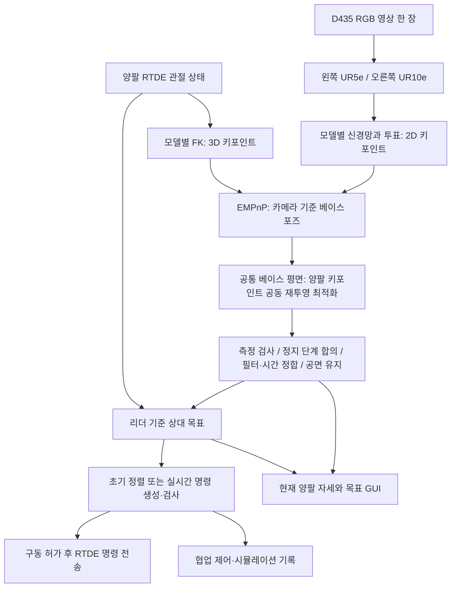

# UR5e와 UR10e 실시간 캘리브레이션 및 양팔 제어 구현 문서

기준일: 2026-11-02 · 대상: `ur_live_calibration` 작업 폴더의 현재 코드

이 시스템은 RealSense D435의 RGB 영상 한 장에서 UR5e와 UR10e의 베이스 자세를 추정하고, 관절 상태와 결합해 두 플랜지가 마주보도록 제어한다. 리더에 대한 상대 자세와 경로를 유지하는 **팔로워 제어**, 실제 초기 상태를 가져와 가상 관절로 실행하는 **시뮬레이션**을 제공한다. 제어 모드는 follow 하나이며 `--mode`를 생략해도 follow로 실행한다.

기본 배치는 **영상 왼쪽 UR5e, 오른쪽 UR10e**이며, 제어 역할은 **UR10e 리더, UR5e 팔로워**다. 현재 코드의 기본 플랜지 간격은 **20 cm**이며, 아래 실행 예시는 `--gap 0.30`으로 **30 cm**를 지정한다. 프로그램 실행만으로 로봇이 움직이지는 않는다. 실제 구동에는 `--execute`, 양팔의 실제 TCP 오프셋 지정, 사용자의 Arm 조작이 필요하다.

빠른 이동: [제어 순서](#5-초기-확보부터-실시간-추종까지) · [기본 설정](#7-주요-기본-설정) · [실행 방법](#8-실행-방법) · [GUI](#9-gui와-영상-조작) · [대기와 정지](#10-대기와-정지-상태-해석) · [코드 위치](#12-코드-위치)

`relative_kalman + feedforward`와 사용자가 지정한 실행 옵션에 대한 유도식·좌표계·적용 순서는 [수식 기반 제어 문서](FOLLOW_RELATIVE_KALMAN_FORMULATION.md)에 모았다. 포즈 추정기 내부를 제외한 제어 입력부터 명령·오차 기록까지 다룬다.

## 1. 제공 기능

| 기능 | 실행 진입점 | 동작 범위 |
| --- | --- | --- |
| UR5e 단독 추론 | `run_ur5e.sh` | 영상·관절값으로 포즈 추정과 표시 |
| UR10e 단독 추론 | `run_ur10e.sh` | 포즈 추정과 표시, 선택적 ROS 2 발행 |
| 같은 영상의 양팔 추론 | `run_dual.sh` | 좌우 영역별 모델로 같은 촬영 시점의 양팔 포즈 추정 |
| 리더–팔로워 제어 | `run_dual_control.sh --mode follow` | 팔로워만 구동해 리더 플랜지 기준 상대 목표 유지 |
| 추종 중 15 cm 접근 | ACTIVE GUI의 `Approach to 15 cm` | 리더 추종을 유지하며 상대 간격 감소, 접근만 일시정지·재개 |
| 상대 작업 경로·제어 방식 비교 | `run_cooperative.sh --mode follow` | hold·line·circle 경로, direct·predict·separated 방식 |
| 실제 초기 상태 기반 시뮬레이션 | `run_simulation.sh` | 초기 상태 취득 후 하드웨어 연결을 닫고 가상 제어 |
| 합성 조건 비교 | `python3 -m urcal.tools.simulate` | 동일한 합성 조건에서 세 제어 방식 비교·기록 |
| 상대 베이스 상태 추정 | `--base_motion_mode relative_kalman` | 촬영 시각 관절 보간·평면 상대 KF·정반 속도 보상 |
| 로그 분석 | `python3 -m urcal.tools.analyze_log` | 추정 오차, 진행률, 완료·정지·복구 기록 분석 |

`run_dual_control.sh --mode follow`와 `run_cooperative.sh --mode follow`는 같은 협업 제어 구현을 사용한다. `--path hold`는 리더 플랜지 기준 상대 자세를 유지하므로 리더가 움직이면 팔로워 목표도 함께 움직인다.

## 2. 전체 처리 구조



실제 제어 실행에서는 영상 추론, GUI, 제어 루프를 별도 프로세스로 나눈다. 제어 루프는 최신 측정과 RTDE 상태를 읽어 목표와 명령을 계산한다. 협업 제어의 JSONL 파일 쓰기는 별도 스레드가 담당한다.

초기 정렬은 RTDE의 `speedJ` 관절속도 명령, 정상 추종은 `speedL` TCP 속도 명령을 사용한다. 각 명령 전에 상태와 적용 한계를 확인하고, 구동 중 명령 갱신은 제어기 watchdog으로 감시한다.

카메라 설정은 기본 **640×480, 30 FPS**이며 제어 루프는 **25 Hz**다. 영상의 실제 추론 속도는 GPU·CPU 성능에 따라 달라진다. 양팔 모델은 같은 프레임에 대해 **순차적으로** 실행되며, 두 모델이 하나의 배치로 동시에 추론되는 구조는 아니다.

## 3. 영상 기반 캘리브레이션

### 3.1 양팔 구분과 포즈 추정

영상 너비의 `--split_ratio` 위치를 기준으로 왼쪽을 UR5e, 오른쪽을 UR10e로 처리한다. 기본값은 `0.5`다. 로봇 종류를 자동 인식하거나 경계를 넘은 로봇을 자동 재배정하지 않는다.

각 영역은 종횡비를 유지하면서 여백을 넣어 모델 입력 크기로 변환한다. 신경망은 로봇별 7개 키포인트의 segmentation과 방향 벡터장을 출력하고, 투표 모듈은 2D 위치·공분산·유효 여부를 계산한다. 이후 키포인트와 공분산을 원본 영상 좌표로 복원하고, RTDE 관절각으로 계산한 3D 키포인트와 함께 EMPnP에 넣는다.

신경망은 ResNet 기반 특징 추출과 Transformer 처리를 사용한다. 투표는 각도 구간별 픽셀 선택을 지원하며 GPU 연산을 활용한다. segmentation 창이 꺼져 있으면 표시용 확률 맵 생성과 CPU 복사를 생략한다.

카메라 내부 파라미터와 왜곡 계수는 D435에서 읽는다. 깊이 영상으로 로봇이나 바닥을 재구성하는 방식은 아니다. 두 추론기는 포즈 이력과 FK를 각각 관리한다.

양팔 추론과 제어에는 **공통 베이스 평면 구속조건**이 기본 적용된다. 두 물리 베이스의 +Z축이 같은 방향을 향하고, 두 원점의 공통 법선 방향 높이가 같다고 가정한다. 카메라 기준 Z값이나 Y값을 같게 만드는 조건이 아니며, 바닥면 자체의 카메라 기준 기울기·높이도 추정한다. 베이스 사이의 평면 내 XY 거리와 각 로봇의 수평 회전각은 고정하지 않는다.

각 EMPnP 결과를 초기값으로, 첫 베이스의 6자유도 자세와 다른 베이스의 상대 X/Y/yaw 3개, 총 **9개 변수**로 두 로봇의 원 검출 키포인트 재투영 오차를 함께 최소화한다. 공면성은 파라미터 구조로 강제하며, 임의의 큰 가중치를 준 벌점 항으로 근사하지 않는다. 픽셀 잔차에는 3 px 척도의 soft-L1을 적용하고 평가 횟수는 최대 40회다. 이전 포즈나 고정 베이스 간격은 이 공동 최적화의 목적함수에 넣지 않는다. 앞단 EMPnP의 이전 포즈 사용 설정은 별도로 적용된다.

최적화가 반복 한도에 도달해도 투영 초기값보다 비용이 낮고 유효한 앞쪽 깊이를 갖는 후보는 사용할 수 있다. 사용할 후보가 없으면 공통 법선·중간 높이로 기하 투영한 초기값을 사용하고 `fallback`을 기록한다. 초기값도 유효하지 않으면 해당 쌍을 실패 처리한다. 한 팔의 검출이 실패했을 때 다른 팔로 누락된 포즈를 만들어내지는 않는다.

제어의 시간 필터·복구 보간이 공면 조건을 깨뜨리지 않도록 최종 베이스 쌍도 같은 평면에 투영한다. 촬영 시각·품질값을 새로 만들지 않으며, 실제 로봇 속도에는 기존 엔코더·RTDE 값을 사용한다. 선택적 `velocity` 연구 모드의 시각 추정 속도는 공통 법선과 높이 조건에 맞는 성분으로 투영한다. 구속조건은 실제 정확도 보장이 아니며, 같은 평면이라는 설치 전제가 맞지 않으면 추정에 편향이 생긴다.

`--common_base_plane`은 명시적 활성화, `--no_common_base_plane`은 해제다. `run_dual.sh`, `run_dual_control.sh` 모두 새 실행은 기본 ON이다. 시작 로그의 `Common base plane: ON`과 영상의 `PnP+plane` 표시로 확인한다. 단일 로봇 추론에는 이 양팔 제약을 적용하지 않는다.

| 로봇 | 기본 체크포인트 | 키포인트 |
| --- | --- | --- |
| UR5e | `trained_models/v3m2a3/best.pt` | `ur5e_link0` ~ `ur5e_link6` |
| UR10e | `trained_models/ur10e_2/best.pt` | `ur10e_link0` ~ `ur10e_link6` |

추론 전용 실행은 유효 키포인트가 4개 미만인 로봇을 실패로 표시한다. 제어 실행은 기본적으로 **양쪽 모두 5개 이상**을 요구하며, 비정상 행렬·카메라 뒤쪽 점·지나치게 일직선으로 모인 검출점 등의 조건도 검사한다.

### 3.2 이전 포즈 보정과 제어 필터

영상 추정기의 이전 포즈 보정과 제어기의 상태 필터는 서로 다른 단계다.

| 설정 | 적용 위치 | 현재 기본값과 의미 |
| --- | --- | --- |
| EMPnP 이전 포즈 사용 | 영상 포즈 추정 | 추론 전용은 ON, 제어 실행은 OFF |
| `--ur5e_empnp_lambda` | 양팔 추론·제어의 UR5e 추정기 | `0.5`; 이전 포즈 사용 시 보정 강도 |
| `--ur10e_empnp_lambda` | 양팔 추론·제어의 UR10e 추정기 | `0.2`; 이전 포즈 사용 시 보정 강도 |
| `--filter_alpha` | 기존 pose/velocity 제어 상태 처리 | `0.2`; 큰 값일수록 새 측정에 강하게 반응 |
| `--base_motion_mode` | follow의 영상 상태 처리 | `pose`; 좌표만 갱신하고 영상 차분 속도를 제어에 사용하지 않음 |
| `--velocity_alpha` | `velocity` 모드의 베이스 속도 추정 | `0.3`; 속도 추정의 갱신 비율 |
| `--prediction_horizon` | `velocity` 모드의 predict·separated | 최대 `0.5 s`의 단기 예측 |

`run_dual.sh`에는 `--filter_alpha` 옵션이 없다. 추론 전용 실행에서 이전 포즈의 영향을 약하게 주려면 로봇별 lambda를 낮춘다. 다음은 두 lambda를 `0.01`로 지정하는 예다.

```bash
./run_dual.sh \
  --ur5e_ip 169.254.186.10 --ur10e_ip 169.254.186.6 \
  --ur5e_empnp_lambda 0.01 --ur10e_empnp_lambda 0.01 --show_seg
```

제어 실행에서는 이전 포즈 보정이 기본 OFF이므로, 같은 보정을 사용하려면 제어 명령에 다음 옵션을 함께 추가한다.

```text
--empnp_use_prev --ur5e_empnp_lambda 0.01 --ur10e_empnp_lambda 0.01
```

`--no_empnp_use_prev`는 이전 포즈 보정을 끈다. 제어의 `--filter_alpha 1.0`은 앞단 포즈 필터에 새 측정을 강하게 반영하는 설정이다. ACTIVE 상대 좌표 안정화(`--base_pose_*`), 속도 필터·예측·측정 검사를 모두 끄는 옵션은 아니다.

### 3.3 시간과 측정 품질

같은 이미지에서 나온 양팔 포즈는 같은 촬영 시각을 갖는다. 촬영 시각, 처리 결과를 받은 시각, 제어 시각을 구분하며, 결과가 늦게 도착했다고 촬영 시각을 새로 쓰지 않는다. 카메라 노출과 RTDE를 하드웨어로 동기화하지는 않으며, 제어 영상 작업자가 관절 샘플의 시간 차이를 검사한다.

평균·최대 재투영 오차는 계산·표시하지만, **오차 크기에 따른 거절은 미리보기와 실제 구동 모두 기본 OFF**다. `--check_reprojection`을 켜면 평균 5 px, 최대 8 px 상한을 적용한다. 이 스위치는 특징점 수, 행렬 유효성, 신선도, 급변 검사까지 끄지는 않는다.

## 4. 좌표계와 마주보기 목표

### 4.1 좌표와 단위

카메라 좌표는 **X 오른쪽, Y 아래쪽, Z 전방**이다. 코드와 CLI의 위치는 m, 관절각과 회전벡터는 rad를 사용한다.

`T_A_B`는 B 좌표의 점을 A 좌표로 변환하는 4×4 행렬이다. `C`는 카메라, `M`은 학습 모델 베이스, `B`는 UR 제어기 베이스, `F`는 플랜지를 뜻한다.

```text
추정 결과                  T_C_M
제어에 사용하는 베이스     T_C_B = T_C_M · T_M_B
TCP에서 플랜지 복원        T_B_F = T_B_TCP · inverse(T_F_TCP)
카메라 기준 플랜지         T_C_F = T_C_B · T_B_F
양팔 상대 베이스           T_B5_B10 = inverse(T_C_B5) · T_C_B10
```

현재 실행 기본값은 **UR10e 출력 보정 ON**이다. 제어에 넘길 때 곱하는 `T_M_B`에 Z축 180° 회전과 **로컬 Z 방향 +5 mm** 이동을 적용한다. 기존 명령으로 실행해도 적용되며, `--ur10e_output_correction`으로 명시할 수도 있다. `--no_ur10e_output_correction`을 지정하면 `T_M_B`를 항등행렬로 두고 원시 PnP 포즈를 제어 베이스 추정값으로 사용한다. UR5e 출력에는 어느 설정에서도 이 보정이 없다. 시작 로그의 `UR10e PnP output correction: ON/OFF`로 확인할 수 있다.

출력 설정과 명목 FK의 좌표 정의는 별개다. 학습 키포인트를 만드는 UR10e FK에는 기존 Z 180° / 5 mm 정의가 있으며, RTDE와 비교하는 명목 FK·Jacobian은 그 정의를 제거해 UR 제어기 기준으로 계산한다. 출력 보정을 끄는 것은 이 FK를 수정하거나 물리적인 자세를 같은 값으로 재표현하는 변경이 아니다. 따라서 기존 보정 ON에 비해 GUI의 UR10e 축·플랜지와 상대 목표 방향이 달라진다. 추론 영상과 ROS 포즈는 추가 출력 보정 없는 모델 좌표다. 양팔 영상의 포즈 값에는 활성화된 공면 추정이 반영된다.

공면 조건은 항상 **물리 베이스** 기준이다. UR10e 모델의 5 mm 오프셋을 고려해 물리 베이스로 변환하고 제약을 적용한 뒤 모델 좌표로 되돌리므로, 출력 보정을 중복으로 넣지 않는다. 출력 보정 OFF일 때도 이 과정은 유지한다. 이 경우 화면·제어가 사용하는 모델 원점과 물리 바닥면은 같은 원점이 아니므로, 출력 원점 둘의 높이가 정확히 같아야 한다는 뜻은 아니다.

새 시뮬레이션 초기 상태에는 `calibration.ur10e_output_correction`을 함께 저장한다. 저장 파일을 재생할 때는 기록된 설정을 사용하며, 이 필드가 없는 기존 v1 파일은 당시의 보정 ON으로 해석해 이전 좌표를 보존한다.

공면 설정은 `calibration.common_base_plane`에 저장하고 재생 시 그대로 따른다. 이 필드가 없는 기존 저장본은 공면 가정을 추가하지 않는 OFF로 읽는다. 새 상태 취득은 현재 실행의 설정을 사용한다.

`--ur5e_tcp_offset`, `--ur10e_tcp_offset`은 **플랜지에서 활성 TCP까지의 변환**이다. 프로그램은 이 설치값을 입력받아 플랜지 목표를 TCP 명령으로 변환한다. 0 오프셋은 실제 활성 TCP가 플랜지와 일치할 때 사용한다.

### 4.2 리더 기준 마주보기 목표

`--mode follow`에서는 리더의 관절 상태를 읽고 **팔로워만** 제어한다. 프로그램이 리더 팔의 동작이나 외부 정반의 구동을 생성하지는 않는다.

상대 목표는 리더 플랜지의 +Z 방향으로 `gap`만큼 떨어진 지점이며, 팔로워의 +Z를 반대로 향하게 한다. 두 플랜지는 +X를 공유하고 +Y와 +Z가 반대다. 즉, 목표에는 위치뿐 아니라 회전 방향도 포함된다.

```text
D = 리더 플랜지 기준 팔로워 목표 변환
D의 위치 = [0, 0, gap]
D의 회전 = diag(1, -1, -1)

팔로워 목표 TCP = inverse(T_C_Bf) · T_C_Bl · T_Bl_Fl · D · T_Ff_TCPf
```

양쪽 베이스의 카메라 기준 변환과 리더의 현재 플랜지 자세가 갱신되면 팔로워 베이스에서 본 목표도 갱신된다. `D` 자체를 현재 측정 상대 자세로 매번 덮어쓰지는 않는다.

## 5. 초기 확보부터 실시간 추종까지

아래 순서는 **`--initial_align`을 지정한 실제 제어 실행**에 해당한다. 이 옵션의 기본값은 OFF이며, 자동 초기 정렬을 원하면 명시해야 한다.

| 단계 | 처리 | 팔 동작 |
| --- | --- | --- |
| PREVIEW / WAIT | 영상·관절 수신, 초기 캘리브레이션과 목표 검사 | 구동하지 않음 |
| READY | 현재 상태에서 Arm 사전 조건 충족 | 사용자 Arm 대기 |
| PREFLIGHT | 제어 연결, native IK/FK, 관절·TCP 제한, 정렬 경로 검사 | 아직 움직이지 않음 |
| ALIGNING | Arm 시 확보한 좌표와 목표로 초기 정렬 | 검증된 관절속도 명령으로 접근 |
| ALIGNED / WAITING FOR LIVE CALIBRATION | 정지 확인 후 새 영상으로 좌표 재확보 | 정렬한 자세에서 영속도 명령 유지 |
| LIVE CALIBRATION READY | 새 좌표·목표 변화·첫 제어 명령 검증 완료 | 다음 제어 주기부터 전환 |
| ACTIVE | 최신 캘리브레이션과 관절 상태로 팔로워 추종 | 실시간 제어 |
| CALIBRATION OBSERVE | 일시적인 영상 실패·급변·만료 후 새 프레임 수집 | 리더 추종과 목표 보정을 끄고 제한된 감속 |
| CALIBRATION BLEND | 신선하고 일관된 좌표 확보 후 점진 반영 | 같은 세션에서 제한된 추종 재개 |
| RECOVERY WAIT / READY | 복구 가능한 실패 후 실제 정지 확인과 새 측정 수집 | 새 Arm 전까지 정지 |

### 5.1 Arm 전 캘리브레이션 확보

기본 `--calibration_acquisition consensus`는 최근 1초 후보에서 다음 조건을 만족하는 그룹을 찾는다.

- 서로 다른 촬영 프레임이 최소 3개다 (`--stable_frames`).
- 그룹이 최근 후보의 60% 이상을 차지한다. 실패한 후보도 전체 후보 수에는 포함된다.
- 그룹의 모든 프레임 쌍에서 양쪽 베이스 및 상대 베이스가 설정한 급변 범위 안에 있다. 기본 범위는 5 cm / 5°다.
- 가장 최근 정상 후보의 실제 촬영 시각이 신선도 제한 0.5초 안에 있다.

위치는 평균하고 회전은 SO(3) 평균으로 정지 초기값을 만든다. 단발성 이상치 때문에 모아 둔 정상 후보를 전부 지우지는 않는다. 반대로 오래된 정상 프레임을 새 시각으로 바꾸거나, 중복 영상으로 개수를 채우지는 않는다.

이 합의 방식은 **정지한 베이스를 가정하는 초기 정렬의 확보 단계**에 적용한다. 실시간 추종 중 베이스 이동을 항상 정지로 처리하는 필터가 아니다. `--calibration_acquisition consecutive`를 선택하면 연속 승인 프레임 방식으로 확보한다.

Arm 활성화에는 캘리브레이션 외에도 현재 로봇 상태, 목표 간격, 이동 영역 등의 사전 조건이 필요하다. READY여도 native IK와 전체 정렬 경로는 Arm 후 PREFLIGHT에서 최종 검사하므로 구동이 거절될 수 있다.

### 5.2 초기 정렬

Arm 시 베이스 좌표와 목표를 복사해 연결·경로 검사·정렬 동안 유지한다. 이 단계에서는 새 PnP 출력으로 정렬 목표를 흔들지 않는다. RTDE 관절·TCP 상태는 계속 읽고, 경로 이탈·실제 과속·리더 움직임·통신 상태를 검사한다.

정확한 목표를 native IK로 풀 수 없거나 적절한 해를 선택하기 어려우면 설정된 플랜지 허용 범위 안에서 도달 가능한 후보를 찾는다. 기본 조정 한도는 **위치 5 cm / 방향 10°**다. 선택한 후보도 native IK/FK, 관절·TCP 제한과 전체 정렬 경로 검사를 통과해야 한다. 경로 간섭을 무시하거나 임의의 우회 경로를 만들어 통과시키는 방식은 아니다.

정렬은 `speedJ` 관절속도 명령으로 수행한다. `--align_speed_scale 2`가 기본이며, 명령은 설정 속도 상한의 최대 90%를 사용하도록 여유를 둔다. 측정된 도착과 정지를 확인해야 정렬 완료로 넘어간다. 그동안 카메라·베이스·리더를 정지 상태로 유지해야 한다.

### 5.3 정렬 후 실시간 캘리브레이션 전환

정렬 완료 시각 **이후 촬영된 영상**을 새로 모은다. 정렬 전에 촬영되어 늦게 도착한 결과는 제외한다. 기본 합의 방식으로 새 좌표를 확보한다. 기본 `pose` 모드는 그 좌표에서 필터를 시작하고 새 영상으로 계속 갱신하되, 영상 차분을 속도로 만들지 않는다. `velocity` 모드는 초기 속도를 0으로 두고 가장 최근 원시 관측값을 별도로 보존해 평균 좌표와 새 영상 사이의 차이가 첫 순간의 가짜 속도가 되지 않게 한다.

전환 전에는 로봇 정지 상태, 정렬 전후 기준 목표 변화, 추종 조건과 첫 명령의 실행 가능성을 확인한다. 기준 목표 변화의 허용 범위는 기본 **15 cm / 15°**이며, 작업 허용 범위 5 cm / 10°와 별도다.

기본 `--handoff_wait hold`는 15초가 지나도 정렬한 자세를 유지하면서 검증 가능한 새 측정을 기다린다. 이때는 `speedJ` 영속도 명령과 watchdog을 유지하며 추종을 시작하지 않는다. `--handoff_wait stop`을 지정하면 `--handoff_timeout` 기한을 넘겼을 때 정지·복구 절차로 전환한다. 실제 로봇 이탈이나 통신 오류는 이 대기로 덮어두지 않는다.

리더를 움직이는 시점은 **LIVE CALIBRATION READY 이후**다. 초기 정렬 옵션 없이 실행하면 이 정렬·전환 단계가 없으므로, 현재 자세가 바로 추종을 시작할 수 있는 조건이어야 한다.

### 5.4 추종 중 일시적인 영상 실패와 좌표 재확보

기본 실제 제어의 `separated + pose + bounded` 조합에는 `--live_calibration_recovery`가 켜져 있다. 한 프레임이 급변·품질 검사에서 거절돼도 **기존 승인 영상의 실제 촬영 나이 0.5초와 최초 거절 후 0.3초**를 모두 만족하면 기존 좌표로 추종을 이어간다. 거절 프레임은 좌표나 촬영 시각을 갱신하지 않으며, 다음 정상 프레임 하나가 돌아오면 재안정화 대기 없이 복귀한다. 초기 확보·preflight에는 이 ACTIVE 유예를 적용하지 않는다.

유예나 촬영 나이가 먼저 만료되면 마지막 사용 좌표를 보관하고 감속·관측으로 전환한다. 감속 중에는 리더 추종·목표 오차 보정·상대 경로 진행을 끄고, 측정된 TCP·관절속도와 직전 명령을 기준으로 명령을 만든다. 복구 기한은 **최초 이상 감지부터 총 2초**이며, 앞의 짧은 유예 시간도 이 기한에 포함한다. 새 프레임이나 거절 반복으로 시간을 연장하지 않는다.

새 후보는 과거 승인 포즈로 돌아올 필요가 없다. 모든 후보의 실제 촬영 나이가 0.5초 이내여야 하며, 최소 `max(3, stable_frames)`개의 서로 다른 프레임과 0.15초 이상의 촬영 간격을 요구한다. 그룹 안의 모든 프레임 쌍은 양팔 및 상대 베이스의 급변 범위 안에 있어야 한다. 기존 승인 기준에 대한 교체 한도는 양팔 및 상대 베이스 각각 **15 cm / 15°**다. 중복·비정상·범위 밖 프레임으로 시간을 새로 쓰거나 관측 기한을 연장하지 않는다.

후보는 짧은 유예 중에도 수집한다. 이때 일관된 새 좌표를 확보하면 불필요한 제동을 끼워 넣지 않고 좌표 전환으로 연결한다. 실제 촬영·수신 시각을 보존해 상태 추정기를 갱신하며, ACTIVE 상대 좌표 안정화 상태는 유지한다. 복구 좌표 전환은 최소 0.5초, 베이스별 0.10 m/s·0.35 rad/s 이내이고, 그 입력인 상대 좌표에는 아래의 더 느린 안정화가 적용된다. 이 값들은 좌표 적용 속도이며 로봇 운동 속도가 아니다. 로봇 명령은 최신 엔코더·TCP 상태와 기존 운동·공간 검사로 제한하며, 같은 세션에서 추종을 이어가므로 새 Arm을 요구하지 않는다.

GUI에서 시작한 15 cm 접근은 단기 영상 거절 유예나 제동 없는 좌표 전환 중 진행률만 보류하며, 정상 좌표로 복귀하면 기존 요청을 자동으로 이어간다. 유예를 넘겨 실제 관측·제동에 들어갔거나 정지·복구한 경우와 사용자가 직접 Pause한 경우에는 일시정지를 유지하며 **Resume approach**가 필요하다. 자세한 버튼 동작은 6.5절과 같다.

관측 중에도 로봇 상태 신선도, 실제 과속, 현재·다음 자세의 이동 영역·간격·관절·형상, native 안전 검사와 watchdog은 유지한다. 마지막 승인 좌표만으로는 관측 공백 중의 실제 카메라·베이스 이동을 확정할 수 없다. 2초 안에 후보를 확보하지 못하거나 감속 명령을 검증할 수 없으면 기존 정지·복구 절차로 넘어가며 새 Arm이 필요하다. `--no_live_calibration_recovery`, `velocity` 또는 `strict` 연구 설정은 기존 촬영 나이·거절 유예 검사를 사용한다. 초기 정렬·handoff 및 초기 상태 취득 후 시뮬레이션의 절차와는 별도다.

## 6. 실시간 제어와 작업 경로

### 6.1 상태 처리와 비교 방식

| `--method` | 상태 처리 | 제어 구성 |
| --- | --- | --- |
| `direct` | 원시 포즈를 공통 촬영 시각에 맞춤; 현재 시각 외삽 없음 | 목표 오차 피드백과 명목 경로 진행 |
| `predict` | SE(3) 필터, 속도 추정, 제한된 단기 예측 | 목표 오차 피드백과 명목 경로 진행 |
| `separated` | predict와 같은 상태 처리 | 기본은 베이스 보상·리더 추종·피드백·상대 작업 분리; `--follow_law pose`로 변환 목표 오차만 사용 가능 |

위 표의 속도 추정·예측 비교는 `--base_motion_mode velocity`에서 적용한다. 기본값은 **`--method separated --base_motion_mode pose`**다. `pose` 모드에서는 영상 차분 속도·속도 외삽·영상 베이스 속도 제한을 적용하지 않는다. 앞단 포즈 필터는 `--filter_alpha`를 사용하며, `direct`는 이 앞단 필터를 생략한다. 어느 모드든 실제 촬영 시각과 측정 신선도 검사는 유지한다.

ACTIVE의 `pose` 모드에는 상대 베이스 좌표 안정화가 추가로 적용된다. 최신 5개 서로 다른 승인 영상(최대 1초 이내)의 상대 포즈 중 전체와 거리가 가장 작은 포즈인 medoid를 선택한다. 최소 3개가 있어야 갱신 목표를 바꾸고, 5 mm / 0.5° 이내의 작은 변화는 따라가지 않는다. 나머지 변화에는 0.35초 시정수와 20 mm/s·0.05 rad/s의 좌표 적용 상한을 둔다. 각 제어 시각에 한 번만 전진하며, 긴 관측 공백을 큰 한 번의 좌표 이동으로 소비하지 않는다. 양팔에 같은 카메라 강체 변환이 적용되면 상대 관계에서 상쇄된다. 필터가 새 측정의 촬영 시각을 만들거나 신선도를 연장하지 않는다.

이 안정화는 실제 관절 움직임의 리더 보상 경로와 독립적이며, 로봇 속도 상한이나 5 cm / 10° 목표 조정 허용량을 바꾸지 않는다. 지속되는 베이스 변화는 계속 반영하지만 빠른 외부 이동에는 지연이 생긴다. 오래 지속되는 PnP 편향을 실제 베이스 이동과 완벽히 구별하는 기능은 아니다. `--base_pose_window 0`으로 이 추가 좌표 안정화만 끌 수 있고, 나머지 수치는 `--base_pose_*`로 조정한다. 명시적 새 목표·정지 후 새 세션에서는 초기화하고, 같은 세션의 영상 재확보에서는 상태를 유지한다.

리더 운동 속도는 **측정 관절속도 `qd`와 Jacobian**으로 계산하며 기본 `--follow_law feedforward`에서 명령에 사용한다. 팔로워 속도·가속도 검사는 두 추종법 모두 **RTDE 측정 TCP 속도와 관절속도 및 직전 명령**을 기준으로 한다. 베이스나 카메라의 이동은 관절 엔코더만으로 관측할 수 없으므로 영상으로 좌표 관계를 계속 갱신한다. `--base_motion_mode pose`는 이 좌표 변화로 생긴 오차를 제한된 피드백으로 줄이며, 빠른 외부 베이스 이동에는 추종 지연이 생길 수 있다. 로그의 `base_velocity_used=false`와 영속도 값은 비전 속도 보상을 사용하지 않는다는 뜻이며, 실제 베이스가 정지했다고 측정한 것은 아니다.

### 6.2 보상과 작업 진행

기본 `--follow_law feedforward`의 separated 방식은 양쪽 베이스의 이동을 상쇄하는 성분, 리더 팔 운동을 따라가는 성분, 상대 오차 피드백, 작업 경로 진행 성분을 구분한다.

`--follow_law pose`는 매 주기에 변환한 팔로워 TCP 목표와 실제 TCP의 오차에서 하나의 속도 요구를 만든다. `A`, `B`가 카메라 기준 리더·팔로워 베이스 변환, `L`이 리더 베이스 기준 실제 플랜지, `D*`가 채택한 상대 목표, `O_f`가 팔로워의 플랜지→TCP 오프셋이면 목표는 `T_goal = inverse(B) @ A @ L @ D* @ O_f`다. TCP 위치 차이와 `Log(R_goal @ R_actual.T)` 회전 오차를 팔로워 베이스 좌표로 계산한다. `--kp_linear`, `--kp_angular`로 오차를 속도로 바꾸며 리더·베이스·상대 경로의 속도 항을 추가하지 않는다. line·circle·15 cm 접근은 목표 `D*`를 변화시키는 방식으로 반영한다.

두 추종법은 같은 데드밴드, `--feedback_speed`·`--feedback_angular_speed` 상한, 측정 속도 감쇠·제동 거리 제한과 최종 TCP·관절 속도·가속도·공간 검사를 사용한다. `pose` 추종법의 감쇠는 **팔로워의 실제 측정 속도**를 사용하며 리더나 경로 속도를 빼지 않는다. 초기 정렬·handoff·유효 측정 검사·관측 복구·경로 진행의 송신 성공 후 확정도 동일하다. 기본 보정 상한이 0.10 m/s인 만큼 추종법 선택만으로 1.0 m/s의 최종 TCP 상한까지 속도를 높이지 않는다. 움직이는 목표의 위치 오차로 따라잡으므로 기존 리더 속도 보상보다 빠르다고 보장하는 방식도 아니다.

`--follow_law pose`는 **`--method separated --base_motion_mode pose --leader_response bounded`** 조합에서 지원한다. 다른 조합은 설정 오류로 거절하며, 옵션 생략과 `--follow_law feedforward`는 기존 제어를 선택한다. GUI의 method/law 표시, 시작·ACTIVE 메시지와 JSONL의 `follow_law`로 사용 중인 추종법을 확인한다.

기본 `--leader_response bounded`와 작업 허용 범위를 사용하면 리더가 갑자기 움직이거나 멈출 때 팔로워가 제한된 가속·감속으로 따라간다. 따라서 리더의 속도 변화를 순간적으로 그대로 복제하지는 않는다. `strict`는 리더 보상을 즉시 충족하도록 요구하는 비교 설정이다.

추종 방향의 후보가 다음 자세 검사에서 거절되면, 직전 명령·측정 속도·두 값의 중간값에서 감속하는 후보도 검사한다. 실행 가능한 감속 후보가 있으면 `decelerating tracking; checking next frame`을 표시하며 상대 작업 진행을 멈추고 다음 제어 주기에서 다시 추종을 시도한다. 이 상태는 세션을 종료하거나 새 Arm을 요구하지 않는다. 감속 후보도 동일한 측정·명령 가속도, 다음 Jacobian, 간격·이동 영역 검사를 통과해야 하며, 모두 실패하면 정지 후 복구 대기로 전환한다.

작업 진행률 `u`는 0부터 1까지 관리하며, 성공적으로 명령을 보낸 뒤에만 갱신한다. 운동 여유나 추종 오차에 따라 상대 작업 진행을 늦추거나 멈출 수 있다. 기본 `pose` 모드는 추정 좌표의 변화를 실제 속도·가속도 범위 안에서 따라간다. `velocity` 연구 모드에서는 **필수 베이스 보상 자체가 실행 불가능하면 작업 진행만 줄여 해결하지 않고 정지한다.**

기본 `pose` + `bounded` 조합은 가상의 베이스 보상만 실행했을 때의 별도 경로 검사를 생략하고, 현재 로봇과 실제 후보 명령의 경로를 검사한다. 측정 과속, 충돌 여유, 관절 범위, 추종 오차, 이동 영역 및 통신 검사는 유지한다. 계획 실패인 `MotionInfeasible`도 `--fault_response preview`에서 실제 정지 확인 후 복구 화면을 유지하며, 새 Arm 없이 자동 재개하지 않는다.

`Pause task`는 상대 경로의 진행률을 멈춘다. 베이스·리더 추종까지 멈추는 로봇 정지 버튼은 아니다.

목표 가까이에서 계속 전진해 넘어가는 현상을 줄이기 위해 `--follow_damping_time 0.12`를 사용한다. 기본 `feedforward` 추종법은 리더의 측정 관절속도와 팔로워의 RTDE 속도로 상대 접근 속도를 계산하고, `pose` 추종법은 팔로워 RTDE 속도를 사용한다. 그 속도로 계속 움직일 때의 오차 감소를 미리 반영해 보정 속도를 줄인다. 기본 베이스 `pose` 모드에서는 영상에서 추정한 베이스 위치의 차분을 이 감쇠 속도로 사용하지 않는다. 관절 Jacobian과 설정한 가속도에서 감속 여유를 계산해 남은 거리에 맞춰 보정 속도를 제한한다. 보정값 자체에 걸려 있던 중복 가속도 제한은 제거하고 전체 명령의 가속도 제한으로 처리한다. `0`으로 지정하면 기존 보정 방식을 사용한다.

이 보정은 목표 접근에 적용하며 전체 명령은 기존 속도·가속도·관절·공간 검사에 계속 종속된다. 기본 `feedforward` 추종법은 리더가 이동하는 동안의 추종 성분과 정지한 목표의 잔여 오차 보정을 구분해, 리더 속도 자체를 불필요하게 줄이는 방식으로 적용하지 않는다.

시간 한도를 넘는 불필요한 정지를 줄이기 위해 캡슐 검사에서 로봇별 FK 중복 계산을 없애고 선분 간 거리를 배열로 계산한다. 일정한 상대 자세인 `--path hold`에서는 같은 속도·관절속도의 거절 후보를 경로 속도별로 다시 검사하지 않는다. 성공한 후보는 선택된 진행률에서 확인하고, 새 제어 주기에는 상태를 다시 읽어 검사한다. 물리 한계와 watchdog 시간은 이 최적화로 늘리지 않는다.

### 6.3 상대 작업 경로

| `--path` | 상대 경로 | 주요 옵션 |
| --- | --- | --- |
| `hold` | 리더 플랜지에 대한 일정한 상대 자세 유지 | `--gap 0.30` |
| `line` | 리더 플랜지 축 기준 위치·회전 변화 | `--path_delta x y z rx ry rz`, `--path_duration` |
| `circle` | 리더 플랜지 XY 평면에서 한 바퀴; 시작 방향 유지 | `--path_radius`, `--path_duration` |

line의 기본 변화는 `[0, 0, -0.05, 0, 0, 0]`, circle의 기본 반지름은 0.02 m, 명목 시간은 10초다. circle은 시작점을 유지하도록 위치 변화가 `[r(cosθ−1), r sinθ, 0]`인 원을 따른다. 양 경로는 시작·끝 속도 변화가 부드럽도록 진행 곡선을 사용한다. 제한에 의해 감속되면 실제 완료 시간은 명목 시간보다 길어진다.

### 6.4 근사 캘리브레이션을 전제로 한 목표 허용 범위

기본 `--target_tolerance_m 0.05 --target_tolerance_deg 10`은 정확한 한 포즈 대신 추정 플랜지 목표 주변의 허용 범위를 사용한다. 초기 정렬에서 명령 목표를 조정할 수 있고, 추종에서 허용 범위 안의 잔여 오차를 불필요하게 계속 줄이지 않을 수 있다.

명목 목표와 선택된 명령 목표는 구분해 표시·기록한다. bounded follow가 채택한 상대 오프셋도 명령 성공 시 정해 유지하며, 매번 현재 오차를 새 목표로 삼지는 않는다. 두 허용 값을 0으로 지정하면 정확한 목표 방식을 사용한다.

**5 cm / 10°는 캘리브레이션의 실측 정확도나 로봇의 안전 거리 보장이 아니다.** 화면과 제어에서 사용하는 추정 목표의 조정·허용 범위다.

### 6.5 추종을 유지하는 15 cm 접근

기본 **separated + pose + bounded** 추종에서 `--path hold`를 사용하면 GUI 버튼으로 접근을 시작할 수 있다. ACTIVE 상태에서 첫 추종 명령이 전송된 뒤 활성화하며, 초기 정렬을 사용하면 정렬과 새 캘리브레이션 전환을 먼저 마쳐야 한다. 미리보기·정렬·전환 대기·영상 관측·복구 대기에서는 새 접근을 시작하지 않는다. 일반 line·circle 작업을 실행 중이면 이 접근 경로로 바꾸지 않는다.

| 버튼·상태 | 동작 |
| --- | --- |
| `Approach to 15 cm` | 현재 명령 상대 자세에서 축 방향 접근 시작 |
| `Pause approach` | 접근 진행률과 목표 간격을 고정, 리더 추종은 계속 |
| `Resume approach` | 저장한 진행률에서 접근 재개 |
| `15 cm target set` | 명령 경로의 최종 간격 설정 완료; 실제 도착·접촉 판정은 아님 |

출발점은 **현재 명령 상대 포즈**이며, bounded 추종이 받아들인 목표 보정 오프셋도 포함한다. 그 오프셋을 새 경로의 시작점에 반영하므로 접근 시작 순간 목표를 원래 명목 포즈로 되돌리지 않는다. 이 시작점의 리더 플랜지 기준 **X/Y 위치와 상대 방향은 그대로 유지**하고, **Z 성분을 +0.15 m까지 감소**시킨다. 따라서 이 기능의 간격은 리더 플랜지 Z축에 대한 부호 있는 축 방향 거리이며, XY 편차가 있으면 두 원점의 직선거리와 다르다.

`--approach_speed 0.005`는 상대 목표의 **최고 접근 속도 5 mm/s**다. 시작·끝 속도와 가속도가 연속인 진행 곡선을 사용하며, 리더 추종·오차 보정이 합쳐진 실제 TCP 속도는 별도의 운동 한계를 따른다. 기존 관절·TCP 속도와 가속도, 이동 영역·간격·형상 검사를 통과한 명령에 대해서만 접근 진행률을 갱신한다. 제한에 따라 진행이 느려지거나 잠시 정지할 수 있다.

최고 속도와 평균 속도는 다르다. 30→15 cm의 명령 경로는 제한·대기 없이 약 56.25초가 걸리며, 처음 5초간 목표 변화는 약 0.92 mm다. 시작 직후 움직임이 작더라도 **Commanded gap**과 진행률이 변하는지 확인할 수 있다.

기본 `feedforward` 추종법에서 상대 경로 속도가 있는 주기는 추종 속도와 접근 속도를 합한 **최종 명령**으로 가속도 한계와 진행률을 계산한다. `pose` 추종법에서는 접근 속도를 별도로 더하지 않고 진행된 상대 목표의 오차로 만든 명령을 검사한다. 명령이 불가능하면 접근 진행률을 0으로 두고 기존 전체 속도에서 제한된 추종·감속을 수행한다. 이전 접근 속도가 남아 있는 상태에 새 접근 속도를 중복으로 더하지 않는다. 이때 명령 속도 이력과 실제 관절·TCP 속도 검사는 모두 유지한다.

Pause는 목표 진행을 동결한다. 실제 팔의 속도를 순간적으로 0으로 만드는 기능이 아니므로, 고정된 간격 목표의 잔여 오차 보정과 리더 추종은 가감속 한계 안에서 계속한다.

단기 영상 거부 유예 중에는 접근 진행률을 동결하고, 기존 좌표의 원래 유효 시간이 남아 있는 동안 일반 추종을 유지한다. 정상 프레임이 돌아오면 기존 접근 요청을 이어간다. 유예 시간 안에 새 좌표의 일관성이 검증되어 제동 없이 좌표를 혼합하는 경우도, 혼합 완료까지 진행률만 동결한 뒤 이어간다. GUI의 **waiting for coordinates (automatic continuation)**와 터미널의 **APPROACH waiting for coordinates (auto-continue)**는 이 일시적 보류를 뜻한다. 이 상태에서도 **Pause approach**로 직접 일시정지할 수 있다.

유예를 벗어나 영상 관측·제동에 들어가거나 실제 복구 정지가 발생하면 접근은 일시정지 상태를 유지한다. 이 경우 일반 추종이 복구되거나 사용자가 재Arm한 뒤에도 **Resume approach**를 눌러야 간격 감소를 재개한다. 사용자가 직접 누른 일시정지도 자동 해제하지 않는다. **Apply target**은 이전 접근 경로와 진행 상태를 초기화한다. 요청은 시작·일시정지·재개 동작을 구분하며, 오래되거나 중복된 GUI 요청으로 접근 상태를 뒤집지 않는다.

GUI의 **Commanded gap**, **Estimated gap**, **Approach progress**는 각각 명령의 축 방향 간격, 캘리브레이션·엔코더로 계산한 축 방향 간격, 명령 경로 진행률이다. 15 cm는 **플랜지 간격**이며 핀·홀 공구 끝의 접촉 거리나 삽입 깊이를 의미하지 않는다. 공구가 있으면 실제 활성 TCP 오프셋을 지정해야 한다. 현재 힘 제어·접촉/삽입 완료 감지·자동 후퇴는 제공하지 않는다.

### 6.6 상대 베이스 칼만 추정과 정반 보상

`--base_motion_mode relative_kalman`은 **마커리스 추정기를 변경하지 않고** 같은 영상에서 나온 공면 베이스 쌍과 협조제어 사이에 상태 추정기를 추가한다. 지원 조합은 `--method separated --follow_law feedforward --leader_response bounded --common_base_plane`이다. 기존 `pose`, `velocity` 모드와 기본값은 유지된다.

카메라 기준 리더 베이스를 A, 팔로워 베이스를 B라 하면 매 영상에서 먼저 `G = inverse(B) · A`를 만든다. UR10e 출력 보정과 물리 베이스 원점 변환을 고려해 **물리 팔로워 베이스 기준의 평면 XY/yaw**를 추정하고, 제어에 전달할 때 출력 좌표로 되돌린다. A와 B를 각각 차분하지 않으므로 같은 시점의 공통 카메라 강체 운동은 G에서 상쇄된다. 두 베이스의 실제 상대 운동만 이 채널에 들어간다.

상태와 정속 모델은 다음과 같다. 위치는 m, 각도는 rad, 시간은 s다.

```text
z = [x, y, yaw, vx, vy, yaw_rate]
z(k|k-1) = F(dt) z(k-1|k-1),   F(dt) = [[I, dt I], [0, I]]
P(k|k-1) = F P Fᵀ + Q(dt)
measurement = H z + noise,      H = [I, 0]
Q = [[dt⁴/4 Qa, dt³/2 Qa], [dt³/2 Qa, dt² Qa]]
```

Yaw 잔차는 ±π로 감싸며, 측정 공분산 R과 가속도 공분산 Qa는 JSON에서 지정한다. Joseph 형태의 공분산 갱신을 사용하고, 혁신 거리와 측정 급변을 검사한다. 실패한 관측은 마지막 정상 시각을 갱신하지 않는다. 새 모드에서는 A/B 개별 카메라 좌표 급변 검사를 생략하지만 **상대 변환 급변·유효성·신선도 검사와 복구 절차는 유지**한다.

영상용 FK에 사용하는 q는 별도 RTDE 수신 이력에서 촬영 시각 앞뒤 샘플을 보간한다. 반복된 로봇 타임스탬프를 새 샘플로 취급하지 않으며, 시간표와 q를 읽는 중 타임스탬프가 바뀐 샘플도 버린다. 보간 구간이 없거나 너무 넓으면 최신 q로 대체하지 않고 해당 영상을 거절한다. 기본 이력 수집은 100 Hz, 보간 대기는 최대 30 ms, 샘플 간격 상한은 50 ms다. 카메라·로봇 시계는 호스트 시간으로 근사 매핑하며 **하드웨어 동기화나 일정한 전송 지연의 제거를 보장하지 않는다**. 시간 매핑·보간 구간·불확실성은 `pose_diagnostics.joint_alignment`에 기록한다.

필터는 촬영 시각에만 갱신한다. 제어 호출은 상태를 변경하지 않고 현재까지 제한적으로 예측한다. 기본 예측 지평은 촬영 이후 0.35초이며 오래된 속도를 무한 외삽하지 않는다. 예측에 쓰는 운동 성분은 신호 대 불확실성, 누적 유효 관측 수에 따라 줄이고, 경과 시간에 따라 속도를 0으로 줄인다. 정지 잡음·급반전·관측 거절·재획득은 속도 억제 또는 초기화로 처리한다. 재확보 좌표를 보간하는 동안에도 이전 속도 보상을 재사용하지 않는다.

동일한 제어용 상대 변환 Gc로 목표와 현재 상대 자세를 모두 계산한다. L은 리더 베이스 기준 플랜지, F는 팔로워 베이스 기준 현재 플랜지다.

```text
T* = Gc · L · D*                    # 팔로워 플랜지 목표
S  = inverse(Gc · L) · F             # 현재 상대 플랜지 자세
Vbase_raw = [ pG_dot + omegaG × (pF - pG) ; omegaG ]
Vbase_bar = rate_limit(speed_limit(lambda · Vbase_raw))
Vreq = Vleader + Vbase_bar + Vfeedback + rho Vtask
```

여기서 G의 원점 속도와 각속도는 같은 예측 시점의 미분이다. **레버 암에는 목표 위치가 아닌 현재 pF를 사용**한다. TCP 오프셋이 있으면 `omega × (pTCP - pF)`를 더해 모든 항을 동일한 팔로워 베이스 TCP 속도로 옮긴다. 전체 T*를 차분하지 않으므로 리더 관절 운동과 15 cm 접근 운동이 정반 보상에 중복 포함되지 않는다.

`lambda`는 0~1의 관측 유효성·공분산·나이 신뢰도이며, 예측 단계에 이미 적용한 방향별 운동 신뢰도를 다시 곱하지 않는다. 실제 보상은 별도 속도·변화율 상한을 거친다. 감쇠에는 `Vmeasured - Vleader - Vbase_bar - rho_previous Vtask`를 사용하여 **동일하게 제한된 정반 보상값**을 뺀다. 보상 이력은 성공한 명령 전송 후에만 갱신되며 미리보기나 거절된 명령으로 진행되지 않는다.

정반 보상은 최종 명령의 조절 가능한 성분이다. 기존 `velocity` 모드의 필수 베이스 보상 경로와 달리, 정반 항 단독의 실행을 강제하지 않는다. 기존 최종 TCP·관절 속도와 가속도, 공간·형상, 실제 RTDE 상태 검사는 그대로 남는다. 따라서 로그의 `effective_tcp`는 별도 제한을 통과한 **요구 성분**이며 실제 전송 속도는 전체 제한 결과인 `twist`를 확인해야 한다.

새 모드에서는 `--filter_alpha`, `--velocity_alpha`, `--prediction_horizon`, `--base_pose_*`가 KF 반응성을 바꾸지 않는다. `--relative_kalman_config configs/relative_kalman.provisional.json`으로 지정한다. 현재 라벨 없는 로그에서는 정반 정지·이동의 실제 정답을 분리할 수 없어 관절 정지/운동 구간의 잡음·지연을 기준으로 **잠정 설정**을 제공한다. 실제 정반 움직임의 성능 보장이 아니며 분석·합성 시험·향후 라벨 지정 절차는 [튜닝 기록](RELATIVE_KALMAN_TUNING.md)에 있다.

## 7. 주요 기본 설정

### 7.1 측정과 실행 주기

| 옵션 | 기본값 | 적용 의미 |
| --- | --- | --- |
| `--camera_w`, `--camera_h`, `--fps` | 640, 480, 30 | 카메라 스트림 설정 |
| `--split_ratio` | 0.5 | 왼쪽 UR5e 영역 비율 |
| `--control_hz` | 25 Hz | 제어 주기 |
| `--watchdog_hz` | 5 Hz | 제어 프로그램 명령 갱신 감시 기준 |
| `--max_calibration_age` | 0.5 s | 정상 추종·새 후보에 필요한 영상 신선도; 기본 실제 추종에서 초과하면 감속 관측 시작 |
| `--max_joint_skew` | 0.08 s | 제어용 영상·관절 시간 정합 허용치 |
| `--max_robot_age` | 0.5 s | 로봇 상태 신선도 제한; 제어 루프 watchdog 기한은 별도 적용 |
| `--max_invalid_duration` | 0.3 s | ACTIVE의 단발 거절 유예; 기존 영상의 실제 나이 제한도 동시에 적용 |
| `--max_calibration_jump_m`, `--max_calibration_jump_deg` | 0.05 m, 5° | 베이스·상대 베이스 급변 검사 |
| `--live_calibration_recovery` | ON | 기본 실제 추종에서 감속·새 후보 관측·점진 좌표 전환 |
| `--calibration_recovery_timeout` | 2 s | 이상 감지부터 후보 확보까지 기한; 반복 거절로 연장하지 않음 |
| `--calibration_recovery_max_shift_m`, `--calibration_recovery_max_shift_deg` | 0.15 m, 15° | 관측 시작 기준에 대한 새 후보의 교체 범위 |
| `--calibration_blend_time` | 0.5 s | 확보한 새 좌표의 최소 전환 시간; 변화율 제한으로 더 길어질 수 있음 |
| `--base_motion_mode` | `pose` | `pose`: 좌표 보정, `velocity`: 기존 독립 속도 추정, `relative_kalman`: 공면 상대 상태 KF |
| `--relative_kalman_config` | 내장 잠정값 | 새 모드의 R/Q·예측 지평·신뢰도 설정 JSON; 경로를 지정하면 엄격하게 검증 |
| `--relative_base_speed`, `--relative_base_angular_speed` | 0.10 m/s, 0.15 rad/s | 새 모드의 플랜지 정반 보상 성분 상한; 전체 로봇 상한과 별도 |
| `--relative_base_accel`, `--relative_base_angular_accel` | 0.20 m/s², 0.30 rad/s² | 새 모드의 정반 보상 변화율 상한 |
| `--joint_history_hz`, `--joint_alignment_wait`, `--joint_alignment_max_gap` | 100 Hz, 0.03 s, 0.05 s | 새 모드의 영상 촬영 시각에 맞춘 관절 이력 보간 |
| `--ur10e_output_correction` | ON | UR10e PnP 출력에 로컬 Z 180° / +5 mm 변환; `--no_ur10e_output_correction`으로 해제 |
| `--common_base_plane` | ON | 물리 베이스의 공통 법선·바닥면 높이; `--no_common_base_plane`으로 해제 |
| `--base_pose_window` | 5 | pose 모드 ACTIVE 상대 좌표 대표값을 구할 영상 수; 홀수 3~31, 0은 추가 안정화 해제 |
| `--base_pose_smoothing_time` | 0.35 s | 상대 베이스 좌표 반영 시정수 |
| `--base_pose_deadband_m`, `--base_pose_deadband_deg` | 0.005 m, 0.5° | 작은 상대 좌표 흔들림을 따라가지 않는 범위; 목표 오차 deadband와 별도 |
| `--base_pose_update_speed`, `--base_pose_update_angular_speed` | 0.02 m/s, 0.05 rad/s | 추정 상대 좌표 적용 상한; 초과 측정을 속도 오류로 거절하지 않음 |
| `--max_base_speed`, `--max_base_angular_speed` | 0.25 m/s, 0.15 rad/s | `velocity` 모드에서만 베이스 속도 추정 검사 |
| `--stable_frames` | 3 | 초기 확보에 필요한 정상 프레임 수 |
| `--handoff_timeout`, `--handoff_wait` | 15 s, `hold` | 정렬 후 대기 알림 기준과 기한 초과 처리 |

합의 확보는 `--initial_align`의 정지 단계에 적용한다. 활성 추종에는 원시 포즈 급변·신선도 검사와 제한된 거절 유예를 적용한다. `velocity` 모드는 관측 속도 검사도 적용한다. 큰 포즈 오류나 오래된 측정이 지속되면 복구 대기나 정지가 발생할 수 있다.

### 7.2 목표와 운동 한계

| 옵션 | 기본값 | 적용 의미 |
| --- | --- | --- |
| `--follow_law` | `feedforward` | 기존 리더 운동 보상+오차 보정; `pose`는 변환 TCP 목표의 오차만으로 속도 생성 |
| `--gap` | 0.20 m | 플랜지 원점 사이 기준 간격; 실행 예시는 0.30 m 명시 |
| `--target_tolerance_m`, `--target_tolerance_deg` | 0.05 m, 10° | 추정 플랜지 목표의 작업 허용 범위 |
| `--max_target_m`, `--max_target_deg` | 0.20 m, 25° | 실시간 추종에서 허용하는 목표 오차 상한 |
| `--handoff_max_shift_m`, `--handoff_max_shift_deg` | 0.15 m, 15° | 정렬 후 새 좌표로 계산한 기준 목표 변화 상한 |
| `--max_travel` | 0.30 m | 최초 시작 TCP 위치를 중심으로 한 이동 영역의 반경; 동일 실행의 재정렬·재Arm에서도 기준점 유지 |
| `--min_gap` | 0.15 m | 최소 플랜지 원점 간 거리 |
| `--follow_max_speed` | 1.0 m/s | follow의 팔로워 TCP 선속도 상한 |
| `--max_speed` | 0.02 m/s | 초기 정렬 TCP 선속도 상한; 직접 지정하면 follow 선속도 기본값에도 적용 |
| `--max_angular_speed` | 0.1 rad/s | TCP 각속도 상한 |
| `--max_joint_speed` | 0.2 rad/s | 관절별 속도 상한 |
| `--max_accel`, `--max_angular_accel` | 0.1 m/s², 0.5 rad/s² | TCP 선·각가속도 상한 |
| `--max_joint_accel` | 0.75 rad/s² | 관절별 가속도 상한; 초기 정렬에도 적용 |
| `--feedback_speed`, `--feedback_angular_speed` | 0.10 m/s, 0.15 rad/s | 뒤처진 위치·방향 오차를 따라잡는 보정 성분의 상한; 전체 명령에는 위 운동 한계를 추가 적용 |
| `--kp_linear`, `--kp_angular` | 3, 3 (1/s) | 위치·방향 오차에 비례하는 보정 속도의 계수 |
| `--follow_damping_time` | 0.12 s | 실제 속도로 목표 접근 시 보정량을 줄이는 예측 시간; `feedforward`는 상대 속도, `pose`는 팔로워 속도 사용; 0은 이 보정을 끔 |
| `--approach_speed` | 0.005 m/s | GUI 15 cm 접근 경로의 상대 목표 최고 속도; 팔로워 전체 TCP 속도 상한과 별도 |
| `--align_speed_scale` | 2 | 초기 정렬 명령 속도 배율; 최대 90% 여유 적용 |
| `--min_singular_value` | 0.01 | nominal Jacobian의 특이 자세 검사 기준 |

팔로워의 1.0 m/s는 **코드의 선속도 상한**이다. 실제 속도는 관절·각속도·가속도, 자세, 목표 오차와 티치펜던트의 속도 배율에 함께 제한된다. `--max_speed`만 명시하면 그 값이 follow 선속도의 기본값으로도 사용된다. follow만 조정하려면 `--follow_max_speed`를 명시한다.

`--max_joint_accel`과 `--max_travel`을 직접 지정하면 기본값보다 우선한다. 실제 제어와 캡처 기반 시뮬레이션에 같은 값을 사용한다. 이동 범위 초과 로그에는 기준 TCP·검사 TCP·거리·한계가 포함된다. 명령 생성 실패 로그에는 측정 관절속도·직전 명령·제어 주기·적용 한계가 포함되며, 미래 관절 검사가 원인이면 해당 후보의 속도와 초과 종류도 기록한다.

기본 `feedforward` 추종법은 리더 관절 속도로 계산한 추종 성분에 위치·방향 오차 보정을 더한다. `pose` 추종법은 변환 TCP 목표의 오차 보정만 사용한다. 위치 보정은 deadband 밖 오차에 `--kp_linear`를 곱하고 `--feedback_speed`로 제한한다. 예를 들어 deadband를 제외한 위치 오차가 20 mm이면 감쇠·제동 제한 전 비례 요구는 60 mm/s다. 실제 명령은 가속도·관절속도 등의 제한을 거쳐 결정되므로 100 mm/s 보정 상한까지 즉시 가속하거나 항상 그 속도로 움직이지 않는다. 방향도 같은 방식이며 전체 각속도 상한 0.1 rad/s가 추가 적용된다. 이 네 옵션은 명시한 값이 기본값보다 우선하고, 실제 follow와 캡처 기반 follow 시뮬레이션에 동일하게 적용된다. 초기 정렬은 별도의 관절 제어를 사용한다.

실시간 추종의 목표 접근 감쇠 시간은 `--follow_damping_time`으로 조정한다. 다른 오차·운동 한계와 별도이며 초기 정렬에는 적용하지 않는다.

정렬 중 리더의 정지 판정은 TCP 0.01 m/s, 각속도 0.05 rad/s, 관절별 0.025 rad/s를 사용하며 각각 `--align_leader_max_speed`, `--align_leader_max_angular_speed`, `--align_leader_max_joint_speed`로 설정한다. 이 값은 **정렬 중 정지 확인 기준**이며 리더를 구동하는 속도 명령이 아니다. 리더 위치 이탈 3 mm, 방향 0.5°, 관절 이탈 0.01 rad 검사도 있다.

초기 정렬과 협업 제어의 기하 검사는 nominal 링크·공구 캡슐, 관절 범위, 선택적 TCP 영역·카메라 좌표 장애물을 사용한다. 설정 파일은 `--workspace_config`로 지정하며 [예시](../configs/workspace.example.json)를 제공한다. 전체 CAD 충돌 검사나 일반적인 장애물 우회 경로 계획을 제공하지는 않는다.

명목 UR 손목 끝은 플랜지 장착면 앞까지 둥근 캡슐 반구가 돌출하지 않도록, 말단 몸체 캡슐을 그 면에서 자른 형상으로 검사한다. 로컬 FK의 마지막 손목 선분과 플랜지 기준을 확인할 수 있는 모델에만 적용한다. 이렇게 해야 몸체 반경 6/8 cm와 여유 2 cm의 합 때문에 정면 플랜지 간격 15 cm가 형식적으로 차단되는 문제를 피할 수 있다. 몸체 반경·여유·공구 캡슐은 그대로이며, 절단 형상의 분리 거리를 보수적으로 증명할 수 없는 쌍은 기존 검사대로 거절한다. 장애물 검사는 기존 캡슐을 유지한다. 이는 명목 모델의 끝 형상 보정이며 실제 공구·설비의 충돌 인증은 아니다. 플랜지와 공구 장착면은 [UR 공식 기계 인터페이스 설명](https://www.universal-robots.com/manuals/EN/HTML/SW10_6/Content/prod-usr-man/hardware/arm_e-Series/UR5e/H_g5_sections/mechanical_interface_g5/securing_tool.htm)을 참고한다.

## 8. 실행 방법

아래 명령은 저장소 루트에서 실행한다. 예시 IP는 UR5e `169.254.186.10`, UR10e `169.254.186.6`이다.

### 8.1 실행 환경

Python 의존성은 `requirements.txt`에 있다. GUI에는 시스템 Tkinter가 필요하고, 실제 추론에는 D435 드라이버·접근 권한과 모델 가중치가 필요하다. CUDA를 사용하려면 설치된 PyTorch와 GPU 환경이 호환되어야 한다.

```bash
cd ~/ur_live_calibration
python3 -m pip install -r requirements.txt
```

스크립트는 `PYTHONPATH`와 `TORCH_HOME`을 저장소 기준으로 설정한다. 다른 Python 환경을 사용할 때는 `ROBOTPOSE_PYTHON`을 지정할 수 있다. 실제 구동에서는 제어 대상 로봇의 Remote Control과 RTDE 연결이 가능해야 한다.

### 8.2 영상 추론만 실행

```bash
./run_ur5e.sh --robot_ip 169.254.186.10 --show_seg
./run_ur10e.sh --robot_ip 169.254.186.6 --show_seg
```

양팔을 같은 영상으로 처리하려면 다음 명령을 사용한다.

```bash
./run_dual.sh \
  --ur5e_ip 169.254.186.10 \
  --ur10e_ip 169.254.186.6 \
  --show_seg
```

추론 전용 실행은 실제 관절값 6개를 `--joints` 또는 로봇별 `--ur5e_joints`, `--ur10e_joints`로 지정하는 방식도 지원한다. 고정 관절값은 실제 팔 자세가 바뀌지 않는 경우에 사용한다.

### 8.3 제어 화면과 초기 정렬 가능 여부 미리보기

```bash
./run_dual_control.sh --mode follow \
  --ur5e_ip 169.254.186.10 \
  --ur10e_ip 169.254.186.6 \
  --gap 0.30 --show_seg --initial_align
```

`--execute`가 없어 실제 운동 명령은 보내지 않는다. TCP 오프셋을 생략한 미리보기는 0으로 가정하므로, 공구가 있으면 실제 오프셋을 지정해야 화면의 플랜지 위치도 맞는다.

### 8.4 초기 정렬 후 실제 follow

다음 예시는 **양쪽 활성 TCP 오프셋이 모두 0인 설치**에 해당한다. 다른 설치에서는 각 여섯 숫자를 실제 `x y z rx ry rz` 값으로 바꾼다.

```bash
./run_dual_control.sh --mode follow \
  --ur5e_ip 169.254.186.10 \
  --ur10e_ip 169.254.186.6 \
  --ur5e_tcp_offset 0 0 0 0 0 0 \
  --ur10e_tcp_offset 0 0 0 0 0 0 \
  --gap 0.30 --show_seg --initial_align --execute
```

1. 영상의 좌우 배치와 GUI의 현재·목표 플랜지를 확인한다.
2. 목표를 수정했다면 **Apply target**으로 적용한다.
3. READY에서 **Arm motion**을 누른다.
4. PREFLIGHT와 ALIGNING, 정렬 후 캘리브레이션 대기 동안 리더와 베이스를 정지시킨다.
5. **LIVE CALIBRATION READY / ACTIVE**로 전환되면 리더 움직임을 따라가는지 확인한다.
6. 간격을 줄이려면 활성화된 **Approach to 15 cm**를 누른다. 이후 같은 버튼으로 접근만 일시정지·재개한다.

최신 승인 좌표를 바로 반영하면서 변환 목표 오차만으로 추종하려면 다음과 같이 실행한다. `--approach_speed 0.01`은 접근 버튼의 상대 목표 최고 속도 10 mm/s이며, 추종 속도 상한을 바꾸지 않는다.

```bash
./run_dual_control.sh --mode follow \
  --ur5e_ip 169.254.186.10 \
  --ur10e_ip 169.254.186.6 \
  --ur5e_tcp_offset 0 0 0 0 0 0 \
  --ur10e_tcp_offset 0 0 0 0 0 0 \
  --gap 0.30 --show_seg \
  --filter_alpha 1.0 --base_pose_window 0 \
  --initial_align --execute --approach_speed 0.01 \
  --follow_law pose
```

공면 상대 베이스 칼만 추정과 정반 속도 보상은 다음과 같이 실행한다. `--execute`를 빼면 미리보기다. 초기 정렬 후 새 관측으로 속도 추정이 준비되며, 자동으로 동작을 시작하지 않고 기존 Arm 절차를 사용한다.

```bash
./run_dual_control.sh --mode follow \
  --ur5e_ip 169.254.186.10 --ur10e_ip 169.254.186.6 \
  --ur5e_tcp_offset 0 0 0 0 0 0 \
  --ur10e_tcp_offset 0 0 0 0 0 0 \
  --gap 0.30 --show_seg \
  --base_motion_mode relative_kalman --follow_law feedforward \
  --relative_kalman_config configs/relative_kalman.provisional.json \
  --initial_align --execute --approach_speed 0.01
```

기존 저장 상태로 시뮬레이션할 때도 해당 파일의 `common_base_plane` 설정을 따른다. 공면 조건이 OFF인 저장본은 이 모드에서 거절되므로 공면 조건으로 취득한 초기 상태가 필요하다.

### 8.5 상대 경로와 비교 옵션

follow 실행 명령에 아래 옵션을 추가한다. GUI에서도 경로를 설정할 수 있다.

| 목적 | 추가 옵션 |
| --- | --- |
| 일정한 상대 자세 | `--path hold` |
| 리더 Z 방향으로 5 cm 접근 | `--path line --path_delta 0 0 -0.05 0 0 0 --path_duration 10` |
| 반지름 2 cm 원 경로 | `--path circle --path_radius 0.02 --path_duration 10` |
| 직접 포즈 비교 | `--method direct` |
| 필터·예측 연구 비교 | `--method predict --base_motion_mode velocity` |
| 영상 좌표 보정 + 엔코더 기반 추종 | `--method separated --base_motion_mode pose` (기본) |
| 변환 TCP 목표 오차만으로 추종 | `--follow_law pose` (기본 separated/pose/bounded 조합 필요) |
| 기존 리더 속도 보상 + 오차 보정 | `--follow_law feedforward` (기본) |
| 평면 상대 KF·정반 속도 보상 | `--method separated --follow_law feedforward --base_motion_mode relative_kalman` |
| 베이스 속도 보상·작업 분리 연구 비교 | `--method separated --base_motion_mode velocity` |
| 팔로워 선속도 상한 500 mm/s | `--follow_max_speed 0.5` |
| 목표 접근 감쇠 시간 | `--follow_damping_time 0.12` (기본), `0`은 기존 보정 방식 |
| GUI 15 cm 접근 최고 속도 | `--approach_speed 0.005` (기본 5 mm/s) |
| 정확한 목표 사용 | `--target_tolerance_m 0 --target_tolerance_deg 0` |

### 8.6 실제 초기 상태 기반 시뮬레이션

```bash
./run_simulation.sh --mode follow \
  --ur5e_ip 169.254.186.10 \
  --ur10e_ip 169.254.186.6 \
  --gap 0.30 --show_seg --sim_motion leader
```

관절각·TCP·캘리브레이션을 한 번 취득하고 카메라와 RTDE 수신 연결을 닫은 뒤 가상 제어를 시작한다. 실제 로봇 제어 스크립트나 속도·정지 명령을 전송하지 않는다. 최초 취득 제한시간은 `--sim_initial_timeout 60`이며, 공구가 있으면 실제 TCP 오프셋도 지정한다.

터미널에 출력되는 저장 파일은 다음과 같다.

```text
runs/simulation/<실행ID>/initial_state.json
runs/simulation/<실행ID>/simulation.jsonl
```

저장된 초기 상태로 다시 실행할 때는 출력된 실제 경로를 사용한다.

```bash
./run_simulation.sh --mode follow \
  --initial_state "runs/simulation/실행ID/initial_state.json" \
  --gap 0.30 --sim_motion leader
```

이 재실행에는 카메라·로봇 연결·추론 가중치가 필요 없다. `--execute`와 `--initial_align`은 시뮬레이션에 함께 사용하지 않는다. 시뮬레이터는 자체 초기 정렬을 제공한다.

| `--sim_motion` | 가상 외부 운동 |
| --- | --- |
| `none` | 베이스·리더 정지 |
| `leader` | 리더 관절의 왕복 운동 |
| `bases` | 베이스의 왕복 운동 |
| `both` | 리더와 베이스 운동 |

공면 설정이 켜진 저장 상태의 `bases`·`both`는 물리 UR5e 베이스의 +X 방향으로 두 베이스를 반대 방향 왕복시켜 공통 바닥면 안에서 움직인다. 공면 설정이 꺼진 저장 상태는 카메라 Y 방향을 사용한다.

GUI에서 **Apply target → Start simulation**으로 시작한다. **Pause simulation**은 가상 시간과 양팔을 함께 멈추고, **Reset simulation**은 취득한 초기 상태로 되돌린다. Reset은 적용한 목표를 유지한다.

가상 초기 정렬 이후 추종 중에는 실제 제어와 같은 15 cm 접근 버튼을 사용한다. **Pause approach**는 접근 경로 진행만 멈추므로 가상 리더 추종은 계속한다. **Pause simulation**으로 가상 시간을 멈춘 동안에는 접근 버튼도 비활성화한다.

이 시뮬레이터는 관절속도를 적분하는 기구학 모델이다. 초기 TCP에 맞춘 nominal FK 보정을 사용하며, 이후 베이스 센서는 노이즈·지연 없는 가상 값이다. 실제 PnP 흔들림, 마찰·관성·접촉, UR 서보 응답이나 네트워크 이상을 재현하는 동역학 시뮬레이터는 아니다.

### 8.7 장비 없는 화면 확인과 합성 비교

```bash
python3 -m urcal.tools.preview_gui --mode follow
```

화면 데모는 합성 자세를 표시하며 Arm을 활성화하지 않는다. 제어 방식의 합성 비교는 별도 도구로 실행한다.

```bash
python3 -m urcal.tools.simulate \
  --output_dir runs/synthetic-comparison \
  --scenario bases --duration 20 --seed 7
```

### 8.8 선택적 ROS 2 포즈 출력

ROS 2 환경이 준비된 경우 UR10e 단독 추론에서 포즈와 재투영 오차를 발행할 수 있다.

```bash
./run_ur10e.sh --robot_ip 169.254.186.6 --show_seg \
  --ros_pose_topic /robotpose/ur10e/pnp_pose \
  --ros_frame_id camera_color_optical_frame \
  --ros_reproj_topic /robotpose/ur10e/reproj_error
```

발행 포즈는 학습 모델 베이스의 카메라 기준 원시 추정값이며, 이 출력에는 Z 180° / 5 mm 후처리를 적용하지 않는다. 제어에서 이 값을 어떤 베이스 좌표로 해석하는지는 4장의 출력 보정 설정을 따른다. UR5e 단독 추론과 양팔 추론에는 이 ROS 발행 인터페이스가 없다.

## 9. GUI와 영상 조작

### 9.1 3D 화면의 의미

| 표시 | 의미 |
| --- | --- |
| 파란색 UR5e, 주황색 UR10e | 추정 베이스와 관절값으로 구성한 현재 링크 자세 |
| `NOW`와 축 | 현재 플랜지 위치·방향; X 빨강, Y 초록, Z 파랑 |
| 자홍색 `TARGET` | 명목 플랜지 목표 |
| 청록색 `COMMAND` | 선택한 정렬 목표 또는 다음 명령 목표 |
| 노란색 `EDIT` | 아직 적용하지 않은 입력값 미리보기 |
| 하단 오차 | 추정 좌표에서 계산한 위치 mm·회전 deg 오차 |
| 회색 `STALE / UNAVAILABLE` | 유효 상태가 끊겨 참고용으로 남긴 그림 |

왼쪽 드래그는 회전, 오른쪽 드래그는 이동, 휠은 확대·축소다. `3D`, `Camera XY`, `XZ`, `YZ`, `Fit all` 버튼으로 시점을 바꾼다.

**배경 격자는 장면 중심을 지나는 카메라 XY 기준면이며 실제 바닥·정반 검출 결과가 아니다.** 링크도 nominal FK 선분이므로 CAD 형상을 나타내지 않는다. 정렬 중에는 고정한 캘리브레이션과 최신 관절 상태를 구분해 표시한다.

GUI에서는 간격과 상대 경로를 편집한다. 간격과 경로의 위치 변화는 cm, 회전 변화는 **회전벡터 성분의 degree 표현**으로 입력한다. 현재 양팔 자세와 리더 기준 팔로워 목표를 함께 표시한다.

입력 편집만으로 목표나 로봇이 움직이지 않는다. Apply target으로 제출한 목표가 제어기 검사까지 통과해야 적용되며, 실제 동작 중에는 목표 편집이 잠긴다.

**Approach to 15 cm / Pause approach / Resume approach**는 활성 추종에서 사용하는 별도 동작이다. 버튼 아래에 명령 간격·추정 간격·접근 진행률과 대기 이유를 표시한다. 일반 작업의 **Pause task**와 달리 이 버튼에는 15 cm 접근 상태가 표시되며, 접근 중의 Pause task도 접근 진행을 멈춘다. 리더 추종까지 멈추려면 **STOP / Exit**를 사용한다.

실행 시 **Follower TCP position error** 창이 자동으로 열린다. 팔로워 제어기 베이스 좌표에서 위치 오차를 계산한다.

`[ex, ey, ez] = 1000 × (p_target_TCP − p_actual_TCP)`, `e_distance = sqrt(ex² + ey² + ez²)` [mm]

전체 거리 오차 하나의 현재 값과 최근 30초를 표시한다. 그래프는 흰 배경에 진한 파란 선 하나를 사용하고 세로축을 **0~50 mm로 고정**한다. 오차 크기에 따른 축 범위 자동 조절은 하지 않는다. 초기 정렬에서는 실제 선택된 IK 정렬 끝점, ACTIVE에서는 허용 보정(`tracking_offset`)을 포함한 채택 목표를 사용한다. 미리보기의 명목 목표는 별도 출처로 표시한다. 다음 주기의 예상 이동점과 비교하는 값이 아니며, 3D 화면의 명목 플랜지 목표 오차와 다를 수 있다. 현재 TCP는 RTDE에서 받고, 목표는 캘리브레이션 좌표로 변환하므로 외부 계측으로 확인한 절대 오차는 아니다. `feedforward`와 `pose` 모두 같은 위치 오차 정의를 사용한다.

데이터가 유효하지 않거나 상태·목표 출처가 바뀌는 구간은 선을 끊는다. 그래프만 닫으면 표시만 숨겨지며 제어는 계속된다. 메인 GUI의 **Position error graph**로 다시 열 수 있다. 그래프는 GUI 프로세스에서 최대 10 Hz로 그리며 제어 명령을 보내지 않는다. 시뮬레이션에서는 가상 시간을 사용하므로 Pause 중 시간축이 진행하지 않고 Reset 시 이력을 초기화한다.

오차 그래프의 **Start recording / Stop & save** 버튼으로 구간을 기록한다. 실시간 제어와 시뮬레이션의 데이터 생성 위치에서 CSV 기록기로 전달하므로 최신값만 남기는 GUI 큐나 화면의 10 Hz 그리기 때문에 표본을 버리지 않는다. 30초 화면 이력 제한과 별개로 종료 요청까지 스트리밍 저장한다. 시작·종료 경계는 생산자가 버튼 요청을 처리한 시점이며, GUI 클릭 시각을 소급해 만들지 않는다. 기록 요청은 Arm·목표 변경과 분리된 전용 경로로 전달된다.

파일은 `runs/error_segments/<UTC시각>-error-<고유값>.csv`에 배타적으로 생성하고 기존 파일을 덮어쓰지 않는다. 그래프에 저장 경로·경과 시간·행 수·저장 완료·실패 상태를 표시한다. 주요 열은 다음과 같다.

| 열 | 의미 |
| --- | --- |
| `record_type` | `start`, `sample`, `gap`, `event`, `stop`, `incomplete` 등 기록 종류 |
| `sample_at_s`, `sample_elapsed_s` | 원래 표본 시각과 해당 시계/에피소드 내 첫 표본 이후 시간 |
| `emitted_at_monotonic_s`, `recording_elapsed_wall_s` | 호스트 전달 시각과 기록 시작 이후 실제 경과 시간 |
| `position_error_mm` | 목표 TCP와 현재 TCP의 거리 오차; 화면의 50 mm 상한을 적용하지 않음 |
| `error_x_mm`, `error_y_mm`, `error_z_mm` | 팔로워 베이스 좌표의 부호 있는 목표−현재 성분 |
| `valid`, `reason` | 유효 여부와 관측 공백 사유; 무효 행의 오차 숫자는 빈 칸 |
| `clock`, `episode`, `segment`, `phase`, `target_source` | 실제/가상 시간, Reset 구분, 연속 구간, 제어 단계와 목표 출처 |

수치 분석에서는 `record_type=sample`, `valid=1` 행을 사용하고 `gap`·`event`를 가로질러 오차 선을 잇지 않는다. 반복된 표본 시각을 새 오차로 저장하지 않으며, 시뮬레이션 Pause는 가상 시간을 늘리지 않는다. Reset·시계·팔로워가 바뀌면 구간을 구분한다. 제어 정지 상태나 관측 실패를 0 mm 오차로 저장하지 않는다.

그래프를 숨겨도 기록은 계속되고, 프로그램 종료 시 진행 중인 구간을 마감한다. 파일 작업은 별도 스레드에서 처리한다. 기록 큐 초과나 쓰기 실패는 `error / INCOMPLETE`로 표시하고 로봇 동작을 중단시키지 않는다. 완료 `stop` 행이 없는 파일은 중단된 기록일 수 있으며, 정상 flush/close가 전원 차단까지의 내구성을 보장하는 것은 아니다.

### 9.2 영상 창 단축키

| 키·옵션 | 양팔 추론 전용 | 제어 실행 |
| --- | --- | --- |
| `s`, `--show_seg` | segmentation 전환·표시 시작 | 동일 |
| `k`, `--hide_keypoints` | 키포인트 점 표시 전환·숨김 시작 | 동일 |
| `q`, Esc | 종료 | 정지 후 종료 |
| Space | 별도 제어 기능 없음 | 정지 후 종료 |
| `a` | 없음 | Arm 요청 |
| `d` | 없음 | `--execute` 없는 미리보기에서 진단 영상·JSON 저장 |

양팔 추론·제어의 OpenCV 영상에는 키포인트 점·좌표축·segmentation을 표시한다. 상태 문구·키포인트 이름·FPS 문구와 가운데 흰 구분선은 그리지 않는다. **추론 영역은 계속 `--split_ratio`로 나누며, 경계선만 표시하지 않는다.** 추론 전용 실행은 FPS·PnP 방식·성공/실패·유효 키포인트 수를 약 1초마다 터미널에 요약한다. 제어 포함 실행은 측정 패킷에 기록한 원본 검출점의 평균·최대 재투영 오차, 촬영 후 경과 시간과 측정 거절 이유도 표시한다. EMPnP 내부 수정점 잔차를 원본 검출점의 재투영 오차로 표시하지 않는다. 단축키 안내는 시작할 때 한 번 출력하며, 제어기의 READY·ACTIVE·WAIT 등 기존 상태 출력도 유지한다.

GUI의 **STOP / Exit**, 메인 창 닫기, Ctrl+C도 종료 절차로 연결된다. 위치 오차 그래프 창만 닫으면 제어는 계속된다.

## 10. 대기와 정지 상태 해석

| 메시지·상황 | 의미와 다음 동작 |
| --- | --- |
| `no accepted calibration pair` | 양팔에 대해 사용할 수 있는 측정이 없음. 영상·특징점·RTDE 상태 확인 |
| `stationary calibration consensus ...` | 최근 후보에서 충분히 일치하는 그룹을 수집 중 |
| `calibration is stale` | 마지막 승인 영상의 실제 촬영 시각이 제한을 넘음 |
| `calibration jump`, `base ... speed exceeds limit` | 위치·회전 변화 또는 추정 속도가 검사 범위를 넘음 |
| `READY` | Arm을 요청할 수 있는 상태; 아직 실제 운동 중은 아님 |
| `PREFLIGHT` | native IK/FK와 정렬 경로 검사 중; 아직 운동 전 |
| `ARM BLOCKED` | 요청한 목표·IK·자세 조건 등에서 구동 전 거절. 목표나 배치를 검토하고 다시 Arm |
| `ALIGNED; WAITING FOR LIVE CALIBRATION` | 정렬은 끝났고 새 좌표·추종 시작 조건을 기다림. 아직 리더 이동 단계가 아님 |
| `ACTIVE ... bounded acceleration` | 리더의 요구 변화를 운동 한계 안에서 가속·감속하며 추종 중 |
| `CALIBRATION OBSERVE` | 감속하면서 새 프레임 확인 중; 일시 상태로 새 Arm 불필요 |
| `CALIBRATION REACQUIRED / BLEND` | 새 좌표를 서서히 반영하며 같은 세션에서 추종 재개 |
| `APPROACH: running / paused` | 15 cm 접근 진행·일시정지 상태; paused에서도 정상 리더 추종은 유지 |
| `15 cm target set` | 접근 명령 목표의 설정 완료; 실제 접촉·삽입 완료 신호가 아님 |
| `live calibration observation exceeded` | 관측 기한 내 일관된 새 측정 확보 실패; 정지 후 새 Arm 필요 |
| `RECOVERY WAIT` | 복구 가능한 실패로 운동을 멈춘 뒤 정지·새 측정을 확인 중 |
| `RECOVERY READY` | 현재 자세·목표를 검토하고 새 Arm을 눌러야 함 |
| `control connection/program stopped` 등 상태 오류 | 제어 연결·프로그램 상태 문제로 중단. 자동 재시작하지 않음 |

기본 `--fault_response preview`는 분류된 측정·계획 실패에서 운동을 멈추고 미리보기를 유지한다. 실제 정지 확인과 새 측정을 거쳐 사용자가 다시 Arm해야 움직인다. `--fault_response exit`는 해당 실패에서도 실행을 종료한다.

실제 과속, 통신·상태 이상, 제어 주기 초과, 정지 명령 실패, 사용자 Stop은 별도 중단 조건이다. 로봇팔의 정지는 외부에서 움직이는 정반·테이블의 정지를 의미하지 않는다.

## 11. 로그와 검증 범위

### 11.1 저장되는 데이터

협업 follow는 기본적으로 `runs/<UTC시각>-<method>-<고유값>.jsonl`을 생성한다. `--log`로 경로를 지정할 수 있으며 기존 파일을 덮어쓰지 않는다. 주요 기록은 다음과 같다.

- 실행 설정(`follow_law` 포함), 원시 포즈, 촬영·수신 시각과 키포인트 품질.
- 공동 평면 추정 전 EMPnP 포즈·최종 출력 포즈, 공면 보정 전후 높이·법선 차이, 원 검출 재투영 오차, 보정량·최적화 상태·처리 시간. `pose_diagnostics.common_base_plane`에 기록한다.
- Arm 시 베이스·관절·TCP·목표, IK 후보와 정렬 진행, 정렬 후 좌표 전환.
- 관절·TCP 상태, 상대 목표·추정 오차, 보상·피드백·작업 성분.
- `relative_kalman` 모드의 Gc·평면 상태·공분산·혁신·신뢰도·예측 시간, 원시/요구/제한된 정반 보상, 촬영 시각 관절 보간 진단. 설정 JSON의 최종 수치도 시작 로그에 저장한다.
- 목표 접근 감쇠 시간, 측정 상대 TCP 속도, 선형·회전 감속 예산.
- 영상 관측 시작·후보 수·재확보·좌표 전환, 보관 좌표와 실제 촬영 나이, 전송 직전 만료로 폐기한 명령.
- 15 cm 접근 요청·거절, 시작·일시정지·재개 상태, 명령 간격·추정 간격과 진행률.
- 명령 전송 여부, 진행률, 속도 제한 상태, 복구와 최종 중단 원인.

상태 취득 시뮬레이션은 초기 상태 JSON과 실행 JSONL을 저장한다. 양팔 추론 전용은 포즈 파일을 자동 저장하지 않는다.

### 11.2 분석

```bash
python3 -m urcal.tools.analyze_log runs/실험.jsonl
python3 -m urcal.tools.analyze_log runs/실험.jsonl \
  --reference independent_reference.jsonl --output report.json
```

독립 기준 JSONL은 각 줄에 `at`과 `relative_pose`를 담는다. `at`은 제어 로그와 정합한 단조 시계 시각이며, `relative_pose`는 같은 프레임 정의의 4×4 행렬 또는 pose6다. 외부 측정기의 시계·좌표 정합을 분석기가 자동 해결하지는 않는다.

**영상 캘리브레이션으로 계산한 추정 오차와 외부 계측으로 확인한 실제 오차는 구분한다.** GUI에서 오차가 작다는 사실만으로 실제 두 플랜지의 위치·회전 정확도가 검증되지는 않는다.

### 11.3 테스트와 구현 한계

`tests/`에는 좌표변환·FK·Jacobian·목표 생성, 시간 정합, 측정 검사, 합의 확보, 초기 정렬, 속도·가속도 제한, 모의 RTDE 실행 순서, 정지·복구, GUI 상태, 시뮬레이션 및 로그 분석 검사가 있다. 기록된 PnP·로봇 상태를 사용하는 오프라인 회귀 자료도 포함한다.

추종 감쇠는 명령 지연과 가속도 제한을 갖는 독립 가상 모델에서 전체 제어기와 함께 검사한다. 목표 초과·정착 시간, 이동하는 리더의 속도 보상, 긴 TCP 오프셋의 회전, 영상 좌표 변화와 실제 속도의 구분을 확인한다. 계산 최적화는 기록된 시간 초과 직전 상태에서 명령의 동등성과 형상 검사 횟수를 검증하며, 실행 시간 자체를 테스트 통과 조건으로 쓰지 않는다.

활성 영상 관측은 일시 실패·지속적인 새 좌표·교대하는 이상치·입력 단절, 원래 촬영 시각 보존, 제한된 감속·좌표 전환, 기한 직전 명령 검사와 기한 후 수동 재Arm을 가상 IO로 확인한다. 실제 실행 로그의 거절 구간도 검사하지만, 이전 프로그램이 정지하면서 기록하지 못한 영상은 복원하지 않으므로 해당 실행 전체가 새 코드에서 복구된다고 단정하지 않는다. 실제 로봇으로 이번 변경을 구동 검증하지는 않았다.

`calibration_depth_switching_20261031.json`에는 실제 34초 구간의 추정 371개, 제어 시점 847개, 직전 handoff 영상 3개를 보존했다. 같은 영상 순서로 좌표 처리·유예·관측을 재생하면 관측·제동 진입은 16→8회, 목표 위치 총변화량은 1,249→405 mm, 제어 주기별 변화의 95백분위는 5.19→0.95 mm다. 실제 리더는 거의 정지했던 구간이며, 비교에는 동일한 고정 리더 TCP를 사용한다. 이는 캘리브레이션이 제어 목표를 흔드는 정도의 비교다. 새 명령으로 달라진 팔 자세가 다시 영상에 미치는 영향까지 재현한 폐루프 결과나 실제 로봇 성능 보장은 아니다. 별도 가상 검증으로 지속적인 베이스 이동, 공통 카메라 이동의 상쇄, 중복 호출, 촬영 나이 보존도 확인한다.

15 cm 접근은 현재 명령에서 연속적으로 시작하는지, 일시정지 중에도 리더 엔코더 움직임을 추종하는지, 재개·중복/만료 요청·영상 관측 후 수동 재개가 같은 제어 세션에서 동작하는지를 모의 IO와 시뮬레이션으로 검사한다. 명목 UR 관절 모델과 실제 코드의 형상 검사로 기본 5 mm/s의 30→15 cm 전체 접근 및 완료 후 리더 추종을 검사한다. 작업 속도의 중복 누적, 실측 지연·리더 반전, 말단 형상 보정과 공구 충돌 거절도 회귀 검사에 포함한다. 목표 설정 완료를 물리적 삽입 성공으로 검증하는 테스트는 아니다.

공통 베이스 평면은 기울어진 카메라, 서로 다른 yaw, UR10e 5 mm 좌표 변환, 잡음이 있는 원 검출점, 한 팔 실패, 최적화 실패와 반복 한도를 검사한다. 필터·좌표 보간 후에도 평면이 유지되는지, 원 시각·검출점이 보존되는지, 저장·재생에 설정이 유지되는지 확인한다. 영상 잔차 감소나 수학적 공면성이 실제 장비의 위치 정확도를 증명하지는 않는다.

```bash
PYTHONPATH=tests:. python3 -B -m unittest discover -s tests -p 'test_*.py'
sha256sum --check SHA256SUMS
```

2026-11-02 CSV 구간 기록까지 포함한 전체 1,205개 중 1,202개 통과, CUDA 환경이 필요한 3개는 제외했다. CSV 기록·GUI·런타임 관련 223개도 통과했다. 최종 변경 후 KF·관절 보간·영상·제어 통합·튜닝의 관련 90개를 다시 검사해 모두 통과했다. 제어 통합은 같은 Gc의 목표/현재 자세, 회전 좌표와 TCP 오프셋, 제한 후 감쇠, 정반·리더·접근 성분 분리, 관측 실패·재획득·정렬 전환·15 cm 접근과 기존 전체 운동 상한을 모의 장비로 확인한다. 합성 정지/이동/반전 성능과 실제 로그 재생의 범위는 튜닝 기록에 따로 명시했다.

이 검사는 수학·코드 경로·모의 장비 동작을 확인한다. 현재 시스템은 비접촉 상대 자세·경로 제어를 위한 구현이며, 힘 제어, 물체 인계의 접촉 제어, 자동 로봇 식별, 가림 복원, 실제 바닥 인식, 완전한 충돌 회피를 제공하지 않는다. 캘리브레이션 정확도와 실제 추종 성능은 장비 배치·영상·공구·속도 조건에서 별도로 측정해야 한다.

## 12. 코드 위치

| 위치 | 담당 내용 |
| --- | --- |
| [inference](../urcal/inference/) | 단일·양팔 추론, 신경망, 투표, EMPnP, 영상 표시 |
| [inference/coplanar.py](../urcal/inference/coplanar.py) | 물리 베이스 공면 투영과 9자유도 공동 키포인트 최적화 |
| [cooperative/base_plane.py](../urcal/cooperative/base_plane.py) | 필터·보간 뒤 공면 유지, 출력 좌표와 상대 상태 갱신 |
| [control/runtime.py](../urcal/control/runtime.py) | 공통 CLI, RTDE 수신·명령 세션, follow 진입점 |
| [control/vision.py](../urcal/control/vision.py) | 제어용 별도 영상 프로세스, 시간·품질 기록 |
| [control/error_recording.py](../urcal/control/error_recording.py) | 구간 선택 오차 CSV·전체 생산 표본·비동기 파일 저장 |
| [control/joint_history.py](../urcal/control/joint_history.py) | 촬영 시각 관절 이력·시계 매핑·보간과 거절 진단 |
| [control/acquisition.py](../urcal/control/acquisition.py) | 정지 단계의 최근 프레임 합의와 초기 상태 구성 |
| [control/startup.py](../urcal/control/startup.py), [alignment.py](../urcal/control/alignment.py) | native IK/FK·경로 검사와 실제 초기 정렬 |
| [control/approximation.py](../urcal/control/approximation.py) | 허용 범위 안의 정렬 목표 후보 탐색 |
| [control/handoff.py](../urcal/control/handoff.py) | 정렬 완료 후 새 캘리브레이션 확보·전환 대기 |
| [control/live_calibration.py](../urcal/control/live_calibration.py) | 활성 관측 중 독립된 신선한 캘리브레이션 후보 수집 |
| [cooperative/calibration.py](../urcal/cooperative/calibration.py), [calibration_braking.py](../urcal/cooperative/calibration_braking.py) | 관측 기한·좌표 전환과 보관 좌표 기반 감속 |
| [cooperative/pose_smoothing.py](../urcal/cooperative/pose_smoothing.py) | ACTIVE 상대 베이스 좌표의 시간 대표값·노이즈 허용범위·점진 반영 |
| [control/policy.py](../urcal/control/policy.py), [recovery.py](../urcal/control/recovery.py) | 측정 승인·운동 한계, 활성 유예와 정지 후 복구 |
| [control/geometry.py](../urcal/control/geometry.py) | 모델·제어기 좌표, 플랜지·TCP, 마주보기 목표 |
| [control/gui.py](../urcal/control/gui.py), [scene_view.py](../urcal/control/scene_view.py) | 목표 편집·버튼, 현재 자세와 목표의 3D 표시 |
| [cooperative/runtime.py](../urcal/cooperative/runtime.py) | follow 실행 상태와 기록, 명령 전송 후 진행 확정 |
| [cooperative/state.py](../urcal/cooperative/state.py) | 시간 정합, SE(3) 필터·속도·예측 |
| [cooperative/relative_kalman.py](../urcal/cooperative/relative_kalman.py) | 같은 촬영 쌍의 평면 상대 KF·신뢰도·제한된 예측 |
| [cooperative/base_compensation.py](../urcal/cooperative/base_compensation.py) | 현재 플랜지에서의 정반 보상과 독립 속도·변화율 제한 |
| [cooperative/controller.py](../urcal/cooperative/controller.py), [follow.py](../urcal/cooperative/follow.py) | 상대 목표, 베이스 보상, bounded 추종과 명령 검사 |
| [cooperative/feedback.py](../urcal/cooperative/feedback.py) | 측정 상대 속도와 감속 여유를 사용한 목표 접근 감쇠 |
| [cooperative/approach.py](../urcal/cooperative/approach.py) | 현재 명령에서 15 cm까지의 축 방향 접근 경로·일시정지·재개 상태 |
| [cooperative/task.py](../urcal/cooperative/task.py), [kinematics.py](../urcal/cooperative/kinematics.py) | 상대 경로·진행률, nominal 기구학·작업공간 검사 |
| [simulation](../urcal/simulation/) | 초기 상태 취득·저장, 가상 관절 모델·초기 정렬·GUI 실행 |
| [tools](../urcal/tools/) | 합성 비교, 로그 분석, GUI 데모 |
| [tools/tune_relative_kalman.py](../urcal/tools/tune_relative_kalman.py) | 라벨 구간·잠정 잡음 설정·실제 로그 재생·합성 검증 |
| [relative_kalman.provisional.json](../configs/relative_kalman.provisional.json), [튜닝 기록](RELATIVE_KALMAN_TUNING.md) | 새 모드의 잠정 수치와 선정 근거·재현 방법 |
| [tests](../tests/) | 단위·회귀·모의 실행 검사와 기록 fixture |
| [Research_Implementation_Plan.txt](Research_Implementation_Plan.txt) | 연구 목표와 평가 기준 |
| [MANIFEST.json](../MANIFEST.json), [SHA256SUMS](../SHA256SUMS) | 파일 출처·메타데이터와 무결성 목록 |
