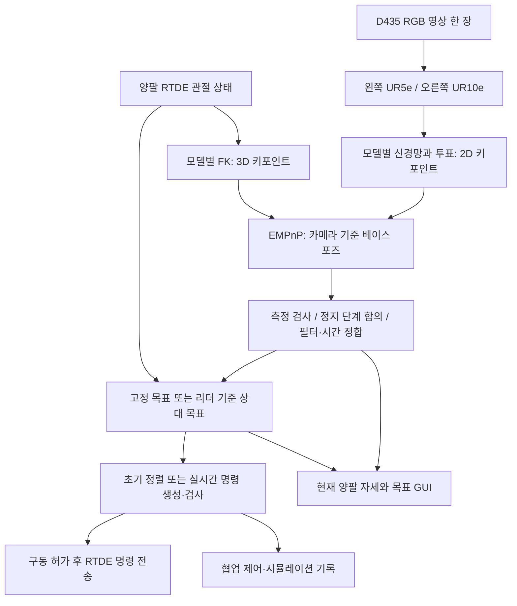

# UR5e와 UR10e 실시간 캘리브레이션 및 양팔 제어 구현 문서

기준일: 2026-10-22 · 대상: `ur_live_calibration` 작업 폴더의 현재 코드

이 시스템은 RealSense D435의 RGB 영상 한 장에서 UR5e와 UR10e의 베이스 자세를 추정하고, 관절 상태와 결합해 두 플랜지가 마주보도록 제어한다. 카메라 좌표계의 고정 목표를 유지하는 **hold**, 리더에 대한 상대 자세와 경로를 유지하는 **follow**, 실제 초기 상태를 가져와 가상 관절로 실행하는 **시뮬레이션**을 제공한다.

기본 배치는 **영상 왼쪽 UR5e, 오른쪽 UR10e**이며, 제어 역할은 **UR10e 리더, UR5e 팔로워**, 플랜지 간 목표 거리는 **30 cm**다. 프로그램 실행만으로 로봇이 움직이지는 않는다. 실제 구동에는 `--execute`, 양팔의 실제 TCP 오프셋 지정, 사용자의 Arm 조작이 필요하다.

빠른 이동: [제어 순서](#5-초기-확보부터-실시간-추종까지) · [기본 설정](#7-주요-기본-설정) · [실행 방법](#8-실행-방법) · [GUI](#9-gui와-영상-조작) · [대기와 정지](#10-대기와-정지-상태-해석) · [코드 위치](#12-코드-위치)

## 1. 제공 기능

| 기능 | 실행 진입점 | 동작 범위 |
| --- | --- | --- |
| UR5e 단독 추론 | `run_ur5e.sh` | 영상·관절값으로 포즈 추정과 표시 |
| UR10e 단독 추론 | `run_ur10e.sh` | 포즈 추정과 표시, 선택적 ROS 2 발행 |
| 같은 영상의 양팔 추론 | `run_dual.sh` | 좌우 영역별 모델로 같은 촬영 시점의 양팔 포즈 추정 |
| 카메라 기준 고정 목표 | `run_dual_control.sh --mode hold` | 양팔의 플랜지를 지정한 위치·방향에 유지 |
| 리더–팔로워 제어 | `run_dual_control.sh --mode follow` | 팔로워만 구동해 리더 플랜지 기준 상대 목표 유지 |
| 상대 작업 경로·제어 방식 비교 | `run_cooperative.sh --mode follow` | hold·line·circle 경로, direct·predict·separated 방식 |
| 실제 초기 상태 기반 시뮬레이션 | `run_simulation.sh --mode hold` 또는 `--mode follow` | 초기 상태 취득 후 하드웨어 연결을 닫고 가상 제어 |
| 합성 조건 비교 | `python3 -m urcal.tools.simulate` | 동일한 합성 조건에서 세 제어 방식 비교·기록 |
| 로그 분석 | `python3 -m urcal.tools.analyze_log` | 추정 오차, 진행률, 완료·정지·복구 기록 분석 |

`run_dual_control.sh --mode follow`와 `run_cooperative.sh --mode follow`는 같은 협업 제어 구현을 사용한다. `--mode hold`와 `--mode follow --path hold`는 목표를 고정하는 좌표계가 서로 다르다.

## 2. 전체 처리 구조



실제 제어 실행에서는 영상 추론, GUI, 제어 루프를 별도 프로세스로 나눈다. 제어 루프는 최신 측정과 RTDE 상태를 읽어 목표와 명령을 계산한다. 협업 제어의 JSONL 파일 쓰기는 별도 스레드가 담당한다.

초기 정렬은 RTDE의 `speedJ` 관절속도 명령, 정상 hold/follow는 `speedL` TCP 속도 명령을 사용한다. 각 명령 전에 상태와 적용 한계를 확인하고, 구동 중 명령 갱신은 제어기 watchdog으로 감시한다.

카메라 설정은 기본 **640×480, 30 FPS**이며 제어 루프는 **25 Hz**다. 영상의 실제 추론 속도는 GPU·CPU 성능에 따라 달라진다. 양팔 모델은 같은 프레임에 대해 **순차적으로** 실행되며, 두 모델이 하나의 배치로 동시에 추론되는 구조는 아니다.

## 3. 영상 기반 캘리브레이션

### 3.1 양팔 구분과 포즈 추정

영상 너비의 `--split_ratio` 위치를 기준으로 왼쪽을 UR5e, 오른쪽을 UR10e로 처리한다. 기본값은 `0.5`다. 로봇 종류를 자동 인식하거나 경계를 넘은 로봇을 자동 재배정하지 않는다.

각 영역은 종횡비를 유지하면서 여백을 넣어 모델 입력 크기로 변환한다. 신경망은 로봇별 7개 키포인트의 segmentation과 방향 벡터장을 출력하고, 투표 모듈은 2D 위치·공분산·유효 여부를 계산한다. 이후 키포인트와 공분산을 원본 영상 좌표로 복원하고, RTDE 관절각으로 계산한 3D 키포인트와 함께 EMPnP에 넣는다.

신경망은 ResNet 기반 특징 추출과 Transformer 처리를 사용한다. 투표는 각도 구간별 픽셀 선택을 지원하며 GPU 연산을 활용한다. segmentation 창이 꺼져 있으면 표시용 확률 맵 생성과 CPU 복사를 생략한다.

카메라 내부 파라미터와 왜곡 계수는 D435에서 읽는다. 깊이 영상으로 로봇이나 바닥을 재구성하는 방식은 아니다. 두 추론기는 포즈 이력과 FK를 각각 관리한다.

| 로봇 | 기본 체크포인트 | 키포인트 |
| --- | --- | --- |
| UR5e | `trained_models/v3m2a3/best.pt` | `ur5e_link0` ~ `ur5e_link6` |
| UR10e | `trained_models/ur10e_2/best.pt` | `ur10e_link0` ~ `ur10e_link6` |

추론 전용 실행은 유효 키포인트가 4개 미만인 로봇을 실패로 표시한다. 제어 실행은 기본적으로 **양쪽 모두 5개 이상**을 요구하며, 비정상 행렬·카메라 뒤쪽 점·지나치게 일직선으로 모인 검출점 등의 조건도 검사한다.

### 3.2 이전 포즈 보정과 제어 필터

영상 추정기의 이전 포즈 보정과 제어기의 상태 필터는 서로 다른 단계다.

| 설정 | 적용 위치 | 현재 기본값과 의미 |
| --- | --- | --- |
| EMPnP 이전 포즈 사용 | 영상 포즈 추정 | 추론 전용은 ON, 제어 실행은 OFF |
| `--ur5e_empnp_lambda` | 양팔 추론·제어의 UR5e 추정기 | `0.5`; 이전 포즈 사용 시 보정 강도 |
| `--ur10e_empnp_lambda` | 양팔 추론·제어의 UR10e 추정기 | `0.2`; 이전 포즈 사용 시 보정 강도 |
| `--filter_alpha` | 제어 상태 처리 | `0.2`; 큰 값일수록 새 측정에 강하게 반응 |
| `--velocity_alpha` | follow 속도 추정 | `0.3`; 속도 추정의 갱신 비율 |
| `--prediction_horizon` | follow의 predict·separated | 최대 `0.5 s`의 단기 예측 |

`run_dual.sh`에는 `--filter_alpha` 옵션이 없다. 추론 전용 실행에서 이전 포즈의 영향을 약하게 주려면 로봇별 lambda를 낮춘다. 다음은 두 lambda를 `0.01`로 지정하는 예다.

```bash
./run_dual.sh \
  --ur5e_ip 169.254.186.10 --ur10e_ip 169.254.186.6 \
  --ur5e_empnp_lambda 0.01 --ur10e_empnp_lambda 0.01 --show_seg
```

제어 실행에서는 이전 포즈 보정이 기본 OFF이므로, 같은 보정을 사용하려면 제어 명령에 다음 옵션을 함께 추가한다.

```text
--empnp_use_prev --ur5e_empnp_lambda 0.01 --ur10e_empnp_lambda 0.01
```

`--no_empnp_use_prev`는 이전 포즈 보정을 끈다. 제어의 `--filter_alpha 1.0`은 새 포즈를 강하게 반영하는 설정이며, 속도 필터·예측·측정 검사까지 모두 끄는 옵션은 아니다.

### 3.3 시간과 측정 품질

같은 이미지에서 나온 양팔 포즈는 같은 촬영 시각을 갖는다. 촬영 시각, 처리 결과를 받은 시각, 제어 시각을 구분하며, 결과가 늦게 도착했다고 촬영 시각을 새로 쓰지 않는다. 카메라 노출과 RTDE를 하드웨어로 동기화하지는 않으며, 제어 영상 작업자가 관절 샘플의 시간 차이를 검사한다.

평균·최대 재투영 오차는 계산·표시하지만, **오차 크기에 따른 거절은 미리보기와 실제 구동 모두 기본 OFF**다. `--check_reprojection`을 켜면 평균 5 px, 최대 8 px 상한을 적용한다. 이 스위치는 특징점 수, 행렬 유효성, 신선도, 급변 검사까지 끄지는 않는다.

## 4. 좌표계와 마주보기 목표

### 4.1 좌표와 단위

카메라 좌표는 **X 오른쪽, Y 아래쪽, Z 전방**이다. 코드와 CLI의 위치는 m, 관절각과 회전벡터는 rad를 사용한다.

`T_A_B`는 B 좌표의 점을 A 좌표로 변환하는 4×4 행렬이다. `C`는 카메라, `M`은 학습 모델 베이스, `B`는 UR 제어기 베이스, `F`는 플랜지를 뜻한다.

```text
추정 결과                  T_C_M
제어에 사용하는 베이스     T_C_B = T_C_M · T_M_B
TCP에서 플랜지 복원        T_B_F = T_B_TCP · inverse(T_F_TCP)
카메라 기준 플랜지         T_C_F = T_C_B · T_B_F
양팔 상대 베이스           T_B5_B10 = inverse(T_C_B5) · T_C_B10
```

`T_M_B`는 UR5e에서 항등변환이다. UR10e에서는 저장소의 학습/FK 좌표 정의에 맞춰 Z축 180° 회전과 Z 방향 5 mm 이동을 포함한다. 따라서 화면 추론의 원시 베이스 포즈를 그대로 UR 제어기 베이스로 간주하면 안 된다.

`--ur5e_tcp_offset`, `--ur10e_tcp_offset`은 **플랜지에서 활성 TCP까지의 변환**이다. 프로그램은 이 설치값을 입력받아 플랜지 목표를 TCP 명령으로 변환한다. 0 오프셋은 실제 활성 TCP가 플랜지와 일치할 때 사용한다.

### 4.2 hold의 목표

`--mode hold`는 카메라 좌표계에 두 플랜지 목표를 고정하고 양팔을 제어한다. GUI에서 중심의 XYZ와 Roll·Pitch·Yaw, 간격을 지정한다. 중심의 +Z는 UR5e에서 UR10e로 향하며, 두 목표는 중심에서 각각 간격의 절반만큼 떨어진다.

중심을 직접 지정하지 않으면 현재 두 플랜지의 중간 위치와 두 플랜지를 잇는 방향으로 초기값을 만든다. GUI에서 **Apply target**으로 적용한다. 적용된 중심은 실시간 측정값으로 매번 다시 잡지 않는다.

hold는 카메라 좌표에 고정된 목표이므로, 카메라 자체를 움직이면 물리적 공간에서 그 목표가 의미하는 위치도 달라진다.

### 4.3 follow의 목표

`--mode follow`에서는 리더의 관절 상태를 읽고 **팔로워만** 제어한다. 프로그램이 리더 팔의 동작이나 외부 정반의 구동을 생성하지는 않는다.

기본 상대 목표는 리더 플랜지의 +Z 방향으로 0.30 m 떨어진 지점이며, 팔로워의 +Z를 반대로 향하게 한다. 두 플랜지는 +X를 공유하고 +Y와 +Z가 반대다. 즉, 목표에는 위치뿐 아니라 회전 방향도 포함된다.

```text
D = 리더 플랜지 기준 팔로워 목표 변환
D의 위치 = [0, 0, gap]
D의 회전 = diag(1, -1, -1)

팔로워 목표 TCP = inverse(T_C_Bf) · T_C_Bl · T_Bl_Fl · D · T_Ff_TCPf
```

양쪽 베이스의 카메라 기준 변환과 리더의 현재 플랜지 자세가 갱신되면 팔로워 베이스에서 본 목표도 갱신된다. `D` 자체를 현재 측정 상대 자세로 매번 덮어쓰지는 않는다.

## 5. 초기 확보부터 실시간 추종까지

아래 순서는 **`--initial_align`을 지정한 실제 제어 실행**에 해당한다. 이 옵션의 기본값은 OFF이며, 자동 초기 정렬을 원하면 명시해야 한다.

| 단계 | 처리 | 팔 동작 |
| --- | --- | --- |
| PREVIEW / WAIT | 영상·관절 수신, 초기 캘리브레이션과 목표 검사 | 구동하지 않음 |
| READY | 현재 상태에서 Arm 사전 조건 충족 | 사용자 Arm 대기 |
| PREFLIGHT | 제어 연결, native IK/FK, 관절·TCP 제한, 정렬 경로 검사 | 아직 움직이지 않음 |
| ALIGNING | Arm 시 확보한 좌표와 목표로 초기 정렬 | 검증된 관절속도 명령으로 접근 |
| ALIGNED / WAITING FOR LIVE CALIBRATION | 정지 확인 후 새 영상으로 좌표 재확보 | 정렬한 자세에서 영속도 명령 유지 |
| LIVE CALIBRATION READY | 새 좌표·목표 변화·첫 제어 명령 검증 완료 | 다음 제어 주기부터 전환 |
| ACTIVE | 최신 캘리브레이션과 관절 상태로 hold 또는 follow | 실시간 제어 |
| RECOVERY WAIT / READY | 복구 가능한 실패 후 실제 정지 확인과 새 측정 수집 | 새 Arm 전까지 정지 |

### 5.1 Arm 전 캘리브레이션 확보

기본 `--calibration_acquisition consensus`는 최근 1초 후보에서 다음 조건을 만족하는 그룹을 찾는다.

- 서로 다른 촬영 프레임이 최소 5개다.
- 그룹이 최근 후보의 60% 이상을 차지한다. 실패한 후보도 전체 후보 수에는 포함된다.
- 그룹의 모든 프레임 쌍에서 양쪽 베이스 및 상대 베이스가 설정한 급변 범위 안에 있다. 기본 범위는 5 cm / 5°다.
- 가장 최근 정상 후보의 실제 촬영 시각이 신선도 제한 0.5초 안에 있다.

위치는 평균하고 회전은 SO(3) 평균으로 정지 초기값을 만든다. 단발성 이상치 때문에 모아 둔 정상 후보를 전부 지우지는 않는다. 반대로 오래된 정상 프레임을 새 시각으로 바꾸거나, 중복 영상으로 개수를 채우지는 않는다.

이 합의 방식은 **정지한 베이스를 가정하는 초기 정렬의 확보 단계**에 적용한다. 실시간 추종 중 베이스 이동을 항상 정지로 처리하는 필터가 아니다. `--calibration_acquisition consecutive`를 선택하면 연속 승인 프레임 방식으로 확보한다.

Arm 활성화에는 캘리브레이션 외에도 현재 로봇 상태, 목표 간격, 이동 영역 등의 사전 조건이 필요하다. READY여도 native IK와 전체 정렬 경로는 Arm 후 PREFLIGHT에서 최종 검사하므로 구동이 거절될 수 있다.

### 5.2 초기 정렬

Arm 시 베이스 좌표와 목표를 복사해 연결·경로 검사·정렬 동안 유지한다. 이 단계에서는 새 PnP 출력으로 정렬 목표를 흔들지 않는다. RTDE 관절·TCP 상태는 계속 읽고, 경로 이탈·실제 과속·리더 움직임·통신 상태를 검사한다.

정확한 목표를 native IK로 풀 수 없거나 적절한 해를 선택하기 어려우면 설정된 플랜지 허용 범위 안에서 도달 가능한 후보를 찾는다. 기본 조정 한도는 **위치 5 cm / 방향 10°**다. 선택한 후보도 native IK/FK, 관절·TCP 제한과 전체 정렬 경로 검사를 통과해야 한다. 경로 간섭을 무시하거나 임의의 우회 경로를 만들어 통과시키는 방식은 아니다.

정렬은 `speedJ` 관절속도 명령으로 수행한다. `--align_speed_scale 2`가 기본이며, 명령은 설정 속도 상한의 최대 90%를 사용하도록 여유를 둔다. 측정된 도착과 정지를 확인해야 정렬 완료로 넘어간다. 그동안 카메라·베이스·리더를 정지 상태로 유지해야 한다.

### 5.3 정렬 후 실시간 캘리브레이션 전환

정렬 완료 시각 **이후 촬영된 영상**을 새로 모은다. 정렬 전에 촬영되어 늦게 도착한 결과는 제외한다. 기본 합의 방식으로 새 좌표를 확보하고, predict·separated 상태 추정기의 초기 베이스 속도를 0으로 둔다. 가장 최근 원시 관측값은 별도로 보존해 평균 좌표와 새 영상 사이의 차이가 첫 순간의 가짜 속도가 되지 않게 한다. direct 방식은 승인 후 최신 정상 원시 좌표를 사용한다.

전환 전에는 로봇 정지 상태, 정렬 전후 기준 목표 변화, 추종 조건과 첫 명령의 실행 가능성을 확인한다. 기준 목표 변화의 허용 범위는 기본 **15 cm / 15°**이며, 작업 허용 범위 5 cm / 10°와 별도다.

기본 `--handoff_wait hold`는 15초가 지나도 정렬한 자세를 유지하면서 검증 가능한 새 측정을 기다린다. 이때는 `speedJ` 영속도 명령과 watchdog을 유지하며 추종을 시작하지 않는다. `--handoff_wait stop`을 지정하면 `--handoff_timeout` 기한을 넘겼을 때 정지·복구 절차로 전환한다. 실제 로봇 이탈이나 통신 오류는 이 대기로 덮어두지 않는다.

리더를 움직이는 시점은 **LIVE CALIBRATION READY 이후**다. 초기 정렬 옵션 없이 실행하면 이 정렬·전환 단계가 없으므로, 현재 자세가 바로 hold/follow를 시작할 수 있는 조건이어야 한다.

## 6. 실시간 제어와 작업 경로

### 6.1 상태 처리와 비교 방식

| `--method` | 상태 처리 | 제어 구성 |
| --- | --- | --- |
| `direct` | 원시 포즈를 공통 촬영 시각에 맞춤; 현재 시각 외삽 없음 | 목표 오차 피드백과 명목 경로 진행 |
| `predict` | SE(3) 필터, 속도 추정, 제한된 단기 예측 | 목표 오차 피드백과 명목 경로 진행 |
| `separated` | predict와 같은 상태 처리 | 베이스 보상, 리더 추종, 피드백, 상대 작업 진행을 구분해 명령 구성 |

기본값은 `separated`다. 상태 추정은 위치와 회전을 함께 처리한다. 촬영 시각 기준으로 속도를 계산하며, 신선도와 예측 기간을 넘은 값을 무기한 외삽하지 않는다.

### 6.2 보상과 작업 진행

separated 방식은 양쪽 베이스의 이동을 상쇄하는 성분, 리더 팔 운동을 따라가는 성분, 상대 오차 피드백, 작업 경로 진행 성분을 구분한다.

기본 `--leader_response bounded`와 작업 허용 범위를 사용하면 리더가 갑자기 움직이거나 멈출 때 팔로워가 제한된 가속·감속으로 따라간다. 따라서 리더의 속도 변화를 순간적으로 그대로 복제하지는 않는다. `strict`는 리더 보상을 즉시 충족하도록 요구하는 비교 설정이다.

작업 진행률 `u`는 0부터 1까지 관리하며, 성공적으로 명령을 보낸 뒤에만 갱신한다. 운동 여유나 추종 오차에 따라 상대 작업 진행을 늦추거나 멈출 수 있다. **필수 베이스 보상 자체가 실행 불가능하면 작업 진행만 줄여 해결하지 않고 중단한다.**

`Pause task`는 상대 경로의 진행률을 멈춘다. 베이스·리더 추종까지 멈추는 로봇 정지 버튼은 아니다.

### 6.3 상대 작업 경로

| `--path` | 상대 경로 | 주요 옵션 |
| --- | --- | --- |
| `hold` | 리더 플랜지에 대한 일정한 상대 자세 유지 | `--gap 0.30` |
| `line` | 리더 플랜지 축 기준 위치·회전 변화 | `--path_delta x y z rx ry rz`, `--path_duration` |
| `circle` | 리더 플랜지 XY 평면에서 한 바퀴; 시작 방향 유지 | `--path_radius`, `--path_duration` |

line의 기본 변화는 `[0, 0, -0.05, 0, 0, 0]`, circle의 기본 반지름은 0.02 m, 명목 시간은 10초다. circle은 시작점을 유지하도록 위치 변화가 `[r(cosθ−1), r sinθ, 0]`인 원을 따른다. 양 경로는 시작·끝 속도 변화가 부드럽도록 진행 곡선을 사용한다. 제한에 의해 감속되면 실제 완료 시간은 명목 시간보다 길어진다.

### 6.4 근사 캘리브레이션을 전제로 한 목표 허용 범위

기본 `--target_tolerance_m 0.05 --target_tolerance_deg 10`은 정확한 한 포즈 대신 추정 플랜지 목표 주변의 허용 범위를 사용한다. 초기 정렬에서 명령 목표를 조정할 수 있고, hold/follow에서 허용 범위 안의 잔여 오차를 불필요하게 계속 줄이지 않을 수 있다.

명목 목표와 선택된 명령 목표는 구분해 표시·기록한다. bounded follow가 채택한 상대 오프셋도 명령 성공 시 정해 유지하며, 매번 현재 오차를 새 목표로 삼지는 않는다. 두 허용 값을 0으로 지정하면 정확한 목표 방식을 사용한다.

**5 cm / 10°는 캘리브레이션의 실측 정확도나 로봇의 안전 거리 보장이 아니다.** 화면과 제어에서 사용하는 추정 목표의 조정·허용 범위다.

## 7. 주요 기본 설정

### 7.1 측정과 실행 주기

| 옵션 | 기본값 | 적용 의미 |
| --- | --- | --- |
| `--camera_w`, `--camera_h`, `--fps` | 640, 480, 30 | 카메라 스트림 설정 |
| `--split_ratio` | 0.5 | 왼쪽 UR5e 영역 비율 |
| `--control_hz` | 25 Hz | 제어 주기 |
| `--watchdog_hz` | 5 Hz | 제어 프로그램 명령 갱신 감시 기준 |
| `--max_calibration_age` | 0.5 s | 승인된 영상의 최대 나이 |
| `--max_joint_skew` | 0.08 s | 제어용 영상·관절 시간 정합 허용치 |
| `--max_robot_age` | 0.15 s | 로봇 상태 신선도 제한 |
| `--max_invalid_duration` | 0.3 s | 활성 제어 중 일시적인 측정 거절 유예 |
| `--max_calibration_jump_m`, `--max_calibration_jump_deg` | 0.05 m, 5° | 베이스·상대 베이스 급변 검사 |
| `--max_base_speed`, `--max_base_angular_speed` | 0.15 m/s, 0.5 rad/s | follow 베이스 속도 추정 검사 |
| `--stable_frames` | 5 | 초기 확보에 필요한 정상 프레임 수 |
| `--handoff_timeout`, `--handoff_wait` | 15 s, `hold` | 정렬 후 대기 알림 기준과 기한 초과 처리 |

합의 확보는 `--initial_align`의 정지 단계에 적용한다. 활성 추종에는 원시 포즈 급변·관측 속도·신선도 검사와 제한된 거절 유예를 적용하므로, PnP가 계속 흔들리거나 베이스가 한계보다 빠르게 움직이면 복구 대기나 정지가 발생할 수 있다.

### 7.2 목표와 운동 한계

| 옵션 | 기본값 | 적용 의미 |
| --- | --- | --- |
| `--gap` | 0.30 m | 플랜지 원점 사이 기준 간격 |
| `--target_tolerance_m`, `--target_tolerance_deg` | 0.05 m, 10° | 추정 플랜지 목표의 작업 허용 범위 |
| `--max_target_m`, `--max_target_deg` | 0.20 m, 25° | 실시간 추종에서 허용하는 목표 오차 상한 |
| `--handoff_max_shift_m`, `--handoff_max_shift_deg` | 0.15 m, 15° | 정렬 후 새 좌표로 계산한 기준 목표 변화 상한 |
| `--max_travel` | 0.15 m | 시작 TCP 위치를 기준으로 한 이동 영역 |
| `--min_gap` | 0.15 m | 최소 플랜지 원점 간 거리 |
| `--follow_max_speed` | 1.0 m/s | follow의 팔로워 TCP 선속도 상한 |
| `--max_speed` | 0.02 m/s | hold·초기 정렬 TCP 선속도 상한 |
| `--max_angular_speed` | 0.1 rad/s | TCP 각속도 상한 |
| `--max_joint_speed` | 0.2 rad/s | 관절별 속도 상한 |
| `--max_accel`, `--max_angular_accel` | 0.1 m/s², 0.5 rad/s² | TCP 선·각가속도 상한 |
| `--max_joint_accel` | 0.5 rad/s² | 관절별 가속도 상한 |
| `--align_speed_scale` | 2 | 초기 정렬 명령 속도 배율; 최대 90% 여유 적용 |
| `--min_singular_value` | 0.01 | nominal Jacobian의 특이 자세 검사 기준 |

팔로워의 1.0 m/s는 **코드의 선속도 상한**이다. 실제 속도는 관절·각속도·가속도, 자세, 목표 오차와 티치펜던트의 속도 배율에 함께 제한된다. `--max_speed`만 명시하면 그 값이 follow 선속도의 기본값으로도 사용된다. follow만 조정하려면 `--follow_max_speed`를 명시한다.

정렬 중 리더의 정지 판정은 TCP 0.01 m/s, 각속도 0.05 rad/s, 관절별 0.025 rad/s를 사용하며 각각 `--align_leader_max_speed`, `--align_leader_max_angular_speed`, `--align_leader_max_joint_speed`로 설정한다. 이 값은 **정렬 중 정지 확인 기준**이며 리더를 구동하는 속도 명령이 아니다. 리더 위치 이탈 3 mm, 방향 0.5°, 관절 이탈 0.01 rad 검사도 있다.

초기 정렬과 협업 제어의 기하 검사는 nominal 링크·공구 캡슐, 관절 범위, 선택적 TCP 영역·카메라 좌표 장애물을 사용한다. 설정 파일은 `--workspace_config`로 지정하며 [예시](../configs/workspace.example.json)를 제공한다. 실제 hold의 지속 제어는 목표·이동 영역·간격·속도와 제어기 제한을 검사하며, follow의 전체 캡슐 예측 검사를 동일하게 수행하는 구조는 아니다. 어느 경우도 전체 CAD 충돌 검사나 일반적인 장애물 우회 경로 계획을 제공하지 않는다.

## 8. 실행 방법

아래 명령은 저장소 루트에서 실행한다. 예시 IP는 UR5e `169.254.186.10`, UR10e `169.254.186.6`이다.

### 8.1 실행 환경

Python 의존성은 `requirements.txt`에 있다. GUI에는 시스템 Tkinter가 필요하고, 실제 추론에는 D435 드라이버·접근 권한과 모델 가중치가 필요하다. CUDA를 사용하려면 설치된 PyTorch와 GPU 환경이 호환되어야 한다.

```bash
cd ~/ur_live_calibration
python3 -m pip install -r requirements.txt
```

스크립트는 `PYTHONPATH`와 `TORCH_HOME`을 저장소 기준으로 설정한다. 다른 Python 환경을 사용할 때는 `ROBOTPOSE_PYTHON`을 지정할 수 있다. 실제 구동에서는 제어 대상 로봇의 Remote Control과 RTDE 연결이 가능해야 한다.

### 8.2 영상 추론만 실행

```bash
./run_ur5e.sh --robot_ip 169.254.186.10 --show_seg
./run_ur10e.sh --robot_ip 169.254.186.6 --show_seg
```

양팔을 같은 영상으로 처리하려면 다음 명령을 사용한다.

```bash
./run_dual.sh \
  --ur5e_ip 169.254.186.10 \
  --ur10e_ip 169.254.186.6 \
  --show_seg
```

추론 전용 실행은 실제 관절값 6개를 `--joints` 또는 로봇별 `--ur5e_joints`, `--ur10e_joints`로 지정하는 방식도 지원한다. 고정 관절값은 실제 팔 자세가 바뀌지 않는 경우에 사용한다.

### 8.3 제어 화면과 초기 정렬 가능 여부 미리보기

```bash
./run_dual_control.sh --mode follow \
  --ur5e_ip 169.254.186.10 \
  --ur10e_ip 169.254.186.6 \
  --gap 0.30 --show_seg --initial_align
```

`--execute`가 없어 실제 운동 명령은 보내지 않는다. TCP 오프셋을 생략한 미리보기는 0으로 가정하므로, 공구가 있으면 실제 오프셋을 지정해야 화면의 플랜지 위치도 맞는다.

### 8.4 초기 정렬 후 실제 follow

다음 예시는 **양쪽 활성 TCP 오프셋이 모두 0인 설치**에 해당한다. 다른 설치에서는 각 여섯 숫자를 실제 `x y z rx ry rz` 값으로 바꾼다.

```bash
./run_dual_control.sh --mode follow \
  --ur5e_ip 169.254.186.10 \
  --ur10e_ip 169.254.186.6 \
  --ur5e_tcp_offset 0 0 0 0 0 0 \
  --ur10e_tcp_offset 0 0 0 0 0 0 \
  --gap 0.30 --show_seg --initial_align --execute
```

1. 영상의 좌우 배치와 GUI의 현재·목표 플랜지를 확인한다.
2. 목표를 수정했다면 **Apply target**으로 적용한다.
3. READY에서 **Arm motion**을 누른다.
4. PREFLIGHT와 ALIGNING, 정렬 후 캘리브레이션 대기 동안 리더와 베이스를 정지시킨다.
5. **LIVE CALIBRATION READY / ACTIVE**로 전환되면 리더 움직임을 따라가는지 확인한다.

### 8.5 카메라 기준 고정 목표 실제 hold

```bash
./run_dual_control.sh --mode hold \
  --ur5e_ip 169.254.186.10 \
  --ur10e_ip 169.254.186.6 \
  --ur5e_tcp_offset 0 0 0 0 0 0 \
  --ur10e_tcp_offset 0 0 0 0 0 0 \
  --gap 0.30 --show_seg --initial_align --execute
```

GUI에서 중심 XYZ·Roll/Pitch/Yaw·간격을 정하고 **Apply target → Arm motion** 순서로 시작한다. 이 모드는 양팔 모두 움직인다. CLI로 중심을 지정할 경우 `--center_pose x y z rx ry rz`는 m와 **회전벡터 rad**이며, GUI의 Euler 각 입력과 표현이 다르다.

### 8.6 상대 경로와 비교 옵션

follow 실행 명령에 아래 옵션을 추가한다. GUI에서도 경로를 설정할 수 있다.

| 목적 | 추가 옵션 |
| --- | --- |
| 일정한 상대 자세 | `--path hold` |
| 리더 Z 방향으로 5 cm 접근 | `--path line --path_delta 0 0 -0.05 0 0 0 --path_duration 10` |
| 반지름 2 cm 원 경로 | `--path circle --path_radius 0.02 --path_duration 10` |
| 직접 포즈 비교 | `--method direct` |
| 필터·예측 비교 | `--method predict` |
| 보상·작업 분리 제어 | `--method separated` |
| 팔로워 선속도 상한 500 mm/s | `--follow_max_speed 0.5` |
| 정확한 목표 사용 | `--target_tolerance_m 0 --target_tolerance_deg 0` |

### 8.7 실제 초기 상태 기반 시뮬레이션

```bash
./run_simulation.sh --mode follow \
  --ur5e_ip 169.254.186.10 \
  --ur10e_ip 169.254.186.6 \
  --gap 0.30 --show_seg --sim_motion leader
```

관절각·TCP·캘리브레이션을 한 번 취득하고 카메라와 RTDE 수신 연결을 닫은 뒤 가상 제어를 시작한다. 실제 로봇 제어 스크립트나 속도·정지 명령을 전송하지 않는다. 최초 취득 제한시간은 `--sim_initial_timeout 60`이며, 공구가 있으면 실제 TCP 오프셋도 지정한다.

터미널에 출력되는 저장 파일은 다음과 같다.

```text
runs/simulation/<실행ID>/initial_state.json
runs/simulation/<실행ID>/simulation.jsonl
```

저장된 초기 상태로 다시 실행할 때는 출력된 실제 경로를 사용한다.

```bash
./run_simulation.sh --mode follow \
  --initial_state "runs/simulation/실행ID/initial_state.json" \
  --gap 0.30 --sim_motion leader
```

이 재실행에는 카메라·로봇 연결·추론 가중치가 필요 없다. `--execute`와 `--initial_align`은 시뮬레이션에 함께 사용하지 않는다. 시뮬레이터는 자체 초기 정렬을 제공한다.

| `--sim_motion` | 가상 외부 운동 |
| --- | --- |
| `none` | 베이스·리더 정지 |
| `leader` | 리더 관절의 왕복 운동; follow 전용 |
| `bases` | 베이스의 왕복 운동 |
| `both` | 리더와 베이스 운동; follow 전용 |

GUI에서 **Apply target → Start simulation**으로 시작한다. **Pause simulation**은 가상 시간과 양팔을 함께 멈추고, **Reset simulation**은 취득한 초기 상태로 되돌린다. Reset은 적용한 목표를 유지한다.

이 시뮬레이터는 관절속도를 적분하는 기구학 모델이다. 초기 TCP에 맞춘 nominal FK 보정을 사용하며, 이후 베이스 센서는 노이즈·지연 없는 가상 값이다. 실제 PnP 흔들림, 마찰·관성·접촉, UR 서보 응답이나 네트워크 이상을 재현하는 동역학 시뮬레이터는 아니다.

### 8.8 장비 없는 화면 확인과 합성 비교

```bash
python3 -m urcal.tools.preview_gui --mode follow
python3 -m urcal.tools.preview_gui --mode hold
```

화면 데모는 합성 자세를 표시하며 Arm을 활성화하지 않는다. 제어 방식의 합성 비교는 별도 도구로 실행한다.

```bash
python3 -m urcal.tools.simulate \
  --output_dir runs/synthetic-comparison \
  --scenario bases --duration 20 --seed 7
```

### 8.9 선택적 ROS 2 포즈 출력

ROS 2 환경이 준비된 경우 UR10e 단독 추론에서 포즈와 재투영 오차를 발행할 수 있다.

```bash
./run_ur10e.sh --robot_ip 169.254.186.6 --show_seg \
  --ros_pose_topic /robotpose/ur10e/pnp_pose \
  --ros_frame_id camera_color_optical_frame \
  --ros_reproj_topic /robotpose/ur10e/reproj_error
```

발행 포즈는 학습 모델 베이스의 카메라 기준 추정값이다. UR 제어기 베이스와 연결할 때는 4장의 모델–제어기 베이스 변환을 적용한다. UR5e 단독 추론과 양팔 추론에는 이 ROS 발행 인터페이스가 없다.

## 9. GUI와 영상 조작

### 9.1 3D 화면의 의미

| 표시 | 의미 |
| --- | --- |
| 파란색 UR5e, 주황색 UR10e | 추정 베이스와 관절값으로 구성한 현재 링크 자세 |
| `NOW`와 축 | 현재 플랜지 위치·방향; X 빨강, Y 초록, Z 파랑 |
| 자홍색 `TARGET` | 명목 플랜지 목표 |
| 청록색 `COMMAND` | 선택한 정렬 목표 또는 다음 명령 목표 |
| 노란색 `EDIT` | 아직 적용하지 않은 입력값 미리보기 |
| 하단 오차 | 추정 좌표에서 계산한 위치 mm·회전 deg 오차 |
| 회색 `STALE / UNAVAILABLE` | 유효 상태가 끊겨 참고용으로 남긴 그림 |

왼쪽 드래그는 회전, 오른쪽 드래그는 이동, 휠은 확대·축소다. `3D`, `Camera XY`, `XZ`, `YZ`, `Fit all` 버튼으로 시점을 바꾼다.

**배경 격자는 장면 중심을 지나는 카메라 XY 기준면이며 실제 바닥·정반 검출 결과가 아니다.** 링크도 nominal FK 선분이므로 CAD 형상을 나타내지 않는다. 정렬 중에는 고정한 캘리브레이션과 최신 관절 상태를 구분해 표시한다.

hold GUI의 중심 XYZ는 m, Roll/Pitch/Yaw는 degree이며 회전 순서는 `Rz(yaw) Ry(pitch) Rx(roll)`이다. 간격은 cm로 입력한다. follow 경로의 위치 변화는 cm, 회전 변화는 **회전벡터 성분의 degree 표현**으로 입력한다.

입력 편집만으로 목표나 로봇이 움직이지 않는다. Apply target으로 제출한 목표가 제어기 검사까지 통과해야 적용되며, 실제 동작 중에는 목표 편집이 잠긴다.

### 9.2 영상 창 단축키

| 키·옵션 | 양팔 추론 전용 | 제어 실행 |
| --- | --- | --- |
| `s`, `--show_seg` | segmentation 전환·표시 시작 | 동일 |
| `k`, `--hide_keypoints` | 키포인트·이름 표시 전환·숨김 시작 | 동일 |
| `q`, Esc | 종료 | 정지 후 종료 |
| Space | 별도 제어 기능 없음 | 정지 후 종료 |
| `a` | 없음 | Arm 요청 |
| `d` | 없음 | `--execute` 없는 미리보기에서 진단 영상·JSON 저장 |

영상과 segmentation 창의 흰 선은 `--split_ratio`에 따른 영역 경계다. GUI의 **STOP / Exit**, 창 닫기, Ctrl+C도 종료 절차로 연결된다.

## 10. 대기와 정지 상태 해석

| 메시지·상황 | 의미와 다음 동작 |
| --- | --- |
| `no accepted calibration pair` | 양팔에 대해 사용할 수 있는 측정이 없음. 영상·특징점·RTDE 상태 확인 |
| `stationary calibration consensus ...` | 최근 후보에서 충분히 일치하는 그룹을 수집 중 |
| `calibration is stale` | 마지막 승인 영상의 실제 촬영 시각이 제한을 넘음 |
| `calibration jump`, `base ... speed exceeds limit` | 위치·회전 변화 또는 추정 속도가 검사 범위를 넘음 |
| `READY` | Arm을 요청할 수 있는 상태; 아직 실제 운동 중은 아님 |
| `PREFLIGHT` | native IK/FK와 정렬 경로 검사 중; 아직 운동 전 |
| `ARM BLOCKED` | 요청한 목표·IK·자세 조건 등에서 구동 전 거절. 목표나 배치를 검토하고 다시 Arm |
| `ALIGNED; WAITING FOR LIVE CALIBRATION` | 정렬은 끝났고 새 좌표·추종 시작 조건을 기다림. 아직 리더 이동 단계가 아님 |
| `ACTIVE ... bounded acceleration` | 리더의 요구 변화를 운동 한계 안에서 가속·감속하며 추종 중 |
| `RECOVERY WAIT` | 복구 가능한 실패로 운동을 멈춘 뒤 정지·새 측정을 확인 중 |
| `RECOVERY READY` | 현재 자세·목표를 검토하고 새 Arm을 눌러야 함 |
| `control connection/program stopped` 등 상태 오류 | 제어 연결·프로그램 상태 문제로 중단. 자동 재시작하지 않음 |

기본 `--fault_response preview`는 분류된 측정·계획 실패에서 운동을 멈추고 미리보기를 유지한다. 실제 정지 확인과 새 측정을 거쳐 사용자가 다시 Arm해야 움직인다. `--fault_response exit`는 해당 실패에서도 실행을 종료한다.

실제 과속, 통신·상태 이상, 제어 주기 초과, 정지 명령 실패, 사용자 Stop은 별도 중단 조건이다. 로봇팔의 정지는 외부에서 움직이는 정반·테이블의 정지를 의미하지 않는다.

## 11. 로그와 검증 범위

### 11.1 저장되는 데이터

협업 follow는 기본적으로 `runs/<UTC시각>-<method>-<고유값>.jsonl`을 생성한다. `--log`로 경로를 지정할 수 있으며 기존 파일을 덮어쓰지 않는다. 주요 기록은 다음과 같다.

- 실행 설정, 원시 포즈, 촬영·수신 시각과 키포인트 품질.
- Arm 시 베이스·관절·TCP·목표, IK 후보와 정렬 진행, 정렬 후 좌표 전환.
- 관절·TCP 상태, 상대 목표·추정 오차, 보상·피드백·작업 성분.
- 명령 전송 여부, 진행률, 속도 제한 상태, 복구와 최종 중단 원인.

실제 hold 실행은 상태 메시지와 미리보기 진단 저장을 제공하지만 follow의 실험 JSONL 기록 전체를 동일하게 제공하지는 않는다. 상태 취득 시뮬레이션은 hold·follow 모두 초기 상태 JSON과 실행 JSONL을 저장한다. 양팔 추론 전용은 포즈 파일을 자동 저장하지 않는다.

### 11.2 분석

```bash
python3 -m urcal.tools.analyze_log runs/실험.jsonl
python3 -m urcal.tools.analyze_log runs/실험.jsonl \
  --reference independent_reference.jsonl --output report.json
```

독립 기준 JSONL은 각 줄에 `at`과 `relative_pose`를 담는다. `at`은 제어 로그와 정합한 단조 시계 시각이며, `relative_pose`는 같은 프레임 정의의 4×4 행렬 또는 pose6다. 외부 측정기의 시계·좌표 정합을 분석기가 자동 해결하지는 않는다.

**영상 캘리브레이션으로 계산한 추정 오차와 외부 계측으로 확인한 실제 오차는 구분한다.** GUI에서 오차가 작다는 사실만으로 실제 두 플랜지의 위치·회전 정확도가 검증되지는 않는다.

### 11.3 테스트와 구현 한계

`tests/`에는 좌표변환·FK·Jacobian·목표 생성, 시간 정합, 측정 검사, 합의 확보, 초기 정렬, 속도·가속도 제한, 모의 RTDE 실행 순서, 정지·복구, GUI 상태, 시뮬레이션 및 로그 분석 검사가 있다. 기록된 PnP·로봇 상태를 사용하는 오프라인 회귀 자료도 포함한다.

```bash
PYTHONPATH=tests:. python3 -B -m unittest discover -s tests -p 'test_*.py'
sha256sum --check SHA256SUMS
```

이 검사는 수학·코드 경로·모의 장비 동작을 확인한다. 현재 시스템은 비접촉 상대 자세·경로 제어를 위한 구현이며, 힘 제어, 물체 인계의 접촉 제어, 자동 로봇 식별, 가림 복원, 실제 바닥 인식, 완전한 충돌 회피를 제공하지 않는다. 캘리브레이션 정확도와 실제 추종 성능은 장비 배치·영상·공구·속도 조건에서 별도로 측정해야 한다.

## 12. 코드 위치

| 위치 | 담당 내용 |
| --- | --- |
| [inference](../urcal/inference/) | 단일·양팔 추론, 신경망, 투표, EMPnP, 영상 표시 |
| [control/runtime.py](../urcal/control/runtime.py) | 공통 CLI, RTDE 수신·명령 세션, 실제 hold, 모드 분기 |
| [control/vision.py](../urcal/control/vision.py) | 제어용 별도 영상 프로세스, 시간·품질 기록 |
| [control/acquisition.py](../urcal/control/acquisition.py) | 정지 단계의 최근 프레임 합의와 초기 상태 구성 |
| [control/startup.py](../urcal/control/startup.py), [alignment.py](../urcal/control/alignment.py) | native IK/FK·경로 검사와 실제 초기 정렬 |
| [control/approximation.py](../urcal/control/approximation.py) | 허용 범위 안의 정렬 목표 후보 탐색 |
| [control/handoff.py](../urcal/control/handoff.py) | 정렬 완료 후 새 캘리브레이션 확보·전환 대기 |
| [control/policy.py](../urcal/control/policy.py), [recovery.py](../urcal/control/recovery.py) | 측정 승인·hold 정책, 활성 유예와 정지 후 복구 |
| [control/geometry.py](../urcal/control/geometry.py) | 모델·제어기 좌표, 플랜지·TCP, 마주보기 목표 |
| [control/gui.py](../urcal/control/gui.py), [scene_view.py](../urcal/control/scene_view.py) | 목표 편집·버튼, 현재 자세와 목표의 3D 표시 |
| [cooperative/runtime.py](../urcal/cooperative/runtime.py) | follow 실행 상태와 기록, 명령 전송 후 진행 확정 |
| [cooperative/state.py](../urcal/cooperative/state.py) | 시간 정합, SE(3) 필터·속도·예측 |
| [cooperative/controller.py](../urcal/cooperative/controller.py), [follow.py](../urcal/cooperative/follow.py) | 상대 목표, 베이스 보상, bounded 추종과 명령 검사 |
| [cooperative/task.py](../urcal/cooperative/task.py), [kinematics.py](../urcal/cooperative/kinematics.py) | 상대 경로·진행률, nominal 기구학·작업공간 검사 |
| [simulation](../urcal/simulation/) | 초기 상태 취득·저장, 가상 관절 모델·초기 정렬·GUI 실행 |
| [tools](../urcal/tools/) | 합성 비교, 로그 분석, GUI 데모 |
| [tests](../tests/) | 단위·회귀·모의 실행 검사와 기록 fixture |
| [Research_Implementation_Plan.txt](Research_Implementation_Plan.txt) | 연구 목표와 평가 기준 |
| [MANIFEST.json](../MANIFEST.json), [SHA256SUMS](../SHA256SUMS) | 파일 출처·메타데이터와 무결성 목록 |
