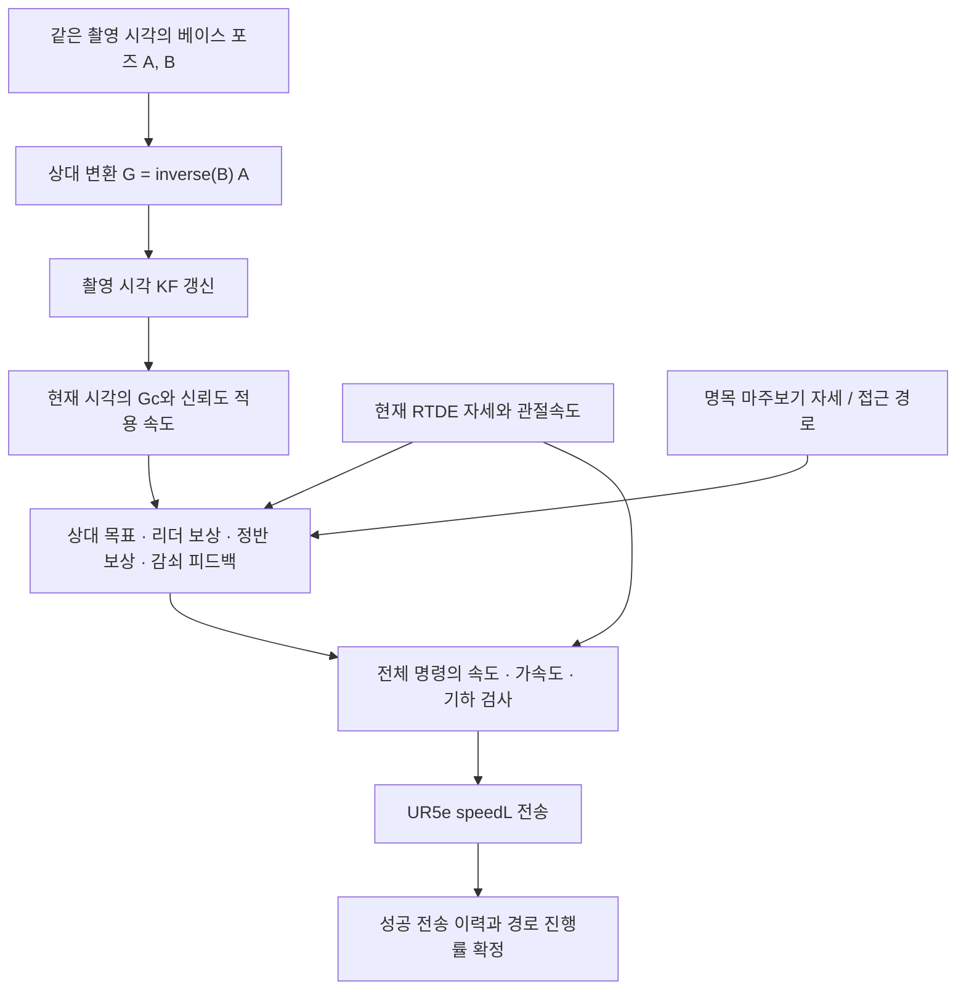

# 상대 베이스 Kalman 추정과 리더–팔로워 제어: 현재 구현의 수식

작성 기준: **2026-11-02**. 아래 실행 명령이 선택하는 현재 코드 경로를 설명한다. 마커리스 포즈 추정기는 입력–출력 인터페이스만 다루며, 신경망·키포인트 검출·PnP 최적화의 내부 구현은 제외한다.

이 실행은 **UR10e의 관절 운동과 두 베이스 사이의 상대 운동을 이용해 UR5e만 제어**한다. 초기 정렬 중에는 확보한 캘리브레이션을 고정하고, 정렬 후 새 영상으로 상대 베이스 상태를 확보한 다음 실시간 추종으로 전환한다.

아래 흐름은 ACTIVE 추종 단계다. 영상 관측 갱신과 로봇 제어는 서로 다른 주기로 실행된다.



## 1. 대상 실행 명령과 실제 적용 설정

```bash
./run_dual_control.sh --mode follow \
  --ur5e_ip 169.254.186.10 \
  --ur10e_ip 169.254.186.6 \
  --ur5e_tcp_offset 0 0 0 0 0 0 \
  --ur10e_tcp_offset 0 0 0 0 0 0 \
  --gap 0.30 --show_seg \
  --filter_alpha 1.0 --base_pose_window 0 \
  --initial_align --execute \
  --approach_speed 0.01 --max_accel 0.8 \
  --base_motion_mode relative_kalman \
  --follow_law feedforward \
  --relative_kalman_config configs/relative_kalman.provisional.json
```

| 구분 | 이 명령의 적용값 | 의미 |
|---|---|---|
| 리더 / 팔로워 | UR10e / UR5e | 리더는 상태 수신, 팔로워만 명령 전송 |
| 제어 구조 | `separated`, `feedforward`, `bounded` | 운동 성분을 합산하고 실행 가능한 속도로 조정 |
| 베이스 상태 | `relative_kalman` | 같은 영상의 상대 베이스 변환을 평면 KF로 처리 |
| 공면 조건 | ON | 물리 베이스의 높이·수직축이 같은 설치 |
| UR10e 출력 보정 | ON | 모델 출력 뒤에 로컬 Z 180° / +5 mm 변환 |
| TCP 오프셋 | 양팔 항등변환 | 계산상 TCP 원점·방향 = 플랜지 원점·방향 |
| 최초 명목 간격 | 0.30 m | 리더 플랜지 +Z 방향 |
| 최초 상대 경로 | `hold` | 리더에 대한 상대 목표 유지; 절대 위치 고정 아님 |
| 초기 정렬 | ON | Arm 후 고정된 좌표로 정렬 |
| 접근 목표 / 최대 목표 속도 | 0.15 m / 0.01 m/s | ACTIVE에서 접근 버튼을 누를 때 적용 |
| 제어 주기 | 25 Hz, 약 0.04 s | ACTIVE 명령 계산에는 실제 간격을 최대 0.08 s로 제한해 사용 |
| RGB 설정 | 640×480, 30 FPS | 추론 결과가 30 Hz로 도착한다는 뜻은 아님 |
| 재투영 평균·최대 오차 거절 | OFF | 유효점·시간·상대변환·로봇 검사는 유지 |

**이 모드에서는 `--filter_alpha 1.0`과 `--base_pose_window 0`이 KF의 반응성을 바꾸지 않는다.** 두 옵션은 기존 포즈 처리 경로의 설정이다. 여기서는 JSON의 $R,Q$, 예측 지평, 속도 신뢰도 설정을 사용한다. CLI의 `--velocity_alpha`, `--prediction_horizon`, `--base_pose_*`도 이 KF의 조절값이 아니다.

`--execute`는 구동을 허용하며, 실제 시작은 **Arm motion** 이후다. `--show_seg`는 화면 표시 옵션이다.

## 2. 기호와 좌표계

${}^{X}T_Y$는 $Y$ 좌표를 $X$ 좌표로 옮기는 동차변환이다.

$$
{}^{X}T_Y=
\begin{bmatrix}R&p\\0&1\end{bmatrix},
\qquad p_X=R\,p_Y+p.
$$

| 기호 | 정의 |
|---|---|
| $C$ | 카메라 좌표계: X 오른쪽, Y 아래쪽, Z 전방 |
| $B_L,B_F$ | 리더·팔로워의 물리 제어기 베이스 좌표계 |
| $F_L,F_F$ | 리더·팔로워 플랜지 좌표계 |
| $A={}^CT_{B_L},\ B={}^CT_{B_F}$ | 카메라 기준 리더·팔로워 베이스 |
| $G=B^{-1}A$ | 팔로워 베이스에서 본 리더 베이스 |
| $L={}^{B_L}T_{F_L},\ F={}^{B_F}T_{F_F}$ | RTDE 현재 플랜지 자세 |
| $D$ | 리더 플랜지에서 본 팔로워 명목 목표 |
| $D_{\rm cmd}$ | 허용 오프셋을 반영한 실제 추종 기준 |
| $G_c$ | 현재 제어 시각에 사용할 KF 상대 베이스 변환 |
| $t_k,t$ | 영상 촬영 시각, 현재 제어 시각 |

위치는 m, 각도는 rad, 시간은 s를 사용한다. 문서에서 °와 mm는 수치 설명용 단위다. $V=[v^T,\omega^T]^T$는 지정한 원점의 선속도와 각속도를 쌓은 **기하학적 속도**다. 선속도를 좌표 원점에 대한 screw moment로 해석하지 않는다.

회전 오차에는 $\operatorname{Log}(R)^\vee$, 즉 SO(3) 회전행렬의 회전벡터를 사용한다. 오일러각 차분이 아니다.

ACTIVE의 속도·가속도·접근 진행 수식에서 $\Delta t$는 다음 **계획용 간격**이다.

$$
\Delta t=\operatorname{clip}
(\Delta t_{\rm wall},10^{-6},2/25)
=\operatorname{clip}(\Delta t_{\rm wall},10^{-6},0.08).
$$

실제 루프 간격 $\Delta t_{\rm wall}$은 별도로 deadline 검사에 사용하며, 현재 설정의 한도는 $\min(0.5,1/5)=0.20$ s다. 초기 정렬은 실제 간격을 사용한다. KF의 $\Delta_k$는 촬영 시각 차이, 예측의 $a$는 관측 나이이므로 이 계획용 간격과 구분한다.

다음 연산을 공통으로 사용한다.

$$
\operatorname{sat}_b(z)=
\begin{cases}z,&\|z\|\le b\\bz/\|z\|,&\|z\|>b,\end{cases}
\qquad
\mathcal D_\epsilon(z)=
\begin{cases}0,&\|z\|\le\epsilon\\
(1-\epsilon/\|z\|)z,&\|z\|>\epsilon.
\end{cases}
$$

$\operatorname{sat}$는 벡터 크기 제한이며, XYZ 각각을 독립적으로 자르는 연산이 아니다.

## 3. 포즈 추정 출력과 촬영 시각 관절값

### 3.1 추정기에서 제어기로 넘어오는 정보

같은 영상 $I_k$와 촬영 시각의 양팔 관절값을 포즈 추정기에 입력한다. 출력은 다음과 같이 취급한다.

$$
(I_k,q_L(t_k),q_F(t_k))
\longmapsto
(P_{L,k},P_{F,k},t_k,\text{sequence},\text{validity}),
\qquad P_i={}^CT_{M_i}.
$$

$M_i$는 추정 모델의 베이스 좌표다. 제어에 넘기는 변환은

$$
A_k=P_{L,k}M_L,\qquad B_k=P_{F,k}M_F,
$$

$$
M_F=I_4,\qquad
M_L=
\begin{bmatrix}
R_z(\pi)&[0,0,0.005]^T\\0&1
\end{bmatrix}.
$$

따라서 **UR10e의 180° / 5 mm 보정은 이 명령에도 적용된다.** 카메라 Z축으로 5 mm를 더하는 것이 아니라, 원출력에 오른쪽 곱으로 적용하는 로컬 변환이다.

공면 조건을 반영한 물리 베이스 쌍을 사용하므로 상대변환은

$$
G_k=B_k^{-1}A_k
=
\begin{bmatrix}
R_z(\psi_k)&[x_k,y_k,0]^T\\0&1
\end{bmatrix}
$$

형태로 표현한다. 여기의 XY는 **팔로워 베이스의 설치 평면**이다. 카메라의 XY 평면이나 화면에 그린 격자 기준이 아니다. 공면 조건은 상대 높이·roll·pitch를 제한하지만 베이스 사이 거리와 상대 yaw는 추정 대상으로 남긴다.

같은 촬영 시점에 카메라 좌표가 공통 변환 $H_C$만큼 바뀐다면

$$
(H_CB_k)^{-1}(H_CA_k)=B_k^{-1}A_k.
$$

이상적인 공통 카메라 움직임은 상대변환에서 소거된다. 실제 추정 오차와 시점 불일치까지 소거된다는 뜻은 아니다.

### 3.2 관절값의 시점 정렬

영상용 RTDE 관절 이력은 기본 100 Hz로 별도 수집한다. `timestamp → q → timestamp`의 두 timestamp가 같은 읽기만 수락한다.

로봇 timestamp를 $\tau_j$, SDK 읽기 전후 호스트 시각을 $t_j^-,t_j^+$라 하면

$$
o=\min_j\left(\frac{t_j^-+t_j^+}{2}-\tau_j\right),
\qquad \tau_k=t_k-o.
$$

$\tau_0\le\tau_k\le\tau_1$인 관절 표본을 찾아

$$
\eta=\frac{\tau_k-\tau_0}{\tau_1-\tau_0},\qquad
q(t_k)=q_0+\eta\,\operatorname{wrap}(q_1-q_0)
$$

로 최단 각도 보간한다. 촬영 시각과 정확히 일치하는 표본은 그대로 쓴다.

브래킷 간격은 최대 **50 ms**, 새 브래킷 대기는 최대 **30 ms**다. 보간할 수 없으면 해당 관측을 사용할 수 없는 것으로 처리하며, 최신 관절값으로 대체하거나 외삽하지 않는다. 영상용 관절값과 별개로 제어 루프는 현재 RTDE 자세·관절속도를 읽는다.

카메라 촬영 timestamp도 호스트 monotonic 시간으로 매핑한다. 이 모드에서는 촬영 시각에서 임의로 한 프레임을 빼지 않으며 시간 매핑의 불확실성을 별도로 기록한다. 이는 소프트웨어 시각 정렬이다. 상수 전송 지연까지 제거한 하드웨어 동기화는 아니다.

시간 지지 범위 검사는

$$
\mathrm{skew}=\frac1{\mathrm{fps}}
+\max_i\left(
\text{촬영 시각에서 보간 브래킷 끝까지 최대 거리}_i
+\frac{\text{SDK 읽기 구간}_i}{2}
\right)
\le0.08\ {\rm s}
$$

를 사용한다. 영상 추론 처리시간 자체를 80 ms로 제한하는 식은 아니다.

## 4. 상대 베이스 상태의 Kalman 갱신

### 4.1 상태와 모델

두 베이스 $A,B$를 따로 차분하지 않고, 같은 촬영의 $G_k$에서 관측을 만든다.

$$
z_k=
\begin{bmatrix}x_k&y_k&\psi_k\end{bmatrix}^T,\qquad
\xi_k=
\begin{bmatrix}x&y&\psi&v_x&v_y&\omega\end{bmatrix}^T.
$$

수락 관측 사이의 **촬영 시각 차이** $\Delta_k=t_k-t_{k-1}$를 사용한다.

$$
\Phi(\Delta)=
\begin{bmatrix}I_3&\Delta I_3\\0&I_3\end{bmatrix},
\qquad H=\begin{bmatrix}I_3&0\end{bmatrix},
$$

$$
\xi_k=\Phi(\Delta_k)\xi_{k-1}+w_k,\qquad z_k=H\xi_k+\nu_k.
$$

현재 JSON의 잡음 설정은

$$
R=\operatorname{diag}\bigl(0.007^2,0.007^2,(0.3\pi/180)^2\bigr),
\qquad
\Sigma_a=\operatorname{diag}(0.10^2,0.10^2,0.15^2),
$$

$$
Q(\Delta)=
\begin{bmatrix}
\frac{\Delta^4}{4}\Sigma_a&\frac{\Delta^3}{2}\Sigma_a\\
\frac{\Delta^3}{2}\Sigma_a&\Delta^2\Sigma_a
\end{bmatrix}.
$$

$Q$는 한 관측 구간 동안 일정한 미지 가속도를 가정한 형태다. $R$의 위치 표준편차 7 mm와 yaw 표준편차 0.3°는 절대 캘리브레이션 정확도를 보장하는 값이 아니다.

### 4.2 예측·관측 갱신

$$
\hat\xi_k^-=\Phi\hat\xi_{k-1}^+,\qquad
P_k^-=\Phi P_{k-1}^+\Phi^T+Q,
$$

$$
r_k=z_k-H\hat\xi_k^-,
\qquad W_k=HP_k^-H^T+R,
\qquad K_k=P_k^-H^TW_k^{-1},
$$

$$
\hat\xi_k^+=\hat\xi_k^-+K_kr_k,
$$

$$
P_k^+=(I-K_kH)P_k^-(I-K_kH)^T+K_kRK_k^T.
$$

yaw 혁신과 상태는 $\operatorname{atan2}(\sin\theta,\cos\theta)$로 감싼다. 공분산은 Joseph 형식으로 갱신한 뒤 수치적으로 대칭·양의 준정부호를 유지한다. 중복 sequence나 제어 루프의 반복 조회는 새로운 관측으로 세지 않는다.

처음 또는 재초기화 시

$$
\hat\xi_0=[z_0^T,0,0,0]^T,
$$

$$
P_0=\operatorname{diag}
\bigl(0.007^2,0.007^2,(0.3\pi/180)^2,\ 0.05^2,0.05^2,0.15^2\bigr).
$$

정지 합의로 초기화할 때는 위치·yaw에 합의값을 쓰고 속도는 0으로 시작한다. 원관측과 실제 촬영 시각은 따로 보존한다.

### 4.3 이상치·정지·반전 처리

| 검사/처리 | 현재 값과 동작 |
|---|---|
| 기존 상대변환 급변 검사 | 직전 수락 원관측 대비 50 mm / 5° |
| KF 자체 원관측 변화 검사 | XY 150 mm / yaw 15° |
| KF 혁신 검사 | $r_k^TW_k^{-1}r_k\le16.27$ |
| 긴 관측 간격 | 0.35 s 초과 후 다음 유효 관측에서 속도·공분산 초기화 |
| 거절 후 재획득 | 다음 유효 관측에서 속도 0, support 1로 시작 |
| KF 속도 상태 제한 | $\sqrt{v_x^2+v_y^2}\le0.15$ m/s, $|\omega|\le0.5$ rad/s |
| 정지 판단 | 최근 0.25 s·최소 4표본에서 XY 산포 ≤5.25 mm, yaw 범위 ≤0.225° |

이 모드의 실시간 입력 gate에서는 카메라 기준 **개별** 베이스 급변 검사만 생략하고, 상대변환 급변 검사는 유지한다. 초기 확보·handoff의 정지 합의는 별도로 개별 베이스와 상대변환을 모두 검사한다. 따라서 KF 내부의 150 mm / 15°만 보고 전체 입력 허용 범위라고 해석하면 안 된다.

정지 판단의 XY 산포는 최근 관측들의 **최종 관측점으로부터 최대 거리**다. 정지로 판단하면 속도와 위치–속도 교차공분산을 0으로, 속도 공분산을 초기값으로 둔다.

선속도 반전은 예를 들어

$$
(v_{xy,\rm old})^T\Delta z_{xy}
<-3\sqrt2\,\sigma_p\|v_{xy,\rm old}\|
$$

일 때 감지한다. yaw도 대응하는 부호·잡음 기준을 쓴다. 반전 시 오래된 방향의 속도를 0으로 지우고 새 관측 지원을 모은다. 작은 반전이나 급정지가 한 프레임에서 항상 검출되는 구조는 아니다.

거절한 관측은 마지막 수락 위치·시각을 새 값으로 덮지 않는다. 대신 속도 신뢰도를 꺼서 오래된 운동 보상을 줄인다. 긴 공백 후에도 step·혁신 검사를 통과해야 재초기화한다.

## 5. 촬영 시각에서 현재 제어 시각으로의 제한 예측

### 5.1 관측 지원과 속도 신뢰도

마지막 관측 후 경과 시간을 $a=t-t_k$, 예측 지평을 $H_p=0.35$ s라 하자. 마지막 갱신 상태를 $\hat\xi_k^+=[r^T,v^T]^T$로 쓴다.

XY 속도 방향 $n_v=v_{xy}/\|v_{xy}\|$에 대해

$$
\mathrm{SNR}_{xy}=
\frac{\|v_{xy}\|}{\sqrt{n_v^TP_{vv,xy}n_v}},
\qquad
\mathrm{SNR}_{\psi}=\frac{|\omega|}{\sqrt{P_{\omega\omega}}}.
$$

속도가 0이면 SNR도 0으로 처리한다. 코드에서는 0 나눗셈을 피하는 작은 하한도 둔다.

$$
g_{xy,\psi}=\operatorname{clip}_{[0,1]}
\left(\frac{\mathrm{SNR}_{xy,\psi}-1.5}{3.0-1.5}\right),
\qquad
g_N=\operatorname{clip}_{[0,1]}\left(\frac{N-3}{4}\right),
$$

$$
D_g=\operatorname{diag}(g_Ng_{xy},g_Ng_{xy},g_Ng_\psi).
$$

$N$은 연속 지원 표본 수다. 네 번째부터 $g_N=0.25$, 일곱 번째부터 1이다. 관측 거절 상태에서는 $D_g=0$으로 둔다. XY 이동이 분명하더라도 yaw 속도는 자체 SNR이 부족하면 예측에 사용하지 않는다.

### 5.2 자세 예측과 그 미분을 일치시키는 방법

$$
h=H_p/2,\qquad u=\min(\max(a-h,0),h),
$$

$$
\tau(a)=\min(a,h)+u-\frac{u^2}{H_p},
\qquad
d(a)=
\begin{cases}
1,&a\le h\\
\max(0,1-u/h),&a>h.
\end{cases}
$$

$$
r_c=r+\tau(a)D_gv,\qquad v_c=d(a)D_gv.
$$

동일 관측 사이에서 $D_g$는 고정되므로 $v_c=\dot r_c$다. 처음 **175 ms**는 일정 속도로 예측하고, 이후 **350 ms**까지 예측 속도를 선형으로 0까지 줄인다. 최대 적분 예측 시간은

$$
\tau_{\max}=3H_p/4=0.2625\ {\rm s}.
$$

즉, 마지막 속도로 350 ms를 끝까지 직선 외삽하는 구현이 아니다. 예측 조회는 저장된 관측 상태를 갱신하지 않는다.

불확실성은 짧아진 $\tau$가 아니라 실제 경과 $a$로 증가시킨다.

$$
P_c=\Phi(a)P_k^+\Phi(a)^T+Q(a).
$$

### 5.3 잔여 적용률 $\lambda$

$$
c_P=\min\left(
1,\frac{3\sigma_p}{\max(\sqrt{P_{c,xx}},\sqrt{P_{c,yy}})},
\frac{3\sigma_\psi}{\sqrt{P_{c,\psi\psi}}}
\right),
\qquad c_a=\max(0,1-a/H_p),
$$

$$
\lambda=
\begin{cases}
c_Pc_a,&D_g\text{에 양수 성분이 있을 때}\\
0,&\text{그 외}.
\end{cases}
$$

**$D_g$는 예측 자세와 그 미분 속도에 적용하고, $\lambda$는 추가 보상 속도에 적용한다.** SNR·지원 표본 계수를 $\lambda$에 다시 곱하지 않는다. 예를 들어 $a=180$ ms이면 나이 계수 $c_a\approx0.486$이다. 속도 상태가 잘 추정되어도 전량을 보상하지 않는다.

350 ms 이후 예측속도와 새로운 보상 요청은 0이 된다. 이미 적용 중인 유효 보상은 8절의 변화율 제한에 따라 0으로 줄어든다. 수락 관측이 **500 ms**보다 오래되면 좌표 자체도 만료된다.

### 5.4 제어용 공통 변환

현재 보정 설정에서는 출력 좌표와 물리 제어기 베이스 좌표가 일치하므로

$$
G_c=
\begin{bmatrix}
R_z(\psi_c)&[x_c,y_c,0]^T\\0&1
\end{bmatrix},
\quad
\hat{\dot p}_G=[v_{x,c},v_{y,c},0]^T,
\quad
\hat\omega_G=[0,0,\omega_c]^T.
$$

카메라 장면과 제어에 쓰는 베이스 쌍은 마지막 팔로워 베이스를 기준으로

$$
B_c=B_{\rm latest},\qquad A_c=B_cG_c
$$

로 구성한다. 따라서 목표와 현재 상대 자세 모두 정확히 같은 $B_c^{-1}A_c=G_c$를 사용한다. 기존 독립 베이스 속도 채널은 0으로 두어 정반 속도를 중복 합산하지 않는다.

## 6. 마주보기 목표와 실제 추종 기준

### 6.1 플랜지 복원과 명목 목표

일반적인 TCP 오프셋 $O_i={}^{F_i}T_{\mathrm{TCP}_i}$에 대해

$$
L=T_{L,\mathrm{TCP}}O_L^{-1},\qquad
F=T_{F,\mathrm{TCP}}O_F^{-1}.
$$

이번 실행은 $O_L=O_F=I_4$이므로 TCP와 플랜지가 같다.

마주보기 명목 상대 자세는

$$
D(g)=
\begin{bmatrix}
R_x(\pi)&[0,0,g]^T\\0&1
\end{bmatrix},
\qquad R_x(\pi)=\operatorname{diag}(1,-1,-1).
$$

리더의 +Z 방향으로 $g=0.30$ m 떨어지고, 두 플랜지의 +X는 같으며 +Y·+Z는 반대다.

팔로워 베이스 기준 명목 목표와 현재 상대 자세:

$$
\boxed{T^*=G_cLD},\qquad
\boxed{S=(G_cL)^{-1}F}.
$$

베이스 운동은 $G_c$, 리더 관절 운동은 $L$, 접근 운동은 $D$에 반영된다.

### 6.2 5 cm / 10° 허용 오프셋

현재 기본값은 정확한 명목 목표 주변에서 위치 **50 mm**, 회전 **10°**의 허용량을 둔다. 초기 정렬의 IK 후보 선택과 추종 기준 설정에 사용하며, 실제 캘리브레이션 정확도가 그 범위라는 의미는 아니다.

추종 최초 기준을 만들 때

$$
\delta p=p_S-p_D,\qquad
\delta r=\operatorname{Log}(R_SR_D^T)^\vee,
$$

$$
p_{\rm accepted}=p_D+\operatorname{sat}_{0.05}(\delta p),
\qquad
R_{\rm accepted}=
\operatorname{Exp}([\operatorname{sat}_{10^\circ}(\delta r)]_\times)R_D,
$$

$$
E_0=D^{-1}D_{\rm accepted},\qquad
D_{\rm cmd}(u)=D(u)E_0.
$$

$E_0$는 **첫 추종 명령이 성공적으로 전송된 뒤 한 번 저장**한다. 이후 추종 지연을 흡수하도록 매번 다시 정하지 않는다.

따라서 피드백·오차 그래프가 따르는 목표는

$$
T_{\rm cmd}=G_cLD_{\rm cmd}
$$

이고, 명목 목표 $T^*$와 구분된다. 원래 명목 목표 대비 큰 오차를 감시하는 검사도 별도로 남아 있다. 5 cm / 10° 안의 오차를 매 주기 전부 무시하는 방식은 아니다.

## 7. 실제 관절 운동에서 구하는 리더 보상

현재 리더 관절값 $q_L$와 실제 관절속도 $\dot q_L$로

$$
\begin{bmatrix}v_L\\\omega_L\end{bmatrix}
=J_L(q_L)\dot q_L
$$

를 계산한다. $J_L$은 리더 베이스 좌표로 표현한 플랜지 기하학 Jacobian이다. 명목 FK와 측정 플랜지 원점의 차이가 있으면 Jacobian의 선속도 부분에도 해당 레버암을 보정한다.

$G_c=[R_G,p_G]$, $L=[R_L,p_L]$라고 하면

$$
p_{LF}=p_G+R_Gp_L,\qquad
\omega_L^F=R_G\omega_L,
$$

$$
\boxed{
V_{\rm leader}=
\begin{bmatrix}
R_Gv_L+\omega_L^F\times(p_F-p_{LF})\\
\omega_L^F
\end{bmatrix}.
}
$$

이 회전 보상은 명목 목표 위치가 아니라 **현재 팔로워 플랜지 위치 $p_F$**를 레버암으로 사용한다. 도달 가능한 오프셋을 허용한 상태에서도 현재 상대 자세를 리더와 함께 운반하기 위한 계산이다.

리더 운동 속도는 영상 베이스 위치의 차분으로 만들지 않는다.

## 8. 상대 베이스 운동에서 구하는 정반 보상

### 8.1 원시 보상

KF의 예측 자세와 같은 시점의 원점 속도 $\hat{\dot p}_G,\hat\omega_G$로

$$
\boxed{
\hat V_{\rm base}=
\begin{bmatrix}
\hat{\dot p}_G+\hat\omega_G\times(p_F-p_G)\\
\hat\omega_G
\end{bmatrix}
}
$$

를 계산한다. 모두 팔로워 베이스 좌표로 표현한다.

이 식은 **$G$의 변화만** 사용한다. 전체 목표 $G_cLD$를 차분하면 $L$의 관절 운동과 $D$의 접근 운동이 섞이므로, 그 결과를 정반 보상으로 더하지 않는다.

### 8.2 적용률·속도·변화율 제한

$$
v_d=\operatorname{sat}_{0.10}(\lambda\hat v_{\rm base}),
\qquad
\omega_d=\operatorname{sat}_{0.15}(\lambda\hat\omega_{\rm base}),
$$

$$
\bar v_{{\rm base},n}
=\bar v_{{\rm base},n-1}
+\operatorname{sat}_{0.20\Delta t}
(v_d-\bar v_{{\rm base},n-1}),
$$

$$
\bar\omega_{{\rm base},n}
=\bar\omega_{{\rm base},n-1}
+\operatorname{sat}_{0.30\Delta t}
(\omega_d-\bar\omega_{{\rm base},n-1}).
$$

정반 보상 자체의 제한은 선속도 0.10 m/s, 각속도 0.15 rad/s, 선속도 변화율 0.20 m/s², 각속도 변화율 0.30 rad/s²다. **`--max_accel 0.8`로 바뀌는 값이 아니다.**

$\lambda$가 떨어질 때도 같은 변화율 제한으로 보상을 줄인다. 이력은 실제 전송에 성공한 주기에만 갱신한다.

일반 TCP 오프셋에서는

$$
\bar v_{\rm base,TCP}=\bar v_{\rm base,F}
+\bar\omega_{\rm base}\times(p_{\rm TCP}-p_F)
$$

로 이동한다. 이번 명령에서는 오프셋이 0이라 이 항은 없다.

## 9. 상대 자세 오차와 오버슈트 억제 피드백

### 9.1 오차의 좌표변환

$$
e_p^L=p_{D_{\rm cmd}}-p_S,\qquad
e_R^L=\operatorname{Log}(R_{D_{\rm cmd}}R_S^T)^\vee.
$$

리더 플랜지 기준 오차를 $R_{GL}=R_GR_L$로 팔로워 베이스에 옮긴다.

$$
\tilde e_p=R_{GL}\mathcal D_{0.001}(e_p^L),\qquad
\tilde e_R=R_{GL}\mathcal D_{0.3^\circ}(e_R^L).
$$

위치 1 mm·회전 0.3°의 작은 deadband는 경계 밖 오차에서 그 반경을 빼는 연속적인 형태다.

### 9.2 같은 유효 정반 보상을 뺀 상대속도

팔로워 RTDE 실제 TCP 속도를 $V_{\rm meas}$, 직전 전송에 성공한 작업 진행률을 $\rho_{\rm prev}$라 하면

$$
\boxed{
V_{\rm rel}
=V_{\rm meas}-V_{\rm leader}-\bar V_{\rm base}
-\rho_{\rm prev}V_{\rm task}.
}
$$

정반 보상은 앞 절의 **제한을 이미 적용한 동일한 $\bar V_{\rm base}$**다. 이 항을 빼야 정상적인 정반 추종 속도를 오버슈트로 보고 감쇠하지 않는다. 이번 실행은 TCP=플랜지이므로 추가 원점 변환이 필요 없다.

### 9.3 감쇠 피드백

선형·각운동 각각에 대해 $e=\tilde e_p$ 또는 $\tilde e_R$, $v_{\rm rel}$을 해당 속도로 두면

$$
e_{\rm ahead}=e-T_dv_{\rm rel},\qquad T_d=0.12\ {\rm s},
$$

$$
v_{\rm brake}(e)=
\sqrt{(a_{\rm fb}T_d)^2+2a_{\rm fb}\|e\|}-a_{\rm fb}T_d,
$$

$$
f(e,v_{\rm rel})=
\operatorname{sat}_{\min(v_{\rm fb,max},v_{\rm brake}(e))}
\bigl(k_pe_{\rm ahead}\bigr).
$$

$\|e\|=0$이면 해당 피드백은 0이다. 이 식은

$$
vT_d+\frac{v^2}{2a_{\rm fb}}\le\|e\|
$$

를 만족하는 접근 속도를 요청하여, 목표를 통과하기 전부터 감속하도록 만든다.

현재 $k_p=3\ {\rm s}^{-1}$, 선형 피드백 상한은 **0.10 m/s**, 회전 피드백 상한은 **0.15 rad/s**다.

$$
V_{\rm feedback}=
\begin{bmatrix}
f(\tilde e_p,v_{\rm rel})\\
f(\tilde e_R,\omega_{\rm rel})
\end{bmatrix}.
$$

$a_{\rm fb}$는 항상 0.8로 고정되지 않는다. 현재 Jacobian과 관절·Cartesian 가속도 제한에서 감속 여유를 계산한다. TCP 오프셋이 0인 이 실행에서는 코드의 scalar ramp 수치 규약에 따라

$$
b_i=\|(J_F^{-1})_{i,1:3}\|+\|(J_F^{-1})_{i,4:6}\|,
\qquad
a_0=\min\left(0.8,\ 0.5,\ \min_i\frac{0.75}{\max(b_i,10^{-12})}\right),
$$

선형·각 피드백에 각각 $a_{\rm fb}=a_0/2$의 여유를 사용한다. 이는 로컬 Jacobian으로 계산한 명령 설계값이며 실제 로봇의 감속도를 실측한 값은 아니다.

## 10. 요구 속도에서 실제 전송 명령까지

### 10.1 요구 속도

$$
\boxed{
V_{\rm req}
=V_{\rm leader}+\bar V_{\rm base}
+V_{\rm feedback}+\rho V_{\rm task},
\qquad 0\le\rho\le1.
}
$$

일반 상대 자세 유지에서는 $V_{\rm task}=0$이다. 15 cm 접근 버튼을 누르면 별도 상대 경로가 생긴다.

현재 KF 모드의 정반 보상은 **감속 가능한 추종 요구**로 들어간다. 최종 명령 조정기에 의무적으로 전량 전달해야 하는 외부 속도로 넣지 않는다.

### 10.2 실행 가능한 속도로 조정

명령 조정기는

$$
W=V_{\rm leader}+\bar V_{\rm base}
+\gamma V_{\rm feedback},
\qquad \gamma\in\{1,\ 0.75,\ 0.5,\ 0.25,\ 0\}
$$

에 대해 먼저 $\gamma=1$부터 시도한다. 실행 불가능할 때 피드백 기여를 낮춰 다시 검사한다.

정적인 속도·관절속도 제한을 만족하는 $W_e=sW,\ 0\le s\le1$를 구하고,

$$
W_\alpha=W_0+\alpha(W_e-W_0),\qquad 0\le\alpha\le1
$$

구간에서 가능한 전환을 찾는다. $W_0$는 직전 전송 명령, 현재 측정 속도, 둘의 중간값을 순서대로 검토한다. 이동 중인 접근 경로는 작업 속도까지 합한 후보를 먼저 검사하며, 불가능하면 경로 진행을 멈추고 추종 전환을 검사한다. 필요한 경우 제한을 만족하는 감속 후보를 찾는다.

따라서 실제 전송하는 $V_{\rm cmd}$가 항상 $V_{\rm req}$와 같지는 않다. 정반 보상의 사전 제한값 $\bar V_{\rm base}$도 전체 명령 조정 이후 독립적으로 100% 전달된다고 보장하지 않는다. 로그의 `tracking_scale`은 선택한 구간의 보간 계수이며 단순한 리더 속도 배율이 아니다.

### 10.3 전체 속도·가속도 제약

현재 팔로워 Jacobian을 $J_F(q_F)$라 하면

$$
\dot q_{\rm cmd}=J_F^{-1}V_{\rm cmd},\qquad
\sigma_{\min}(J_F)\ge0.01.
$$

SVD로 특이성을 검사한다. 이 최소 특이값은 코드가 사용하는 m·rad Jacobian 규약의 수치다.

명령은 아래 제한의 교집합을 만족해야 한다.

$$
\|v_{\rm cmd}\|\le1.0,\quad
\|\omega_{\rm cmd}\|\le0.1,\quad
|\dot q_{{\rm cmd},i}|\le0.2,
$$

$$
\|v_{\rm cmd}-v_{\rm anchor}\|\le0.8\Delta t,\quad
\|\omega_{\rm cmd}-\omega_{\rm anchor}\|\le0.5\Delta t,
$$

$$
|\dot q_{{\rm cmd},i}-\dot q_{{\rm anchor},i}|
\le0.75\Delta t.
$$

$\mathrm{anchor}$는 **직전 전송 명령과 현재 실제 측정값 모두**에 대해 검사한다. 위치 추정의 차분을 실제 팔 속도로 검사하는 방식이 아니다.

추가로 현재·예상 관절/플랜지/TCP 상태, Jacobian 변화, 작업영역, 관절 한계, 링크 캡슐 간격, 플랜지 간격, 시작 위치 대비 이동량을 검사한다. 다음 한 주기의 대표 관절 예측은

$$
q_F^+=q_F+\dot q_{\rm cmd}\Delta t
$$

이며 현재 Jacobian만으로 통과한 명령도 다음 상태의 검사에서 거절될 수 있다. 이 검사는 연속시간의 모든 충돌·서보 동역학을 증명하는 것은 아니다.

### 10.4 RTDE 명령

ACTIVE에서는 팔로워에

$$
\operatorname{speedL}(V_{\rm cmd},a_{\rm send},0.002)
$$

를 전송한다. 마지막 인자 0.002 s는 로봇 쪽 속도 스레드의 갱신 인자이며, 호스트 제어가 500 Hz라는 뜻이나 2 ms 뒤 속도가 자동 만료된다는 뜻이 아니다. 호스트 제어는 기본 25 Hz이고, 계산의 $\Delta t$는 2절의 제한된 계획용 간격이다. $\dot q_{\rm cmd}$는 주로 실행 가능성 검사용이며 ACTIVE 전송은 Cartesian 속도 명령이다.

$a_{\rm send}$도 별도로 계산한다. 현재 코드는 선형·각운동에 같은 scalar ramp 인자를 사용하므로 수치적으로

$$
a_{\rm send}\le\min(0.8,\ 0.5)
$$

이고, 실제 속도에서 명령 속도까지의 차이 및 $J_F^{-1}$로 변환한 각 ramp 구간의 관절가속도 제한이 더 적용된다. 따라서 **`--max_accel 0.8`이 실제 0.8 m/s² 가속이나 1 m/s 추종을 보장하지 않는다.** 각속도·관절속도·관절가속도·로봇 자체 속도 배율도 함께 작용한다.

전송 성공 후에만 이전 속도, 상대 기준 오프셋, 정반 보상 이력, 경로 진행률을 확정한다.

## 11. 30 cm에서 15 cm로 접근하는 상대 작업

ACTIVE 추종 중 **Approach to 15 cm** 버튼을 누르면 현재 명령 상대 자세 $D_{\rm cmd}$에서 접근을 시작한다. 현재 오프셋은 새 경로의 시작 자세에 포함하고 $E_0=I$로 바꾸므로 목표가 순간적으로 바뀌지 않는다.

시작 signed Z 간격을 $g_0$, 종료값을 $g_f=0.15$ m라 하자.

$$
s(u)=10u^3-15u^4+6u^5,\qquad
s'(u)=30u^2(1-u)^2,\qquad 0\le u\le1,
$$

$$
g(u)=g_0+(g_f-g_0)s(u).
$$

리더 플랜지 기준 X·Y·방향은 유지하고 Z만 줄인다.

$$
T_{\rm approach}=
\max\left(
\frac{1.875(g_0-g_f)}{0.01},
\sqrt{\frac{(10\sqrt3/3)(g_0-g_f)}{0.01}}
\right).
$$

첫 분모 0.01은 사용자가 지정한 **최대 목표 속도(m/s)**, 두 번째 0.01은 접근 경로 생성기의 **목표 가속도 예산(m/s²)**이다. 전체 로봇의 `--max_accel 0.8`과 구분한다.

$g_0=0.30$ m라면 명목 소요 시간은 **28.125 s**다. 평균 10 mm/s가 아니라 최대 10 mm/s의 시작·끝이 부드러운 경로이기 때문이다.

$$
V_{\rm task}^{L}=
\begin{bmatrix}
0\\0\$g_f-g_0)s'(u)/T_{\rm approach}\\0\\0\\0
\end{bmatrix},
\qquad
V_{\rm task}=
\operatorname{diag}(R_{GL},R_{GL})V_{\rm task}^{L}.
$$

성공적으로 전송한 명령에 대해서만

$$
u_{n+1}=\min\left(1,u_n+\rho_n\Delta t/T_{\rm approach}\right)
$$

로 진행한다. 명목 목표 대비 오차 $e_{p,\rm nom},e_{R,\rm nom}$가 커지면

$$
\rho_{\max}=\min\left(
1,\
\max\left(0,\frac{0.20-\|e_{p,\rm nom}\|}{0.20-0.01}\right),\
\max\left(0,\frac{25^\circ-\|e_{R,\rm nom}\|}{25^\circ-5^\circ}\right)
\right)
$$

로 진행률을 줄이고, 최종 $\rho$는 속도·가속도·기하 검사까지 통과해야 한다.

다시 버튼을 누르면 접근 진행을 일시정지한다. 리더 추종 자체는 계속하며, 명령 전환은 가속도 제한에 따라 감속한다. 다시 누르면 이어서 진행한다. 관측 실패/복구 과정도 접근 진행을 일시 보류하거나 일시정지시킬 수 있다.

15 cm는 **리더 플랜지 축 방향의 목표 원점 간격**이다. peg·hole 길이, 접촉력, 삽입 성공을 감지하는 제어는 포함하지 않는다. 경로 progress=1은 목표 경로 끝에 도달했다는 뜻이며 실제 접촉/삽입 완료 판정이 아니다.

## 12. 초기 정렬과 실시간 추종 전환

| 단계 | 좌표·목표의 처리 | 전송 |
|---|---|---|
| PREVIEW / READY | 정지 베이스 합의·현재 상태·목표 검사 | 없음 |
| PREFLIGHT | Arm 시 좌표·목표 고정, native IK/FK와 경로 검사 | 아직 운동 명령 없음 |
| ALIGNING | 확보한 베이스·리더 목표 유지, 현재 관절로 정렬 | 팔로워 `speedJ` |
| ALIGNED / WAITING FOR LIVE CALIBRATION | 정렬 완료 후 촬영한 새 프레임으로 합의 | 검증한 영속도 `speedJ` |
| ACTIVE | 촬영 시각 KF 갱신 + 현재 시각 예측 + 상대 추종 | 팔로워 `speedL` |
| CALIBRATION OBSERVE / BLEND | 감속·관측 수집·검증된 좌표 점진 반영 | 제한을 만족하는 감속/전환 |
| RECOVERY WAIT / READY | 정지 확인과 새 상태 검증 | 새 Arm 전까지 추종 재개 안 함 |

### 12.1 Arm 전 합의와 IK

초기 확보는 최근 1초 후보의 최소 3개 서로 다른 촬영 프레임, 60% 이상 합의 그룹, 실제 촬영 시각 기준 신선도를 확인한다. 정지 합의는 각 베이스 및 상대 좌표의 일관성을 검사한다. ACTIVE의 단일 상대 KF 갱신과 같은 절차가 아니다.

Arm 시

$$
T_{\rm align}=G_{\rm captured}L_{\rm captured}D
$$

를 정하고, 필요하면 50 mm / 10° 허용 범위에서 조정한 후보에 대해 native IK/FK·관절·TCP 제한을 확인한다.

$$
q(s)=q_0+s(q_{\rm IK}-q_0),\qquad
s\in\{0,1/80,\ldots,1\}
$$

의 **81개 표본**으로 관절 경로를 검사한다. 장애물을 피하는 임의 우회 경로 탐색은 아니다.

### 12.2 측정 관절 기반 정렬

정렬의 기본 요구 속도는

$$
\dot q_{\rm desired}=0.5(q_{\rm IK}-q_{\rm measured})
$$

이며 전체 속도·가속도·경로 구간 검사를 통과하는 명령으로 조정해 `speedJ`로 전송한다. 시간표만 앞서 진행하는 방식이 아니다.

이 명령의 초기 정렬 선속도 상한은 `max_speed=0.02` m/s다. 기본 `align_speed_scale=2`에서 명령 예산은 상한의 90%, 기본 요구는 그 98%를 사용한다. 선형 기준 약 **17.64 mm/s 요구**, **18 mm/s 명령 예산**이며 실제 하드 상한은 20 mm/s다. ACTIVE의 `follow_max_speed=1.0`과 별개다.

정렬 도착은 관절 잔차 ≤0.01 rad, 측정 TCP 위치 오차 ≤2 mm, 회전 오차 ≤1° 및 정지 상태를 확인하고, 성공 전송 기준 5회 연속으로 정지 조건을 만족해야 한다. 이 오차는 선택된 정렬 목표에 대한 값이지 실제 양팔 캘리브레이션 정확도가 아니다.

정렬 중 새 영상 추정값은 정렬 목표를 바꾸지 않는다. 따라서 이 단계에서 외부 베이스 이동을 영상 피드백으로 보상하지 않는다.

### 12.3 정렬 후 handoff

정렬 완료 **이후 촬영된** 새 영상으로 좌표를 확보한다. KF 위치·yaw는 새 정지 합의값에서, 속도는 0에서 시작한다.

정렬 전후 명목 목표 변화 기본 한도는 150 mm / 15°다. 새 상태의 첫 추종 명령까지 검사한 뒤 ACTIVE로 넘어간다. 기본 `handoff_wait=hold`에서는 15초 대기 후에도 검증된 영속도 유지 상태에서 새 측정을 기다린다.

### 12.4 실시간 관측 실패와 복구

짧은 실패에는 마지막 수락 관측의 실제 나이를 유지한 채 제한된 유예를 사용한다. 거절 시 KF 속도 지원을 끄고, 보상 속도도 줄인다.

관측 수집 상태에서는 리더·정반·오차 추종 요구를 끄고 검사 가능한 감속을 수행한다. 새 좌표가 일관되게 확보되고 기하·전환 조건을 만족하면 blend 후 같은 세션에서 재개할 수 있다. 기본 관측 기한은 2 s, 허용 좌표 변화는 150 mm / 15°, blend 최소 시간은 0.5 s다.

복구 가능한 실패가 정지 복구 상태로 넘어가면 새 Arm이 필요하다. 통신·프로그램·안전 상태 이상은 이 관측 유예로 덮지 않는다.

## 13. 이 실행에서 구분해야 할 주요 제한값

| 대상 | 설정 | 적용값 |
|---|---|---|
| ACTIVE 전체 TCP 선속도 | `follow_max_speed` | 1.0 m/s |
| 초기 정렬 TCP 선속도 | `max_speed` | 0.02 m/s |
| 전체 TCP 각속도 | `max_angular_speed` | 0.1 rad/s |
| 전체 명령 선가속도 | `max_accel` | **0.8 m/s²** |
| 전체 명령 각가속도 | `max_angular_accel` | 0.5 rad/s² |
| 관절속도 / 관절가속도 | `max_joint_speed / max_joint_accel` | 0.2 rad/s / 0.75 rad/s² |
| 정반 보상 속도 | `relative_base_speed / relative_base_angular_speed` | 0.10 m/s / 0.15 rad/s |
| 정반 보상 변화율 | `relative_base_accel / relative_base_angular_accel` | 0.20 m/s² / 0.30 rad/s² |
| 피드백 속도 | `feedback_speed / feedback_angular_speed` | 0.10 m/s / 0.15 rad/s |
| 접근 목표 최고속도 | `approach_speed` | **0.01 m/s** |
| 명목 목표 오차 한도 | `max_target_m / max_target_deg` | 0.20 m / 25° |
| 명목 목표 조정 허용량 | `target_tolerance_m / target_tolerance_deg` | 0.05 m / 10° |
| 플랜지 원점 최소 간격 | `min_gap` | 0.15 m |
| 세션 시작 위치 대비 이동 반경 | `max_travel` | 0.30 m |
| 상대 캘리브레이션 급변 | `max_calibration_jump_m / deg` | 0.05 m / 5° |
| 영상 나이 / 실제 상태 미갱신 | `max_calibration_age / max_robot_age` | 각각 0.5 s |
| 거절 영상 유예 | `max_invalid_duration` | 0.3 s; 마지막 수락 관측도 신선해야 함 |
| 영상–관절 시간 지지 범위 | `max_joint_skew` | 0.08 s |
| watchdog | `watchdog_hz` | 5 Hz |

전체 명령 제한, 관측 거절, 추종 목표 허용량은 서로 다른 항목이다. 예를 들어 50 mm는 이 실행에서 **목표 조정 허용량**과 **상대 관측 급변 한도** 양쪽에 등장하지만 검사 대상이 다르다.

측정 TCP 과속 진단에는 명령 상한과 별도 여유가 있어 ACTIVE에서 선속도는 $1.1v_{\max}+0.001$, 각속도는 $1.1\omega_{\max}+0.005$를 사용한다. 실제 관절속도·통신 상태·기하 검사도 별도로 수행한다. 위 표는 주요 설정값이며 로봇 컨트롤러의 설치 제한을 대체하는 목록은 아니다.

## 14. 오차 그래프와 구간 CSV의 수학적 의미

ACTIVE에서 표시·기록하는 위치 오차는

$$
\Delta p_{\rm graph}
=\operatorname{trans}(G_cLD_{\rm cmd}O_F)
-\operatorname{trans}(T_{F,\mathrm{TCP}}),
$$

$$
\boxed{
e_{\rm graph,mm}
=1000\|\Delta p_{\rm graph}\|_2.
}
$$

이번 실행은 $O_F=I$다. 이것은 **캘리브레이션과 현재 RTDE에 근거한 추종 기준 대비 거리 오차**이며, 외부 계측기로 측정한 실제 peg–hole 오차가 아니다. 초기 정렬 중에는 고정한 정렬 목표 TCP를 기준으로 계산한다.

그래프는 흰 배경의 한 개 norm 곡선, 최근 30초, Y축 고정 **0–50 mm**다. 50 mm를 넘으면 선은 위쪽 경계에 표시하고 수치·CSV는 실제 값을 유지한다.

**Start recording → Stop & save**로 선택한 구간을

```text
runs/error_segments/<UTC시각>-error-<고유값>.csv
```

에 저장한다. 화면 갱신은 최대 10 Hz지만 기록은 제어 쪽 데이터 생성 위치에서 전달하므로 화면의 주기·30초 이력 제한에 의한 표본 손실을 피한다. 반복된 같은 시각을 새 수치 표본으로 만들지는 않는다.

| CSV 열 | 의미 |
|---|---|
| `sample_elapsed_s` | 해당 표본 구간의 경과 시간 |
| `position_error_mm` | $1000\|\Delta p_{\rm graph}\|_2$ |
| `error_x_mm / error_y_mm / error_z_mm` | 목표 − 현재의 부호 있는 성분 |
| `phase / target_source` | 정렬·추종 등 단계와 목표 출처 |
| `valid / reason / record_type` | 정상 표본, 관측 공백, 사건, 시작·종료·불완전 기록 구분 |
| `recording_elapsed_wall_s` | 기록 요청 처리 후 실제 경과 시간 |

수치 분석에는 `record_type=sample`, `valid=1`인 행을 사용한다. 관측 불가·전환 구간은 0 mm로 채우지 않는다. 구간 경계는 제어 쪽에서 버튼 요청을 처리한 시각이며 클릭 시각까지 소급하지 않는다.

그래프를 숨겨도 기록은 계속된다. 정상 종료 시 자동 마감하며, 큐 초과·파일 오류·저장 미완료는 `INCOMPLETE`로 알린다. 기록 오류가 로봇 동작 명령으로 전환되지는 않는다.

JSONL 실행 로그에는 $G_c$, KF 상태·공분산·혁신·관측 나이·$\lambda$·`prediction_gain`, 원시/제한 정반 보상, 상대 목표, 요구/적용 속도, 경로 진행률과 제한 사유도 남는다.

## 15. 구현 대응과 해석 범위

| 코드/설정 | 이 문서의 대응 |
|---|---|
| [control/runtime.py](../urcal/control/runtime.py) | CLI 기본값과 모드 검증 |
| [control/vision.py](../urcal/control/vision.py), [joint_history.py](../urcal/control/joint_history.py) | 촬영 시각·관절 보간·추정기 입출력 |
| [control/geometry.py](../urcal/control/geometry.py) | 출력 좌표 보정·플랜지·회전 오차 |
| [cooperative/relative_kalman.py](../urcal/cooperative/relative_kalman.py) | 상대 관측·KF·예측·신뢰도 |
| [relative_kalman.provisional.json](../configs/relative_kalman.provisional.json) | 이 실행의 KF 수치 |
| [cooperative/base_compensation.py](../urcal/cooperative/base_compensation.py) | 현재 플랜지 기준 정반 보상·독립 제한 |
| [cooperative/controller.py](../urcal/cooperative/controller.py) | 같은 $G_c$로 목표·현재 상대 자세 계산, 성분 합성 |
| [cooperative/feedback.py](../urcal/cooperative/feedback.py) | 상대속도 감쇠·제동 거리 피드백 |
| [cooperative/follow.py](../urcal/cooperative/follow.py), [task.py](../urcal/cooperative/task.py) | 명령 조정·속도/가속도 제약·작업 진행률 |
| [control/cartesian_ramp.py](../urcal/control/cartesian_ramp.py) | `speedL` scalar 가속도 계산 |
| [cooperative/approach.py](../urcal/cooperative/approach.py) | 15 cm 접근의 5차 경로 |
| [control/alignment.py](../urcal/control/alignment.py), [handoff.py](../urcal/control/handoff.py) | 초기 정렬·새 좌표로 전환 |
| [cooperative/runtime.py](../urcal/cooperative/runtime.py) | 실제 실행 상태·RTDE 전송·기록 연동 |
| [control/tracking_error.py](../urcal/control/tracking_error.py), [error_plot.py](../urcal/control/error_plot.py), [error_recording.py](../urcal/control/error_recording.py) | 추종 오차·그래프·CSV |

이 문서의 수치·분기·수식은 위 명령을 CLI로 해석한 결과와 현재 소스를 대조했다. 실행 코드를 변경하거나 로봇을 구동한 작업은 아니다.

KF JSON은 **정반 상태 라벨 없는 실제 로그의 산포·지연과 합성 시험을 참고한 잠정 설정**이다. 지속적인 포즈 추정 편향과 실제 느린 정반 이동을 완벽하게 구분하지 못한다. 예측·속도 보상은 지연을 줄이는 구조이며, 영상 추정이나 소프트웨어 동기화의 오차 자체를 없애지 않는다.

튜닝 근거는 [상대 베이스 KF 튜닝 기록](RELATIVE_KALMAN_TUNING.md)에 있다. 코드의 기하 검사는 명목 모델·관측 좌표에 근거하며, 부착 공구 전체 형상·접촉력·실제 삽입 성공을 모델링한 제어로 해석하면 안 된다.
